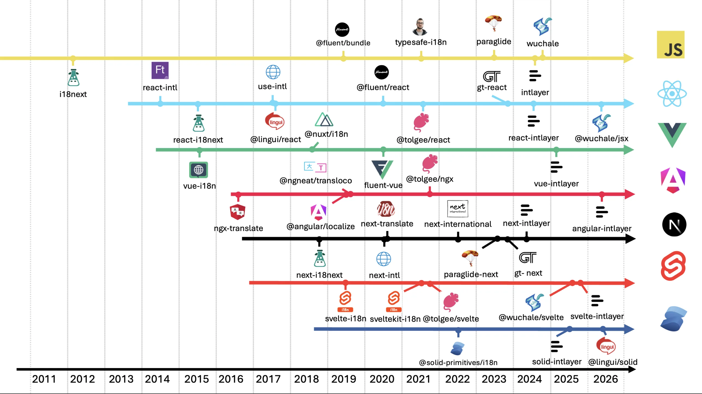

# ההיסטוריה של בינאום ב-JavaScript (i18n)

<iframe title="הכול על i18n: המדריך המלא לבינאום ווב" class="m-auto aspect-16/9 w-full overflow-hidden rounded-lg border-0" allow="autoplay; gyroscope;" loading="lazy" width="1080" height="auto" src="https://www.youtube.com/embed/7VtLdbtV1us?autoplay=0&amp;start=716&amp;origin=https://intlayer.org&amp;controls=0&amp;rel=1"/>

בינאום אינו דבר חדש. הרבה לפני JavaScript והווב המודרני, תוכנות כבר נדרשו להתמודד עם שפות מרובות, מטבעות, תבניות תאריכים ומוסכמות אזוריות. מערכות הפעלה גרפיות מוקדמות כגון GEM ו-Mac OS כבר פתרו רבות מבעיות אלו בשנות ה-80.

אותם רעיונות מצאו את דרכם בסופו של דבר אל פריימוורקים ב-backend. פלטפורמות כמו Ruby on Rails, Django, פריימוורקים של Java ואפליקציות PHP פיתחו כולן גישות משלהן לבינאום. הבעיות הבסיסיות היו מובנות היטב:

- היכן צריכים להישמר התרגומים?
- כיצד אנו מעצבים תאריכים, מספרים ומטבעות?
- כיצד אנו מטפלים בריבוי (plurals) ובהבדלים דקדוקיים?
- כיצד אנו קובעים איזו שפה המשתמש צריך לראות?

כאשר השרת רינדר את העמוד, הדברים היו פשוטים יחסית. האפליקציה יכלה לטעון את התרגומים המתאימים, לרנדר את ה-HTML ולשלוח את התוצאה המוכנה לדפדפן.

> ראוי לציין ש-PHP ו-GNU gettext שימשו כמבשרי דפוס פונקציית העזר `t()` שהפכה מאוחר יותר לנפוצה כל כך ב-JavaScript וב-JSX.

ואז ה-JavaScript החל להשתלט על הדפדפן.

ככל שאפליקציות עברו מעמודים מרונדרי-שרת לאפליקציות צד-לקוח מורכבות יותר ויותר, הבינאום הפך גם לבעיית frontend. לפתע, הדפדפן נדרש לטעון תרגומים, להחליף שפות, לעצב ערכים, לטפל בריבוי ולעדכן את ממשק המשתמש מבלי לרענן את העמוד כולו.

וזה הציג שאלה חדשה:

**כיצד הופכים אפליקציה לרב-לשונית מבלי לשלוח כמות עצומה של נתוני תרגום וקוד זמן ריצה לכל משתמש?**

שאלה זו עיצבה את תחום ה-i18n ב-JavaScript במשך יותר מעשור.

הפתרונות השתנו באופן ניכר. עברנו מאובייקטים גלובליים ב-JavaScript וקריאות `t('some.key')`, לספריות ייעודיות לפריימוורקים, חילוץ בזמן בנייה (compile-time extraction), טיפוסים הנוצרים על ידי TypeScript, רכיבי שרת (Server Components), הסרת קוד עודף (tree-shaking), ובסופו של דבר גישות מבוססות מהדר שבהן תרגומים מומרים לקוד JavaScript במהלך הבנייה.

מאמר זה סוקר את ההתפתחות הזו בערך משנת 2011 עד 2026: מה כל דור של כלים ניסה לפתור, מה עבד, מה נכשל, וכיצד הארכיטקטורה של אפליקציות frontend השפיעה על האופן שבו אנו מטפלים ב-i18n כיום.

## תוכן העניינים

<TOC/>

## הווב המוקדם: בינאום ב-JavaScript לפני 2016

כדי להבין היכן עומדים כלי i18n מודרניים כיום, עלינו להיזכר כיצד הרגיש הפיתוח לווב בין השנים 2011 ל-2015.

### ביות צד הלקוח (The Domestication of the Client)

בראשית שנות ה-2010, בינאום היה בעיקר באחריות צד השרת. קוד JavaScript שימש ברובו כשכבת שיפור לאנימציות, אימות טפסים ורכיבי DOM קטנים באמצעות jQuery.

ככל שאפליקציות Single-Page Applications (SPAs) צברו פופולריות עם Backbone.js, Knockout.js וגרסאות מוקדמות של AngularJS, לוגיקת הרינדור נדדה ישירות אל תוך הדפדפן. קוד צד-לקוח נדרש פתאום להציג תאריכים מותאמים, לעצב מטבעות, לנהל צורות ריבוי ולהחליף טקסט באופן דינמי ללא רענון מלא של העמוד.

אולם סביבת הדפדפן של 2011 לא הייתה ערוכה לאתגר זה:

<AccordionGroup>
<Accordion header="ללא API מובנה לבינאום">

מפרט ה-ECMAScript Internationalization API (ECMA-402) הושלם סופית רק בדצמבר 2012, והציג את האובייקט הגלובלי `Intl`. לפני שיצרני הדפדפנים אימצו את `Intl`, אפילו עיצוב בסיסי של תאריכים ומספרים דרש פונקציות עיצוב מותאמות אישית או ספריות polyfill כבדות.

</Accordion>
<Accordion header="ללא כלי bundler מודרניים">

כלים כמו Webpack היו בחיתוליהם, ומודולי ESM לא היו קיימים בדפדפנים. מפתחים טענו סקריפטים באמצעות תגיות `<script>`, ולעיתים קרובות הזריקו תרגומים לתוך אובייקטים גלובליים כגון `window.translations = { ... }`.

</Accordion>
<Accordion header="עומסי JSON מונוליתיים">

תרגומים נכתבו בקובצי JSON ענקיים וריכוזיים. משתמש בטוקיו שטען את דף הנחיתה הוריד עדיין את כל המחרוזות של הגדרות החשבון, לוחות החיובים וממשקי הניהול.

</Accordion>
</AccordionGroup>

### הגל הראשון של ספריות צד-לקוח

בין 2012 ל-2015 הונחה התשתית הראשונית של ה-i18n המודרני ב-JavaScript:

<AccordionGroup>
<Accordion header="i18next (ינואר 2012)">

נוצרה על ידי Jan Mühlemann, והגדירה את התוכנית הראשית למילוני מפתח-ערך בזמן ריצה ב-JavaScript. היא הציגה ניווט במפתחות, אינטרפולציה של משתנים, כללי ריבוי וארכיטקטורה מבוססת תוספים (plugins) לזיהוי שפות ולטעינת נתונים. היא הפכה במהירות לתקן הנפוץ ב-vanilla JS ובשרתי Node.js מוקדמים.

</Accordion>
<Accordion header="vue-i18n (מאי 2014)">

נוצרה על ידי Kazupon (Kazuya Kawaguchi), והתאימה את הבינאום ישירות למודל ה-reactive data-binding של Vue.js, תוך הצגת הוראות תבנית (`v-t`) ופונקציית העזר `$t()`.

</Accordion>
<Accordion header="react-intl (יוני 2014)">

נוצרה על ידי !Yahoo כחלק מפרויקט FormatJS, והביאה את תקן ICU MessageFormat ואת ממשקי ה-`Intl` של הדפדפן לתוך React באמצעות רכיבים דקלרטיביים כגון `<FormattedMessage>` ו-`<FormattedDate>`.

</Accordion>
<Accordion header="react-i18next (דצמבר 2015)">

Jan Mühlemann הביא את `i18next` לקהילת React הצומחת במהירות, תוך שימוש ברכיבים מסדר גבוה (Higher-Order Components כגון `withTranslation`) וספקי context של React כדי לרנדר מחדש רכיבים בעת שינוי שפה.

</Accordion>
</AccordionGroup>

### מגבלות עידן טרום-2016

למרות שכלים אלה אפשרו יצירת אפליקציות לקוח רב-לשוניות עשירות, האילוצים הארכיטקטוניים של אותה תקופה יצרו נקודות כאב מתמשכות:

<AccordionGroup>
<Accordion header="מפתחות מחרוזת שבירים">

חיפושים כגון `t('marketing.landing.hero.cta')` סיפקו אפס משוב סטטי. שגיאות כתיב במפתחות נכשלו בשקט ב-production, והציגו תוויות ריקות או מזהי מפתחות גולמיים למשתמשי הקצה.

</Accordion>
<Accordion header="תקורת ניתוח בזמן ריצה">

ניתוח תחביר הודעות של ICU ועיבוד אינטרפולציה מבוססת regex בזמן ריצה גזלו מחזורי מעבד יקרים במכשירים ניידים.

</Accordion>
<Accordion header="ניפוח חבילות קוד (Bundle Bloat)">

ללא פיצול קוד מבוסס נתיבים או רכיבים, כל המחרוזות המתורגמות נטענו בבת אחת, מה שפגע במדדי זמני הטעינה הראשוניים של העמוד.

</Accordion>
<Accordion header="נתק בין מפתחים למתרגמים">

מילונים נשמרו בקובצי JSON ריכוזיים ומרוחקים מהרכיבים שרינדרו אותם, מה שהפך מפתחות יתומים ותרגומים חסרים לתופעות שכיחות.

</Accordion>
</AccordionGroup>

## עידן הפריימוורקים: אבולוציה בין אקוסיסטמים

בין 2016 ל-2026 השתנתה לחלוטין ארכיטקטורת ה-frontend. TypeScript הפך לתקן ברירת המחדל, ארכיטקטורות מבוססות רכיבים הבשילו, כלי bundling כמו Webpack, Vite ו-Turbopack הציגו פיצול קוד (code splitting), רכיבי שרת ב-React (RSC) החזירו את הרינדור לצד השרת, ומהדרים החלו לנתח את קוד האפליקציה באופן פעיל.

הלשוניות הבאות מציגות כיצד כל פריימוורק ואקוסיסטם התמודדו עם אתגרים אלה, תוך תיעוד תאריכי השקה, מניעים עיקריים וחידושים משמעותיים בטבלאות השוואתיות. בכל המערכות הללו, `react-intlayer` וכל המקבילים שלו (`next-intlayer`, `vue-intlayer`, `angular-intlayer`, `svelte-intlayer` ו-`solid-intlayer`) הם מימושים בעלי ביצועים גבוהים המותאמים במיוחד לסביבות הריצה הייעודיות שלהם.

<Tabs>

<Tab label="Core JavaScript" value="javascript">

| שחרור ראשון  | ספרייה                               | יוצר                                                         | מה היא באה לפתור                                                                                                                                                            | חידוש מרכזי                                                                                                                                                                           |
| ------------ | ------------------------------------ | ------------------------------------------------------------ | --------------------------------------------------------------------------------------------------------------------------------------------------------------------------- | ------------------------------------------------------------------------------------------------------------------------------------------------------------------------------------- |
| ינואר 2012   | `i18next`                            | Jan Mühlemann (`@jamuhl`)                                    | תקנון חיפוש מילונים בזמן ריצה עבור הדפדפן ו-Node.js ללא תלות בפריימוורק ספציפי.                                                                                             | ארכיטקטורת זמן ריצה מבוססת תוספים המפרידה בין לוגיקת התרגום המרכזית לבין מנגנוני טעינה, זיהוי שפה ושמירה במטמון (caching).                                                            |
| פברואר 2021  | `typesafe-i18n`                      | Ivan Hofer (`@ivanhofer`)                                    | מניעת שגיאות זמן ריצה שקטות ואינטרפולציות שבורות הנגרמות ממפתחות מחרוזת ללא טיפוסים (untyped).                                                                              | פונקציות תרגום בעלות טיפוסיות מלאה הנוצרות ישירות מאובייקטי תרגום ללא תלויות זמן ריצה כלל.                                                                                            |
| אוקטובר 2023 | `paraglide` (`@inlang/paraglide-js`) | Samuel Stroschein (`@samuelstroschein`) / Inlang (`@inlang`) | ביטול מוחלט של חיפושי מילון בזמן ריצה, מנתחים כבדים וניפוח ה-bundle.                                                                                                        | קימפול הודעות ישירות למודולי ECMAScript התומכים ב-tree-shaking ולפונקציות JS פשוטות.                                                                                                  |
| אוגוסט 2024  | `intlayer`                           | Aymeric Pineau (`@aymericzip`)                               | החלפת namespaces שאינם ניתנים לתחזוקה (i18next/use-intl), מניעת דליפת תוכן בין עמודים, צמצום קונפליקטים ב-Git בין מפתחים ופתרון היעדר type safety מקורי בעידן ה-TypeScript. | הצבת קובצי `.content` בצמוד למקום שבו פונקציות נקראות לפיצול קוד נקי, יצירה אוטומטית של טיפוסי TypeScript לחוויית מפתח משופרת, ומערכת CMS ויזואלית עם כלי CLI לתרגום מבוסס AI מובנים. |
| יוני 2025    | `wuchale`                            | Kidus Adugna (`@K1DV5`)                                      | ביטול החיכוך של חילוץ ידני של מחרוזות טקסט והמצאת מפתחות תרגום במהלך הפיתוח.                                                                                                | עיבוד מקדים (preprocessing) ברמת ה-AST המזהה טקסט מוטמע ומקמפל אותו לפונקציות מתורגמות ללא wrapper בזמן הבנייה.                                                                       |

</Tab>

<Tab label="React" value="react">

| שחרור ראשון | ספרייה           | יוצר                           | מה היא באה לפתור                                                                                                                                                      | חידוש מרכזי                                                                                                                                                                            |
| ----------- | ---------------- | ------------------------------ | --------------------------------------------------------------------------------------------------------------------------------------------------------------------- | -------------------------------------------------------------------------------------------------------------------------------------------------------------------------------------- |
| יוני 2014   | `react-intl`     | Yahoo! / FormatJS              | תקנון עיצוב מספרים, תאריכים, מטבעות וריבוי מורכב ב-React.                                                                                                             | רכיבים דקלרטיביים (`<FormattedMessage>`, `<FormattedDate>`) המממשים את תקני ICU MessageFormat ו-ECMA-402.                                                                              |
| דצמבר 2015  | `react-i18next`  | Jan Mühlemann (`@jamuhl`)      | אספקת התממשקות אידיומטית ל-React עבור `i18next` עם רינדור מחדש ריאקטיבי.                                                                                              | התפתחה לצד React מרכיבי Higher-Order Components לאינטרפולציית JSX באמצעות `<Trans>` ול-hook המוכר `useTranslation`.                                                                    |
| ינואר 2018  | `@lingui/react`  | Tomáš Ehrlich (`@tricoder42`)  | צמצום תקורת גודל ה-bundle של JavaScript הנגרמת ממנתחי ICU בזמן ריצה.                                                                                                  | פקודות מאקרו בזמן בנייה (Babel/SWC) המקמפלות את `<Trans>` ו-`t` למערכים מקודדים וקומפקטיים בזמן הבנייה.                                                                                |
| דצמבר 2020  | `use-intl`       | Jan Amann (`@amannn`)          | אספקת חלופה קלת משקל, מבוססת hooks ומוגדרת טיפוסים לספריות ה-i18n המסורתיות ב-React.                                                                                  | ה-hooks הארגונומיים `useTranslations` ו-`useFormatter` עם שילוב TypeScript עמוק.                                                                                                       |
| פברואר 2021 | `@tolgee/react`  | Jan Cizmar (`@jcizmar`)        | ביטול לולאת המשוב האיטית בין מפתחים, מתרגמים ומעצבים.                                                                                                                 | עריכה בתוך הדפדפן בהקשר חי (in-context), המאפשרת ללחוץ Alt-click על טקסט, לערוך תרגומים במקום ולצלם צילומי מסך אוטומטיים.                                                              |
| אוגוסט 2024 | `react-intlayer` | Aymeric Pineau (`@aymericzip`) | אספקת מימוש בעל ביצועים גבוהים עבור React המותאם למחזור החיים של רכיבי React, תוך ביטול מילוני JSON ריכוזיים, namespaces שאינם ניתנים לתחזוקה ודליפת תוכן בין עמודים. | ה-hook עתיר הביצועים `useIntlayer` המותאם לרינדור ב-React, טיפוסי TypeScript הנוצרים אוטומטית, tree-shaking ל-bundle ברמת הרכיב, וסנכרון חי עם CMS ויזואלי ללא boilerplate של context. |
| יולי 2024   | `gt-react`       | Ernest McCarter (`@eoinest`)   | אוטומציה של ייצוא קבצים ידני, העברת חומרים למתרגמים ותחזוקת תרגומים.                                                                                                  | לוקליזציה אוטומטית מבוססת ענן ו-AI ישירות בתוך רכיבי React עם צינורות תרגום מכונה.                                                                                                     |
| יוני 2025   | `@wuchale/jsx`   | Kidus Adugna (`@K1DV5`)        | ביטול הצורך במתן שמות למפתחות וב-hooks של תרגום בזמן כתיבת קוד JSX ב-React.                                                                                           | טרנספורמציית AST המחלצת אוטומטית צמתי טקסט גולמיים ב-JSX ומקמפלת אותם למקבילים מתורגמים.                                                                                               |

</Tab>

<Tab label="Next.js" value="nextjs">

| שחרור ראשון  | ספרייה                                      | יוצר                                                         | מה היא באה לפתור                                                                                                                              | חידוש מרכזי                                                                                                                                                                                                                |
| ------------ | ------------------------------------------- | ------------------------------------------------------------ | --------------------------------------------------------------------------------------------------------------------------------------------- | -------------------------------------------------------------------------------------------------------------------------------------------------------------------------------------------------------------------------- |
| נובמבר 2018  | `next-i18next`                              | Isaac Hinman (`@isaachinman`)                                | תמיכה ב-SSR וב-SSG עם `i18next` ב-Pages Router של Next.js ללא צווארי בקבוק (waterfalls) בצד הלקוח.                                            | הפונקציות `serverSideTranslations` ו-`appWithTranslation` המעבירות namespaces מתורגמים ישירות ל-props של העמוד.                                                                                                            |
| דצמבר 2020   | `next-translate`                            | Arvin Wiyono (`@arvinn`) / Vinissimus (`@vinissimus`)        | פישוט הגדרות וצמצום משקל ה-bundle באפליקציות Pages Router של Next.js.                                                                         | תוסף loader ל-Webpack המזריק אוטומטית רק את ה-namespaces הנדרשים לתרגום בכל עמוד.                                                                                                                                          |
| דצמבר 2020   | `next-intl`                                 | Jan Amann (`@amannn`)                                        | ארגון מחדש של בינאום ב-Next.js עבור App Router, רכיבי שרת (RSC) ו-streaming SSR.                                                              | אינטגרציה מקורית עם middleware של Next.js App Router, פעולות שרת (Server Actions) ורכיבי שרת אסינכרוניים ללא קוד JS בצד הלקוח.                                                                                             |
| יולי 2022    | `next-international`                        | Tom Dussaix (`@tom-dussaix`)                                 | מקסום ה-type safety של TypeScript עם תקורת bundle מינימלית בצד הלקוח עבור Next.js.                                                            | יצירת טיפוסים קפדנית עבור מפתחות תרגום מתוחמים עם מתאמים קלי משקל עבור App Router ו-Pages Router.                                                                                                                          |
| אוקטובר 2023 | `paraglide-next` (`@inlang/paraglide-next`) | Samuel Stroschein (`@samuelstroschein`) / Inlang (`@inlang`) | הבאת הודעות מקומפלות ללא זמן ריצה (zero-runtime) ל-Next.js App Router ו-Pages Router.                                                         | ניתוב middleware בשילוב עם פונקציות הודעה התומכות ב-tree-shaking המונעות ניתוח JSON בזמן ריצה ב-RSC ובחבילות הלקוח.                                                                                                        |
| אוגוסט 2024  | `next-intlayer`                             | Aymeric Pineau (`@aymericzip`)                               | אספקת מתאם רכיבי שרת עתיר ביצועים עבור Next.js App Router ו-Pages Router, המבטל את הצורך להעביר פונקציות `t()` או מילונים כ-props בין רכיבים. | מתאם רכיבי שרת מקורי המאפשר לקרוא ל-`useIntlayer` ישירות ברכיבי שרת סינכרוניים (כגון סרגלי ניווט וכותרות) ללא prop-drilling של `t()`, בשילוב רינדור שרת ללא waterfalls, middleware לניתוב מותאם וסנכרון חי עם CMS ויזואלי. |
| יולי 2024    | `gt-next`                                   | Ernest McCarter (`@eoinest`)                                 | אוטומציה של יצירת תוכן רב-לשוני וניתוב דינמי מותאם שפה ב-Next.js באמצעות תרגום AI.                                                            | אינטגרציית App Router המשלבת תרגום מכונה מבוסס ענן עם edge middleware ושכבות שמירה במטמון (caching) של Next.js.                                                                                                            |

</Tab>

<Tab label="Vue & Nuxt" value="vue">

| שחרור ראשון | ספרייה         | יוצר                                        | מה היא באה לפתור                                                                                                               | חידוש מרכזי                                                                                                                                                         |
| ----------- | -------------- | ------------------------------------------- | ------------------------------------------------------------------------------------------------------------------------------ | ------------------------------------------------------------------------------------------------------------------------------------------------------------------- |
| מאי 2014    | `vue-i18n`     | Kazupon (`@kazupon`)                        | אספקת בינאום אידיומטי וריאקטיבי לאפליקציות Vue.                                                                                | אינטגרציית ריאקטיביות עמוקה, הוראות תבנית (`v-t`), פונקציות עזר `$t`, ובלוקים מותאמים אישית מסוג `<i18n>` ברכיבי קובץ יחיד (SFC).                                   |
| נובמבר 2017 | `@nuxt/i18n`   | Nuxt Community                              | ניהול ניתוב כתובות URL מותאמות לשפה, תגיות SEO hreflang ו-SSR hydration ב-Nuxt.                                                | מודול ניתוב מלא המייצר נתיבים מותאמים (קידומת, דומיין), כותרות מטא ל-SEO וטעינת מקטעים מושהית (lazy chunk loading).                                                 |
| אוגוסט 2020 | `fluent-vue`   | Mozilla (`@mozilla`) / Demivan (`@demivan`) | טיפול במגדר דקדוקי מורכב, יחסות ומבני שפה א-סימטריים ב-Vue.                                                                    | אינטגרציית Vue לתחביר של Project Fluent מבית Mozilla, המונעת קוד מותנה מסורבל עבור שינויים לשוניים.                                                                 |
| ינואר 2025  | `vue-intlayer` | Aymeric Pineau (`@aymericzip`)              | אספקת מימוש בעל ביצועים גבוהים עבור Vue המותאם מקורית ל-Composition API של Vue 3 ול-Nuxt, תוך מניעת זיהום ה-namespace הגלובלי. | ה-composable עתיר הביצועים `useIntlayer` המותאם למעקב תלויות ריאקטיבי של Vue 3, תיחום ישיר ברמת הרכיב, השלמה אוטומטית מלאה ב-TypeScript ואינטגרציה עם עורך ויזואלי. |

</Tab>

<Tab label="Angular" value="angular">

| שחרור ראשון | ספרייה              | יוצר                                                         | מה היא באה לפתור                                                                                               | חידוש מרכזי                                                                                                                                                |
| ----------- | ------------------- | ------------------------------------------------------------ | -------------------------------------------------------------------------------------------------------------- | ---------------------------------------------------------------------------------------------------------------------------------------------------------- |
| פברואר 2017 | `ngx-translate`     | Olivier Combe (`@ocombe`)                                    | אספקת תרגום דינמי בזמן ריצה ב-Angular ללא צורך בפריסת חבילות קוד (bundles) נפרדות לכל שפה.                     | `TranslateService` ו-pipe ייעודי `translate` המאפשרים טעינת תרגומים דינמית והחלפת שפה בזמן ריצה.                                                           |
| יולי 2019   | `@ngneat/transloco` | Netanel Basal (`@NetanelBasal`) & Shahar Kazaz (`@shahar_k`) | פתרון צווארי בקבוק בביצועים, היעדר תיחום (scoping) ותכונות חסרות בספריות Angular ישנות יותר.                   | הוראה מבנית (`*transloco`), תרגומים מתוחמים עבור feature modules בטעינה מושהית (lazy-loaded), תמיכת SSR ו-CLI לחילוץ מחרוזות.                              |
| ספטמבר 2019 | `@angular/localize` | צוות Angular (@angular)                                      | מודרניזציה של ה-i18n המובנה של Angular בזמן בנייה כדי למנוע הידור מחדש של TypeScript עבור כל שפה.              | תבניות מחרוזת מתויגות (Tagged template literals) עם `$localize` המוזרקות כשלב מהיר לאחר הבנייה במנוע המהדר Ivy.                                            |
| פברואר 2021 | `@tolgee/ngx`       | Jan Cizmar (`@jcizmar`)                                      | שילוב תרגום שיתופי בתוך ההקשר (in-context) ולכידת צילומי מסך בתוך תהליכי העבודה ב-Angular.                     | pipes והוראות ב-Angular המחוברים ישירות ל-Tolgee לצורך לוקליזציה חיה בתוך הדפדפן.                                                                          |
| מרץ 2026    | `angular-intlayer`  | Aymeric Pineau (`@aymericzip`)                               | אספקת מימוש בעל ביצועים גבוהים עבור Angular המותאם מקורית ל-Angular המודרני (Signals, רכיבי standalone ו-SSR). | אינטגרציית תוכן ריאקטיבית מבוססת Signals המותאמת למנגנון זיהוי השינויים של Angular המודרני, הזרקת תלויות עצמאית (standalone DI) וסנכרון חי עם CMS ויזואלי. |

</Tab>

<Tab label="Svelte & SvelteKit" value="svelte">

| שחרור ראשון  | ספרייה            | יוצר                           | מה היא באה לפתור                                                                  | חידוש מרכזי                                                                                                                                                           |
| ------------ | ----------------- | ------------------------------ | --------------------------------------------------------------------------------- | --------------------------------------------------------------------------------------------------------------------------------------------------------------------- |
| יולי 2018    | `svelte-i18n`     | Kaisermann (`@kaisermann`)     | אספקת ספריית בינאום אידיומטית וריאקטיבית המותאמת ל-stores של Svelte.              | חיפוש `$t` המגובה ב-store ומבטיח עדכוני DOM ריאקטיביים מדויקים וגרנולריים בעת שינוי השפה.                                                                             |
| דצמבר 2021   | `sveltekit-i18n`  | Ivan Fevrier (`@ivanfevrier`)  | ניהול נקי של SSR וטעינת תרגומים מבוססת נתיבים באפליקציות SvelteKit.               | ארכיטקטורת טוען (loader) מודולרית המושכת רק את התרגומים והמעצבים הנחוצים עבור הנתיב הפעיל ב-SvelteKit.                                                                |
| נובמבר 2021  | `@tolgee/svelte`  | Jan Cizmar (`@jcizmar`)        | אפשור לוקליזציה בתוך ההקשר באפליקציות Svelte.                                     | קישורי Svelte store המתממשקים לשכבת התרגום בתוך ההקשר של Tolgee וליצירת צילומי מסך אוטומטית.                                                                          |
| אוקטובר 2025 | `svelte-intlayer` | Aymeric Pineau (`@aymericzip`) | אספקת מימוש בעל ביצועים גבוהים עבור Svelte המותאם מקורית ל-Svelte 5 ול-SvelteKit. | קישורי תוכן ריאקטיביים המותאמים ל-Runes של Svelte 5 (`$state`), הצהרות `.content` מתוחמות ברמת הרכיב, תוספי בנייה ללא הגדרות (zero-config) ועריכת תוכן ב-CMS ויזואלי. |
| יולי 2025    | `@wuchale/svelte` | Kidus Adugna (`@K1DV5`)        | הסרת ה-boilerplate של הצהרת מילונים וייבוא פונקציות `$t` ברכיבי Svelte.           | קדם-מעבד של Svelte המנתח תבניות בזמן הבנייה ומקמפל צמתי טקסט ישירות לפלטים מתורגמים ללא wrappers.                                                                     |

</Tab>

<Tab label="SolidJS" value="solid">

| שחרור ראשון | ספרייה                   | יוצר                           | מה היא באה לפתור                                                                  | חידוש מרכזי                                                                                                                                           |
| ----------- | ------------------------ | ------------------------------ | --------------------------------------------------------------------------------- | ----------------------------------------------------------------------------------------------------------------------------------------------------- |
| ספטמבר 2021 | `@solid-primitives/i18n` | SolidJS Community              | אספקת פרימיטיב i18n אידיומטי התואם לריאקטיביות העדינה והגרנולרית של SolidJS.      | פותר תרגומים ריאקטיבי מבוסס Signals המעדכן צמתי DOM ללא צורך ב-Virtual DOM או ברינדורים מחדש מיותרים.                                                 |
| יולי 2025   | `solid-intlayer`         | Aymeric Pineau (`@aymericzip`) | אספקת מימוש בעל ביצועים גבוהים של Intlayer המותאם מקורית ל-SolidJS ול-SolidStart. | קישורי תוכן מותאמי Signals המיועדים לפרימיטיבים הריאקטיביים של Solid ללא תקורת Virtual DOM, השלמת סכמות מלאה ב-TypeScript ואינטגרציה עם עורך ויזואלי. |
| יוני 2026   | `@lingui/solid`          | Tomáš Ehrlich (`@tricoder42`)  | הרחבת חילוץ פקודות המאקרו בזמן בנייה ותמיכת ICU MessageFormat אל תוך SolidJS.     | טרנספורמציות מאקרו המותאמות לריאקטיביות הגרנולרית של Solid, המקמפלות הודעות למבני זמן ריצה קומפקטיים.                                                 |

</Tab>

</Tabs>

## ארבעת העידנים הארכיטקטוניים של i18n ב-JavaScript

במבט לאחור על פני חמש עשרה שנות פיתוח, ניתן לסווג את ההיסטוריה של הבינאום ב-JavaScript לארבעה עידנים ארכיטקטוניים מובחנים:

<AccordionGroup>
<Accordion header="1. עידן מילוני זמן הריצה (2011 עד 2017)">

מאופיין על ידי `i18next`, `react-intl` ו-`vue-i18n`. אפליקציות טענו קטלוגי JSON סטטיים לתוך הזיכרון, ופונקציות זמן ריצה התאימו מפתחות מחרוזת מול אובייקטים מקוננים. ריבוי ואינטרפולציה נוהלו בדפדפן באמצעות התאמות regex ומנתחי ICU בזמן ריצה.

</Accordion>
<Accordion header="2. עידן פקודות המאקרו בזמן בנייה ובטיחות הטיפוסים (2018 עד 2021)">

מאופיין על ידי `lingui`, `next-translate`, `transloco` ו-`typesafe-i18n`. מפתחים הבינו את מחירי הביצועים של ניתוח בזמן ריצה ואת השבריריות של מפתחות ללא טיפוסים. פקודות מאקרו של Babel חילצו הודעות בזמן בנייה, תוספי bundler פיצלו מילונים לפי עמוד, ומהדרי TypeScript החלו לאמת ארגומנטים של תרגומים.

</Accordion>
<Accordion header="3. עידן רכיבי השרת והזרמת התוכן (2022 עד 2024)">

מאופיין על ידי `next-intl`, `next-international` ומתאמי RSC מוקדמים. עם הופעתם של React Server Components ו-Next.js App Router, המטרה עברה לרינדור תוכן מתורגם ישירות בשרת מבלי לשלוח מילוני תרגום או סביבות זמן ריצה של i18n לדפדפן הלקוח.

</Accordion>
<Accordion header="4. עידן המהדר המודרני והתוכן המאוחד (2024 עד 2026)">

מאופיין על ידי `paraglide`, `intlayer` ו-`wuchale`. כלים מודרניים מתייחסים לבינאום לא רק כאל החלפת מחרוזות, אלא כאל ארכיטקטורת תוכן משולבת. מהדרים ממירים הודעות ישירות לפונקציות קוד התומכות ב-tree-shaking, הצהרות תוכן מוצבות בצמוד לרכיבים, ועורכים ויזואליים, כלי MCP ותהליכי תרגום מבוססי AI משתלבים ישירות בזרימת העבודה של המפתח. במודל זה, Intlayer מפריד בין הצהרת התוכן ויצירת הטיפוסים האוטומטית לבין אספקת התוכן בזמן ריצה, ומספק מימושים ייעודיים עתירי ביצועים (`react-intlayer`, `next-intlayer`, `vue-intlayer`, `angular-intlayer`, `svelte-intlayer` ו-`solid-intlayer`) המותאמים מקורית לריאקטיביות ולסביבת הריצה של כל פריימוורק.

</Accordion>
</AccordionGroup>

## סיכום: איזון בין חוויית מפתח (DX), ביצועים ומהפכת ה-AI

לאורך חמש עשרה שנים וארבעה גלים ארכיטקטוניים מובחנים, האתגר האולטימטיבי של בינאום ב-JavaScript נותר זהה: גישור בין חוויית המפתח (DX) ויכולת התחזוקה ארוכת הטווח של בסיס הקוד, לבין אספקת ביצועים מיטביים בצד הלקוח.

מה שהחל במשתנים גלובליים ובקובצי JSON ריכוזיים שקשה לתחזק, הבשיל בהדרגה לתוכן המוצב בצמוד לרכיבים, בטיחות טיפוסים אוטומטית ב-TypeScript, רינדור שרת ללא צווארי בקבוק (zero-waterfall) והסרת קוד עודף (tree-shaking) בזמן בנייה.

### מהפכת ה-AI ומודל ה-SaaS המסורתי

זרז מכריע בשנים האחרונות היה יצירת תרגומים אוטומטית באמצעות AI, המאתגרת באופן יסודי את המודלים העסקיים של פלטפורמות הלוקליזציה המסורתיות.

מבחינה היסטורית, ריכוז תוכן בתוך קובצי JSON מונוליתיים היה פשרה שנועדה להקל על שילובן של מערכות ניהול תרגום (TMS). מאגר ריכוזי יחיד סיפק למתרגמים שאינם אנשי פיתוח ולפלטפורמות TMS של צד שלישי יעד ייבוא וייצוא פשוט. עם זאת, נוחות זו עבור שירותים חיצוניים גבתה מחיר ארכיטקטוני כבד מהמפתחים: קונפליקטים תכופים במיזוגי Git בין ענפי פיתוח שונים, מפתחות יתומים ללא מעקב, היעדר הקשר ברמת הרכיב ו-namespaces גלובליים שאינם ניתנים לתחזוקה.

עם הופעתם של מודלי בינה מלאכותית יוצרת (Generative AI) וכלי הידור מודרניים, חוויית המפתח (DX) תפסה את ההובלה באופן מובהק. כלי בנייה ו-CLI מסוגלים כעת לאתר, לאמת ולתרגם אוטומטית קובצי תוכן המוצבים בצמוד לרכיבים, ובכך מבטלים את הצורך להקריב ארכיטקטורה נקייה לטובת צינורות תרגום.

במשך למעלה מעשור, חבילות תרגום מסחריות בנו הכנסות חוזרות סביב החיכוך הידני הזה של עבודה מול TMS:

- פתרונות כגון **Locize** (פלטפורמת ה-SaaS המסחרית שמאחורי `i18next`) ו-**Crowdin** (הספונסר הראשי ושותף האינטגרציה של `vue-i18n`, `next-intl`, `use-intl` ו-`lingui`) ביססו את המודלים העסקיים שלהם על אחסון תרגומים בענן, מגבלות מסלולים ותשלום לפי ספירת מילים.
- מכיוון שפלטפורמות ותיקות אלו מייצרות רווחים מנפח עבודה ומזרימות עבודה ידניות, אין להן תמריץ כלכלי לספק יצירת תרגומים אוטומטית מקצה לקצה בחינם ישירות בתוך כלי הפיתוח של המהנדסים.

### גל ה-AI החדש לעומת עלות ספק ישירה

ככל שמודלי שפה גדולים (LLMs) מודרניים הורידו את עלויות התרגום לשברירי סנטים תוך שיפור הדיוק הלשוני, קם דור חדש של כלים מסחריים שנועד לכבוש שוק זה:

- פלטפורמות כמו **lingo.dev** או **General Translation** (`gt-react`, `gt-next`) ניסו לרכוב על גל ה-AI באמצעות הצגת מסלולי מנוי קנייניים חדשים וצינורות ענן מתווכים.
- לעומת זאת, **Intlayer** מספק תרגום AI אוטומטי ישירות מהקופסה דרך ה-CLI שלו, ומאפשר לצוותים לחבר את מפתחות ה-API האישיים שלהם (כגון OpenAI, Anthropic, Mistral או Google Gemini). אין עמלות תיווך, אין תוספות מחיר ואין נעילת ספק, הכל פועל ישירות לפי העלות הגולמית והישירה של ספק ה-AI שבחרתם.

### מעבר ל-i18n: מערכת תוכן רב-לשונית שלמה

ולבסוף, פיתוח ווב מודרני התרחב הרבה מעבר להחלפת מחרוזות פשוטה. אפליקציות כיום אינן זקוקות רק לתרגום של מילים בודדות כמו `"Submit"` או `"Log In"`, אלא דורשות תוכן עשיר, דינמי ומובנה לאורך מסעות משתמש מורכבים.

Intlayer ניגש לבעיה זו לא ככלי צר לחיפוש מפתחות מחרוזת, אלא כמערכת תוכן רב-לשונית מקיפה. עם תמיכה מקורית במסמכי Markdown, מבני HTML, סכמות נתונים מקוננות ועריכה ויזואלית חלקה ב-CMS, הוא מגשר על הפער שבין הנדסה ברמת הקוד, תהליכי עבודה אוטומטיים ב-AI וניהול תוכן.

להשוואות ארכיטקטוניות מעמיקות יותר ולמדריכי הגירה מעשיים, גלו את המקורות הבאים:

- [i18n מבוסס מהדר (Compiler) לעומת דקלרטיבי](https://github.com/aymericzip/intlayer/blob/main/docs/blog/he-IL/compiler_vs_declarative_i18n.md)
- [i18n ברמת הרכיב לעומת מרוכז](https://github.com/aymericzip/intlayer/blob/main/docs/blog/he-IL/per-component_vs_centralized_i18n.md)
- [ביצועים ובדיקות השוואתיות (Benchmarks)](https://github.com/aymericzip/intlayer/blob/main/docs/docs/he-IL/benchmark/index.md)
- [מתאמי תאימות של Intlayer](https://github.com/aymericzip/intlayer/blob/main/docs/docs/he-IL/compat/index.md)
