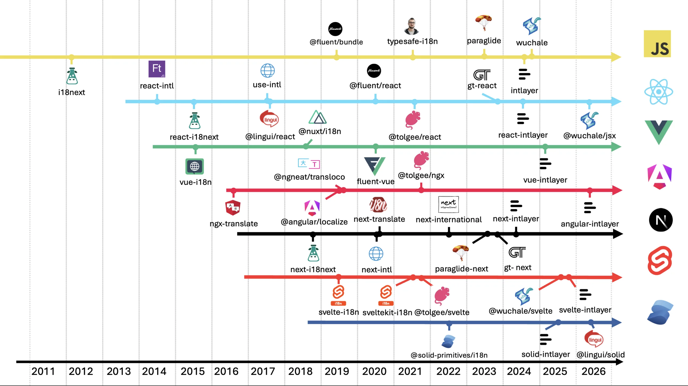
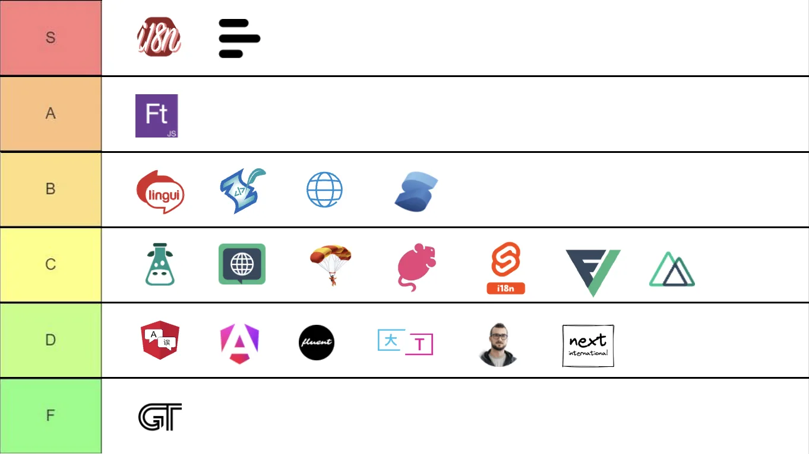

# כיצד לבחור את ספריית ה-i18n הנכונה ל-React

<iframe title="הכול על i18n: המדריך המלא לבינאום ווב" class="m-auto aspect-16/9 w-full overflow-hidden rounded-lg border-0" allow="autoplay; gyroscope;" loading="lazy" width="1080" height="auto" src="https://www.youtube.com/embed/7VtLdbtV1us?autoplay=0&amp;start=1465&amp;origin=https://intlayer.org&amp;controls=0&amp;rel=1"/>

React אינה מגיעה עם פרימיטיב i18n מובנה. הספרייה שתבחרו ביום הראשון תקבע כיצד יישמרו התרגומים, כיצד הם יגיעו ל-bundle, וכמה עבודה ידנית תישאר באחריותכם בשנים הבאות. רוב הצוותים בוחרים לפי פופולריות, ואז מגלים את הפשרות הארכיטקטוניות כשהם מגיעים ל-2,000 מפתחות.

מדריך זה נוקט בגישה הפוכה: ענו תחילה על מספר שאלות לגבי הפרויקט שלכם, ולאחר מכן התאימו את התשובות לספריות המתאימות ביותר. מדריך זה מתמקד ב-React טהור (Vite, React Router, TanStack Start). ל-Next.js יש אילוצים משלו, הנסקרים ב-[השוואת ספריות ב-Next.js](https://github.com/aymericzip/intlayer/blob/main/docs/blog/he-IL/next-i18next_vs_next-intl_vs_intlayer.md).

- [השוואת ספריות ב-Next.js](https://github.com/aymericzip/intlayer/blob/main/docs/blog/he-IL/next-i18next_vs_next-intl_vs_intlayer.md)

## תוכן העניינים

<TOC/>

## שש שאלות שיש לענות עליהן לפני שמשווים בין ספריות

טבלת תכונות חסרת תועלת אם אינכם יודעים אילו שורות באמת רלוונטיות עבורכם. עברו תחילה על שאלות אלו:

1. **כיצד האפליקציה מרונדרת?** SPA בלבד, SSR עם hydration, או React Server Components (RSC). ב-SPA, פונקציות hooks מבוססות Context פועלות בכל מקום. ב-RSC, שימוש ב-hook מחייב הוספת `"use client"` לכל רכיב שמרנדר טקסט, כך שתזדקקו גם ל-API בצד השרת.
2. **מי כותב את התרגומים?** מפתחים, צוות פנימי שמשתמש במערכת TMS, סוכנות שמספקת קובצי ICU, או צינור אוטומטי מבוסס AI. גורם זה מכתיב את פורמט הקטלוג יותר מכל פרט API.
3. **כמה שפות ועמודים יש באפליקציה?** שתי שפות וחמישה עמודים יכולים להרשות לעצמם לטעון הכל מראש. עשר שפות וחמישים נתיבים לא יכולים, ואסטרטגיית הטעינה הופכת לגורם העלות העיקרי.
4. **האם אתם זקוקים לטיפוסים על מפתחות (Types on keys)?** שגיאת כתיב ב-`t("checkout.totl")` תעבור קומפילציה בכל ספרייה מבוססת מפתחות אלא אם תגדירו את הטיפוסים ידנית בעצמכם. החליטו האם זה קביל עבורכם.
5. **מה מכילה המחרוזת?** טקסט פשוט, צורות ריבוי, או משפטים עם רכיב `<Link>` באמצע. תוכן עשיר (rich content) הוא המקום שבו רוב ה-APIs הופכים למסורבלים.
6. **מהו אורך החיים המתוכנן של הפרויקט?** אב-טיפוס לשלושה חודשים ומוצר לחמש שנים אינם דורשים את אותה כמות של כלי בנייה ותשתיות.

רשמו לעצמכם את התשובות. כל הניתוח שלהלן מתייחס אליהן ישירות.

## תמונת המצב הכוללת

חמש עשרה שנות i18n ב-JavaScript מתחלקות לארבעה גלים ארכיטקטוניים, וספריות ה-React שתשוו מגיעות מתוכם.



<AccordionGroup>
<Accordion header="מילוני זמן ריצה (2011 עד 2017): i18next, react-intl">

קטלוגי JSON הנטענים לזיכרון, חיפוש `t("a.b")` בזמן ריצה, וניתוח ICU או תחביר מותאם אישית בדפדפן. המערכות האקולוגיות הגדולות ביותר, סביבות זמן הריצה הכבדות ביותר, ותמיכה בטיפוסים רק בהגדרה ידנית (opt-in).

</Accordion>
<Accordion header="פקודות מאקרו בזמן בנייה (2018 עד 2021): Lingui, typesafe-i18n">

הודעות מחולצות בזמן בנייה, מקומפלות לקטלוגים קומפקטיים וארגומנטים מוגדרי טיפוסים. שלב בנייה נוסף (`extract`, `compile`) בתמורה לחבילות קוד (bundles) קטנות יותר.

</Accordion>
<Accordion header="ממוקדות שרת (2022 עד 2024): use-intl / next-intl">

תוכננו סביב SSR ורכיבי שרת. רינדור בשרת והידרציה רק של מה שהלקוח צריך. עדיין מבוססות מפתחות וריכוזיות.

</Accordion>
<Accordion header="מהדרים ותוכן המוצב בצמוד לרכיבים (2024 עד 2026): Paraglide, Intlayer, wuchale">

התוכן מקומפל לפונקציות התומכות ב-tree-shaking או למילונים ברמת הרכיב. טיפוסים נוצרים אוטומטית, תרגומים חסרים מכשילים את הבנייה, ותרגום מבוסס AI פועל ישירות מה-CLI.

</Accordion>
</AccordionGroup>

המאמר על [ההיסטוריה של בינאום ב-JavaScript](https://github.com/aymericzip/intlayer/blob/main/docs/blog/he-IL/history_of_i18n.md) מפרט כיצד כל גל ענה על הבעיות של הגל שקדם לו.

- [ההיסטוריה של בינאום ב-JavaScript](https://github.com/aymericzip/intlayer/blob/main/docs/blog/he-IL/history_of_i18n.md)

## ההחלטה החשובה ביותר: היכן התוכן שמור ומתי הוא נטען

לכל ספריית i18n ב-React יש מבנה דומה: store, provider ו-hook. כל מה שה-provider מקבל מגיע בסופו של דבר ל-bundle של הלקוח או ל-payload של ה-hydration. לכן שתי הבחירות המבניות הן:

- **תוכן מרוכז או מתוחם (Scoped):** קובץ `en.json` יחיד לכל האפליקציה, או הצהרה אחת לכל רכיב (או לכל namespace).
- **ייבוא סטטי או דינמי:** הכל נכלל ב-bundle בעת ההפעלה, או שהשפה והנתיב הפעילים נמשכים לפי דרישה.

התרשים שלהלן מעריך את ה-payload של אפליקציה תיאורטית בעלת 1 עד 10 עמודים, המתורגמת ל-1 עד 10 שפות, עם כ-30 KB של טקסט לכל עמוד.


תוכן מרוכז עם ייבוא סטטי גדל בשני הצירים: 10 עמודים כפול 10 שפות שווים 300 KB של טקסט בכל עמוד. ייבוא דינמי מסיר את ציר השפות. תיחום (Scoping) מסיר את ציר העמודים. רק השילוב של שניהם שומר על גודל קבוע ושטוח.

אין זו תכונה מובנית של ספרייה, אלא עניין של משמעת הנדסית. ניתן לתחם את `react-i18next` באמצעות namespaces וטעינה מושהית. ניתן לפצל את `use-intl` לפי נתיב. אך שום דבר אינו כופה זאת, ורכיב `<Button>` משותף הקורא ל-`t("common:cta")` הופך בשקט את ה-namespace של `common` לתלות של כל נתיב באפליקציה. ה-[benchmark](https://github.com/aymericzip/intlayer/blob/main/docs/docs/he-IL/benchmark/index.md) מודד זאת כ"דליפה מנתיבים אחרים" ו"דליפה משפות אחרות", וזהו המקור לרוב הפערים בין הספריות.

- [Benchmark בדיקות השוואתיות](https://github.com/aymericzip/intlayer/blob/main/docs/docs/he-IL/benchmark/index.md)

אם תשובתכם לשאלה 3 הייתה "שפות רבות, עמודים רבים", העניקו לסעיף זה משקל רב יותר מכל העדפת API. המאמר על [i18n ברמת הרכיב לעומת מרוכז](https://github.com/aymericzip/intlayer/blob/main/docs/blog/he-IL/per-component_vs_centralized_i18n.md) מרחיב על היבט התחזוקה של אותה בחירה.

- [i18n ברמת הרכיב לעומת מרוכז](https://github.com/aymericzip/intlayer/blob/main/docs/blog/he-IL/per-component_vs_centralized_i18n.md)

## הספריות המועמדות

גדלי הספריות לקוחים מתוך [השוואת הביצועים ב-TanStack Start](https://github.com/aymericzip/intlayer/blob/main/docs/docs/he-IL/benchmark/tanstack.md): provider בתוספת hook בתוך רכיב ריק, לאחר bundling, tree-shaking ו-minification, ב-10 עמודים ו-10 שפות. התוכן נמדד בנפרד.

- [השוואת ביצועים ב-TanStack Start](https://github.com/aymericzip/intlayer/blob/main/docs/docs/he-IL/benchmark/tanstack.md)


| ספרייה                  | גל        | מודל תוכן                        | בטיחות טיפוסים (Type Safety)             | פורמט הודעות                  | גודל ספרייה                          |
| :---------------------- | :-------- | :------------------------------- | :--------------------------------------- | :---------------------------- | :----------------------------------- |
| `react-i18next`         | זמן ריצה  | JSON מרכזי, namespaces           | 2/5 - בהגדרה ידנית (`CustomTypeOptions`) | i18next (סיומות ריבוי)        | ~18.4 kB                             |
| `react-intl` (FormatJS) | זמן ריצה  | JSON מרכזי, ICU                  | 2/5 - בהגדרה ידנית (חילוץ + union)       | ICU                           | ~15.3 kB                             |
| `use-intl`              | ממוקד שרת | JSON מרכזי, ICU                  | 2/5 - בהגדרה ידנית (declaration merging) | ICU                           | ~14.1 kB                             |
| `@tolgee/react`         | זמן ריצה  | מרכזי, עריכה בתוך ההקשר          | 1/5 - ללא                                | ICU                           | ~11.1 kB                             |
| Lingui                  | מאקרו     | טקסט מקור בקוד, קטלוגים מקומפלים | 2/5 - טובה, מתוך המהדר                   | ICU דרך פקודות מאקרו          | ~11.8 kB                             |
| Paraglide               | מהדר      | פרויקט inlang, פונקציות נוצרות   | 3.5/5 - נוצרת אוטומטית                   | פורמט עצמאי                   | קרוב לאפס (בשל קוד שנוצר בתוך המאגר) |
| Intlayer                | מהדר      | `.content.ts` לכל רכיב           | 5/5 - נוצרת, פועלת כברירת מחדל           | Intlayer (+ ICU, i18next, PO) | ~5.0 kB                              |

> המספרים מייצגים תמונת מצב בגרסאות שנבדקו במבחן ההשוואה ומשתנים עם שחרור גרסאות חדשות. הריצו את ה-benchmark על האפליקציה שלכם לפני קבלת החלטה על סמך גודל בלבד.
> בטיחות טיפוסים: ציון 5/5 מעיד על כך שמפתחות, פרמטרים וכל שפה נבדקים ללא צורך בהגדרה ידנית, כולל מעצבי כתובות URL וכלי עזר.

שני דברים שהטבלה אינה מציגה: `Paraglide` כמעט ואינה שולחת ספריית זמן ריצה מכיוון שהיא מייצרת קוד ישירות לתוך המאגר שלכם, מה שמחייב שלב יצירה מחדש לפני כל commit וגורר קונפליקטים במיזוגים בקבצים שנוצרו. בנוסף, `Intlayer` דורשת תוסף bundler (`vite-intlayer` או מקביל), ולכן אינה יכולה לפעול בסביבה ללא שלב בנייה (no-build setup).

## פעילות Commits

כמות ה-commits מציגה כמה עבודה מושקעת בכל פרויקט. מונו-ריפו כולל את כל החבילות שהוא משחרר, לכן יש לקרוא את המספר כאינדיקציה לרמת הפעילות ולא כמדד איכות בלעדי.

<GithubCommits repositories="i18next/react-i18next,formatjs/formatjs,amannn/next-intl,tolgee/tolgee-js,lingui/js-lingui,opral/paraglide-js,aymericzip/intlayer" />

## הורדות ב-npm

<NpmDownloads packages="react-i18next,react-intl,use-intl,@tolgee/react,@lingui/react,@inlang/paraglide-js,react-intlayer" period="last-6-months" />

נתוני הורדות מתגמלים את הפתרונות הוותיקים ביותר ולא בהכרח את הטובים ביותר. ספרייה ששוחררה לפני שנים עדיין מותקנת על ידי כל פרויקט שבחר בה בעבר, בכל הרצת CI ועל ידי כל חבילה שתלויה בה. הכמות משקפת אינרציה יותר מאשר בחירה עדכנית.

עוזרי AI מעצימים את האפקט. ספריות כמו `next-intl`, `i18next` ו-`vue-i18n` נפוצות בכל הקוד שעליו אומנו המודלים, ולכן הם מציעים אותן כברירת מחדל ללא השוואה עם חלופות. כל הצעה כזו מייצרת הורדות נוספות, המזינות את ההמלצה הבאה. השוו על סמך נתוני ביצועים אמיתיים ולא על סמך ספירת הורדות בלבד.

## התאימו את התשובות שלכם לספרייה

<AccordionGroup>
<Accordion header="אב-טיפוס (MVP), צוות קטן, מעט שפות">

בחרו בפתרון הפשוט ביותר שעובד ואל תשקיעו יתר על המידה בתשתיות. `react-i18next` עם קובץ JSON בודד לכל שפה תספיק לחלוטין, ועשור של תשובות ב-Stack Overflow יחסוך לכם זמן יקר. דלגו על namespaces עד שיהיה בהם צורך אמיתי. אם האב-טיפוס יהפוך למוצר מלא, תכננו מראש מעבר לתוכן מתוחם; [מתאם התאימות של react-i18next](https://github.com/aymericzip/intlayer/blob/main/docs/docs/he-IL/compat/react-i18next.md) הופך מעבר כזה להדרגתי ופשוט.

- [מתאם תאימות עבור react-i18next](https://github.com/aymericzip/intlayer/blob/main/docs/docs/he-IL/compat/react-i18next.md)

</Accordion>
<Accordion header="התרגומים מגיעים מסוכנות או מ-TMS התומך ב-ICU">

פורמט הקטלוג שלכם נקבע מראש. הספרייה `react-intl` תומכת ב-ICU באופן מקורי וכלי החילוץ של FormatJS נבנו עבור צינור עבודה זה. גם `use-intl` קוראת פורמט ICU. הספרייה `react-i18next` דורשת את תוסף ה-ICU ומפתחות ריבוי משלה ללא התוסף. התמיכה של Intlayer ב-ICU היא עדיין חלקית, לכן אם אתם מקבלים מחרוזות ICU כיום, התייחסו לכך כאל חסם עד להשלמת התמיכה.

</Accordion>
<Accordion header="אפליקציה גדולה, נתיבים רבים, תקציב ה-bundle קריטי">

העדיפו תוכן מתוחם וטעינה דינמית כברירת מחדל ולא כעניין של מוסכמה בלבד. `Lingui` ו-`Paraglide` מגיעות לכך באמצעות קומפילציה. Intlayer מגיעה לכך באמצעות הצהרות ברמת הרכיב, והמהדר שולח רק את מה שהנתיב מרנדר בפועל. עם `react-i18next` או `use-intl`, תכננו את אסטרטגיית ה-namespaces והטעינה המושהית כבר ביום הראשון ואכפו אותה בסקירות קוד (code reviews), מכיוון שהכלים עצמם לא יאכפו זאת.

</Accordion>
<Accordion header="בטיחות טיפוסים (Type safety) היא דרישת חובה בלתי מתפשרת">

כל ספרייה מבוססת מפתחות יכולה לתמוך בטיפוסים, אך כמעט אף אחת אינה עושה זאת כברירת מחדל. אם אינכם רוצים לתחזק declaration merging שצריך להתמודד עם namespaces הנטענים בהשהיה, בחרו בספרייה שבה הטיפוסים נוצרים ישירות מתוך התוכן: `Lingui`, `Paraglide` או Intlayer. המאמר על [זיהוי תרגומים חסרים](https://github.com/aymericzip/intlayer/blob/main/docs/blog/he-IL/detecting_missing_translations.md) משווה מה כל כלי מסוגל לתפוס בזמן הבנייה.

- [זיהוי תרגומים חסרים](https://github.com/aymericzip/intlayer/blob/main/docs/blog/he-IL/detecting_missing_translations.md)

</Accordion>
<Accordion header="תוכן עשיר מרובה: markdown, קישורים בתוך משפטים, רכיבים מותאמי שפה">

צמתים עשירים (rich nodes) הם המקום שבו פונקציית `t()` המחזירה מחרוזת בלבד מתחילה להתפרק. ל-`react-i18next` ול-`Lingui` יש את רכיב `<Trans>`, ל-`react-intl` יש תגיות rich text, וכולן מסורבלות יותר בהשוואה למחרוזת פשוטה. צמתי התוכן של Intlayer מקבלים JSX, Markdown ואובייקטים מקוננים ישירות, מה שמתאים הרבה יותר כאשר התוכן מורכב יותר מסתם תוויות בממשק.

</Accordion>
<Accordion header="התרגומים ייווצרו על ידי AI וייבדקו על ידי מפתחים">

במקרה כזה, קובץ JSON מרכזי אינו עוד דרישת חובה, מכיוון שאין מערכת TMS לייבא אליה. תוכן המוצב בצמוד לרכיבים לצד כלי CLI שמשלים שפות חסרות מספקים את הנתיב הקצר ביותר. פקודת ה-`fill` של Intlayer פועלת מול מפתח ה-API האישי שלכם (OpenAI, Anthropic, Mistral, Gemini) ומתרגמת אך ורק את מה שהשתנה. Paraglide ו-Tolgee מציעות חלופות מנוהלות בענן במסלולי תשלום משלהן.

</Accordion>
<Accordion header="ייתכן שתעברו ל-Next.js App Router בעתיד">

מנגנון ה-Context של React אינו חוצה את גבול השרת והלקוח. ספריות שנבנו סביב hook של צד הלקוח בלבד (`react-i18next`, `react-intl`) יזדקקו ל-API מקביל בצד השרת ביום שבו תאמצו RSC. הספריות `use-intl` (כ-`next-intl`) ו-Intlayer (כ-`next-intlayer`) כבר כוללות הפרדה זו. קראו את [המדריך ל-i18n ב-Next.js](https://github.com/aymericzip/intlayer/blob/main/docs/blog/he-IL/next-i18next_vs_next-intl_vs_intlayer.md) לפני שתקבעו דפוס קבוע.

- [המדריך ל-i18n ב-Next.js](https://github.com/aymericzip/intlayer/blob/main/docs/blog/he-IL/next-i18next_vs_next-intl_vs_intlayer.md)

</Accordion>
</AccordionGroup>

## היכן כל ספרייה מתקשה

מגבלות גלויות, שכן לכל אפשרות יש כאלה:

- **`react-i18next`**: הכבדה ביותר בקבוצה, פורמט ריבוי משלה, תחזוקת טיפוסים דורשת הגדרות ידניות, ומפתחות מתים מצטברים בשקט לאורך זמן.
- **`react-intl`**: חוויית מפתח (DX) מסורבלת (`useIntl()` ואז `formatMessage({ id })`), מופע גלובלי הקשור לצמתים רבים.
- **`use-intl`**: קלה להתחלה, קשה למיטוב. שילוב של namespaces, טעינה דינמית וטיפוסים מאט מאוד את קצב הפיתוח.
- **`Lingui`**: שלב בנייה נוסף של `extract` ו-`compile`, מספר תחבירים חופפים (`t()`, תבנית מתויגת, `i18n.t()`, `<Trans>`) שמבלבלים הן מפתחים והן עוזרי AI.
- **`Paraglide`**: קבצים הנוצרים ישירות בתוך המאגר, הסרת הקוד העודף (tree-shaking) לא באה לידי ביטוי במבחן הביצועים של React, והשפה נקראת מאחסון בכל צומת במקום מתוך store.
- **`Tolgee`**: ללא טיפוסים על מפתחות, תהליך קליטה מורכב יותר, עיקר המשיכה הוא עריכה בתוך ההקשר (in-context editing).
- **`Intlayer`**: מחייבת תוסף לבנייה, אקוסיסטם קטן יותר, תמיכת ICU חלקית בלבד, ותוכן המפוזר על פני בסיס הקוד מעצם התכנון כך שייצוא קובץ JSON בודד למתרגם דורש שימוש בכלי עזר.
- **`gt-react`, `lingo.dev`**: אינן מומלצות ב-benchmark: שגיאות מכסה (quota) בזמן בנייה, נעילת ספק ובעיות בריאקטיביות שחייבו כפיית רינדור מחדש של ה-provider.

## כיצד כל אפשרות נראית בקוד

אותו רכיב בדיוק, סיכום עגלת קניות עם כותרת וצורת ריבוי, כתוב בכל אחת מהספריות המועמדות. החלק המעניין אינו הרכיב עצמו, אלא המקום שבו התוכן נשמר ומה שבודק הטיפוסים יודע עליו.

<Tabs defaultTab="react-i18next">
  <Tab label="react-i18next" value="react-i18next">

  <Tabs group="locale">
  <Tab value="en" label="English">

```json fileName="public/locales/en/cart.json"
{
  "title": "Your cart",
  "items_one": "{{count}} item",
  "items_other": "{{count}} items"
}
```

  </Tab>
  <Tab value="fr" label="French">

```json fileName="public/locales/fr/cart.json"
{
  "title": "Votre panier",
  "items_one": "{{count}} article",
  "items_other": "{{count}} articles"
}
```

  </Tab>
  <Tab value="es" label="Spanish">

```json fileName="public/locales/es/cart.json"
{
  "title": "Tu carrito",
  "items_one": "{{count}} artículo",
  "items_other": "{{count}} artículos"
}
```

  </Tab>
  </Tabs>

```tsx fileName="src/components/CartSummary.tsx"
import type { FC } from "react";
import { useTranslation } from "react-i18next";

export const CartSummary: FC<{ count: number }> = ({ count }) => {
  const { t } = useTranslation("cart");

  return (
    <section>
      <h2>{t("title")}</h2>
      <p>{t("items", { count })}</p>
    </section>
  );
};
```

צורות ריבוי הן מפתחות עם סיומת הנפתרים דרך `Intl.PluralRules`. הפונקציה `t` מוגדרת כ-`(key: string) => string` אלא אם תצהירו על `CustomTypeOptions`, כך שהקריאה `t("titel")` תעבור קומפילציה ללא שגיאה.

  </Tab>
  <Tab label="react-intl" value="react-intl">

  <Tabs group="locale">
  <Tab value="en" label="English">

```json fileName="src/locales/en.json"
{
  "cart.title": "Your cart",
  "cart.items": "{count, plural, one {# item} other {# items}}"
}
```

  </Tab>
  <Tab value="fr" label="French">

```json fileName="src/locales/fr.json"
{
  "cart.title": "Votre panier",
  "cart.items": "{count, plural, one {# article} other {# articles}}"
}
```

  </Tab>
  <Tab value="es" label="Spanish">

```json fileName="src/locales/es.json"
{
  "cart.title": "Tu carrito",
  "cart.items": "{count, plural, one {# artículo} other {# artículos}}"
}
```

  </Tab>
  </Tabs>

```tsx fileName="src/components/CartSummary.tsx"
import type { FC } from "react";
import { FormattedMessage, useIntl } from "react-intl";

export const CartSummary: FC<{ count: number }> = ({ count }) => {
  const intl = useIntl();

  return (
    <section>
      <h2>
        <FormattedMessage id="cart.title" />
      </h2>
      <p>{intl.formatMessage({ id: "cart.items" }, { count })}</p>
    </section>
  );
};
```

שימוש ב-ICU מקצה לקצה, שזה הפורמט שרוב מערכות ה-TMS מייצאות. טיפוסים על `id` מגיעים משלב החילוץ של `formatjs` בתוספת union שנוצר אוטומטית, ולא ישירות מהקופסה.

  </Tab>
  <Tab label="use-intl" value="use-intl">

  <Tabs group="locale">
  <Tab value="en" label="English">

```json fileName="messages/en.json"
{
  "Cart": {
    "title": "Your cart",
    "items": "{count, plural, one {# item} other {# items}}"
  }
}
```

  </Tab>
  <Tab value="fr" label="French">

```json fileName="messages/fr.json"
{
  "Cart": {
    "title": "Votre panier",
    "items": "{count, plural, one {# article} other {# articles}}"
  }
}
```

  </Tab>
  <Tab value="es" label="Spanish">

```json fileName="messages/es.json"
{
  "Cart": {
    "title": "Tu carrito",
    "items": "{count, plural, one {# artículo} other {# artículos}}"
  }
}
```

  </Tab>
  </Tabs>

```tsx fileName="src/components/CartSummary.tsx"
import type { FC } from "react";
import { useTranslations } from "use-intl";

export const CartSummary: FC<{ count: number }> = ({ count }) => {
  const t = useTranslations("Cart");

  return (
    <section>
      <h2>{t("title")}</h2>
      <p>{t("items", { count })}</p>
    </section>
  );
};
```

אותו מבנה כמו ב-`next-intl` ללא הקישורים הספציפיים ל-Next.js. מפתחות מקבלים טיפוסים ברגע שמרחיבים את `AppConfig` עם טיפוס ההודעות; פיצול ה-namespaces נשאר באחריותכם.

  </Tab>
  <Tab label="Lingui" value="lingui">

  <Tabs group="locale">
  <Tab value="en" label="English">

```po fileName="src/locales/en/messages.po"
msgid "Your cart"
msgstr "Your cart"

msgid "{count, plural, one {# item} other {# items}}"
msgstr "{count, plural, one {# item} other {# items}}"
```

  </Tab>
  <Tab value="fr" label="French">

```po fileName="src/locales/fr/messages.po"
msgid "Your cart"
msgstr "Votre panier"

msgid "{count, plural, one {# item} other {# items}}"
msgstr "{count, plural, one {# article} other {# articles}}"
```

  </Tab>
  <Tab value="es" label="Spanish">

```po fileName="src/locales/es/messages.po"
msgid "Your cart"
msgstr "Tu carrito"

msgid "{count, plural, one {# item} other {# items}}"
msgstr "{count, plural, one {# artículo} other {# artículos}}"
```

  </Tab>
  </Tabs>

```tsx fileName="src/components/CartSummary.tsx"
import type { FC } from "react";
import { Plural, Trans } from "@lingui/react/macro";

export const CartSummary: FC<{ count: number }> = ({ count }) => (
  <section>
    <h2>
      <Trans>Your cart</Trans>
    </h2>
    <p>
      <Plural value={count} one="# item" other="# items" />
    </p>
  </section>
);
```

שפת המקור נכתבת ישירות בתוך הרכיב; שפות אחרות נשמרות בקובצי `.po` תחת מזהים מגובבים (hashed ids) לאחר הרצת `lingui extract`. שכחה של שלב `extract` או `compile` תוביל לנסיגה (fallback) שקטה לאנגלית.

  </Tab>
  <Tab label="Paraglide" value="paraglide">

  <Tabs group="locale">
  <Tab value="en" label="English">

```json fileName="messages/en.json"
{
  "cart_title": "Your cart",
  "cart_items": "{count} items"
}
```

  </Tab>
  <Tab value="fr" label="French">

```json fileName="messages/fr.json"
{
  "cart_title": "Votre panier",
  "cart_items": "{count} articles"
}
```

  </Tab>
  <Tab value="es" label="Spanish">

```json fileName="messages/es.json"
{
  "cart_title": "Tu carrito",
  "cart_items": "{count} artículos"
}
```

  </Tab>
  </Tabs>

```tsx fileName="src/components/CartSummary.tsx"
import type { FC } from "react";
import { m } from "../paraglide/messages.js";

export const CartSummary: FC<{ count: number }> = ({ count }) => (
  <section>
    <h2>{m.cart_title()}</h2>
    <p>{m.cart_items({ count })}</p>
  </section>
);
```

כל הודעה היא פונקציה מוגדרת טיפוסים שנוצרת אוטומטית, כך שמפתח חסר מהווה שגיאת ייבוא (import error). התיקייה `paraglide/` נוצרת בתוך המאגר שלכם ומיוצרת מחדש בכל שינוי.

  </Tab>
  <Tab label="Intlayer" value="intlayer">

```ts fileName="src/components/cartSummary.content.ts"
import { plural, t, type Dictionary } from "intlayer";

const cartSummaryContent = {
  key: "cart-summary",
  content: {
    title: t({
      en: "Your cart",
      fr: "Votre panier",
      es: "Tu carrito",
    }),
    items: t({
      en: plural({ one: "{{count}} item", other: "{{count}} items" }),
      fr: plural({ one: "{{count}} article", other: "{{count}} articles" }),
      es: plural({ one: "{{count}} artículo", other: "{{count}} artículos" }),
    }),
  },
} satisfies Dictionary;

export default cartSummaryContent;
```

```tsx fileName="src/components/CartSummary.tsx"
import type { FC } from "react";
import { useIntlayer } from "react-intlayer";

export const CartSummary: FC<{ count: number }> = ({ count }) => {
  const { title, items } = useIntlayer("cart-summary");

  return (
    <section>
      <h2>{title}</h2>
      <p>{items(count)}</p>
    </section>
  );
};
```

כל השפות נשמרות בקובץ יחיד בצמוד לרכיב. טיפוסים נוצרים בזמן בנייה, כך ש-`title` מושלם אוטומטית ושגיאת כתיב תכשיל את `tsc` ללא צורך ב-declaration merging. מחיקת התיקייה מוחקת את המחרוזות יחד איתה.

  </Tab>
</Tabs>

כבר משתמשים ב-`react-i18next`, `react-intl` או `Lingui`? מתאמי התאימות ([react-i18next](https://github.com/aymericzip/intlayer/blob/main/docs/docs/he-IL/compat/react-i18next.md), [react-intl](https://github.com/aymericzip/intlayer/blob/main/docs/docs/he-IL/compat/react-intl.md), [Lingui](https://github.com/aymericzip/intlayer/blob/main/docs/docs/he-IL/compat/lingui.md)) מספקים כינויים (aliases) לייבוא ברמת ה-bundler, כך שה-API הקיים ימשיך לפעול בזמן שאתם מעבירים רכיב אחר רכיב. [מדריך ההגירה](https://github.com/aymericzip/intlayer/blob/main/docs/docs/he-IL/migration_from_react-i18next_to_intlayer.md) מכסה את שאר השלבים.

- [מתאם עבור react-i18next](https://github.com/aymericzip/intlayer/blob/main/docs/docs/he-IL/compat/react-i18next.md)
- [מתאם עבור react-intl](https://github.com/aymericzip/intlayer/blob/main/docs/docs/he-IL/compat/react-intl.md)
- [מתאם עבור Lingui](https://github.com/aymericzip/intlayer/blob/main/docs/docs/he-IL/compat/lingui.md)
- [מדריך הגירה](https://github.com/aymericzip/intlayer/blob/main/docs/docs/he-IL/migration_from_react-i18next_to_intlayer.md)

## נקודות למחשבה לפני שמתחייבים

טבלת תכונות מציגה מה הספרייה יודעת לעשות כיום. הנקודות הבאות ממחישות כיצד תיראה שגרת החיים איתה.

**בדקו את פעילות המאגר (Repository Activity).**

כמות commits, זמן מענה ל-issues, והאם גרסת ה-minor האחרונה שוחררה השנה. תכנון מעולה ללא מתחזק פעיל הוא הגירה שמחכה לקרות.

**אל תבחרו לפי כמות ההורדות ב-npm.**

הספרייה המותקנת ביותר היא זו ששוחררה ראשונה, לא זו שהכי מתאימה לבסיס קוד של React ב-2026. הורדות מודדות היסטוריה, לא התאמה.



**שאלו מי מממן את המתחזק, ומה הוא מוכר.**

הספרייה `i18next` נתמכת על ידי Locize. הספריות `next-intl` / `use-intl`, `vue-i18n`, `svelte-i18n` ו-Lingui נתמכות על ידי Crowdin. הספריות Tolgee, Paraglide (inlang) ו-Intlayer מפעילות כל אחת פלטפורמה משלה. לספק שרווחיו מבוססים על אחסון תרגומים בענן יש אינטרס נמוך מאוד לספק תרגום חינמי ישירות בתוך כלי הפיתוח שלכם. Intlayer היא היחידה בקבוצה שמספקת תרגום AI דרך ה-CLI עם מפתח API אישי שלכם, ומערכת CMS שניתן לארח עצמאית (self-host).

**האם הספרייה מוכנה לסוכני AI (AI Agents)?**

סוכנים מתקשים לעיתים קרובות עם i18n: הם שוכחים שפות, ממציאים מפתחות ומערבבים תחבירי הודעות. האם הספרייה מספקת [Agent Skills](https://github.com/aymericzip/intlayer/blob/main/docs/docs/he-IL/agent_skills.md) או [שרת MCP](https://github.com/aymericzip/intlayer/blob/main/docs/docs/he-IL/mcp_server.md) כך שהסוכן יוכל לרשום, למלא ולבדוק תוכן? והאם טעינת התוכן ממוטבת כברירת מחדל, או שמישהו יצטרך לבדוק namespaces וטעינות מושהות מדי רבעון?

- [כישורי סוכן (Agent Skills)](https://github.com/aymericzip/intlayer/blob/main/docs/docs/he-IL/agent_skills.md)
- [שרת MCP](https://github.com/aymericzip/intlayer/blob/main/docs/docs/he-IL/mcp_server.md)

**בטיחות טיפוסים (Type safety) מהקופסה.**

לא "יכולה לתמוך בטיפוסים עם הגדרות נוספות", אלא "מפתח שגוי מכשיל את `tsc` בהתקנה חדשה". בדקו מה קורה עם מפתח שאינו קיים, ועם שפה שחסר בה תרגום אחד.

**זיהוי תוכן שאינו בשימוש.**

קטלוגים נוטים רק לגדול. תהליך הבנייה של Intlayer מנקה שדות שאינם בשימוש ומתעד אותם (`build.purge`). הספרייה Paraglide משיגה זאת באופן מבני, מכיוון שפונקציית הודעה שאינה נקראת מוסרת ב-tree-shaking. כל שאר הספריות משאירות את הניקוי לאחריותכם.

**חוויית פיתוח (DX).**

זמן הגדרה עד למחרוזת המתורגמת הראשונה, תמיכת [LSP](https://github.com/aymericzip/intlayer/blob/main/docs/docs/he-IL/lsp.md) או [תוסף VS Code](https://github.com/aymericzip/intlayer/blob/main/docs/docs/he-IL/vs_code_extension.md) המציג את התרגום בריחוף (hover) ומקפיץ להצהרה, [CLI](https://github.com/aymericzip/intlayer/blob/main/docs/docs/he-IL/cli/index.md) למילוי, בדיקה ודחיפת תוכן, [מהדר](https://github.com/aymericzip/intlayer/blob/main/docs/docs/he-IL/compiler.md) או מחלץ המוציא מחרוזות מקודדות מתוך הרכיבים כדי שלא תנהלו כל מחרוזת מפתח-אחר-מפתח, ואפשרות לאנשי תוכן שאינם מפתחים לערוך תוכן ([עורך ויזואלי](https://github.com/aymericzip/intlayer/blob/main/docs/docs/he-IL/intlayer_visual_editor.md) או [CMS](https://github.com/aymericzip/intlayer/blob/main/docs/docs/he-IL/intlayer_CMS.md)) ללא צורך ב-pull request.

- [שרת שפה (LSP)](https://github.com/aymericzip/intlayer/blob/main/docs/docs/he-IL/lsp.md)
- [תוסף VS Code](https://github.com/aymericzip/intlayer/blob/main/docs/docs/he-IL/vs_code_extension.md)
- [ממשק CLI](https://github.com/aymericzip/intlayer/blob/main/docs/docs/he-IL/cli/index.md)
- [מהדר (Compiler)](https://github.com/aymericzip/intlayer/blob/main/docs/docs/he-IL/compiler.md)
- [עורך ויזואלי](https://github.com/aymericzip/intlayer/blob/main/docs/docs/he-IL/intlayer_visual_editor.md)
- [מערכת CMS](https://github.com/aymericzip/intlayer/blob/main/docs/docs/he-IL/intlayer_CMS.md)

## שאלות נפוצות

<FAQ>

<Question title="האם react-i18next היא עדיין ברירת מחדל טובה ב-2026?">

כן, עבור רוב הצוותים. יש לה את האקוסיסטם הגדול ביותר ואת כמות התשובות הגדולה ביותר ברשת. העלויות שלה ממשיות אך צפויות: סביבת זמן הריצה הכבדה ביותר, פורמט ריבוי מותאם אישית, ובטיחות טיפוסים ותיחום שעליכם להגדיר ולהגן עליהם בעצמכם.

</Question>

<Question title="האם אני זקוק לספרייה מבוססת מהדר (Compiler-based)?">

רק אם גודל ה-bundle, טיפוסים הנוצרים אוטומטית או בדיקות מפתחות חסרים בזמן בנייה הם בין הדרישות המרכזיות שלכם. עבור אפליקציה קטנה עם שתי שפות, ספריית זמן ריצה פשוטה יותר. המאמר על [i18n מבוסס מהדר לעומת דקלרטיבי](https://github.com/aymericzip/intlayer/blob/main/docs/blog/he-IL/compiler_vs_declarative_i18n.md) מסביר מה מהדרים מעניקים והיכן הם עלולים לטעות.

- [i18n מבוסס מהדר לעומת דקלרטיבי](https://github.com/aymericzip/intlayer/blob/main/docs/blog/he-IL/compiler_vs_declarative_i18n.md)

</Question>

<Question title="האם ניתן להחליף ספרייה מאוחר יותר מבלי לשכתב כל רכיב?">

באופן חלקי. ספריות מבוססות מפתחות חולקות מבנה דומה מספיק כדי שמתאם תאימות יוכל לספק כינוי (alias) מ-API אחד למשנהו, וזו הדרך שבה מתאמי Intlayer פועלים. פורמטים של הודעות (ICU לעומת i18next לעומת כלי עזר) אינם מומרים אוטומטית, כך שצורות ריבוי ואינטרפולציה הן החלק שתצטרכו לעדכן.

</Question>

<Question title="האם בחירת הספרייה משפיעה על SEO?">

באופן עקיף. מה שזחלנים (crawlers) רואים נקבע על ידי ניתוב, `hreflang`, תגית `<html lang>` והשאלה האם הטקסט נמצא ב-HTML שמרונדר בשרת. ספריות מסוימות מספקות כלי עזר לכך, ורובן משאירות זאת לאחריותכם. עיינו ב-[מדריך hreflang](https://github.com/aymericzip/intlayer/blob/main/docs/blog/he-IL/hreflang_guide_multilingual_seo.md).

- [מדריך hreflang](https://github.com/aymericzip/intlayer/blob/main/docs/blog/he-IL/hreflang_guide_multilingual_seo.md)

</Question>

</FAQ>

## קריאה נוספת

- [השוואת ביצועים של ספריות i18n: גודל bundle, דליפות וזמני החלפת שפה](https://github.com/aymericzip/intlayer/blob/main/docs/docs/he-IL/benchmark/index.md)
- [דוח TanStack Start](https://github.com/aymericzip/intlayer/blob/main/docs/docs/he-IL/benchmark/tanstack.md)
- [react-i18next לעומת react-intl לעומת Intlayer, תכונה אחר תכונה](https://github.com/aymericzip/intlayer/blob/main/docs/blog/he-IL/react-i18next_vs_react-intl_vs_intlayer.md)
- [next-i18next לעומת next-intl לעומת Intlayer](https://github.com/aymericzip/intlayer/blob/main/docs/blog/he-IL/next-i18next_vs_next-intl_vs_intlayer.md)
- [ההיסטוריה של בינאום ב-JavaScript](https://github.com/aymericzip/intlayer/blob/main/docs/blog/he-IL/history_of_i18n.md)
- [i18n מבוסס מהדר לעומת דקלרטיבי](https://github.com/aymericzip/intlayer/blob/main/docs/blog/he-IL/compiler_vs_declarative_i18n.md)
- [i18n ברמת הרכיב לעומת מרוכז](https://github.com/aymericzip/intlayer/blob/main/docs/blog/he-IL/per-component_vs_centralized_i18n.md)
- [כיצד פועל מיטוב bundle בזמן בנייה](https://github.com/aymericzip/intlayer/blob/main/docs/docs/he-IL/bundle_optimization.md)
- [הגדרת i18n באפליקציית Vite + React](https://github.com/aymericzip/intlayer/blob/main/docs/docs/he-IL/intlayer_with_vite+react.md)

מדריכים מקבילים עבור

- [Vue](https://github.com/aymericzip/intlayer/blob/main/docs/blog/he-IL/how_to_pick_vue_i18n_library.md)
- [Svelte](https://github.com/aymericzip/intlayer/blob/main/docs/blog/he-IL/how_to_pick_svelte_i18n_library.md)
- [Solid](https://github.com/aymericzip/intlayer/blob/main/docs/blog/he-IL/how_to_pick_solid_i18n_library.md)
