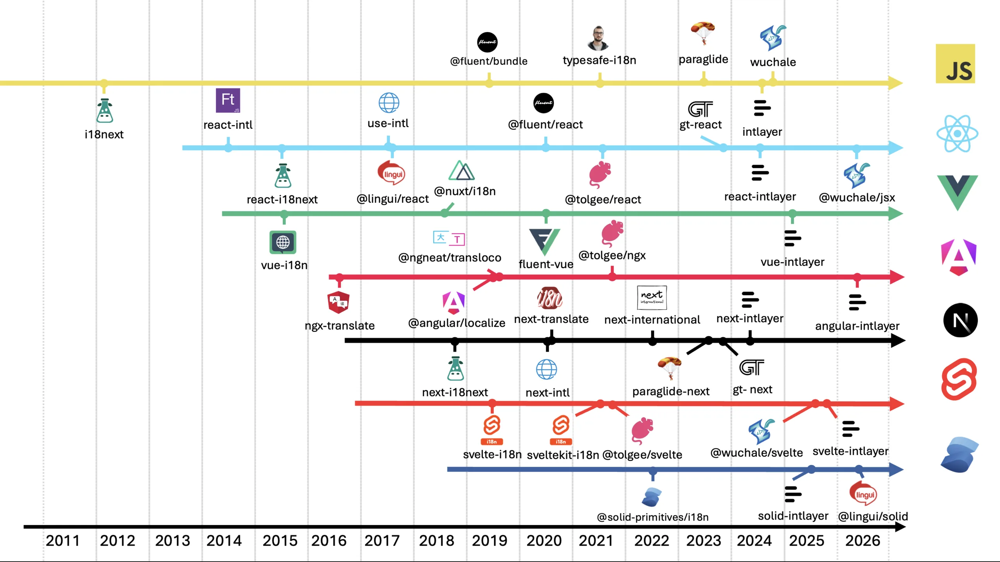
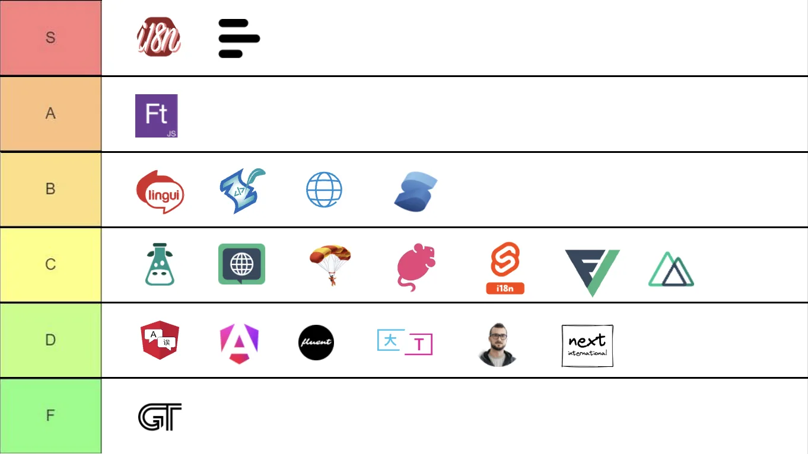

# כיצד לבחור את ספריית ה-i18n הנכונה ל-Solid

מודל הריאקטיביות של Solid משנה באופן מהותי את מה שספריית i18n נדרשת לבצע. רכיבים ב-Solid רצים פעם אחת בלבד, ולכן תרגום שנשמר במשתנה `const` בעת האתחול הוא מחרוזת קפואה. ספרייה שמחזירה מחרוזות גולמיות במקום פונקציות accessor תוביל לכך שהאפליקציה תחליף שפה בכל מקום מלבד בשלושת הרכיבים שבהם מפתח עשה זאת. בחירת ספרייה עבור Solid נוגעת לא רק ל-API, אלא בעיקר לשאלה מי מהן הופכת שגיאה כזו לבלתי אפשרית לכתיבה.

מדריך זה מפרט את השאלות שיש לענות עליהן תחילה, ולאחר מכן משווה בין `@solid-primitives/i18n`, `solid-i18next`, Paraglide, `@lingui/solid` ו-Intlayer, עבור Vite + Solid ועבור SolidStart.

## תוכן העניינים

<TOC/>

## שש שאלות שיש לענות עליהן לפני שמשווים בין ספריות

1. **Vite SPA או SolidStart?** ב-SPA השפה יכולה להישמר ב-Signal פשוט ולא מעבר לכך. ב-SolidStart יש לזהות את השפה בצד השרת מתוך כתובת ה-URL, וכל מה שזחלן אינטרנט צריך לראות ללא JavaScript (כגון `<html lang>`, `hreflang`) שייך ל-`entry-server.tsx`.
2. **עד כמה ריאקטיבי צריך להיות שינוי השפה?** ישנן אפליקציות שבהן רענון עמוד מלא בעת החלפת שפה הוא קביל. אם לא, ערכי הספרייה חייבים להיות signals או accessors, והקריאה שלהם חייבת להיות מנוטרת (tracked) ולא מועתקת.
3. **מי כותב את התרגומים?** מפתחים, מערכת TMS, סוכנות המספקת מחרוזות בפורמט ICU, או צינור אוטומטי של AI. הספרייה `solid-i18next` משתמשת בפורמט של i18next. הספרייה `@solid-primitives/i18n` משתמשת בכל אובייקט מילון שתגדירו. התאימו את הבחירה לספק התוכן שלכם.
4. **כמה שפות ועמודים יש באפליקציה?** שתי שפות וחמישה עמודים יכולים לטעון הכל מראש. עשר שפות וארבעים נתיבים לא יכולים, וקטלוגים בטעינה מושהית (lazy) יחד עם תיחום (scoping) הופכים לעלות המרכזית.
5. **האם אתם זקוקים לטיפוסים על מפתחות (Types on keys)?** הספרייה `@solid-primitives/i18n` גוזרת אותם מאובייקט המקור. הספרייה `solid-i18next` דורשת הצהרה ידנית. ספריות זמן בנייה מייצרות אותם אוטומטית.
6. **כמה תכונות מקיפות אתם צריכים?** ניהול עוגיות (cookies), ניתוב עם קידומת שפה, הפניות (redirects), מעצבי נתונים (formatters). האפשרות הקלה ביותר אינה כוללת אף אחד מאלה, וזה מצוין עד שפתאום צריך אותם.

רשמו לעצמכם את התשובות. כל הניתוח שלהלן מתייחס אליהן ישירות.

## תמונת המצב הכוללת

Solid היא האקוסיסטם הצעיר ביותר מבין הפריימוורקים הראשיים ויש בה את כמות האפשרויות הקטנה ביותר, המתפרסת על פני שלושה גלים.



<AccordionGroup>
<Accordion header="מילוני זמן ריצה: solid-i18next">

מעטפת של i18next עבור Solid. כוללת namespaces, backends, detectors ועשור של תוספים. זו האפשרות הכבדה ביותר בקבוצה, ובעלת אותן עלויות של `t("a.b")` כמו ב-React.

</Accordion>
<Accordion header="פרימיטיבים מינימליסטיים (2022): @solid-primitives/i18n">

מילון שטוח בבעלותכם, פונקציית `translator()` שמחזירה accessors, וטיפוסים הנגזרים מאובייקט המקור. קלה במיוחד, ללא תיחום, ללא ניתוב וללא מעצבים. ברירת המחדל של הקהילה.

</Accordion>
<Accordion header="מהדרים ותוכן המוצב בצמוד לרכיבים (2024 עד 2026): Paraglide, Intlayer, @lingui/solid">

Paraglide מייצרת פונקציה אחת לכל הודעה. Intlayer מצהירה על תוכן לכל רכיב בקובצי `.content.ts` ומחזירה צמתים המגובים ב-Signals. הקישור של Lingui ל-Solid הגיע בשנת 2026 ומביא עמו חילוץ מבוסס פקודות מאקרו.

</Accordion>
</AccordionGroup>

המאמר על [ההיסטוריה של בינאום ב-JavaScript](https://github.com/aymericzip/intlayer/blob/main/docs/blog/he-IL/history_of_i18n.md) סוקר כל גל בהרחבה.

- [ההיסטוריה של בינאום ב-JavaScript](https://github.com/aymericzip/intlayer/blob/main/docs/blog/he-IL/history_of_i18n.md)

## ההחלטה החשובה ביותר: היכן התוכן שמור ומתי הוא נטען

שתי בחירות מבניות מסבירות את מרבית ההבדלים בגודל ה-bundle בין ההגדרות השונות:

- **תוכן מרוכז או מתוחם (Scoped):** מילון יחיד לאפליקציה כולה, או הצהרה אחת לכל רכיב.
- **ייבוא סטטי או דינמי:** הכל נטען עם הפעלת האפליקציה, או שהשפה הפעילה (ובאופן אידיאלי גם הנתיב הפעיל) נמשכים לפי דרישה.

התרשים מעריך את גודל המידע של אפליקציה תיאורטית בעלת 1 עד 10 עמודים, המתורגמת ל-1 עד 10 שפות, עם כ-30 KB של טקסט לכל עמוד.


הספרייה `@solid-primitives/i18n` אינה מטפלת באף אחד מהצירים הללו מעצמה: אתם משתמשים ב-`createResource` למשיכת מילון לכל שפה, מה שמספק טעינה דינמית, אך כל השאר באחריותכם. הספרייה `solid-i18next` מציעה namespaces ו-backends בטעינה מושהית, אך שום דבר אינו כופה את ההפרדה, כך שרכיב משותף המייבא את `common` הופך אותו לתלות של כל נתיב. Paraglide מטפלת בציר העמודים באמצעות tree-shaking, אם כי הדבר לא בא לידי ביטוי במבחן הביצועים של [Solid benchmark](https://github.com/aymericzip/intlayer/blob/main/docs/docs/he-IL/benchmark/solid.md). ו-Intlayer פותרת זאת באמצעות הצהרות צמודות-רכיב.

- [השוואת ביצועים ב-Solid (Solid benchmark)](https://github.com/aymericzip/intlayer/blob/main/docs/docs/he-IL/benchmark/solid.md)

אם תשובתכם לשאלה 4 הייתה "עמודים רבים", העניקו לחלק זה משקל רב יותר מכל העדפת תחביר API. המאמר על [i18n ברמת הרכיב לעומת מרוכז](https://github.com/aymericzip/intlayer/blob/main/docs/blog/he-IL/per-component_vs_centralized_i18n.md) עוסק בהשלכות התחזוקה של פשרה זו.

- [i18n ברמת הרכיב לעומת מרוכז](https://github.com/aymericzip/intlayer/blob/main/docs/blog/he-IL/per-component_vs_centralized_i18n.md)

## הספריות המועמדות

גדלי הספריות מבוססים על תוצאות ה-[Solid benchmark](https://github.com/aymericzip/intlayer/blob/main/docs/docs/he-IL/benchmark/solid.md): provider יחד עם accessor בתוך רכיב ריק, לאחר bundling, tree-shaking ו-minification, באפליקציה של 10 עמודים ו-10 שפות. התוכן נמדד בנפרד.

- [דוח Solid benchmark](https://github.com/aymericzip/intlayer/blob/main/docs/docs/he-IL/benchmark/solid.md)


| ספרייה                   | מודל תוכן                               | ריאקטיביות בהחלפת שפה                           | בטיחות טיפוסים (Type safety)   | תיחום וטעינה מושהית      | גודל ספרייה                          |
| :----------------------- | :-------------------------------------- | :---------------------------------------------- | :----------------------------- | :----------------------- | :----------------------------------- |
| `@solid-primitives/i18n` | מילון שטוח בבעלותכם                     | Signal, פונקציות accessor מוחזרות               | 3/5 - נגזרת מאובייקט המילון    | ללא תמיכה מובנית         | ~0.6 kB                              |
| `solid-i18next`          | קטלוגים ו-namespaces של i18next         | Store, רינדור מחדש דרך ה-provider               | 2/5 - הצהרה ידנית              | Namespaces, טעינה מושהית | ~14.9 kB                             |
| Paraglide                | פרויקט inlang, פונקציות נוצרות אוטומטית | קריאה בכל הפעלה מתוך cookie או אחסון            | 3.5/5 - נוצרת אוטומטית         | Tree-shaking (לא במבחן)  | קרוב לאפס (בשל קוד שנוצר בתוך המאגר) |
| `@lingui/solid`          | טקסט מקור בקוד, קטלוגים מקומפלים        | מבוססת Signals                                  | 2/5 - מתוך המהדר               | לפי קטלוג                | ~11.8 kB                             |
| Intlayer                 | קובץ `.content.ts` אחד לכל רכיב         | צמתים מגובים ב-Signals, ללא ריצה חוזרת של הרכיב | 5/5 - נוצרת, פעילה כברירת מחדל | כן, ברמת הרכיב           | ~4.3 kB                              |

> המספרים מייצגים תמונת מצב בגרסאות שנבדקו במבחן ההשוואה. גודל `@lingui/solid` נלקח ממבחן TanStack Start. הריצו את הבדיקה על האפליקציה שלכם לפני קבלת החלטה על סמך גודל בלבד.
> בטיחות טיפוסים: ציון 5/5 מעיד על כך שמפתחות, פרמטרים וכל שפה נבדקים ללא צורך בהגדרה ידנית, כולל מעצבי כתובות URL וכלי עזר.

גודל הספרייה האפסי כמעט של Paraglide נובע מעצם המבנה שלה: קוד זמן הריצה נוצר ישירות בתוך מאגר הקוד שלכם. Intlayer זקוקה לתוסף `vite-intlayer`, ולכן אינה יכולה לפעול ללא שלב בנייה.

## פעילות Commits

כמות ה-commits משקפת כמה מאמץ פיתוח מושקע בכל פרויקט. מונו-ריפו סופר כל חבילה שהוא משחרר, לכן יש לקרוא את המספר כאינדיקציה לפעילות שוטפת ולא בהכרח כמדד איכות.

<GithubCommits repositories="solidjs-community/solid-primitives,mbarzda/solid-i18next,opral/paraglide-js,lingui/js-lingui,aymericzip/intlayer" />

## הורדות ב-npm

<NpmDownloads packages="@solid-primitives/i18n,solid-i18next,@inlang/paraglide-js,@lingui/solid,solid-intlayer" period="last-6-months" />

נתוני הורדות מתגמלים פתרונות ותיקים ולא בהכרח את הטובים ביותר. ספרייה ששוחררה לפני שנים עדיין מותקנת על ידי כל פרויקט שבחר בה בעבר, בכל הרצת CI ועל ידי כל חבילה שתלויה בה. הכמות משקפת אינרציה ולא בהכרח בחירה מודרנית.

עוזרי AI מעצימים את האפקט. ספריות כמו `next-intl`, `i18next` ו-`vue-i18n` נפוצות בכל הקוד שעליו אומנו המודלים, ולכן הם מציעים אותן כברירת מחדל מבלי להשוות חלופות. כל הצעה מובילה להורדות נוספות, שמזינות את ההמלצה הבאה. מומלץ להשוות על פי תוצאות ה-benchmark ולא על פי מדדי הורדות.

## התאימו את התשובות שלכם לספרייה

<AccordionGroup>
<Accordion header="Vite SPA, קטלוג קטן, רוצים מינימום מורכבות">

`@solid-primitives/i18n`. מילון שטוח, פונקציית `translator()` המחזירה accessors, וטיפוסים הנגזרים ללא צורך בהגדרות נוספות. זו התשובה הנכונה לאפליקציה קטנה, וקריאת קוד המקור שלה אורכת עשר דקות. מה שתצטרכו לכתוב בעצמכם: שמירת שפה מקומית, ניתוב, מעצבי תאריכים ומספרים, ופיצול לפי נתיבים. אם רשימה זו תתארך, זהו הסימן לעבור לפתרון מקיף יותר.

</Accordion>
<Accordion header="מגיעים מ-React עם בסיס קוד קיים של i18next">

הספרייה `solid-i18next` מאפשרת שימוש חוזר בקטלוגים, ב-namespaces, ב-backends וב-detectors כפי שהם. זוהי האפשרות הכבדה ביותר והיא נושאת את אותן עלויות כמו `react-i18next`: הצהרת טיפוסים ידנית, אופטימיזציות שגוזלות זמן, ופונקציית `t()` שמחזירה מחרוזת, מה שהופך את באג התרגום הקפוא לקל מאוד לכתיבה. עטפו תמיד קריאות בתוך JSX או memo ולעולם אל תשמרו אותן בגוף ה-setup.

</Accordion>
<Accordion header="SolidStart עם ניתוב מבוסס קידומת שפה ו-SSR">

השפה חייבת להיקבע מתוך כתובת ה-URL בצד השרת כדי ששני הצדדים יסכימו על אותו הפלט; זיהוי בצד הלקוח הוא מאוחר מדי. הספריות `@solid-primitives/i18n` ו-`solid-i18next` משאירות את נתיב `[[locale]]`, את `matchFilters`, את ההפניות ואת תגיות `entry-server.tsx` לטיפולכם. ל-Paraglide יש תוסף Vite המטפל בניתוב. Intlayer כוללת middleware וכלי עזר לניתוב מובנים. בכל אפשרות שתבחרו, הציבו את `<html lang>` ואת `hreflang` בתוך `entry-server.tsx`; החבילה `@solidjs/meta` מוחלת בלקוח רק לאחר ההידרציה ב-SolidStart v2. המדריך על [בינאום ב-Solid](https://github.com/aymericzip/intlayer/blob/main/docs/docs/he-IL/intlayer_with_solid_start.md) מלווה את ההגדרה הזו שלב אחר שלב.

- [מדריך בינאום ב-SolidStart](https://github.com/aymericzip/intlayer/blob/main/docs/docs/he-IL/intlayer_with_solid_start.md)

</Accordion>
<Accordion header="החלפת שפה חייבת להיות מיידית ומדויקת (Fine-grained)">

בחרו בספרייה שערכיה הם signals או accessors שהקריאה מהם מנוטרת. ה-accessors של `@solid-primitives/i18n` והצמתים של Intlayer מעדכנים שניהם אך ורק את צמתי ה-DOM שקוראים אותם, ללא ריצה חוזרת של הרכיב כולו. הספרייה `solid-i18next` מרנדרת מחדש דרך ה-provider. הספרייה Paraglide קוראת את השפה מתוך cookie או אחסון בכל קריאת הודעה במקום להסתמך על Signal, מה שעובד אך מבצע יותר פעולות מהנדרש לכל צומת.

</Accordion>
<Accordion header="אפליקציה גדולה, נתיבים מרובים, תקציב bundle קפדני">

תוכן מתוחם המקומפל בזמן הבנייה. Intlayer שולחת אך ורק את מה שהנתיב מרנדר. Paraglide אמורה להגיע לכך באמצעות tree-shaking; ודאו זאת בסביבה שלכם, שכן במבחן ההשוואה הדבר לא בא לידי ביטוי. עם `solid-i18next`, תכננו את אסטרטגיית ה-namespaces והטעינה המושהית מראש ואכפו אותה בסקירות קוד.

</Accordion>
<Accordion header="בטיחות טיפוסים (Type safety) היא דרישת חובה">

`@solid-primitives/i18n` מספקת טיפוסים נגזרים בחינם, שזה יותר ממה שרוב ספריות React מציעות. עבור טיפוסים הנוצרים אוטומטית ושורדים טעינה מושהית ופיצול נתיבים, Paraglide, `@lingui/solid` ו-Intlayer מייצרות אותם ישירות מתוך התוכן. המאמר על [זיהוי תרגומים חסרים](https://github.com/aymericzip/intlayer/blob/main/docs/blog/he-IL/detecting_missing_translations.md) משווה מה כל ספרייה תופסת בזמן הבנייה.

- [זיהוי תרגומים חסרים](https://github.com/aymericzip/intlayer/blob/main/docs/blog/he-IL/detecting_missing_translations.md)

</Accordion>
<Accordion header="התרגומים ייווצרו באמצעות AI">

במקרה כזה, אין עוד צורך בקטלוג JSON מרוכז מכיוון שאין מערכת TMS שמצדיקה זאת. תוכן המוצב בצמוד לרכיבים בליווי כלי CLI שמשלים שפות חסרות מהווים את הנתיב הקצר ביותר. פקודת ה-`fill` של Intlayer פועלת מול מפתח ה-API האישי שלכם (OpenAI, Anthropic, Mistral, Gemini) ומתרגמת מחדש רק את מה שהשתנה.

</Accordion>
</AccordionGroup>

## היכן כל ספרייה מתקשה

- **`@solid-primitives/i18n`**: ללא טעינה מושהית או תיחום מעבר למה שתבנו בעצמכם, ללא ניתוב, ללא טיפול בעוגיות וללא מעצבי נתונים. מעולה לאפליקציות קטנות, אך נעשית מוגבלת במהירות באפליקציות מקצועיות.
- **`solid-i18next`**: הכבדה ביותר בקבוצה, דורשת טיפוסים ידניים, פורמט ריבוי משלה, ו-`t()` מחזירה מחרוזת כך שתרגומים קופאים אם הם נשמרים בגוף ה-setup.
- **Paraglide**: קבצים הנוצרים ישירות בתוך המאגר ויש לייצרם מחדש לפני כל push, הסרת קוד עודף (tree-shaking) לא הופעלה במבחן הביצועים של Solid, והשפה נקראת מאחסון בכל קריאה במקום מתוך Signal.
- **`@lingui/solid`**: חדשה יחסית משנת 2026, ולכן טרם צברה משוב רב מהפקות חיות. יורשת את שלב הבנייה של `extract` / `compile` של Lingui ואת תחביריה המרובים.
- **Intlayer**: דורשת תוסף בנייה חובה, אקוסיסטם קטן יותר, תמיכת ICU חלקית, ותוכן המפוזר בבסיס הקוד מעצם התכנון, כך שייצוא JSON בודד למתרגם דורש שימוש בכלי עזר.

## כיצד כל אפשרות נראית בקוד

אותו רכיב בדיוק, סיכום עגלת קניות עם כותרת וצורת ריבוי, כתוב בכל אחת מהספריות. שימו לב היכן התרגום נקרא: בתוך JSX הוא מנוטר ריאקטיבית, אך בגוף ה-setup הוא נשמר כמחרוזת קפואה.

<Tabs defaultTab="solid-primitives">
  <Tab label="@solid-primitives/i18n" value="solid-primitives">

  <Tabs group="locale">
  <Tab value="en" label="English">

```ts fileName="src/i18n/en.ts"
export const en = {
  cart: { title: "Your cart", items: "{{ count }} items" },
};

export type Dict = typeof en;
```

  </Tab>
  <Tab value="fr" label="French">

```ts fileName="src/i18n/fr.ts"
import type { Dict } from "./en";

export const fr: Dict = {
  cart: { title: "Votre panier", items: "{{ count }} articles" },
};
```

  </Tab>
  <Tab value="es" label="Spanish">

```ts fileName="src/i18n/es.ts"
import type { Dict } from "./en";

export const es: Dict = {
  cart: { title: "Tu carrito", items: "{{ count }} artículos" },
};
```

  </Tab>
  </Tabs>

```ts fileName="src/i18n/index.ts"
import { createSignal } from "solid-js";
import * as i18n from "@solid-primitives/i18n";
import { en } from "./en";
import { fr } from "./fr";
import { es } from "./es";

export type Locale = "en" | "fr" | "es";

const dictionaries = {
  en: i18n.flatten(en),
  fr: i18n.flatten(fr),
  es: i18n.flatten(es),
};

export const [locale, setLocale] = createSignal<Locale>("en");
export const dictionary = () => dictionaries[locale()];
export const t = i18n.translator(dictionary, i18n.resolveTemplate);
```

```tsx fileName="src/components/CartSummary.tsx"
import type { Component } from "solid-js";
import { t } from "../i18n";

export const CartSummary: Component<{ count: number }> = (props) => (
  <section>
    <h2>{t("cart.title")}</h2>
    <p>{t("cart.items", { count: props.count })}</p>
  </section>
);
```

המפתחות מוגדרי טיפוסים מתוך אובייקט המקור באנגלית ללא צורך ביצירת קוד (codegen). אין כללי ריבוי מובנים, אין טעינה מושהית ואין ניתוב; כל אחד מאלה עליכם להוסיף בעצמכם.

  </Tab>
  <Tab label="solid-i18next" value="solid-i18next">

  <Tabs group="locale">
  <Tab value="en" label="English">

```json fileName="public/locales/en/cart.json"
{
  "title": "Your cart",
  "items_one": "{{count}} item",
  "items_other": "{{count}} items"
}
```

  </Tab>
  <Tab value="fr" label="French">

```json fileName="public/locales/fr/cart.json"
{
  "title": "Votre panier",
  "items_one": "{{count}} article",
  "items_other": "{{count}} articles"
}
```

  </Tab>
  <Tab value="es" label="Spanish">

```json fileName="public/locales/es/cart.json"
{
  "title": "Tu carrito",
  "items_one": "{{count}} artículo",
  "items_other": "{{count}} artículos"
}
```

  </Tab>
  </Tabs>

```tsx fileName="src/components/CartSummary.tsx"
import { useTransContext } from "@mbarzda/solid-i18next";
import type { Component } from "solid-js";

export const CartSummary: Component<{ count: number }> = (props) => {
  const [t] = useTransContext();

  return (
    <section>
      <h2>{t("cart:title")}</h2>
      <p>{t("cart:items", { count: props.count })}</p>
    </section>
  );
};
```

שימוש בקטלוגים, ב-namespaces ובתוספים של i18next כפי שהם. הפונקציה `t` מחזירה מחרוזת, כך שהגדרה כמו `const title = t("cart:title")` בגוף ה-setup תקפיא את הערך; הקפידו להשאיר את הקריאה בתוך ה-JSX.

  </Tab>
  <Tab label="Paraglide" value="paraglide">

  <Tabs group="locale">
  <Tab value="en" label="English">

```json fileName="messages/en.json"
{
  "cart_title": "Your cart",
  "cart_items": "{count} items"
}
```

  </Tab>
  <Tab value="fr" label="French">

```json fileName="messages/fr.json"
{
  "cart_title": "Votre panier",
  "cart_items": "{count} articles"
}
```

  </Tab>
  <Tab value="es" label="Spanish">

```json fileName="messages/es.json"
{
  "cart_title": "Tu carrito",
  "cart_items": "{count} artículos"
}
```

  </Tab>
  </Tabs>

```tsx fileName="src/components/CartSummary.tsx"
import type { Component } from "solid-js";
import { m } from "../paraglide/messages.js";

export const CartSummary: Component<{ count: number }> = (props) => (
  <section>
    <h2>{m.cart_title()}</h2>
    <p>{m.cart_items({ count: props.count })}</p>
  </section>
);
```

כל הודעה היא פונקציה מוגדרת טיפוסים שנוצרת אוטומטית. השפה נקראת מתוך cookie או אחסון בכל קריאה במקום מתוך Signal, ולכן חיבור הריאקטיביות בעת החלפת שפה מוטל עליכם.

  </Tab>
  <Tab label="Intlayer" value="intlayer">

```ts fileName="src/components/cartSummary.content.ts"
import { type Dictionary, plural, t } from "intlayer";

const cartSummaryContent = {
  key: "cart-summary",
  content: {
    title: t({
      en: "Your cart",
      fr: "Votre panier",
      es: "Tu carrito",
    }),
    items: plural({
      one: t({ en: "{{count}} item", fr: "{{count}} article" }),
      other: t({ en: "{{count}} items", fr: "{{count}} articles" }),
    }),
  },
} satisfies Dictionary;

export default cartSummaryContent;
```

```tsx fileName="src/components/CartSummary.tsx"
import { useIntlayer } from "solid-intlayer";
import type { Component } from "solid-js";

export const CartSummary: Component<{ count: number }> = (props) => {
  const content = useIntlayer("cart-summary");

  return (
    <section>
      <h2>{content.title}</h2>
      <p>{content.items(props.count)}</p>
    </section>
  );
};
```

כל השפות נשמרות בקובץ יחיד בצמוד לרכיב. הפונקציה `useIntlayer` מחזירה צמתים המגובים ב-Signals, כך ששינוי שפה מעדכן רק את צמתי ה-DOM שקוראים אותם. השימוש ב-`{content.title}` ב-JSX מנוטר באופן מלא; שימוש ב-`content.title.value` בגוף ה-setup אינו מנוטר.

  </Tab>
</Tabs>

בבסיס קוד קיים המבוסס על i18next, [מתאם התאימות של i18next](https://github.com/aymericzip/intlayer/blob/main/docs/docs/he-IL/compat/i18next.md) מספק כינוי (alias) לחבילה ברמת ה-bundler, כך שקטלוגים וקריאות `t()` ממשיכים לפעול בזמן ש-Intlayer מגישה את התוכן. [מדריך ההגירה](https://github.com/aymericzip/intlayer/blob/main/docs/docs/he-IL/migration_from_i18next_to_intlayer.md) מכסה את שאר השלבים.

- [מתאם תאימות עבור i18next](https://github.com/aymericzip/intlayer/blob/main/docs/docs/he-IL/compat/i18next.md)
- [מדריך הגירה מ-i18next ל-Intlayer](https://github.com/aymericzip/intlayer/blob/main/docs/docs/he-IL/migration_from_i18next_to_intlayer.md)

## נקודות למחשבה לפני שמתחייבים

טבלת תכונות מציגה מה הספרייה יודעת לעשות כיום. הנקודות הבאות ממחישות כיצד תיראה שגרת החיים איתה.

**בדקו את פעילות המאגר (Repository Activity).**

כמות commits, זמן מענה ל-issues, והאם גרסת ה-minor האחרונה שוחררה השנה. תכנון מעולה ללא מתחזק פעיל הוא הגירה שמחכה לקרות.

**אל תבחרו לפי כמות ההורדות ב-npm.**

הספרייה המותקנת ביותר היא זו ששוחררה ראשונה, לא זו שהכי מתאימה לבסיס קוד של Solid ב-2026. הורדות מודדות היסטוריה, לא התאמה.



**שאלו מי מממן את המתחזק, ומה הוא מוכר.**

הספרייה `i18next` (שעומדת מאחורי `solid-i18next`) נתמכת על ידי Locize. הספריות `next-intl`, `vue-i18n`, `svelte-i18n` ו-Lingui נתמכות על ידי Crowdin. הספריות Tolgee, Paraglide (inlang) ו-Intlayer מפעילות כל אחת פלטפורמה משלה. לספק שרווחיו מבוססים על אחסון תרגומים בענן יש אינטרס נמוך מאוד לספק תרגום חינמי ישירות בתוך כלי הפיתוח שלכם. Intlayer היא היחידה בקבוצה שמספקת תרגום AI דרך ה-CLI עם מפתח API אישי שלכם, ומערכת CMS שניתן לארח עצמאית.

**האם הספרייה מוכנה לסוכני AI (AI Agents)?**

סוכנים מתקשים לעיתים קרובות עם i18n: הם שוכחים שפות, ממציאים מפתחות ומערבבים תחבירי הודעות. האם הספרייה מספקת [Agent Skills](https://github.com/aymericzip/intlayer/blob/main/docs/docs/he-IL/agent_skills.md) או [שרת MCP](https://github.com/aymericzip/intlayer/blob/main/docs/docs/he-IL/mcp_server.md) כך שהסוכן יוכל לרשום, למלא ולבדוק תוכן? והאם טעינת התוכן ממוטבת כברירת מחדל, או שמישהו יצטרך לבדוק namespaces וטעינות מושהות מדי רבעון?

- [כישורי סוכן (Agent Skills)](https://github.com/aymericzip/intlayer/blob/main/docs/docs/he-IL/agent_skills.md)
- [שרת MCP](https://github.com/aymericzip/intlayer/blob/main/docs/docs/he-IL/mcp_server.md)

**בטיחות טיפוסים (Type safety) מהקופסה.**

לא "יכולה לתמוך בטיפוסים עם הגדרות נוספות", אלא "מפתח שגוי מכשיל את `tsc` בהתקנה חדשה". בדקו מה קורה עם מפתח שאינו קיים, ועם שפה שחסר בה תרגום אחד.

**זיהוי תוכן שאינו בשימוש.**

קטלוגים נוטים רק לגדול. תהליך הבנייה של Intlayer מנקה שדות שאינם בשימוש ומתעד אותם (`build.purge`). הספרייה Paraglide משיגה זאת באופן מבני, מכיוון שפונקציית הודעה שאינה נקראת מוסרת ב-tree-shaking. כל שאר הספריות משאירות את הניקוי לאחריותכם.

**חוויית פיתוח (DX).**

זמן הגדרה עד למחרוזת המתורגמת הראשונה, תמיכת [LSP](https://github.com/aymericzip/intlayer/blob/main/docs/docs/he-IL/lsp.md) או [תוסף VS Code](https://github.com/aymericzip/intlayer/blob/main/docs/docs/he-IL/vs_code_extension.md) המציג את התרגום בריחוף (hover) ומקפיץ להצהרה, [CLI](https://github.com/aymericzip/intlayer/blob/main/docs/docs/he-IL/cli/index.md) למילוי, בדיקה ודחיפת תוכן, [מהדר](https://github.com/aymericzip/intlayer/blob/main/docs/docs/he-IL/compiler.md) או מחלץ המוציא מחרוזות מקודדות מתוך הרכיבים כדי שלא תנהלו כל מחרוזת מפתח-אחר-מפתח, ואפשרות לאנשי תוכן שאינם מפתחים לערוך תוכן ([עורך ויזואלי](https://github.com/aymericzip/intlayer/blob/main/docs/docs/he-IL/intlayer_visual_editor.md) או [CMS](https://github.com/aymericzip/intlayer/blob/main/docs/docs/he-IL/intlayer_CMS.md)) ללא צורך ב-pull request.

- [שרת שפה (LSP)](https://github.com/aymericzip/intlayer/blob/main/docs/docs/he-IL/lsp.md)
- [תוסף VS Code](https://github.com/aymericzip/intlayer/blob/main/docs/docs/he-IL/vs_code_extension.md)
- [ממשק CLI](https://github.com/aymericzip/intlayer/blob/main/docs/docs/he-IL/cli/index.md)
- [מהדר (Compiler)](https://github.com/aymericzip/intlayer/blob/main/docs/docs/he-IL/compiler.md)
- [עורך ויזואלי](https://github.com/aymericzip/intlayer/blob/main/docs/docs/he-IL/intlayer_visual_editor.md)
- [מערכת CMS](https://github.com/aymericzip/intlayer/blob/main/docs/docs/he-IL/intlayer_CMS.md)

## שאלות נפוצות

<FAQ>

<Question title="האם @solid-primitives/i18n מספיקה לאפליקציית production?">

לאפליקציה קטנה, כן, וזו האפשרות הקלה ביותר שקיימת. היא מפסיקה להספיק ברגע שאתם זקוקים לקטלוגים בטעינה מושהית לכל נתיב, ניתוב שפות ב-SolidStart, שמירה בעוגיות או מעצבי נתונים, מכיוון שאת כל אלה תידרשו לבנות בעצמכם.

</Question>

<Question title="מדוע התרגום שלי אינו מתעדכן בעת החלפת שפה?">

מכיוון שרכיבי Solid רצים פעם אחת בלבד. תרגום שנקרא לתוך משתנה `const` בעת האתחול הוא מחרוזת פשוטה ולא מנוי ריאקטיבי (subscription). קראו אותו בתוך JSX, בתוך effect או בתוך memo, או בחרו בספרייה שערכיה הם accessors כך שיהיה קשה יותר לכתוב את הגרסה השגויה.

</Question>

<Question title="האם אני זקוק לספרייה מבוססת מהדר?">

רק אם גודל ה-bundle, טיפוסים הנוצרים אוטומטית או בדיקות מפתחות חסרים בזמן בנייה הם דרישות ממשיות. המאמר על [i18n מבוסס מהדר לעומת דקלרטיבי](https://github.com/aymericzip/intlayer/blob/main/docs/blog/he-IL/compiler_vs_declarative_i18n.md) מסביר מה מהדרים מעניקים והיכן הם עלולים לטעות.

- [i18n מבוסס מהדר לעומת דקלרטיבי](https://github.com/aymericzip/intlayer/blob/main/docs/blog/he-IL/compiler_vs_declarative_i18n.md)

</Question>

<Question title="האם בחירת הספרייה משפיעה על SEO?">

באופן עקיף. מה שזחלנים רואים תלוי בניתוב, ב-`hreflang`, בתגית `<html lang>` ובשאלה האם הטקסט נכלל ב-HTML שמרונדר בשרת, מה שב-SolidStart אומר `entry-server.tsx`. עיינו ב-[מדריך hreflang](https://github.com/aymericzip/intlayer/blob/main/docs/blog/he-IL/hreflang_guide_multilingual_seo.md).

- [מדריך hreflang](https://github.com/aymericzip/intlayer/blob/main/docs/blog/he-IL/hreflang_guide_multilingual_seo.md)

</Question>

</FAQ>

## קריאה נוספת

- [השוואת ביצועים ב-Solid: גודל bundle, דליפות וזמני החלפת שפה](https://github.com/aymericzip/intlayer/blob/main/docs/docs/he-IL/benchmark/solid.md)
- [מתאם תאימות מהיר עבור i18next](https://github.com/aymericzip/intlayer/blob/main/docs/docs/he-IL/compat/i18next.md)
- [מדריך הגירה מ-i18next](https://github.com/aymericzip/intlayer/blob/main/docs/docs/he-IL/migration_from_i18next_to_intlayer.md)
- [ההיסטוריה של בינאום ב-JavaScript](https://github.com/aymericzip/intlayer/blob/main/docs/blog/he-IL/history_of_i18n.md)
- [i18n מבוסס מהדר לעומת דקלרטיבי](https://github.com/aymericzip/intlayer/blob/main/docs/blog/he-IL/compiler_vs_declarative_i18n.md)
- [i18n ברמת הרכיב לעומת מרוכז](https://github.com/aymericzip/intlayer/blob/main/docs/blog/he-IL/per-component_vs_centralized_i18n.md)
- [כיצד פועל מיטוב bundle בזמן בנייה](https://github.com/aymericzip/intlayer/blob/main/docs/docs/he-IL/bundle_optimization.md)
- [הגדרת i18n באפליקציית Vite + Solid](https://github.com/aymericzip/intlayer/blob/main/docs/docs/he-IL/intlayer_with_vite+solid.md)
- [אפליקציית SolidStart](https://github.com/aymericzip/intlayer/blob/main/docs/docs/he-IL/intlayer_with_solid_start.md)

מדריכים מקבילים עבור

- [React](https://github.com/aymericzip/intlayer/blob/main/docs/blog/he-IL/how_to_pick_react_i18n_library.md)
- [Vue](https://github.com/aymericzip/intlayer/blob/main/docs/blog/he-IL/how_to_pick_vue_i18n_library.md)
- [Svelte](https://github.com/aymericzip/intlayer/blob/main/docs/blog/he-IL/how_to_pick_svelte_i18n_library.md)
