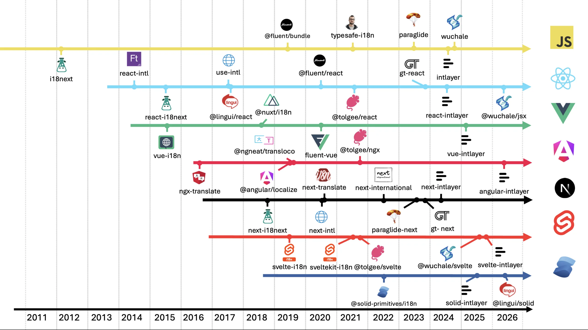
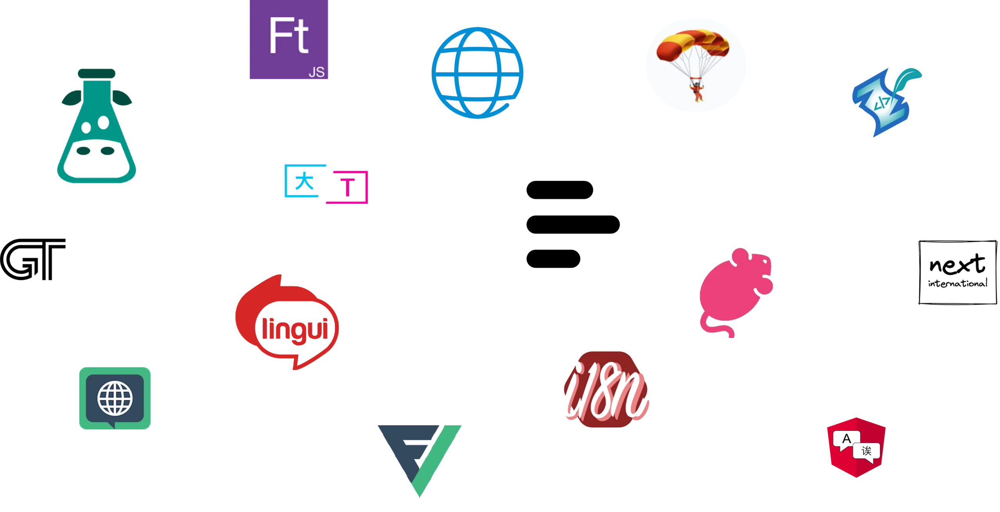
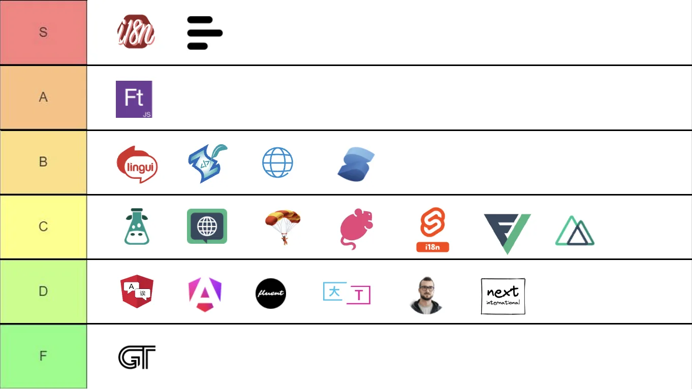

# כיצד לבחור את ספריית ה-i18n הנכונה ל-Svelte

Svelte אינה כוללת שום דבר מובנה עבור i18n. אין `$t`, אין פרימיטיב לניהול locale, ואין פורמט הודעות רשמי. כל אפשרות היא בחירה של צד שלישי, והאקוסיסטם של Svelte הוא המקום שבו i18n בזמן בנייה הרחיק לכת יותר מכל, כך שהמועמדים שונים זה מזה באופן מהותי יותר מאשר ב-React או ב-Vue.

מדריך זה מונה תחילה את השאלות שיש לענות עליהן, ולאחר מכן מתאים את התשובות ל-`svelte-i18n`, Paraglide, `typesafe-i18n`, `wuchale` ו-Intlayer, עבור Vite + Svelte ועבור SvelteKit.

## תוכן העניינים

<TOC/>

## שש שאלות שיש לענות עליהן לפני שמשווים בין ספריות

1. **Vite SPA או SvelteKit?** ב-SPA, שימוש ב-store ברמת המודול (module-level store) הוא תקין: לשונית אחת, משתמש אחד, שפה אחת. ב-SvelteKit אותו מופע יחיד (singleton) משותף לרוחב בקשות מקבילות בשרת, ובקשה ב' תתרנדר בשפה של בקשה א'. הספרייה חייבת לספק לכם מבנה מבודד לכל בקשה (context, `locals`) או שתצטרכו להקים זאת בעצמכם.
2. **מי כותב את התרגומים?** מפתחים, מערכת TMS, סוכנות המספקת מחרוזות ICU, או צינור אוטומטי מבוסס AI. הספרייה `svelte-i18n` מבוססת על ICU. הספריות Paraglide ו-`typesafe-i18n` משתמשות בתחביר משלהן. התאימו את הכלי לספק התוכן שלכם.
3. **כמה שפות ועמודים יש באפליקציה?** שתי שפות וחמישה עמודים יכולים לטעון הכל מראש. עשר שפות וארבעים נתיבים לא יכולים, וההבדל בין קטלוגים בזמן ריצה לבין הודעות מקומפלות הופך לגורם העלות העיקרי.
4. **האם אתם זקוקים לטיפוסים על מפתחות (Types on keys)?** קריאה ל-`$_("cart.totl")` היא כשל בזמן ריצה ב-`svelte-i18n`. ספריות זמן בנייה הופכות זאת לשגיאת טיפוסים (type error) כחלק מהמבנה שלהן.
5. **Svelte 4 stores או Svelte 5 runes?** מנגנון ה-Runes משנה את התחביר של ניהול המצב, לא את בעיית השיתוף בשרת. אולם `$state` בקובץ `.ts` מתקמפל למשתנה רגיל, כך שסביבת זמן הריצה של הספרייה חייבת לתמוך ב-runes אם אתם משתמשים ב-Svelte 5.
6. **האם אתם יכולים לחיות עם קבצים שנוצרים אוטומטית במאגר הקוד?** גם Paraglide וגם `typesafe-i18n` מייצרות קובצי JavaScript או TypeScript ישירות בתוך עץ המקור שלכם. חלק מהצוותים מקבלים זאת בהבנה, ואחרים נתקלים בקונפליקטים במיזוגים בכל ענף מקביל.

רשמו לעצמכם את התשובות. כל הניתוח שלהלן מתייחס אליהן ישירות.

## תמונת המצב הכוללת

ה-i18n ב-Svelte הגיע מאוחר יותר מאשר ב-React או ב-Vue, ודילג ישירות אל גלי הזמן-בנייה והמהדרים.



<AccordionGroup>
<Accordion header="מילוני זמן ריצה (2019 עד 2020): svelte-i18n, sveltekit-i18n">

קטלוגי JSON, ניתוח ICU בדפדפן באמצעות `intl-messageformat`, ושפה המנוהלת ב-stores ברמת המודול (`$locale`, `$_`). המאומצות ביותר, מתועדות היטב, אך חיבור ה-SSR הוא כולו באחריותכם.

</Accordion>
<Accordion header="טיפוסים שנוצרים אוטומטית (2020 עד 2022): typesafe-i18n">

מחולל (generator) שעוקב אחר הקטלוגים שלכם ומייצר פונקציות גישה מוגדרות טיפוסים (`$LL.cart.total()`). מודל מתוכנן היטב, קבצים שנוצרים בתוך המאגר, אם כי פעילות הפיתוח במאגר האטה לאחרונה.

</Accordion>
<Accordion header="מהדרים ותוכן המוצב בצמוד לרכיבים (2022 עד 2026): Paraglide, wuchale, Intlayer">

Paraglide מקמפלת כל הודעה לפונקציה מיוצאת כך שכלי ה-bundling מסיר ב-tree-shaking מה שנתיב אינו קורא לו. `wuchale` מחלצת מחרוזות מתוך התבניות בזמן הבנייה. Intlayer מצהירה על תוכן בצמוד לרכיב ומייצרת טיפוסים ומילונים ייעודיים לכל רכיב.

</Accordion>
</AccordionGroup>

המאמר על [ההיסטוריה של בינאום ב-JavaScript](https://github.com/aymericzip/intlayer/blob/main/docs/blog/he-IL/history_of_i18n.md) מכסה כל גל בהרחבה.

- [ההיסטוריה של בינאום ב-JavaScript](https://github.com/aymericzip/intlayer/blob/main/docs/blog/he-IL/history_of_i18n.md)

## ההחלטה החשובה ביותר: היכן התוכן שמור ומתי הוא נטען

שתי בחירות מבניות מסבירות את מרבית ההבדלים בגודל ה-bundle בין ההגדרות השונות:

- **תוכן מרוכז או מתוחם (Scoped):** קובץ `locales/en.json` יחיד לכל האפליקציה, או הצהרה אחת לכל רכיב.
- **ייבוא סטטי או דינמי:** הכל נטען עם הפעלת האפליקציה, או שהשפה הפעילה (ובאופן אידיאלי גם הנתיב הפעיל) נמשכים לפי דרישה.

התרשים מעריך את גודל המידע של אפליקציה תיאורטית בעלת 1 עד 10 עמודים, המתורגמת ל-1 עד 10 שפות, עם כ-30 KB של טקסט לכל עמוד.


הספרייה `svelte-i18n` ממוקמת בפינה השמאלית העליונה כברירת מחדל: שימוש ב-`register("fr", () => import("./fr.json"))` מעניק טעינה דינמית לכל שפה, אך קטלוג השפה הוא אובייקט אחד וטעינתו טוענת את הטקסטים של כל העמודים. Paraglide היא המקרה המעניין: מכיוון שכל הודעה מיוצאת בנפרד, מנגנון ה-tree-shaking מסיר את ציר העמודים ללא מאמץ נוסף, ומבחן הביצועים של [Svelte benchmark](https://github.com/aymericzip/intlayer/blob/main/docs/docs/he-IL/benchmark/svelte.md) מאשר שזה פועל כמובטח ב-Vite + Svelte (בניגוד למבחני React ו-Next.js). הספרייה Intlayer מגיעה לאותה תוצאה באמצעות הצהרות צמודות-רכיב.

- [השוואת ביצועים ב-Svelte (Svelte benchmark)](https://github.com/aymericzip/intlayer/blob/main/docs/docs/he-IL/benchmark/svelte.md)

אם תשובתכם לשאלה 3 הייתה "עמודים רבים", העניקו לחלק זה משקל רב יותר מכל העדפת תחביר API. המאמר על [i18n ברמת הרכיב לעומת מרוכז](https://github.com/aymericzip/intlayer/blob/main/docs/blog/he-IL/per-component_vs_centralized_i18n.md) עוסק בהשלכות התחזוקה של פשרה זו.

- [i18n ברמת הרכיב לעומת מרוכז](https://github.com/aymericzip/intlayer/blob/main/docs/blog/he-IL/per-component_vs_centralized_i18n.md)

## הספריות המועמדות

גדלי הספריות מבוססים על תוצאות ה-[Svelte benchmark](https://github.com/aymericzip/intlayer/blob/main/docs/docs/he-IL/benchmark/svelte.md): store בתוספת accessor בתוך רכיב ריק, לאחר bundling, tree-shaking ו-minification, באפליקציה של 10 עמודים ו-10 שפות. התוכן נמדד בנפרד.

- [דוח Svelte benchmark](https://github.com/aymericzip/intlayer/blob/main/docs/docs/he-IL/benchmark/svelte.md)



| ספרייה          | היכן נשמרות ההודעות             | ניהול מצב שפה                            | בטיחות טיפוסים (Type safety) | פורמט הודעות                  | פיצול לפי נתיב           | גודל ספרייה                          |
| :-------------- | :------------------------------ | :--------------------------------------- | :--------------------------- | :---------------------------- | :----------------------- | :----------------------------------- |
| `svelte-i18n`   | קטלוגי JSON לפי שפה             | Svelte store ברמת המודול                 | 2/5 - union ידני             | ICU                           | לא                       | ~16.6 kB                             |
| `typesafe-i18n` | מודולי TS שנוצרים אוטומטית      | מתאם store                               | 4/5 - נוצרת אוטומטית         | פורמט עצמאי                   | חלקי                     | קטן                                  |
| Paraglide       | פרויקט inlang, מקומפל לפונקציות | קריאה בכל הפעלה מעוגייה, URL או אחסון    | 3.5/5 - נוצרת אוטומטית       | פורמט עצמאי                   | כן, באמצעות tree-shaking | קרוב לאפס (בשל קוד שנוצר בתוך המאגר) |
| `wuchale`       | מחולץ מתוך התבניות בזמן הבנייה  | Store                                    | לא רלוונטי (ללא מפתחות)      | פורמט עצמאי                   | כן                       | ~30.7 kB                             |
| Intlayer        | קובצי `.content.ts` בצמוד לרכיב | Context בתוספת store, תמיכה מלאה ב-runes | 5/5 - נוצרת, ברירת מחדל      | Intlayer (+ ICU, i18next, PO) | כן, ברמת הרכיב           | ~3.6 kB                              |

> המספרים מייצגים תמונת מצב בגרסאות שנבדקו במבחן ההשוואה. הריצו את הבדיקה על האפליקציה שלכם לפני קבלת החלטה על סמך גודל בלבד.
> בטיחות טיפוסים: ציון 5/5 מעיד על כך שמפתחות, פרמטרים וכל שפה נבדקים ללא צורך בהגדרה ידנית, כולל מעצבי כתובות URL וכלי עזר.

גודל הספרייה האפסי כמעט של Paraglide נובע מעצם המבנה שלה: קוד זמן הריצה נוצר ישירות בתוך מאגר הקוד שלכם. Intlayer זקוקה לתוסף `vite-intlayer`, ולכן אינה יכולה לפעול ללא שלב בנייה.

## פעילות Commits

כמות ה-commits משקפת כמה מאמץ פיתוח מושקע בכל פרויקט. מונו-ריפו סופר כל חבילה שהוא משחרר, לכן יש לקרוא את המספר כאינדיקציה לפעילות שוטפת ולא בהכרח כמדד איכות.

<GithubCommits repositories="kaisermann/svelte-i18n,codingcommons/typesafe-i18n,opral/paraglide-js,wuchalejs/wuchale,aymericzip/intlayer" />

## הורדות ב-npm

<NpmDownloads packages="svelte-i18n,typesafe-i18n,@inlang/paraglide-js,wuchale,svelte-intlayer" period="last-6-months" />

נתוני הורדות מתגמלים פתרונות ותיקים ולא בהכרח את הטובים ביותר. ספרייה ששוחררה לפני שנים עדיין מותקנת על ידי כל פרויקט שבחר בה בעבר, בכל הרצת CI ועל ידי כל חבילה שתלויה בה. הכמות משקפת אינרציה ולא בהכרח בחירה עדכנית.

עוזרי AI מעצימים את האפקט. ספריות כמו `next-intl`, `i18next` ו-`vue-i18n` נפוצות בכל הקוד שעליו אומנו המודלים, ולכן הם מציעים אותן כברירת מחדל מבלי להשוות חלופות. כל הצעה מובילה להורדות נוספות, שמזינות את ההמלצה הבאה. מומלץ להשוות על פי תוצאות ה-benchmark ולא על פי מדדי הורדות.

## התאימו את התשובות שלכם לספרייה

<AccordionGroup>
<Accordion header="Vite SPA, צוות קטן, מעט שפות">

`svelte-i18n`. זו האפשרות בעלת התיעוד הרחב ביותר, התחביר `$_` קריא וטבעי בתבניות, והשילוב של `register` עם `waitLocale()` מכסה טעינה מושהית לפי שפה. חסמו את הרינדור הראשוני באמצעות `isLoading`, אחרת המשתמשים יחוו הבהוב של מפתחות גולמיים. אם יש סיכוי שהאפליקציה תכלול שרת בעתיד, הציבו את השפה בתוך ה-context של Svelte כבר מהיום הראשון במקום להסתמך על ה-store ברמת המודול; זה לא עולה דבר כעת ומונע באג חמקמק ב-production בעתיד.

</Accordion>
<Accordion header="SvelteKit עם ניתוב שפות ו-SSR">

בעיית שיתוף המצב בשרת מכריעה כאן. הספרייה `svelte-i18n` עובדת ב-SvelteKit, אך החיבור המבודד לכל בקשה (`hooks.server.ts`, `locals`, `load` ואז `setContext`) מוטל עליכם וקל מאוד לעשות בו טעויות עדינות. Paraglide מספקת אינטגרציה ל-SvelteKit המטפלת בניתוב וקוראת את השפה בכל קריאה, מה שעוקף את בעיית ה-singleton. הספרייה Intlayer מגדירה את השפה ישירות מנתוני ה-`load` אל תוך ה-context. המדריך על [בינאום ב-SvelteKit](https://github.com/aymericzip/intlayer/blob/main/docs/docs/he-IL/intlayer_with_svelte_kit.md) מסביר את הבחירה בין `[[lang]]` לבין `reroute`, החלטה שכדאי לקבל עוד לפני בחירת הספרייה.

- [מדריך בינאום ב-SvelteKit](https://github.com/aymericzip/intlayer/blob/main/docs/docs/he-IL/intlayer_with_svelte_kit.md)

</Accordion>
<Accordion header="התרגומים מגיעים מ-TMS או מסוכנות המספקת ICU">

`svelte-i18n` תומכת ב-ICU באופן מקורי באמצעות `intl-messageformat`, כך שהיא מתחברת ישירות למרבית ספקי התוכן. Paraglide ו-`typesafe-i18n` משתמשות בתחביר משלהן ודורשות המרה. התמיכה של Intlayer ב-ICU היא חלקית, כך שאם אתם מקבלים מחרוזות בפורמט ICU כיום, יש לראות בכך חסם.

</Accordion>
<Accordion header="גודל ה-bundle הוא האילוץ המרכזי">

פתרונות זמן בנייה. הסרת הקוד העודף (tree-shaking) של Paraglide עובדת מצוין ב-Vite + Svelte ועלות הספרייה קרובה לאפס. המילונים צמודי-הרכיב של Intlayer מספקים את אותה תוצאה ללא צורך ביצירת קבצים בתוך המאגר. `svelte-i18n` שולחת את מנתח ה-ICU יחד עם הקטלוג כולו, ומגיעה לגודל של פי 4.5 מ-`svelte-intlayer` במבחן ההשוואה עוד לפני הוספת תוכן כלשהו.

</Accordion>
<Accordion header="בטיחות טיפוסים (Type safety) היא דרישת חובה">

כל פתרון פרט להגדרה בסיסית של `svelte-i18n`, שבה הטיפוס היחיד הוא union ידני שמתרחק מקובץ ה-JSON במהירות. `typesafe-i18n`, Paraglide ו-Intlayer מייצרות כולן טיפוסים מתוך התוכן. בדקו את פעילות המאגר של `typesafe-i18n` לפני שתתחייבו אליה. המאמר על [זיהוי תרגומים חסרים](https://github.com/aymericzip/intlayer/blob/main/docs/blog/he-IL/detecting_missing_translations.md) משווה מה כל ספרייה תופסת בזמן הבנייה.

- [זיהוי תרגומים חסרים](https://github.com/aymericzip/intlayer/blob/main/docs/blog/he-IL/detecting_missing_translations.md)

</Accordion>
<Accordion header="אינכם רוצים קבצים שנוצרים אוטומטית במאגר הקוד">

דרישה זו פוסלת את Paraglide ואת `typesafe-i18n`. הספריות `svelte-i18n` ו-Intlayer שומרות את הפלט שלהן בתוך `node_modules` או בתיקיית בנייה מבודדת; ב-Intlayer קובצי ה-`.content.ts` הם קבצי מקור הנכתבים ביד, ואילו המילונים המקומפלים והטיפוסים נשמרים ב-`.intlayer/` המוגדר ב-`.gitignore`.

</Accordion>
<Accordion header="התרגומים ייווצרו באמצעות AI">

במקרה כזה, לקובץ JSON מרכזי אין עוד צורך ממשי שמצדיק אותו. תוכן המוצב בצמוד לרכיבים בליווי כלי CLI שמשלים שפות חסרות מספקים את הנתיב הקצר ביותר. פקודת ה-`fill` של Intlayer פועלת מול מפתח ה-API האישי שלכם (OpenAI, Anthropic, Mistral, Gemini) ומתרגמת מחדש רק את מה שהשתנה. האקוסיסטם של inlang ב-Paraglide מציע חלופות מנוהלות בענן במסלולי תשלום משלהן.

</Accordion>
</AccordionGroup>

## היכן כל ספרייה מתקשה

- **`svelte-i18n`**: הכבדה ביותר בקבוצה, ללא טיפוסים על מפתחות, ללא פיצול לפי נתיב, ו-store ברמת המודול שדולף בין בקשות שונות ב-SvelteKit אלא אם תחברו context בעצמכם.
- **`typesafe-i18n`**: דורשת תהליך watcher פעיל, מייצרת קבצים בתוך המאגר, והמאגר לא רשם פעילות משמעותית לאחרונה.
- **Paraglide**: קבצים הנוצרים ישירות בתוך המאגר שיש לייצר מחדש לפני כל push, קונפליקטים במיזוגים בענפים מקבילים, והשפה נקראת מעוגייה או אחסון בכל קריאת הודעה במקום מתוך store, מה שגורר עבודה מיותרת בהחלפת שפה.
- **`wuchale`**: רעיון חילוץ מעניין, אך עדיין בשלבים מוקדמים. במבחן הביצועים של React התגלו בעיות ריאקטיביות שחייבו כפיית רינדור של ה-provider, והתיעוד מצומצם למדי.
- **Intlayer**: מחייבת תוסף בנייה, אקוסיסטם קטן יותר, תמיכת ICU חלקית, ותוכן המפוזר בבסיס הקוד מעצם התכנון, כך שייצוא JSON בודד למתרגם דורש שימוש בכלי עזר.

## כיצד כל אפשרות נראית בקוד

אותו רכיב בדיוק, סיכום עגלת קניות עם כותרת וצורת ריבוי, כתוב בכל אחת מהספריות. החלק המעניין אינו התבנית עצמה, אלא המקום שבו התוכן נשמר, כיצד השפה מנוהלת, ומה בודק הטיפוסים יודע עליה.

<Tabs defaultTab="svelte-i18n">
  <Tab label="svelte-i18n" value="svelte-i18n">

  <Tabs group="locale">
  <Tab value="en" label="English">

```json fileName="src/locales/en.json"
{
  "cart": {
    "title": "Your cart",
    "items": "{count, plural, one {# item} other {# items}}"
  }
}
```

  </Tab>
  <Tab value="fr" label="French">

```json fileName="src/locales/fr.json"
{
  "cart": {
    "title": "Votre panier",
    "items": "{count, plural, one {# article} other {# articles}}"
  }
}
```

  </Tab>
  <Tab value="es" label="Spanish">

```json fileName="src/locales/es.json"
{
  "cart": {
    "title": "Tu carrito",
    "items": "{count, plural, one {# artículo} other {# artículos}}"
  }
}
```

  </Tab>
  </Tabs>

```svelte fileName="src/lib/CartSummary.svelte"
<script lang="ts">
  import { _ } from "svelte-i18n";

  let { count }: { count: number } = $props();
</script>

<section>
  <h2>{$_("cart.title")}</h2>
  <p>{$_("cart.items", { values: { count } })}</p>
</section>
```

שימוש ב-ICU דרך `intl-messageformat`, והשפה נשמרת ב-store ברמת המודול. הפונקציה `$_` מקבלת כל מחרוזת; הטיפוסיות היחידה מבוססת על union שמוגדר ידנית.

  </Tab>
  <Tab label="Paraglide" value="paraglide">

  <Tabs group="locale">
  <Tab value="en" label="English">

```json fileName="messages/en.json"
{
  "cart_title": "Your cart",
  "cart_items": "{count} items"
}
```

  </Tab>
  <Tab value="fr" label="French">

```json fileName="messages/fr.json"
{
  "cart_title": "Votre panier",
  "cart_items": "{count} articles"
}
```

  </Tab>
  <Tab value="es" label="Spanish">

```json fileName="messages/es.json"
{
  "cart_title": "Tu carrito",
  "cart_items": "{count} artículos"
}
```

  </Tab>
  </Tabs>

```svelte fileName="src/lib/CartSummary.svelte"
<script lang="ts">
  import { m } from "$lib/paraglide/messages.js";

  let { count }: { count: number } = $props();
</script>

<section>
  <h2>{m.cart_title()}</h2>
  <p>{m.cart_items({ count })}</p>
</section>
```

כל הודעה היא פונקציה מוגדרת טיפוסים שנוצרת אוטומטית, ומוסרת ב-tree-shaking אם אינה נקראת. התיקייה `paraglide/` נוצרת בתוך המאגר שלכם, והשפה נקראת בכל קריאה במקום מתוך store.

  </Tab>
  <Tab label="typesafe-i18n" value="typesafe-i18n">

  <Tabs group="locale">
  <Tab value="en" label="English">

```ts fileName="src/i18n/en/index.ts"
import type { BaseTranslation } from "../i18n-types";

const en = {
  cart: {
    title: "Your cart",
    items: "{count} item{{s}}",
  },
} satisfies BaseTranslation;

export default en;
```

  </Tab>
  <Tab value="fr" label="French">

```ts fileName="src/i18n/fr/index.ts"
import type { Translation } from "../i18n-types";

const fr = {
  cart: {
    title: "Votre panier",
    items: "{count} article{{s}}",
  },
} satisfies Translation;

export default fr;
```

  </Tab>
  <Tab value="es" label="Spanish">

```ts fileName="src/i18n/es/index.ts"
import type { Translation } from "../i18n-types";

const es = {
  cart: {
    title: "Tu carrito",
    items: "{count} artículo{{s}}",
  },
} satisfies Translation;

export default es;
```

  </Tab>
  </Tabs>

```svelte fileName="src/lib/CartSummary.svelte"
<script lang="ts">
  import LL from "$i18n/i18n-svelte";

  let { count }: { count: number } = $props();
</script>

<section>
  <h2>{$LL.cart.title()}</h2>
  <p>{$LL.cart.items({ count })}</p>
</section>
```

פונקציות גישה מוגדרות טיפוסים הנוצרות על ידי תהליך watcher. המודל יציב; הקבצים שנוצרו נשמרים במאגר והפרויקט שקט יחסית בתקופה האחרונה.

  </Tab>
  <Tab label="Intlayer" value="intlayer">

```ts fileName="src/lib/cartSummary.content.ts"
import { plural, t, type Dictionary } from "intlayer";

const cartSummaryContent = {
  key: "cart-summary",
  content: {
    title: t({
      en: "Your cart",
      fr: "Votre panier",
      es: "Tu carrito",
    }),
    items: t({
      en: plural({ one: "{{count}} item", other: "{{count}} items" }),
      fr: plural({ one: "{{count}} article", other: "{{count}} articles" }),
      es: plural({ one: "{{count}} artículo", other: "{{count}} artículos" }),
    }),
  },
} satisfies Dictionary;

export default cartSummaryContent;
```

```svelte fileName="src/lib/CartSummary.svelte"
<script lang="ts">
  import { useIntlayer } from "svelte-intlayer";

  let { count }: { count: number } = $props();
  const content = useIntlayer("cart-summary");
</script>

<section>
  <h2>{$content.title}</h2>
  <p>{$content.items(count)}</p>
</section>
```

כל השפות נשמרות בקובץ יחיד בצמוד לרכיב. הפונקציה `useIntlayer` מחזירה readable store, כך ש-`$content` מספק מנוי אוטומטי מוכר, והשפה נשמרת בתוך context (בטוח ל-SSR) ולא ב-singleton ברמת המודול.

  </Tab>
</Tabs>

כבר משתמשים ב-`svelte-i18n`? [מתאם התאימות של `@intlayer/svelte-i18n`](https://github.com/aymericzip/intlayer/blob/main/docs/docs/he-IL/compat/svelte-i18n.md) מספק כינוי (alias) לחבילה ברמת ה-bundler, כך ש-`$_`, `$date`, `$number` והמפתחות השטוחים שלכם ממשיכים לפעול בזמן ש-Intlayer מגישה את התוכן.

- [מתאם תאימות עבור `@intlayer/svelte-i18n`](https://github.com/aymericzip/intlayer/blob/main/docs/docs/he-IL/compat/svelte-i18n.md)

## נקודות למחשבה לפני שמתחייבים

טבלת תכונות מציגה מה הספרייה יודעת לעשות כיום. הנקודות הבאות ממחישות כיצד תיראה שגרת החיים איתה.

**בדקו את פעילות המאגר (Repository Activity).**

כמות commits, זמן מענה ל-issues, והאם גרסת ה-minor האחרונה שוחררה השנה. תכנון מעולה ללא מתחזק פעיל הוא הגירה שמחכה לקרות.

**אל תבחרו לפי כמות ההורדות ב-npm.**

הספרייה המותקנת ביותר היא זו ששוחררה ראשונה, לא זו שהכי מתאימה לבסיס קוד של Svelte ב-2026. הורדות מודדות היסטוריה, לא התאמה.



**שאלו מי מממן את המתחזק, ומה הוא מוכר.**

הספרייה `svelte-i18n` נתמכת על ידי Crowdin, בדומה ל-`next-intl` ו-`vue-i18n`. הספרייה `i18next` נתמכת על ידי Locize. הספריות Tolgee, Paraglide (inlang) ו-Intlayer מפעילות כל אחת פלטפורמה משלה. לספק שרווחיו מבוססים על אחסון תרגומים בענן יש אינטרס נמוך מאוד לספק תרגום חינמי ישירות בתוך כלי הפיתוח שלכם. Intlayer היא היחידה בקבוצה שמספקת תרגום AI דרך ה-CLI עם מפתח API אישי שלכם, ומערכת CMS שניתן לארח עצמאית.

**האם הספרייה מוכנה לסוכני AI (AI Agents)?**

סוכנים מתקשים לעיתים קרובות עם i18n: הם שוכחים שפות, ממציאים מפתחות ומערבבים תחבירי הודעות. האם הספרייה מספקת [Agent Skills](https://github.com/aymericzip/intlayer/blob/main/docs/docs/he-IL/agent_skills.md) או [שרת MCP](https://github.com/aymericzip/intlayer/blob/main/docs/docs/he-IL/mcp_server.md) כך שהסוכן יוכל לרשום, למלא ולבדוק תוכן? והאם טעינת התוכן ממוטבת כברירת מחדל, או שמישהו יצטרך לבדוק namespaces וטעינות מושהות מדי רבעון?

- [כישורי סוכן (Agent Skills)](https://github.com/aymericzip/intlayer/blob/main/docs/docs/he-IL/agent_skills.md)
- [שרת MCP](https://github.com/aymericzip/intlayer/blob/main/docs/docs/he-IL/mcp_server.md)

**בטיחות טיפוסים (Type safety) מהקופסה.**

לא "יכולה לתמוך בטיפוסים עם הגדרות נוספות", אלא "מפתח שגוי מכשיל את `tsc` בהתקנה חדשה". בדקו מה קורה עם מפתח שאינו קיים, ועם שפה שחסר בה תרגום אחד.

**זיהוי תוכן שאינו בשימוש.**

קטלוגים נוטים רק לגדול. תהליך הבנייה של Intlayer מנקה שדות שאינם בשימוש ומתעד אותם (`build.purge`). הספרייה Paraglide משיגה זאת באופן מבני, מכיוון שפונקציית הודעה שאינה נקראת מוסרת ב-tree-shaking. כל שאר הספריות משאירות את הניקוי לאחריותכם.

**חוויית פיתוח (DX).**

זמן הגדרה עד למחרוזת המתורגמת הראשונה, תמיכת [LSP](https://github.com/aymericzip/intlayer/blob/main/docs/docs/he-IL/lsp.md) או [תוסף VS Code](https://github.com/aymericzip/intlayer/blob/main/docs/docs/he-IL/vs_code_extension.md) המציג את התרגום בריחוף (hover) ומקפיץ להצהרה, [CLI](https://github.com/aymericzip/intlayer/blob/main/docs/docs/he-IL/cli/index.md) למילוי, בדיקה ודחיפת תוכן, [מהדר](https://github.com/aymericzip/intlayer/blob/main/docs/docs/he-IL/compiler.md) או מחלץ המוציא מחרוזות מקודדות מתוך הרכיבים כדי שלא תנהלו כל מחרוזת מפתח-אחר-מפתח, ואפשרות לאנשי תוכן שאינם מפתחים לערוך תוכן ([עורך ויזואלי](https://github.com/aymericzip/intlayer/blob/main/docs/docs/he-IL/intlayer_visual_editor.md) או [CMS](https://github.com/aymericzip/intlayer/blob/main/docs/docs/he-IL/intlayer_CMS.md)) ללא צורך ב-pull request.

- [שרת שפה (LSP)](https://github.com/aymericzip/intlayer/blob/main/docs/docs/he-IL/lsp.md)
- [תוסף VS Code](https://github.com/aymericzip/intlayer/blob/main/docs/docs/he-IL/vs_code_extension.md)
- [ממשק CLI](https://github.com/aymericzip/intlayer/blob/main/docs/docs/he-IL/cli/index.md)
- [מהדר (Compiler)](https://github.com/aymericzip/intlayer/blob/main/docs/docs/he-IL/compiler.md)
- [עורך ויזואלי](https://github.com/aymericzip/intlayer/blob/main/docs/docs/he-IL/intlayer_visual_editor.md)
- [מערכת CMS](https://github.com/aymericzip/intlayer/blob/main/docs/docs/he-IL/intlayer_CMS.md)

## שאלות נפוצות

<FAQ>

<Question title="האם svelte-i18n היא עדיין ברירת המחדל הנכונה ב-2026?">

עבור אפליקציית Vite SPA עם קטלוג קטן, כן. זו האפשרות המתועדת ביותר ותאימות ל-ICU חשובה לצוותים רבים. ב-SvelteKit או מעבר לכמה עשרות עמודים, העלויות שלה (היעדר טיפוסים, היעדר תיחום, store משותף) מתחילות להצטבר.

</Question>

<Question title="האם מנגנון ה-tree-shaking של Paraglide אמיתי?">

ב-Vite + Svelte, כן, מבחן הביצועים מאשר זאת במפורש. ב-React עם TanStack Start או Next.js הוא לא הופעל באותו מבחן השוואה. בדקו זאת בסביבה שלכם במקום להסתמך על תוצאה אחת בלבד.

</Question>

<Question title="האם מנגנון ה-runes משנה באיזו ספרייה כדאי לבחור?">

הם משנים את תחביר ניהול המצב שלכם, אך לא את בעיית שיתוף המצב בשרת. מה שחשוב הוא האם סביבת זמן הריצה של הספרייה תומכת ב-runes ב-Svelte 5 והאם היא משתמשת ב-context במקום ב-store ברמת המודול. בדקו את שניהם.

</Question>

<Question title="האם בחירת הספרייה משפיעה על SEO?">

באופן עקיף. מה שזחלנים רואים תלוי בניתוב, ב-`hreflang`, בתגית `<html lang>` ובשאלה האם הטקסט נכלל ב-HTML שמרונדר בשרת. עיינו ב-[מדריך hreflang](https://github.com/aymericzip/intlayer/blob/main/docs/blog/he-IL/hreflang_guide_multilingual_seo.md).

- [מדריך hreflang](https://github.com/aymericzip/intlayer/blob/main/docs/blog/he-IL/hreflang_guide_multilingual_seo.md)

</Question>

</FAQ>

## קריאה נוספת

- [השוואת ביצועים ב-Svelte: גודל bundle, דליפות וזמני החלפת שפה](https://github.com/aymericzip/intlayer/blob/main/docs/docs/he-IL/benchmark/svelte.md)
- [מתאם תאימות מהיר עבור svelte-i18n](https://github.com/aymericzip/intlayer/blob/main/docs/docs/he-IL/compat/svelte-i18n.md)
- [ההיסטוריה של בינאום ב-JavaScript](https://github.com/aymericzip/intlayer/blob/main/docs/blog/he-IL/history_of_i18n.md)
- [i18n מבוסס מהדר לעומת דקלרטיבי](https://github.com/aymericzip/intlayer/blob/main/docs/blog/he-IL/compiler_vs_declarative_i18n.md)
- [i18n ברמת הרכיב לעומת מרוכז](https://github.com/aymericzip/intlayer/blob/main/docs/blog/he-IL/per-component_vs_centralized_i18n.md)
- [כיצד פועל מיטוב bundle בזמן בנייה](https://github.com/aymericzip/intlayer/blob/main/docs/docs/he-IL/bundle_optimization.md)
- [הגדרת i18n באפליקציית Vite + Svelte](https://github.com/aymericzip/intlayer/blob/main/docs/docs/he-IL/intlayer_with_vite+svelte.md)
- [אפליקציית SvelteKit](https://github.com/aymericzip/intlayer/blob/main/docs/docs/he-IL/intlayer_with_svelte_kit.md)

מדריכים מקבילים עבור

- [React](https://github.com/aymericzip/intlayer/blob/main/docs/blog/he-IL/how_to_pick_react_i18n_library.md)
- [Vue](https://github.com/aymericzip/intlayer/blob/main/docs/blog/he-IL/how_to_pick_vue_i18n_library.md)
- [Solid](https://github.com/aymericzip/intlayer/blob/main/docs/blog/he-IL/how_to_pick_solid_i18n_library.md)
