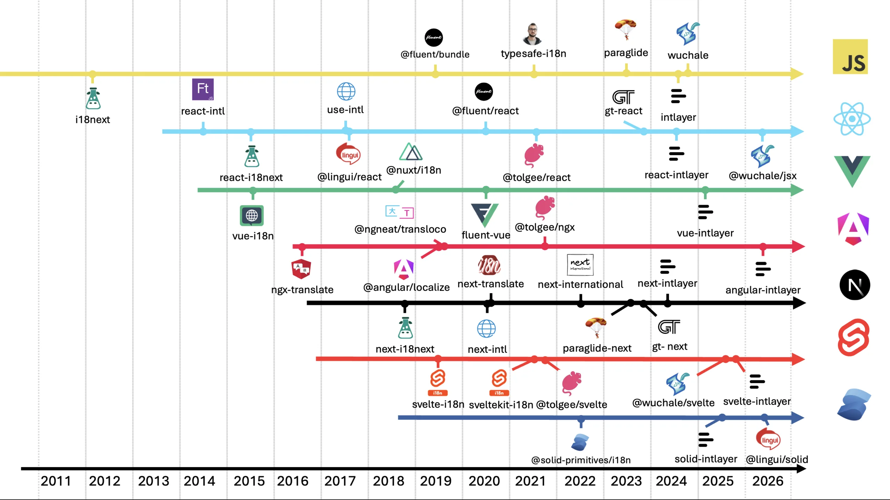
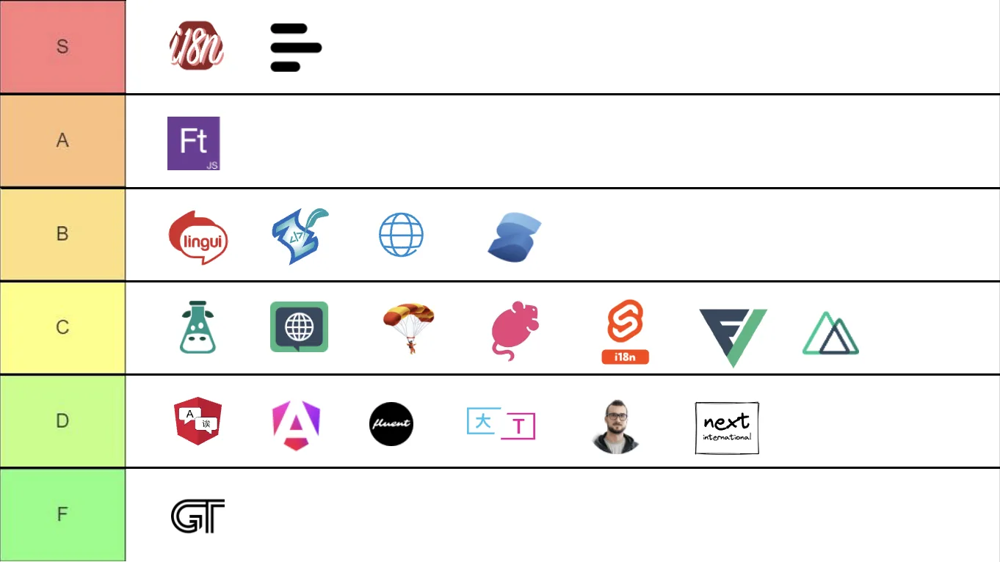

# כיצד לבחור את ספריית ה-i18n הנכונה ל-Vue

"Vue i18n" הוא גם מונח כללי וגם שמה של הספרייה שכמעט כולם מתקינים. זהו מצב נוח אך גם מטעה: `vue-i18n` היא ברירת מחדל טובה, אך היא אינה האפשרות היחידה, והשאלות שאמורות להניע את הבחירה (SSR או לא, כמה עמודים קיימים, מי כותב את התרגומים) נשאלות לעיתים נדירות לפני שמריצים `npm install`.

מדריך זה שואל את השאלות הללו תחילה, ולאחר מכן מתאים את התשובות לספריות המתאימות ביותר, עבור Vite + Vue ועבור Nuxt.

## תוכן העניינים

<TOC/>

## שש שאלות שיש לענות עליהן לפני שמשווים בין ספריות

1. **Vite SPA או Nuxt?** ב-SPA, עלות הקטלוג היא בעיה של גודל חבילת ה-JS. ב-Nuxt זו גם בעיה של משקל ה-HTML, מכיוון שההודעות עוברות סריאליזציה לתוך ה-state של ה-SSR ועוברות הידרציה. מסיבה זו, רוב הדיווחים בנוסח "vue-i18n איטית" מגיעים מאפליקציות Nuxt.
2. **מי כותב את התרגומים?** מפתחים, מערכת TMS, סוכנות המספקת מחרוזות בפורמט ICU, או צינור אוטומטי של AI. הספרייה `vue-i18n` משתמשת בתחביר ריבוי משלה המופרד בתווי pipe (`|`), ולא ב-ICU. עובדה זו קריטית אם המחרוזות מגיעות מגורם חיצוני.
3. **כמה שפות ועמודים יש באפליקציה?** שתי שפות וחמישה עמודים יכולים לטעון הכל מראש. עשר שפות וארבעים נתיבים לא יכולים, ואסטרטגיית הטעינה הופכת לעלות המרכזית.
4. **האם אתם זקוקים לטיפוסים על מפתחות (Types on keys)?** קריאה ל-`t("cart.totl")` תעבור קומפילציה ב-`vue-i18n` אלא אם תעבירו טיפוס גנרי של סכמת הודעות, וסכמה זו מתנגשת לעיתים קרובות עם קטלוגים בטעינה מושהית (lazy).
5. **מה מכיל התוכן?** תוויות ממשק בלבד, או מסמכי Markdown, קישורים בתוך משפטים ובלוקים מותאמים לכל שפה. תוכן עשיר הוא המקום שבו פונקציית `t()` המחזירה מחרוזת הופכת למסורבלת.
6. **האם CSP מהווה אילוץ?** גרסת הבנייה המוגדרת כברירת מחדל ב-`vue-i18n` מקמפלת הודעות בדפדפן באמצעות `new Function`. גרסאות זמן ריצה בלבד (Runtime-only) דורשות את `@intlify/unplugin-vue-i18n` לצורך קומפילציה מקדימה בזמן בנייה.

רשמו לעצמכם את התשובות. כל הניתוח שלהלן מתייחס אליהן ישירות.

## תמונת המצב הכוללת

באקוסיסטם של Vue יש פחות ספריות i18n מאשר ב-React, והן מגיעות מגלים ארכיטקטוניים שונים.



<AccordionGroup>
<Accordion header="מילוני זמן ריצה (2015 עד 2019): vue-i18n, @nuxt/i18n">

`vue-i18n` הופיעה ב-2015 ומשמשת כברירת המחדל מאז. החבילה `@nuxt/i18n` עוטפת אותה עם ניתוב שפות, תגיות SEO וטעינה מושהית לפי שפה. הודעות מקומפלות לפונקציות רינדור, בזמן בנייה אם מוסיפים את ה-unplugin, או ישירות בדפדפן בכל מקרה אחר.

</Accordion>
<Accordion header="פורמטים חלופיים (2020): fluent-vue">

קובצי `.ftl` של Mozilla Fluent הביאו עמם תחביר הודעות נוח יותר עם וריאציות תלויות-דקדוק. ללא טיפוסים על מפתחות, ותוסף ה-Vite טוען את כל השפות לתוך כל עמוד.

</Accordion>
<Accordion header="מהדרים ותוכן המוצב בצמוד לרכיבים (2024 עד 2026): Paraglide, Intlayer">

Paraglide מייצרת פונקציה אחת לכל הודעה ומאפשרת לכלי ה-bundling להסיר את השאר ב-tree-shaking. הספרייה Intlayer מצהירה על תוכן ברמת הרכיב בקובצי `.content.ts`, מייצרת טיפוסים, ושולחת אך ורק את מה שנתיב מסוים מרנדר.

</Accordion>
</AccordionGroup>

המאמר על [ההיסטוריה של בינאום ב-JavaScript](https://github.com/aymericzip/intlayer/blob/main/docs/blog/he-IL/history_of_i18n.md) סוקר כל גל בהרחבה.

- [ההיסטוריה של בינאום ב-JavaScript](https://github.com/aymericzip/intlayer/blob/main/docs/blog/he-IL/history_of_i18n.md)

## ההחלטה החשובה ביותר: היכן התוכן שמור ומתי הוא נטען

שתי בחירות מבניות מסבירות את מרבית ההבדלים בגודל ה-bundle בין ההגדרות השונות:

- **תוכן מרוכז או מתוחם (Scoped):** קובץ `locales/en.json` יחיד לכל האפליקציה, או הצהרה אחת לכל רכיב.
- **ייבוא סטטי או דינמי:** הכל נטען עם הפעלת האפליקציה, או שהשפה הפעילה (ובאופן אידיאלי גם הנתיב הפעיל) נמשכים לפי דרישה.

התרשים מעריך את גודל המידע של אפליקציה תיאורטית בעלת 1 עד 10 עמודים, המתורגמת ל-1 עד 10 שפות, עם כ-30 KB של טקסט לכל עמוד.


הספרייה `vue-i18n` תומכת בציר הדינמי: שימוש ב-`setLocaleMessage` לאחר קריאת `import()` מאפשר להפסיק לשלוח תשע שפות שאיש אינו קורא. מה שהיא אינה מספקת הוא את ציר העמודים. קטלוג שפה הוא אובייקט יחיד, וטעינתו טוענת את הטקסט של כל העמודים באפליקציה. באפליקציית SPA איש אינו מבחין בכך. ב-Nuxt, עם `@nuxtjs/i18n` ומעל לעשרה עמודים, כל נתיב נושא את המחרוזות של כל שאר הנתיבים פעמיים: בתוך מקטע ה-JS ובתוך ה-payload של ה-SSR.

מבחן הביצועים של [Vue benchmark](https://github.com/aymericzip/intlayer/blob/main/docs/docs/he-IL/benchmark/vue.md) מודד זאת כ"דליפה מנתיבים אחרים" ו"דליפה משפות אחרות". אם תשובתכם לשאלה 3 הייתה "עמודים רבים", סעיף זה גובר על כל העדפת API. המאמר על [i18n ברמת הרכיב לעומת מרוכז](https://github.com/aymericzip/intlayer/blob/main/docs/blog/he-IL/per-component_vs_centralized_i18n.md) עוסק בהשלכות התחזוקה של פשרה זו.

- [השוואת ביצועים ב-Vue (Vue benchmark)](https://github.com/aymericzip/intlayer/blob/main/docs/docs/he-IL/benchmark/vue.md)
- [i18n ברמת הרכיב לעומת מרוכז](https://github.com/aymericzip/intlayer/blob/main/docs/blog/he-IL/per-component_vs_centralized_i18n.md)

## הספריות המועמדות

גדלי הספריות מבוססים על תוצאות ה-[Vue benchmark](https://github.com/aymericzip/intlayer/blob/main/docs/docs/he-IL/benchmark/vue.md): תוסף יחד עם composable בתוך רכיב ריק, לאחר bundling, tree-shaking ו-minification, באפליקציה של 10 עמודים ו-10 שפות. התוכן נמדד בנפרד.

- [דוח Vue benchmark](https://github.com/aymericzip/intlayer/blob/main/docs/docs/he-IL/benchmark/vue.md)


| ספרייה         | מודל תוכן                                                  | בטיחות טיפוסים (Type safety)      | פורמט הודעות                        | פיצול לפי נתיב   | גודל ספרייה                          |
| :------------- | :--------------------------------------------------------- | :-------------------------------- | :---------------------------------- | :--------------- | :----------------------------------- |
| `vue-i18n`     | קטלוגים מרכזיים לפי שפה, בלוקים אופציונליים `<i18n>` ב-SFC | 2/5 - בהגדרה ידנית דרך טיפוס גנרי | פורמט עצמאי (ריבוי בתו pipe)        | לא               | ~24.3 kB                             |
| `@nuxtjs/i18n` | זהה ל-`vue-i18n`, בתוספת ניתוב ותגיות SEO                  | 2/5 - זהה                         | זהה                                 | לא, לפי שפה בלבד | ~24.3 kB                             |
| `fluent-vue`   | קובצי `.ftl` (Mozilla Fluent)                              | 1/5 - ללא                         | Fluent                              | לא               | ~29.7 kB                             |
| Paraglide      | פרויקט inlang, פונקציות נוצרות אוטומטית                    | 3.5/5 - נוצרת אוטומטית            | פורמט עצמאי                         | דרך tree-shaking | קרוב לאפס (בשל קוד שנוצר בתוך המאגר) |
| Intlayer       | קובץ `.content.ts` אחד לכל רכיב                            | 5/5 - נוצרת, פעילה כברירת מחדל    | Intlayer (+ ICU, i18next, vue-i18n) | כן, ברמת הרכיב   | ~3.9 kB                              |

> המספרים מייצגים תמונת מצב בגרסאות שנבדקו במבחן ההשוואה. הריצו את הבדיקה על האפליקציה שלכם לפני קבלת החלטה על סמך גודל בלבד.
> בטיחות טיפוסים: ציון 5/5 מעיד על כך שמפתחות, פרמטרים וכל שפה נבדקים ללא צורך בהגדרה ידנית, כולל מעצבי כתובות URL וכלי עזר.

גודל הספרייה האפסי כמעט של Paraglide נובע מעצם המבנה שלה: קוד זמן הריצה נוצר ישירות בתוך מאגר הקוד שלכם, מה שמחייב שלב יצירה מחדש לפני כל push וגורר קונפליקטים במיזוגים. Intlayer זקוקה לתוסף `vite-intlayer` (או למודול Nuxt), ולכן אינה יכולה לפעול ללא שלב בנייה.

## פעילות Commits

כמות ה-commits משקפת כמה מאמץ פיתוח מושקע בכל פרויקט. מונו-ריפו סופר כל חבילה שהוא משחרר, לכן יש לקרוא את המספר כאינדיקציה לפעילות שוטפת ולא בהכרח כמדד איכות.

<GithubCommits repositories="intlify/vue-i18n,nuxt-modules/i18n,fluent-vue/fluent-vue,opral/paraglide-js,aymericzip/intlayer" />

## הורדות ב-npm

<NpmDownloads packages="vue-i18n,@nuxtjs/i18n,fluent-vue,@inlang/paraglide-js,vue-intlayer" period="last-6-months" />

נתוני הורדות מתגמלים פתרונות ותיקים ולא בהכרח את הטובים ביותר. ספרייה ששוחררה לפני שנים עדיין מותקנת על ידי כל פרויקט שבחר בה בעבר, בכל הרצת CI ועל ידי כל חבילה שתלויה בה. הכמות משקפת אינרציה ולא בהכרח בחירה עדכנית.

עוזרי AI מעצימים את האפקט. ספריות כמו `next-intl`, `i18next` ו-`vue-i18n` נפוצות בכל הקוד שעליו אומנו המודלים, ולכן הם מציעים אותן כברירת מחדל מבלי להשוות חלופות. כל הצעה מובילה להורדות נוספות, שמזינות את ההמלצה הבאה. מומלץ להשוות על פי תוצאות ה-benchmark ולא על פי מדדי הורדות.

## התאימו את התשובות שלכם לספרייה

<AccordionGroup>
<Accordion header="Vite SPA, צוות קטן, מעט שפות">

`vue-i18n` במצב Composition (`legacy: false`), עם `@intlify/unplugin-vue-i18n` כך שתשלחו חבילת זמן ריצה בלבד (runtime-only). טענו שפות בהשהיה באמצעות `import()`. הגדרה זו מכסה את מרבית האפליקציות הקטנות והתשובות בקהילה זמינות בכל מקום. בלוקי `<i18n>` ברכיבי SFC מציבים את ההודעות בצמוד לרכיב, מה שמסייע מאוד, אך כלי החילוץ ומערכות ה-TMS סביבם דלים יותר מאשר סביב קטלוגי JSON, לכן החליטו מראש באיזה פורמט הצוות ישתמש.

</Accordion>
<Accordion header="Nuxt עם ניתוב שפות, מפת אתר (sitemap) ו-hreflang">

`@nuxtjs/i18n` מספקת את אסטרטגיית הניתוב, תגיות ה-`hreflang` וזיהוי השפה ללא צורך בכתיבת קוד מיוחד, וזה כשלעצמו מצדיק את הבחירה בה לאתרי תוכן עם עמודים בודדים. המגבלה שלה טמונה בקטלוג לפי שפה: מעבר לעשרה עמודים לערך, ה-payload של ה-SSR נושא את הטקסטים של כל הנתיבים. אם זה המצב אצלכם, חברו ידנית את `vue-i18n` עם הודעות לפי נתיב, או עברו לתוכן מתוחם. המדריך על [בינאום ב-Nuxt](https://github.com/aymericzip/intlayer/blob/main/docs/docs/he-IL/intlayer_with_nuxt.md) מלווה את בחירת אסטרטגיית הניתוב תחילה.

- [מדריך בינאום ב-Nuxt](https://github.com/aymericzip/intlayer/blob/main/docs/docs/he-IL/intlayer_with_nuxt.md)

</Accordion>
<Accordion header="התרגומים מגיעים מ-TMS או מסוכנות המספקת ICU">

תחביר הריבוי של `vue-i18n` (לדוגמה `"no item | one item | {count} items"`) אינו תואם ל-ICU ואינו נייד. יש לעדכן את המתרגמים על כך מראש, וייצוא ממערכת TMS לא ייצר תחביר זה מעצמו. הסכימו על הפורמט לפני יצירת הקטלוג הראשון, או בחרו בספרייה שהפורמט שלה תואם לספק התוכן שלכם. התמיכה של Intlayer ב-ICU היא חלקית, לכן אם אתם מקבלים מחרוזות ICU כיום, התייחסו לכך כאל חסם.

</Accordion>
<Accordion header="אפליקציה גדולה, נתיבים מרובים, תקציב קפדני ל-bundle או ל-SSR">

העדיפו תוכן מתוחם המקומפל בזמן הבנייה. Paraglide מגיעה לכך באמצעות tree-shaking, הפועל כמובטח ב-Vite. הספרייה Intlayer מגיעה לכך באמצעות הצהרות ברמת הרכיב ושולחת אך ורק את מה שהנתיב מרנדר. עם `vue-i18n` תוכלו לפצל הודעות לפי נתיב באופן ידני, אך שום דבר אינו כופה זאת, ורכיב משותף המייבא namespace גלובלי מבטל בשקט את הפיצול.

</Accordion>
<Accordion header="בטיחות טיפוסים (Type safety) היא דרישת חובה">

ניתן להגדיר טיפוסים ב-`vue-i18n` על ידי העברת טיפוס גנרי של סכמה לפונקציה `createI18n`. זה עובד, אך נשבר ברגע שקטלוגים נטענים בהשהיה, מכיוון שהסכמה מתארת הודעות שאולי טרם נטענו. אם אינכם רוצים לתחזק זאת, בחרו בספרייה שהטיפוסים שלה נוצרים ישירות מתוך התוכן: Paraglide או Intlayer. המאמר על [זיהוי תרגומים חסרים](https://github.com/aymericzip/intlayer/blob/main/docs/blog/he-IL/detecting_missing_translations.md) משווה מה כל כלי תופס בזמן הבנייה.

- [זיהוי תרגומים חסרים](https://github.com/aymericzip/intlayer/blob/main/docs/blog/he-IL/detecting_missing_translations.md)

</Accordion>
<Accordion header="התוכן מורכב יותר מסתם תוויות ממשק פשוטות">

עמודי Markdown, משפטים עם רכיב `<RouterLink>` באמצע, רכיבים ייעודיים לכל שפה. הספרייה `vue-i18n` כוללת את `<i18n-t>` לאינטרפולציית רכיבים, שעובד אך מסורבל למדי. צמתי התוכן של Intlayer מקבלים Markdown, HTML ואובייקטים מקוננים ישירות, מה שמתאים הרבה יותר לאפליקציות עתירות תוכן.

</Accordion>
<Accordion header="התרגומים ייווצרו באמצעות AI">

במקרה כזה, לקובץ JSON מרכזי אין עוד צורך ממשי שמצדיק אותו. תוכן המוצב בצמוד לרכיבים בליווי כלי CLI שמשלים שפות חסרות מספקים את הנתיב הקצר ביותר. פקודת ה-`fill` של Intlayer פועלת מול מפתח ה-API האישי שלכם (OpenAI, Anthropic, Mistral, Gemini) ומתרגמת מחדש רק את מה שהשתנה.

</Accordion>
</AccordionGroup>

## היכן כל ספרייה מתקשה

- **`vue-i18n`**: הכבדה ביותר בקבוצה, פורמט ריבוי עצמאי, טיפוסים מוגדרים ידנית ושבירים בעת טעינה מושהית, ללא תיחום לפי נתיב, ומפתחות מתים מצטברים בשקט. השארת `legacy: true` באפליקציית Vue 3 משאירה את שכבת התאימות של Vue 2 ומבטלת את הטיפוסיות של `useI18n()`.
- **`@nuxtjs/i18n`**: יורשת את כל המגבלות שלעיל, ובנוסף ה-payload של ה-SSR נושא את המחרוזות של כל עמוד ברגע שעוברים תריסר נתיבים.
- **`fluent-vue`**: תחביר הודעות אלגנטי, ללא טיפוסים על מפתחות, ותוסף ה-Vite טוען את כל התוכן בכל השפות לתוך כל עמוד. הכבדה ביותר במבחן הביצועים.
- **Paraglide**: קבצים הנוצרים ישירות בתוך המאגר, יצירה מחדש לפני כל push, והשפה נקראת מעוגייה או אחסון בכל קריאת הודעה במקום מתוך reactive store, מה שגורר פעולות מיותרות בהחלפת שפה.
- **Intlayer**: מחייבת תוסף בנייה, אקוסיסטם קטן יותר, תמיכת ICU חלקית, ותוכן המפוזר בבסיס הקוד מעצם התכנון, כך שייצוא JSON בודד למתרגם דורש שימוש בכלי עזר.

## כיצד כל אפשרות נראית בקוד

אותו רכיב בדיוק, סיכום עגלת קניות עם כותרת וצורת ריבוי, כתוב בכל אחת מהספריות. החלק המעניין אינו התבנית עצמה, אלא המקום שבו התוכן נשמר ומה ש-`vue-tsc` יודע עליו.

<Tabs defaultTab="vue-i18n">
  <Tab label="vue-i18n" value="vue-i18n">

  <Tabs group="locale">
  <Tab value="en" label="English">

```json fileName="src/locales/en.json"
{
  "cart": {
    "title": "Your cart",
    "items": "no item | one item | {count} items"
  }
}
```

  </Tab>
  <Tab value="fr" label="French">

```json fileName="src/locales/fr.json"
{
  "cart": {
    "title": "Votre panier",
    "items": "aucun article | un article | {count} articles"
  }
}
```

  </Tab>
  <Tab value="es" label="Spanish">

```json fileName="src/locales/es.json"
{
  "cart": {
    "title": "Tu carrito",
    "items": "ningún artículo | un artículo | {count} artículos"
  }
}
```

  </Tab>
  </Tabs>

```vue fileName="src/components/CartSummary.vue"
<script setup lang="ts">
import { useI18n } from "vue-i18n";

const props = defineProps<{ count: number }>();
const { t } = useI18n();
</script>

<template>
  <section>
    <h2>{{ t("cart.title") }}</h2>
    <p>{{ t("cart.items", { count: props.count }, props.count) }}</p>
  </section>
</template>
```

ריבוי מופרד ב-pipe הוא הפורמט העצמאי של vue-i18n ולא ICU. הפונקציה `t` מקבלת כל מחרוזת אלא אם תעבירו טיפוס גנרי של סכמת הודעות ל-`createI18n`.

  </Tab>
  <Tab label="fluent-vue" value="fluent-vue">

  <Tabs group="locale">
  <Tab value="en" label="English">

```ftl fileName="src/locales/en.ftl"
cart-title = Your cart
cart-items = { $count ->
    [one] { $count } item
   *[other] { $count } items
}
```

  </Tab>
  <Tab value="fr" label="French">

```ftl fileName="src/locales/fr.ftl"
cart-title = Votre panier
cart-items = { $count ->
    [one] { $count } article
   *[other] { $count } articles
}
```

  </Tab>
  <Tab value="es" label="Spanish">

```ftl fileName="src/locales/es.ftl"
cart-title = Tu carrito
cart-items = { $count ->
    [one] { $count } artículo
   *[other] { $count } artículos
}
```

  </Tab>
  </Tabs>

```vue fileName="src/components/CartSummary.vue"
<script setup lang="ts">
import { useFluent } from "fluent-vue";

const props = defineProps<{ count: number }>();
const { $t } = useFluent();
</script>

<template>
  <section>
    <h2>{{ $t("cart-title") }}</h2>
    <p>{{ $t("cart-items", { count: props.count }) }}</p>
  </section>
</template>
```

התחביר של Fluent מתמודד היטב עם צורות ריבוי ושינויים דקדוקיים. מזהי ההודעות הם מחרוזות ללא טיפוסים, ותוסף ה-Vite כולל את כל השפות בתוך כל עמוד.

  </Tab>
  <Tab label="Paraglide" value="paraglide">

  <Tabs group="locale">
  <Tab value="en" label="English">

```json fileName="messages/en.json"
{
  "cart_title": "Your cart",
  "cart_items": "{count} items"
}
```

  </Tab>
  <Tab value="fr" label="French">

```json fileName="messages/fr.json"
{
  "cart_title": "Votre panier",
  "cart_items": "{count} articles"
}
```

  </Tab>
  <Tab value="es" label="Spanish">

```json fileName="messages/es.json"
{
  "cart_title": "Tu carrito",
  "cart_items": "{count} artículos"
}
```

  </Tab>
  </Tabs>

```vue fileName="src/components/CartSummary.vue"
<script setup lang="ts">
import { m } from "../paraglide/messages.js";

const props = defineProps<{ count: number }>();
</script>

<template>
  <section>
    <h2>{{ m.cart_title() }}</h2>
    <p>{{ m.cart_items({ count: props.count }) }}</p>
  </section>
</template>
```

כל הודעה היא פונקציה מוגדרת טיפוסים שנוצרת אוטומטית, כך שמפתח חסר מהווה שגיאת ייבוא (import error). התיקייה `paraglide/` נוצרת בתוך המאגר שלכם ומיוצרת מחדש בכל שינוי.

  </Tab>
  <Tab label="Intlayer" value="intlayer">

```ts fileName="src/components/cartSummary.content.ts"
import { plural, t, type Dictionary } from "intlayer";

const cartSummaryContent = {
  key: "cart-summary",
  content: {
    title: t({
      en: "Your cart",
      fr: "Votre panier",
      es: "Tu carrito",
    }),
    items: t({
      en: plural({ one: "{{count}} item", other: "{{count}} items" }),
      fr: plural({ one: "{{count}} article", other: "{{count}} articles" }),
      es: plural({ one: "{{count}} artículo", other: "{{count}} artículos" }),
    }),
  },
} satisfies Dictionary;

export default cartSummaryContent;
```

```vue fileName="src/components/CartSummary.vue"
<script setup lang="ts">
import { useIntlayer } from "vue-intlayer";

const props = defineProps<{ count: number }>();
const { title, items } = useIntlayer("cart-summary");
</script>

<template>
  <section>
    <h2><title /></h2>
    <p>{{ items(props.count) }}</p>
  </section>
</template>
```

כל השפות נשמרות בקובץ יחיד בצמוד לרכיב. טיפוסים נוצרים בזמן בנייה, כך ש-`title` מושלם אוטומטית ושגיאת כתיב תכשיל את `vue-tsc`. התגית `<title />` מרנדרת צומת שהעורך הוויזואלי יכול להתמקד בו; התחביר `{{ items(props.count) }}` מחזיר את המחרוזת הפשוטה.

  </Tab>
</Tabs>

כבר משתמשים ב-`vue-i18n`? [מתאם התאימות של `@intlayer/vue-i18n`](https://github.com/aymericzip/intlayer/blob/main/docs/docs/he-IL/compat/vue-i18n.md) מספק כינוי (alias) לחבילה ברמת ה-bundler, כך ש-`useI18n()`, `$t`, ריבוי מבוסס pipe וההוראה `v-t` ממשיכים לפעול בזמן ש-Intlayer מגישה את התוכן. [מדריך ההגירה](https://github.com/aymericzip/intlayer/blob/main/docs/docs/he-IL/migration_from_vue-i18n_to_intlayer.md) מכסה את שלבי המעבר מהמתאם לאחר מכן, וקיים גם [מדריך ייעודי ל-Nuxt](https://github.com/aymericzip/intlayer/blob/main/docs/docs/he-IL/migration_from_nuxtjs_i18n_to_intlayer.md).

- [מתאם תאימות עבור `@intlayer/vue-i18n`](https://github.com/aymericzip/intlayer/blob/main/docs/docs/he-IL/compat/vue-i18n.md)
- [מדריך הגירה מ-vue-i18n ל-Intlayer](https://github.com/aymericzip/intlayer/blob/main/docs/docs/he-IL/migration_from_vue-i18n_to_intlayer.md)
- [מדריך הגירה מ-@nuxtjs/i18n ל-Intlayer](https://github.com/aymericzip/intlayer/blob/main/docs/docs/he-IL/migration_from_nuxtjs_i18n_to_intlayer.md)

## נקודות למחשבה לפני שמתחייבים

טבלת תכונות מציגה מה הספרייה יודעת לעשות כיום. הנקודות הבאות ממחישות כיצד תיראה שגרת החיים איתה.

**בדקו את פעילות המאגר (Repository Activity).**

כמות commits, זמן מענה ל-issues, והאם גרסת ה-minor האחרונה שוחררה השנה. תכנון מעולה ללא מתחזק פעיל הוא הגירה שמחכה לקרות.

**אל תבחרו לפי כמות ההורדות ב-npm.**

הספרייה המותקנת ביותר היא זו ששוחררה ראשונה, לא זו שהכי מתאימה לבסיס קוד של Vue ב-2026. הורדות מודדות היסטוריה, לא התאמה.



**שאלו מי מממן את המתחזק, ומה הוא מוכר.**

הספרייה `vue-i18n` נתמכת על ידי Crowdin, בדומה ל-`next-intl` ו-`svelte-i18n`. הספרייה `i18next` נתמכת על ידי Locize. הספריות Tolgee, Paraglide (inlang) ו-Intlayer מפעילות כל אחת פלטפורמה משלה. לספק שרווחיו מבוססים על אחסון תרגומים בענן יש אינטרס נמוך מאוד לספק תרגום חינמי ישירות בתוך כלי הפיתוח שלכם. Intlayer היא היחידה בקבוצה שמספקת תרגום AI דרך ה-CLI עם מפתח API אישי שלכם, ומערכת CMS שניתן לארח עצמאית.

**האם הספרייה מוכנה לסוכני AI (AI Agents)?**

סוכנים מתקשים לעיתים קרובות עם i18n: הם שוכחים שפות, ממציאים מפתחות ומערבבים תחבירי הודעות. האם הספרייה מספקת [Agent Skills](https://github.com/aymericzip/intlayer/blob/main/docs/docs/he-IL/agent_skills.md) או [שרת MCP](https://github.com/aymericzip/intlayer/blob/main/docs/docs/he-IL/mcp_server.md) כך שהסוכן יוכל לרשום, למלא ולבדוק תוכן? והאם טעינת התוכן ממוטבת כברירת מחדל, או שמישהו יצטרך לבדוק namespaces וטעינות מושהות מדי רבעון?

- [כישורי סוכן (Agent Skills)](https://github.com/aymericzip/intlayer/blob/main/docs/docs/he-IL/agent_skills.md)
- [שרת MCP](https://github.com/aymericzip/intlayer/blob/main/docs/docs/he-IL/mcp_server.md)

**בטיחות טיפוסים (Type safety) מהקופסה.**

לא "יכולה לתמוך בטיפוסים עם הגדרות נוספות", אלא "מפתח שגוי מכשיל את `tsc` בהתקנה חדשה". בדקו מה קורה עם מפתח שאינו קיים, ועם שפה שחסר בה תרגום אחד.

**זיהוי תוכן שאינו בשימוש.**

קטלוגים נוטים רק לגדול. תהליך הבנייה של Intlayer מנקה שדות שאינם בשימוש ומתעד אותם (`build.purge`). הספרייה Paraglide משיגה זאת באופן מבני, מכיוון שפונקציית הודעה שאינה נקראת מוסרת ב-tree-shaking. כל שאר הספריות משאירות את הניקוי לאחריותכם.

**חוויית פיתוח (DX).**

זמן הגדרה עד למחרוזת המתורגמת הראשונה, תמיכת [LSP](https://github.com/aymericzip/intlayer/blob/main/docs/docs/he-IL/lsp.md) או [תוסף VS Code](https://github.com/aymericzip/intlayer/blob/main/docs/docs/he-IL/vs_code_extension.md) המציג את התרגום בריחוף (hover) ומקפיץ להצהרה, [CLI](https://github.com/aymericzip/intlayer/blob/main/docs/docs/he-IL/cli/index.md) למילוי, בדיקה ודחיפת תוכן, [מהדר](https://github.com/aymericzip/intlayer/blob/main/docs/docs/he-IL/compiler.md) או מחלץ המוציא מחרוזות מקודדות מתוך הרכיבים כדי שלא תנהלו כל מחרוזת מפתח-אחר-מפתח, ואפשרות לאנשי תוכן שאינם מפתחים לערוך תוכן ([עורך ויזואלי](https://github.com/aymericzip/intlayer/blob/main/docs/docs/he-IL/intlayer_visual_editor.md) או [CMS](https://github.com/aymericzip/intlayer/blob/main/docs/docs/he-IL/intlayer_CMS.md)) ללא צורך ב-pull request.

- [שרת שפה (LSP)](https://github.com/aymericzip/intlayer/blob/main/docs/docs/he-IL/lsp.md)
- [תוסף VS Code](https://github.com/aymericzip/intlayer/blob/main/docs/docs/he-IL/vs_code_extension.md)
- [ממשק CLI](https://github.com/aymericzip/intlayer/blob/main/docs/docs/he-IL/cli/index.md)
- [מהדר (Compiler)](https://github.com/aymericzip/intlayer/blob/main/docs/docs/he-IL/compiler.md)
- [עורך ויזואלי](https://github.com/aymericzip/intlayer/blob/main/docs/docs/he-IL/intlayer_visual_editor.md)
- [מערכת CMS](https://github.com/aymericzip/intlayer/blob/main/docs/docs/he-IL/intlayer_CMS.md)

## שאלות נפוצות

<FAQ>

<Question title="האם vue-i18n היא עדיין ברירת המחדל הנכונה ב-2026?">

עבור רוב אפליקציות ה-Vue, כן. האקוסיסטם שלה הוא הגדול ביותר, התיעוד מקיף מאוד, והעלויות שלה צפויות: סביבת זמן ריצה כבדה, פורמט ריבוי ייחודי, ותיחום לפי נתיבים שעליכם לבנות ולהגן עליו בעצמכם.

</Question>

<Question title="האם כדאי להשתמש ב-@nuxtjs/i18n או לחבר את vue-i18n ידנית ב-Nuxt?">

השתמשו במודול הרשמי אלא אם הניתוב שלכם חריג במיוחד או שהאפליקציה כוללת עמודים בודדים בלבד. חיבור ידני מחייב בנייה עצמאית של נתיבי שפה, middleware, תגיות `hreflang` ומפת אתר (sitemap), וכל אלה מורכבים מכפי שהם נראים בתחילה.

</Question>

<Question title="האם אני זקוק לספרייה מבוססת מהדר?">

רק אם גודל ה-bundle, משקל ה-SSR payload, טיפוסים הנוצרים אוטומטית או בדיקות מפתחות חסרים בזמן בנייה הם דרישות ממשיות. המאמר על [i18n מבוסס מהדר לעומת דקלרטיבי](https://github.com/aymericzip/intlayer/blob/main/docs/blog/he-IL/compiler_vs_declarative_i18n.md) מסביר מה מהדרים מעניקים והיכן הם עלולים לטעות.

- [i18n מבוסס מהדר לעומת דקלרטיבי](https://github.com/aymericzip/intlayer/blob/main/docs/blog/he-IL/compiler_vs_declarative_i18n.md)

</Question>

<Question title="האם בחירת הספרייה משפיעה על SEO?">

באופן עקיף. מה שזחלנים רואים תלוי בניתוב, ב-`hreflang`, בתגית `<html lang>` ובשאלה האם הטקסט נכלל ב-HTML שמרונדר בשרת. עיינו ב-[מדריך hreflang](https://github.com/aymericzip/intlayer/blob/main/docs/blog/he-IL/hreflang_guide_multilingual_seo.md).

- [מדריך hreflang](https://github.com/aymericzip/intlayer/blob/main/docs/blog/he-IL/hreflang_guide_multilingual_seo.md)

</Question>

</FAQ>

## קריאה נוספת

- [השוואת ביצועים ב-Vue: גודל bundle, דליפות וזמני החלפת שפה](https://github.com/aymericzip/intlayer/blob/main/docs/docs/he-IL/benchmark/vue.md)
- [vue-i18n לעומת Intlayer, תכונה אחר תכונה](https://github.com/aymericzip/intlayer/blob/main/docs/blog/he-IL/vue-i18n_vs_intlayer.md)
- [השוואת ביצועים: vue-i18n לעומת Intlayer](https://github.com/aymericzip/intlayer/blob/main/docs/blog/he-IL/vue-i18n_vs_intlayer.md)
- [האם vue-i18n מיושנת?](https://github.com/aymericzip/intlayer/blob/main/docs/blog/he-IL/is_vue-i18n_outdated.md)
- [ההיסטוריה של בינאום ב-JavaScript](https://github.com/aymericzip/intlayer/blob/main/docs/blog/he-IL/history_of_i18n.md)
- [i18n מבוסס מהדר לעומת דקלרטיבי](https://github.com/aymericzip/intlayer/blob/main/docs/blog/he-IL/compiler_vs_declarative_i18n.md)
- [i18n ברמת הרכיב לעומת מרוכז](https://github.com/aymericzip/intlayer/blob/main/docs/blog/he-IL/per-component_vs_centralized_i18n.md)
- [הגדרת i18n באפליקציית Vite + Vue](https://github.com/aymericzip/intlayer/blob/main/docs/docs/he-IL/intlayer_with_vite+vue.md)
- [אפליקציית Nuxt](https://github.com/aymericzip/intlayer/blob/main/docs/docs/he-IL/intlayer_with_nuxt.md)

מדריכים מקבילים עבור

- [React](https://github.com/aymericzip/intlayer/blob/main/docs/blog/he-IL/how_to_pick_react_i18n_library.md)
- [Svelte](https://github.com/aymericzip/intlayer/blob/main/docs/blog/he-IL/how_to_pick_svelte_i18n_library.md)
- [Solid](https://github.com/aymericzip/intlayer/blob/main/docs/blog/he-IL/how_to_pick_solid_i18n_library.md)
