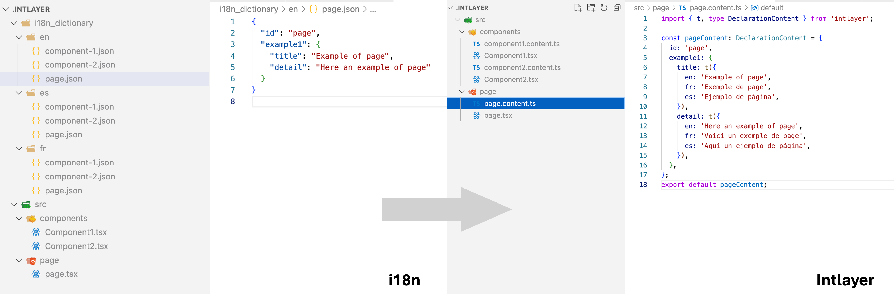

# i18next מול Intlayer: מבחן ביצועים (Benchmark) לבינאום ב-React וב-Next.js


`i18next` היא מסגרת הבינאום הנפוצה ביותר באקוסיסטם של JavaScript. דרך `react-i18next` ו-`next-i18next`, היא מניעה נתח נכבד מאפליקציות React ו-Next.js. Intlayer היא חלופה מודרנית מבוססת קומפיילר עם תחימת תוכן ברמת הקומפוננטה (component-scoped).

מאמר זה משווה ביניהן על בסיס מדידות אמפיריות ולא על בסיס רשימות תכונות שיווקיות. הנתונים מגיעים מ-[Benchmark Bloom](https://github.com/intlayer-org/benchmark-bloom), מערך בדיקות בקוד פתוח הבונה את אותה האפליקציה בדיוק עם כל ספרייה ומודד מה הדפדפן מוריד בפועל.

<TOC/>

> **תקציר (tl;dr)**: `i18next` היא ספריית זמן הריצה הכבדה ביותר במבחן הביצועים: **תוספת של 77 KB gzip לכל עמוד** ב-Next.js בתצורה בסיסית, ו-**תוספת של 22 KB** גם לאחר אופטימיזציה מלאה של namespaces וטעינה עצלה. Intlayer מוסיפה **0.3 KB בלבד**. כל תצורת `i18next` (למעט זו שתוחמת באופן ידני קפדני) שולחת **~90% ממחרוזות העמודים הזרים**; Intlayer שולחת **0%** כברירת מחדל. החלפת שפה עם backend הנטען בעצלות ארכה **123-185 ms** ב-`react-i18next` לעומת **3-4 ms** ב-Intlayer. מתאם התאימות של `@intlayer/next-i18next` משמר את אותו ה-API של `i18next` והגיע ל-**150.7 KB** לעמוד לעומת **218.5 KB** במקור.

## בקצרה

- **i18next / react-i18next / next-i18next** - בוגרת, עשירה בתוספים, בלתי תלויה בפריימוורק. כוללת namespaces, גלאי שפה, backends, תמיכת ICU באמצעות תוסף ותגית `<Trans>` לתוכן עשיר. התוכן מרוכז בקובצי `locales/{lng}/{ns}.json`. עוצמתית, אך כל אופטימיזציה (פיצול namespaces, טעינה לפי דף, בטיחות טיפוסים) דורשת קונפיגורציה ותחזוקה ידנית מתמדת מצדכם.
- **Intlayer** - מודל תוכן המתמקד בקומפוננטה. מילוני `.content.ts` יושבים לצד הקומפוננטה שהם משרתים, קומפיילר בזמן build מבצע tree-shaking וטוען אותם בעצלות לפי קומפוננטה ולפי שפה, טיפוסי TypeScript קפדניים נוצרים אוטומטית מתוך התוכן, ותרגומים חסרים מכשילים את הבנייה בזמן הידור. כוללת middleware מובנה, עזרי SEO, עורך ויזואלי / CMS מובנה ותרגום בסיוע בינה מלאכותית (AI).

| ספרייה                  | כוכבי GitHub                                                                                                                                                                       | סך הכל Commits                                                                                                                                                                         | Commit אחרון                                                                                                                                            | גרסה ראשונה | גרסת NPM                                                                                                              | הורדות NPM                                                                                                                       |
| ----------------------- | ---------------------------------------------------------------------------------------------------------------------------------------------------------------------------------- | -------------------------------------------------------------------------------------------------------------------------------------------------------------------------------------- | ------------------------------------------------------------------------------------------------------------------------------------------------------- | ----------- | --------------------------------------------------------------------------------------------------------------------- | -------------------------------------------------------------------------------------------------------------------------------- |
| `aymericzip/intlayer`   | [](https://github.com/aymericzip/intlayer/stargazers)     | [](https://github.com/aymericzip/intlayer/commits)     | [](https://github.com/aymericzip/intlayer/commits)     | אפריל 2024  | [](https://www.npmjs.com/package/intlayer)           | [](https://www.npmjs.com/package/intlayer)           |
| `i18next/i18next`       | [](https://github.com/i18next/i18next/stargazers)             | [](https://github.com/i18next/i18next/commits)             | [](https://github.com/i18next/i18next/commits)             | ינואר 2012  | [](https://www.npmjs.com/package/i18next)             | [](https://www.npmjs.com/package/i18next)             |
| `i18next/react-i18next` | [](https://github.com/i18next/react-i18next/stargazers) | [](https://github.com/i18next/react-i18next/commits) | [](https://github.com/i18next/react-i18next/commits) | דצמבר 2015  | [](https://www.npmjs.com/package/react-i18next) | [](https://www.npmjs.com/package/react-i18next) |
| `i18next/next-i18next`  | [](https://github.com/i18next/next-i18next/stargazers)   | [](https://github.com/i18next/next-i18next/commits)   | [](https://github.com/i18next/next-i18next/commits)   | נובמבר 2018 | [](https://www.npmjs.com/package/next-i18next)   | [](https://www.npmjs.com/package/next-i18next)   |

> התגים מתעדכנים באופן אוטומטי.

## השוואת תכונות ראש בראש

| תכונה                                       | Intlayer (`react-intlayer` / `next-intlayer`)                       | i18next (`react-i18next` / `next-i18next`)                                    |
| ------------------------------------------- | ------------------------------------------------------------------- | ----------------------------------------------------------------------------- |
| **תרגומים לצד קומפוננטות**                  | ✅ כן, `.content.ts` ממוקם לצד כל קומפוננטה                         | ❌ לא, קובצי `locales/{lng}/{ns}.json` מרוכזים                                |
| **אינטגרציה עם TypeScript**                 | ✅ טיפוסים קפדניים שנוצרים אוטומטית מהתוכן                          | ⚠️ בסיסית; מפתחות קפדניים דורשים הרחבת `CustomTypeOptions`                    |
| **זיהוי תרגומים חסרים**                     | ✅ שגיאת TypeScript + שגיאה או אזהרה בזמן build                     | ⚠️ Fallback בזמן ריצה (`saveMissing`, חזרת מפתח)                              |
| **תוכן עשיר (JSX / Markdown / קומפוננטות)** | ✅ תמיכה ישירה                                                      | ⚠️ `<Trans>` עם מצייני מיקום ממוספרים                                         |
| **תמיכת ICU**                               | ⚠️ בתהליך פיתוח                                                     | ⚠️ באמצעות תוסף (`i18next-icu`)                                               |
| **צורות ריבוי (Pluralization)**             | ✅ תבניות מבוססות Enumeration                                       | ✅ סיומות `_one` / `_other` (Intl.PluralRules)                                |
| **עיצוב (תאריכים, מספרים, מטבעות)**         | ✅ `useNumber`, `useDate`, ... (מבוסס `Intl`)                       | ⚠️ מעצבי אינטרפולציה או שימוש ידני ב-`Intl.*`                                 |
| **ניתוב מתורגם ו-Middleware**               | ✅ Proxy/Middleware מובנים, `getMultilingualUrls`                   | ⚠️ לא בליבה; נדרש middleware ידני או צד שלישי                                 |
| **עזרי SEO (hreflang, sitemap, robots)**    | ✅ עזרים מובנים                                                     | ❌ ידני                                                                       |
| **קומפוננטות שרת סינכרוניות**               | ✅ `useIntlayer` מתוך `next-intlayer/server` פועל בכל קומפוננטת שרת | ⚠️ `getFixedT` בעמוד, ואז העברת `t` כ-props במורד העץ                         |
| **Tree-shaking (משלוח תוכן בשימוש בלבד)**   | ✅ לכל קומפוננטה, לכל שפה, אוטומטי על ידי הקומפיילר                 | ⚠️ ידני: namespaces + רשימת `ns` לכל עמוד + backend                           |
| **טעינה עצלה (Lazy loading)**               | ✅ `importMode: 'dynamic'` (שורת הגדרה בודדת)                       | ✅ דרך תוספי backend (`i18next-resources-to-backend`, `i18next-http-backend`) |
| **ניקוי תוכן ללא שימוש (Purge)**            | ✅ מילונים שאינם בשימוש מושמטים בזמן build                          | ❌ אינו מובנה                                                                 |
| **בדיקת תרגומים חסרים ב-CLI וב-CI**         | ✅ `npx intlayer content test`                                      | ⚠️ `i18next-parser` / כלי צד שלישי                                            |
| **תרגום באמצעות בינה מלאכותית (AI)**        | ✅ מובנה, תוך שימוש במפתחות ה-API שלכם                              | ❌ לא (Locize הוא שירות חיצוני בתשלום)                                        |
| **עורך ויזואלי / CMS**                      | ✅ עורך ויזואלי חינמי + CMS אופציונלי                               | ❌ לא (Locize / פלטפורמות חיצוניות)                                           |
| **שרת MCP ו-Agent Skills**                  | ✅ כן                                                               | ❌ לא                                                                         |
| **אקוסיסטם / קהילה**                        | ⚠️ קטנה יותר אך צומחת במהירות                                       | ✅ הגדולה והבוגרת ביותר                                                       |

## ה-Benchmark

### מה נמדד

מערך הבדיקות [Benchmark Bloom](https://github.com/intlayer-org/benchmark-bloom) בונה **את אותה האפליקציה בדיוק** עם כל ספרייה: **10 עמודים** (בית, אודות, בלוג, קריירה, צור קשר, שאלות נפוצות, מחירים, מוצרים, הגדרות, צוות), **10 שפות** (`en`, `fr`, `es`, `de`, `it`, `pt`, `zh`, `ja`, `ko`, `ru`), קומפוננטות זהות ותוכן זהה. העמודים נמדדים ב-`en` וב-`fr`. כל ספרייה מומשה בעד ארבע **אסטרטגיות טעינה**:

| אסטרטגיה           | תיאור                                                                               | מי משתמש בזה                          |
| ------------------ | ----------------------------------------------------------------------------------- | ------------------------------------- |
| **static**         | כל השפות וכל העמודים נארזים יחד (`resources` מוטמע ב-`init()`)                      | פרוטוטייפים מהירים, קוד מבוסס AI      |
| **dynamic**        | רק השפה הפעילה נטענת דרך backend, אך כל ה-namespaces נטענים יחד                     | רוב הפרויקטים בעולם האמיתי            |
| **scoped-static**  | namespace אחד לכל נתיב, אך כולם נארזים מראש מראש                                    | נדיר                                  |
| **scoped-dynamic** | namespace אחד לכל נתיב + טעינה עצלה ב-backend. רק העמוד הנוכחי והשפה הנוכחית נטענים | אפליקציות עם תקציב ביצועים קפדני מאוד |

ל-Intlayer אין גרסת "scoped" נפרדת: הקומפיילר תוחם את התוכן **לכל קומפוננטה** באופן אוטומטי, כך ששורות ה-`static` וה-`dynamic` שלה כבר כוללות את התחימה הזו.

עבור כל build נמדדו המדדים הבאים:

- **גודל ספרייה (Lib size)**: גודל ב-gzip של קומפוננטה ריקה המייבאת רק את ספריית ה-i18n.
- **JS לעמוד (Page JS)**: ממוצע ה-JavaScript ב-gzip המורד בכל עמוד, בממוצע על פני כל העמודים והשפות.
- **זליגת שפות % (Locale leak %)**: אחוז המחרוזות המתורגמות ב-JS השייכות לשפות שהמשתמש אינו צופה בהן כעת.
- **זליגת עמודים % (Page leak %)**: אחוז המחרוזות המתורגמות ב-JS השייכות לעמודים שהמשתמש אינו נמצא בהם כעת.
- **ממוצע קומפוננטה (Component avg)**: ממוצע הגודל ב-gzip של כל קומפוננטה שקומפלה בנפרד.
- **זמן תגובה E2E (E2E reactivity)**: הזמן שלוקח מהחלפת שפה ועד עדכון תגית ה-DOM.
- **משך Hydration**: זמן שלב ה-hydration של React.

> הנתונים להלן נמדדו בהרצה מיום **2026-09-12** עם `next-i18next` 16.3.0, `react-i18next` 17.0.13 ו-`intlayer` 9.5.1.

### תוצאות ב-Next.js (`next-i18next`)

בחרו את המדדים והספריות שמעניינים אתכם:

<I18nBenchmark framework="nextjs" packages="next-i18next,next-intlayer" vertical/>

| ספרייה                            | אסטרטגיה       | גודל ספרייה (gz) | ממוצע JS לדף (gz) | זליגת שפות | זליגת עמודים | ממוצע קומפוננטה (gz) | תגובת E2E | Hydration |
| --------------------------------- | -------------- | ---------------: | ----------------: | ---------: | -----------: | -------------------: | --------: | --------: |
| **בסיס** (ללא i18n)               | -              |           0.0 KB |          141.0 KB |       0.0% |         0.0% |               0.9 KB |   13.4 ms |   11.8 ms |
| `next-i18next`                    | static         |          19.7 KB |          218.5 KB |       0.0% |        89.8% |              78.5 KB |   16.4 ms |   15.6 ms |
| `next-i18next`                    | dynamic        |          19.7 KB |          169.5 KB |      50.0% |        89.8% |              26.1 KB |   15.4 ms |   27.7 ms |
| `next-i18next`                    | scoped-static  |          19.7 KB |          220.1 KB |       0.0% |        89.8% |              78.9 KB |   16.4 ms |   14.7 ms |
| `next-i18next`                    | scoped-dynamic |          19.7 KB |          163.4 KB |       0.0% |         0.0% |              27.1 KB |   15.9 ms |   15.1 ms |
| **`next-intlayer`**               | static         |       **5.5 KB** |      **141.3 KB** |   **0.0%** |     **0.0%** |           **8.5 KB** |   15.5 ms |   16.9 ms |
| **`next-intlayer`**               | dynamic        |       **5.5 KB** |      **141.3 KB** |   **0.0%** |     **0.0%** |           **6.9 KB** |   15.3 ms |   15.9 ms |
| `@intlayer/next-i18next` (compat) | static         |           9.4 KB |          150.7 KB |       0.0% |         0.0% |               9.7 KB |   10.7 ms |   11.3 ms |
| `@intlayer/next-i18next` (compat) | dynamic        |           9.4 KB |          150.7 KB |       0.0% |         0.0% |               9.7 KB |   11.9 ms |   10.6 ms |

**כיצד לנתח את הנתונים**

- **עלות זמן הריצה.** ליבת `i18next` בתוספת `react-i18next` היא ספריית זמן הריצה הגדולה ביותר שנמדדה: **19.7 KB gzip** עבור קומפוננטה ריקה, לעומת 5.5 KB בלבד ב-`next-intlayer`.
- **ההגדרה הפשוטה יקרה מאוד.** הטמעת `resources` ב-`init()` מייצרת **218.5 KB לכל עמוד** (+77.5 KB מעל אפליקציית הבסיס).
- **תהליך האופטימיזציה מורכב.** מעבר ל-backend חוסך 49 KB אך עדיין מדליף **90% ממחרוזות העמודים הזרים**, ובקונפיגורציה זו מחצית מהמחרוזות שייכות לשפה הלא נכונה. פיצול מלא ל-namespaces לכל נתיב מגיע ל-**163.4 KB**, עדיין **+22.4 KB לכל עמוד** מעל 141.3 KB של Intlayer שלא דרשה שום עבודת קונפיגורציה ידנית.
- **גודל קומפוננטות.** קומפוננטה שקוראת ל-`useTranslation()` שוקלת 26-79 KB בהתאם לתצורה; אותה קומפוננטה עם `useIntlayer()` שוקלת 6.9 KB בלבד.
- **זמן ה-Hydration** קופץ ל-27.7 ms בתצורת `dynamic` כיוון שמופע ה-i18next חייב לאתחל ולפתור את ה-backend שלו בצד הלקוח לפני ש-React מסיימת לבצע hydration.

<ClickToOpenIframe
src="https://intlayer.org/markdown?url=https%3A%2F%2Fraw.githubusercontent.com%2Fintlayer-org%2Fbenchmark-i18n%2Fmain%2Freport%2Fscripts%2Fsummarize-nextjs.md"
width="100%"
height="600px"
style="border:none;"
/>

> הטבלה המלאה מופיעה ב[דוח ביצועי Next.js](https://github.com/aymericzip/intlayer/blob/main/docs/docs/he-IL/benchmark/nextjs.md).

- [דוח ביצועי Next.js](https://github.com/aymericzip/intlayer/blob/main/docs/docs/he-IL/benchmark/nextjs.md)

### תוצאות ב-TanStack Start (`react-i18next`)

אותה אפליקציית בדיקה ב-TanStack Start עם `react-i18next` טהורה:

| ספרייה              | אסטרטגיה       | גודל ספרייה (gz) | ממוצע JS לדף (gz) | זליגת שפות | זליגת עמודים | ממוצע קומפוננטה (gz) |  תגובת E2E | Hydration |
| ------------------- | -------------- | ---------------: | ----------------: | ---------: | -----------: | -------------------: | ---------: | --------: |
| **בסיס** (ללא i18n) | -              |           0.0 KB |          111.0 KB |       0.0% |         0.0% |               0.7 KB |     8.1 ms |   21.6 ms |
| `react-i18next`     | static         |          18.4 KB |          180.3 KB |      50.0% |        89.8% |              24.3 KB |    12.9 ms |   85.1 ms |
| `react-i18next`     | dynamic        |          18.4 KB |          136.4 KB |      23.1% |        89.8% |              24.8 KB |   123.1 ms |   32.9 ms |
| `react-i18next`     | scoped-static  |          18.4 KB |          184.2 KB |      50.7% |        89.8% |              25.3 KB |   185.1 ms |   25.2 ms |
| `react-i18next`     | scoped-dynamic |          18.4 KB |          127.2 KB |       0.0% |         0.0% |              26.7 KB |    17.6 ms |   11.3 ms |
| **`intlayer`**      | static         |       **5.0 KB** |      **125.8 KB** |      50.0% |     **0.0%** |           **8.1 KB** | **3.2 ms** |   11.5 ms |
| **`intlayer`**      | dynamic        |       **5.0 KB** |      **118.6 KB** |   **0.0%** |     **0.0%** |           **6.3 KB** | **3.6 ms** |   14.1 ms |

**כיצד לנתח את הנתונים**

- אפליקציית `react-i18next` בסיסית שולחת **+69 KB לכל עמוד** מעל אפליקציית הבסיס, וזמן ה-hydration אורך **85 ms** (פי 4 מהבסיס) כיוון שעץ המשאבים כולו מפוענח ונרשם בלקוח לפני הרינדור הראשון.
- **החלפת שפה היא הנקודה שבה טעינה עצלה פוגעת בחוויית המשתמש.** כאשר משאבים נטענים לפי דרישה דרך backend, שינוי שפה מייצר קריאת רשת שמעכבת את עדכון ה-DOM: **123 ms** בתצורת `dynamic`, ו-**185 ms** ב-`scoped-static`. Intlayer מעדכנת את ה-DOM ב-**3-4 ms** בלבד בשני המצבים.
- תצורת `scoped-dynamic` הממוטבת ביותר של `react-i18next` מגיעה ל-127.2 KB, עדיין **+8.6 KB** מעל שורת ה-`dynamic` של Intlayer, ודרשה מיפוי נתיבים ל-namespaces, backend מותאם וגבולות Suspense בכל עמוד.
- שורת ה-`static` של Intlayer מגיעה כבר ל-**0% זליגת עמודים** כיוון שרק המילונים המיובאים על ידי קומפוננטות העמוד נארזים ב-bundle. הפעלת `importMode: 'dynamic'` מבטלת גם את זליגת השפות.
- **גודל קומפוננטה**: 24-27 KB לכל קומפוננטה ב-`react-i18next` לעומת 6-8 KB ב-Intlayer.

<ClickToOpenIframe
src="https://intlayer.org/markdown?url=https%3A%2F%2Fraw.githubusercontent.com%2Fintlayer-org%2Fbenchmark-i18n%2Fmain%2Freport%2Fscripts%2Fsummarize-tanstack.md"
width="100%"
height="600px"
style="border:none;"
/>

> הטבלה המלאה ב[דוח ביצועי TanStack Start](https://github.com/aymericzip/intlayer/blob/main/docs/docs/he-IL/benchmark/tanstack.md).

- [דוח ביצועי TanStack Start](https://github.com/aymericzip/intlayer/blob/main/docs/docs/he-IL/benchmark/tanstack.md)

## מה גורם לפער? מופע גלובלי לעומת מילונים מקומפלים



`i18next` תוכננה בשנת 2012 כספריית זמן ריצה: מופע גלובלי מחזיק את מאגר המשאבים, תוספים מרחיבים אותו, והקריאה `t()` מחפשת מפתחות בזמן רינדור. זה מה שהופך אותה לכל כך גמישה (בכל פריימוורק ובכל פורמט), וזה גם מה שהופך אותה לכבדה:

```bash
.
├── i18n.ts                      # createInstance().use(...).use(...).init({...})
└── src
    ├── locales
    │   ├── en
    │   │   ├── common.json
    │   │   ├── home.json
    │   │   └── about.json
    │   └── fr
    │       ├── common.json
    │       ├── home.json
    │       └── about.json
    ├── components
    │   └── Counter.tsx          # useTranslation("about") + t("counter.label")
    └── app
        └── [locale]
            └── about
                └── page.tsx     # חייב לדעת שהוא צריך את ["common", "about"]
```

המופע אינו יכול לדעת באילו מפתחות תשתמש קומפוננטה מסוימת, ולכן הוא שומר את כל ה-namespaces שהוגדרו עבורו. ביצוע אופטימיזציה אומר ש**אתם** מפצלים קטלוגים ל-namespaces, **אתם** מפרטים אילו namespaces כל עמוד צריך, ו**אתם** מוודאים שרשימה זו נשארת מדויקת כשקומפוננטות זזות בין עמודים.

המחיר גדל בשני צירים במקביל:


Intlayer מסירה את המופע הגלובלי. התוכן מוצהר ישירות לצד הקומפוננטה, והקומפיילר פותר את גרף התלויות בזמן build:

```bash
.
├── intlayer.config.ts
└── src
    ├── components
    │   └── Counter
    │       ├── index.tsx        # useIntlayer("counter")
    │       └── index.content.ts
    └── app
        └── [locale]
            └── about
                ├── page.tsx
                └── page.content.ts
```

התוספים של Intlayer מזהים איזו קומפוננטה מייבאת איזה מילון, אורזים רק אותם, רק עבור השפה הפעילה, ומשמיטים מילונים שאינם בשימוש. אופטימיזציית ה-"scoped-dynamic" הופכת לתוצר אוטומטי של תהליך הבנייה במקום משימת תחזוקה ידנית מעיקה.

> כדי להשיג את תוצאות שורת ה-`dynamic`, הגדירו `dictionary.importMode: 'dynamic'` בקובץ `intlayer.config.ts`. ראו את [תיעוד אופטימיזציית bundle](https://github.com/aymericzip/intlayer/blob/main/docs/docs/he-IL/bundle_optimization.md).

- [תיעוד אופטימיזציית bundle](https://github.com/aymericzip/intlayer/blob/main/docs/docs/he-IL/bundle_optimization.md)

## חוויית פיתוח (DX)

### הגדרה ראשונית

<Tabs defaultTab="intlayer" group="techno">
<Tab label="next-i18next" value="i18next">

```ts fileName="src/app/i18n/server.ts"
import { createInstance } from "i18next";
import { initReactI18next } from "react-i18next/initReactI18next";
import resourcesToBackend from "i18next-resources-to-backend";
import { defaultLocale } from "@/i18n.config";

const backend = resourcesToBackend(
  (locale: string, namespace: string) =>
    import(`../../locales/${locale}/${namespace}.json`)
);

export const initI18next = async (
  locale: string,
  namespaces: string[] = ["common"]
) => {
  const i18n = createInstance();
  await i18n
    .use(initReactI18next)
    .use(backend)
    .init({
      lng: locale,
      fallbackLng: defaultLocale,
      ns: namespaces,
      defaultNS: "common",
      interpolation: { escapeValue: false },
      react: { useSuspense: false },
    });
  return i18n;
};
```

בנוסף נדרש `I18nProvider` בצד הלקוח המשחזר את המופע עם אותן הגדרות, הגדרת `generateStaticParams`, וניהול רשימת `namespaces` בכל עמוד.

</Tab>
<Tab label="Intlayer" value="intlayer">

```ts fileName="intlayer.config.ts"
import { type IntlayerConfig, Locales } from "intlayer";

const config: IntlayerConfig = {
  internationalization: {
    locales: [Locales.ENGLISH, Locales.FRENCH],
    defaultLocale: Locales.ENGLISH,
  },
};

export default config;
```

```tsx fileName="src/app/[locale]/layout.tsx"
import { getHTMLTextDir } from "intlayer";
import { IntlayerClientProvider, type NextLayoutIntlayer } from "next-intlayer";

const LocaleLayout: NextLayoutIntlayer = async ({ children, params }) => {
  const { locale } = await params;

  return (
    <html lang={locale} dir={getHTMLTextDir(locale)}>
      <body>
        <IntlayerClientProvider locale={locale}>
          {children}
        </IntlayerClientProvider>
      </body>
    </html>
  );
};

export default LocaleLayout;
```

</Tab>
</Tabs>

### קומפוננטת לקוח

<Tabs defaultTab="intlayer" group="techno">
<Tab label="react-i18next" value="i18next">

```json fileName="src/locales/en/about.json"
{
  "counter": {
    "label": "Counter",
    "increment": "Increment"
  }
}
```

```tsx fileName="src/components/Counter.tsx"
"use client";

import { useState } from "react";
import { useTranslation } from "react-i18next";

export const Counter = () => {
  const { t, i18n } = useTranslation("about");
  const [count, setCount] = useState(0);
  const numberFormat = new Intl.NumberFormat(i18n.language);

  return (
    <div>
      <p>{numberFormat.format(count)}</p>
      <button
        aria-label={t("counter.label")}
        onClick={() => setCount((c) => c + 1)}
      >
        {t("counter.increment")}
      </button>
    </div>
  );
};
```

> העמוד שמרנדר קומפוננטה זו חייב לטעון את ה-namespace של `about`, והקריאה `t("counter.label")` היא מחרוזת רגילה ללא בטיחות טיפוסים אלא אם מרחיבים את `CustomTypeOptions`.

</Tab>
<Tab label="Intlayer" value="intlayer">

```ts fileName="src/components/Counter/index.content.ts"
import { t, type Dictionary } from "intlayer";

const counterContent = {
  key: "counter",
  content: {
    label: t({ en: "Counter", fr: "Compteur", "he-IL": "מונה" }),
    increment: t({ en: "Increment", fr: "Incrémenter", "he-IL": "הגדל" }),
  },
} satisfies Dictionary;

export default counterContent;
```

```tsx fileName="src/components/Counter/index.tsx"
"use client";

import { useState } from "react";
import { useIntlayer } from "next-intlayer";
import { useNumber } from "next-intlayer/format";

export const Counter = () => {
  const { label, increment } = useIntlayer("counter");
  const number = useNumber();
  const [count, setCount] = useState(0);

  return (
    <div>
      <p>{number(count)}</p>
      <button aria-label={label} onClick={() => setCount((c) => c + 1)}>
        {increment}
      </button>
    </div>
  );
};
```

השדות `label` ו-`increment` מוקלדים במלואם; שגיאת כתיב היא שגיאת TypeScript, ותרגום חסר הוא שגיאת build.

</Tab>
</Tabs>

### קומפוננטת שרת סינכרונית

<Tabs defaultTab="intlayer" group="techno">
<Tab label="next-i18next" value="i18next">

```tsx fileName="src/components/ServerCounter.tsx"
type ServerCounterProps = {
  t: (key: string) => string;
  locale: string;
  count: number;
};

export const ServerCounter = ({ t, locale, count }: ServerCounterProps) => (
  <div>
    <p>{new Intl.NumberFormat(locale).format(count)}</p>
    <button aria-label={t("counter.label")}>{t("counter.increment")}</button>
  </div>
);
```

העמוד קורא ל-`i18n.getFixedT(locale, "about")` ומעביר את `t` ואת `locale` כ-props במורד העץ.

</Tab>
<Tab label="Intlayer" value="intlayer">

```tsx fileName="src/components/ServerCounter.tsx"
import { useIntlayer } from "next-intlayer/server";
import { useNumber } from "next-intlayer/server/format";

export const ServerCounter = ({ count }: { count: number }) => {
  const { label, increment } = useIntlayer("counter");
  const number = useNumber();

  return (
    <div>
      <p>{number(count)}</p>
      <button aria-label={label}>{increment}</button>
    </div>
  );
};
```

</Tab>
</Tabs>

## שמירה על ממשק ה-API של i18next עם הביצועים של Intlayer

אינכם חייבים לשכתב את הקומפוננטות שלכם כדי לקבל את מספרי הביצועים שלעיל. החבילות `@intlayer/i18next`, `@intlayer/react-i18next` ו-`@intlayer/next-i18next` הן מתאמים חלופיים ישירים: `useTranslation`, `t()`, `<Trans>`, `{{interpolation}}`, צורות ריבוי `_one` / `_other`, סיומות הקשר ו-`returnObjects` ממשיכים לפעול כרגיל, ומוגשים מתוך מילוני Intlayer המקומפלים על ידי הקומפיילר שלה.

```ts fileName="next.config.ts"
import type { NextConfig } from "next";
import { createNextI18nPlugin } from "@intlayer/next-i18next/plugin";

const withIntlayer = createNextI18nPlugin();

const nextConfig: NextConfig = {};

export default withIntlayer(nextConfig);
```

```ts fileName="vite.config.ts"
import { defineConfig } from "vite";
import { reactI18nextVitePlugin } from "@intlayer/react-i18next/plugin";

export default defineConfig({
  plugins: [reactI18nextVitePlugin()],
});
```

במבחן הביצועים, אותה אפליקציית Next.js עם המתאם ירדה מ-**218.5 KB ל-150.7 KB** לכל עמוד, מ-**78.5 KB ל-9.7 KB** לקומפוננטה, מ-**~90% זליגת עמודים ל-0%**, וזמן ה-hydration ירד מ-15.6 ms ל-11.3 ms, מבלי לגעת בקוד הקומפוננטות. קובצי ה-`locales/{lng}/{ns}.json` הקיימים שלכם נשארים מקור האמת דרך תוסף ה-JSON sync.

ראו את מדריכי ההגירה: [i18next](https://github.com/aymericzip/intlayer/blob/main/docs/docs/he-IL/migration_from_i18next_to_intlayer.md), [react-i18next](https://github.com/aymericzip/intlayer/blob/main/docs/docs/he-IL/migration_from_react-i18next_to_intlayer.md), [next-i18next](https://github.com/aymericzip/intlayer/blob/main/docs/docs/he-IL/migration_from_next-i18next_to_intlayer.md).

- [i18next](https://github.com/aymericzip/intlayer/blob/main/docs/docs/he-IL/migration_from_i18next_to_intlayer.md)
- [react-i18next](https://github.com/aymericzip/intlayer/blob/main/docs/docs/he-IL/migration_from_react-i18next_to_intlayer.md)
- [next-i18next](https://github.com/aymericzip/intlayer/blob/main/docs/docs/he-IL/migration_from_next-i18next_to_intlayer.md)

## מתי לבחור בכל אפשרות?

<AccordionGroup>
<Accordion header="לבחור ב-i18next">

אתם זקוקים לאקוסיסטם התוספים הרחב שלה (גלאים, backends, ICU, Locize), אתם מבצעים לוקליזציה גם מחוץ ל-React (שירותי Node, ונילה JS, פריימוורקים אחרים), הצוות שלכם מכיר אותה היטב, או שפלטפורמת תרגום חיצונית מצפה לקובצי `locales/{lng}/{ns}.json`. קחו בחשבון את הזמן הנדרש לחלוקת קטלוגים ל-namespaces, חיבור backend ותחזוקת מיפוי הדפים ל-namespaces במידה והביצועים חשובים לכם.

</Accordion>
<Accordion header="לבחור ב-Intlayer">

אתם מעוניינים ב**תוכן מתוחם לקומפוננטה**, **TypeScript קפדני**, **שגיאות build על מפתחות חסרים**, **tree-shaking וטעינה עצלה ללא מאמץ**, החלפת שפה מיידית, קומפוננטות שרת סינכרוניות, וכלי עריכה מובנים ([עורך ויזואלי](https://github.com/aymericzip/intlayer/blob/main/docs/docs/he-IL/intlayer_visual_editor.md), [CMS](https://github.com/aymericzip/intlayer/blob/main/docs/docs/he-IL/intlayer_CMS.md), [תרגום ב-AI](https://github.com/aymericzip/intlayer/blob/main/docs/docs/he-IL/autoFill.md), [שרת MCP](https://github.com/aymericzip/intlayer/blob/main/docs/docs/he-IL/mcp_server.md)). רלוונטי במיוחד עבור בסיסי קוד מודולריים גדולים ו-Design Systems.

- [עורך ויזואלי](https://github.com/aymericzip/intlayer/blob/main/docs/docs/he-IL/intlayer_visual_editor.md)
- [CMS](https://github.com/aymericzip/intlayer/blob/main/docs/docs/he-IL/intlayer_CMS.md)
- [תרגום ב-AI](https://github.com/aymericzip/intlayer/blob/main/docs/docs/he-IL/autoFill.md)
- [שרת MCP](https://github.com/aymericzip/intlayer/blob/main/docs/docs/he-IL/mcp_server.md)

</Accordion>
<Accordion header="לבחור במתאמי @intlayer/*-i18next">

אתם כבר עובדים עם i18next ומעוניינים בשיפור הביצועים ובצמצום ה-bundle מבלי לשכתב את הקוד. קובצי ה-`locales/{lng}/{ns}.json` נשארים מקור האמת. השוואה מפורטת מופיעה במאמר [i18next מול @intlayer/i18next](https://github.com/aymericzip/intlayer/blob/main/docs/blog/he-IL/i18next_vs_intlayer-i18next.md).

- [i18next מול @intlayer/i18next](https://github.com/aymericzip/intlayer/blob/main/docs/blog/he-IL/i18next_vs_intlayer-i18next.md)

</Accordion>
</AccordionGroup>

## שאלות נפוצות

<FAQ>

<Question title="מדוע i18next כבדה משמעותית מספריות אחרות?">

היא תוכננה כספריית זמן ריצה בלתי תלויה בפריימוורק: מופע גלובלי, צינור תוספים, מאגר משאבים ופותר מפתחות. גמישות זו מקומפלת לתוך כל bundle. קומפוננטה ריקה שמייבאת רק את הספרייה שוקלת **19.7 KB gzip** ב-`next-i18next` לעומת **5.5 KB** ב-`next-intlayer`, ועלות זו משולמת בכל עמוד ללא תלות במשקל התוכן שלכם.

</Question>

<Question title="האם טעינה עצלה עם backend פותרת את הבעיה?">

היא מצמצמת את כמות הבייטים, אך מוסיפה השהיה (latency). מעבר ל-`i18next-resources-to-backend` חוסך כ-49 KB לעמוד אך מוסיף קריאת רשת בעת החלפת שפה: **123 ms** בתצורת `dynamic` ו-**185 ms** ב-`scoped-static`, לעומת **3-4 ms** בלבד ב-Intlayer. זמן ה-hydration עולה גם הוא ל-27.7 ms.

</Question>

<Question title="האם ניתן להגיע ל-0% זליגת תוכן עם i18next?">

כן, בעזרת תצורת `scoped-dynamic`: namespace אחד לכל נתיב, backend משאבים ומיפוי נתיב-ל-namespace שמתוחזק ידנית. היא מגיעה ל-163.4 KB לעמוד ב-Next.js, עדיין **+22 KB** מעל 141.3 KB של Intlayer שלא דרשה שום תחזוקה ידנית. ראו [אופטימיזציית bundle](https://github.com/aymericzip/intlayer/blob/main/docs/docs/he-IL/bundle_optimization.md).

- [אופטימיזציית bundle](https://github.com/aymericzip/intlayer/blob/main/docs/docs/he-IL/bundle_optimization.md)

</Question>

<Question title="האם חייבים לשכתב קומפוננטות כדי לבצע הגירה?">

לא. המתאמים `@intlayer/i18next`, `@intlayer/react-i18next` ו-`@intlayer/next-i18next` משמרים את `useTranslation`, `t()`, `<Trans>`, `{{interpolation}}`, צורות ריבוי `_one` / `_other`, סיומות הקשר ו-`returnObjects`. שורת תוסף אחת ב-`next.config.ts` או `vite.config.ts`. מדריך שלב אחר שלב נמצא ב[מדריך הגירה מ-next-i18next](https://github.com/aymericzip/intlayer/blob/main/docs/docs/he-IL/migration_from_next-i18next_to_intlayer.md).

- [מדריך הגירה מ-next-i18next](https://github.com/aymericzip/intlayer/blob/main/docs/docs/he-IL/migration_from_next-i18next_to_intlayer.md)

</Question>

<Question title="מה קורה לתוספי ה-i18next שלי?">

תוספי backends וגלאי שפה מתקבלים ללא שגיאה אך אינם פעילים: אין עוד צורך לטעון או לזהות שום דבר בזמן ריצה. זיהוי שפה מנוהל דרך הגדרות הניתוב של Intlayer (קידומת URL, עוגייה, header). אם האפליקציה שולפת תרגומים מ-CMS בזמן ריצה, השתמשו ב-[Intlayer CMS](https://github.com/aymericzip/intlayer/blob/main/docs/docs/he-IL/intlayer_CMS.md) או ב-`intlayer pull` / `push`.

- [Intlayer CMS](https://github.com/aymericzip/intlayer/blob/main/docs/docs/he-IL/intlayer_CMS.md)

</Question>

</FAQ>

## השוואות קשורות

באותו ה-benchmark, ספריות נוספות:

- [next-intl מול Intlayer](https://github.com/aymericzip/intlayer/blob/main/docs/blog/he-IL/next-intl_vs_intlayer.md)
- [Lingui מול Intlayer](https://github.com/aymericzip/intlayer/blob/main/docs/blog/he-IL/lingui_vs_intlayer.md)
- [vue-i18n מול Intlayer](https://github.com/aymericzip/intlayer/blob/main/docs/blog/he-IL/vue-i18n_vs_intlayer.md)
- [next-i18next מול next-intl מול Intlayer](https://github.com/aymericzip/intlayer/blob/main/docs/blog/he-IL/next-i18next_vs_next-intl_vs_intlayer.md)
- [react-i18next מול react-intl מול Intlayer](https://github.com/aymericzip/intlayer/blob/main/docs/blog/he-IL/react-i18next_vs_react-intl_vs_intlayer.md)

מאמרים נוספים על i18next:

- [i18next מול @intlayer/i18next](https://github.com/aymericzip/intlayer/blob/main/docs/blog/he-IL/i18next_vs_intlayer-i18next.md)
- [האם i18next מיושנת?](https://github.com/aymericzip/intlayer/blob/main/docs/blog/he-IL/is_i18next_outdated.md)
- [שימוש ב-Intlayer עם i18next](https://github.com/aymericzip/intlayer/blob/main/docs/blog/he-IL/intlayer_with_i18next.md)
- [עם react-i18next](https://github.com/aymericzip/intlayer/blob/main/docs/blog/he-IL/intlayer_with_react-i18next.md)
- [כיצד לבצע בינאום באפליקציית Next.js עם next-i18next](https://github.com/aymericzip/intlayer/blob/main/docs/blog/he-IL/i18n_using_next-i18next.md)

תיעוד רלוונטי:

- [דוח ביצועי Next.js](https://github.com/aymericzip/intlayer/blob/main/docs/docs/he-IL/benchmark/nextjs.md)
- [דוח ביצועי TanStack Start](https://github.com/aymericzip/intlayer/blob/main/docs/docs/he-IL/benchmark/tanstack.md)
- [אופטימיזציית bundle](https://github.com/aymericzip/intlayer/blob/main/docs/docs/he-IL/bundle_optimization.md)
- [קומפיילר Intlayer](https://github.com/aymericzip/intlayer/blob/main/docs/docs/he-IL/compiler.md)
- [בינאום לפי קומפוננטה מול בינאום מרוכז](https://github.com/aymericzip/intlayer/blob/main/docs/blog/he-IL/per-component_vs_centralized_i18n.md)
- [בינאום מונחה קומפיילר מול בינאום דקלרטיבי](https://github.com/aymericzip/intlayer/blob/main/docs/blog/he-IL/compiler_vs_declarative_i18n.md)

מתאמי תאימות:

- [i18next](https://github.com/aymericzip/intlayer/blob/main/docs/docs/he-IL/compat/i18next.md)
- [react-i18next](https://github.com/aymericzip/intlayer/blob/main/docs/docs/he-IL/compat/react-i18next.md)
- [next-i18next](https://github.com/aymericzip/intlayer/blob/main/docs/docs/he-IL/compat/next-i18next.md)

מדריכי הגירה:

- [i18next](https://github.com/aymericzip/intlayer/blob/main/docs/docs/he-IL/migration_from_i18next_to_intlayer.md)
- [react-i18next](https://github.com/aymericzip/intlayer/blob/main/docs/docs/he-IL/migration_from_react-i18next_to_intlayer.md)
- [next-i18next](https://github.com/aymericzip/intlayer/blob/main/docs/docs/he-IL/migration_from_next-i18next_to_intlayer.md)

> כדי להבין מהיכן הגיעו ספריות אלו, קראו על ההיסטוריה של בינאום ב-JavaScript.

- [ההיסטוריה של בינאום ב-JavaScript](https://github.com/aymericzip/intlayer/blob/main/docs/blog/he-IL/history_of_i18n.md)

## כוכבי GitHub

כוכבי GitHub מהווים מדד חזק לפופולריות של פרויקט, אמון הקהילה והרלוונטיות שלו לטווח ארוך.

[](https://star-history.com/#i18next/i18next&i18next/react-i18next&i18next/next-i18next&aymericzip/intlayer)

## פעילות Commits

כוכבים מעידים על פופולריות, בעוד ש-commits מראים כמה עבודה מושקעת בפרויקט באופן שוטף. בעת כתיבת שורות אלו, Intlayer מונה כ-7,500 commits, יותר ממרבית הספריות המושוות כאן, וכפי 5 יותר מ-`next-intl` או `next-i18next`.

<GithubCommits repositories="i18next/i18next,i18next/react-i18next,i18next/next-i18next,aymericzip/intlayer" />

> Intlayer היא monorepo, כך שספירת ה-commits כוללת את כל חבילות הפריימוורקים, ה-CLI והתיעוד. התייחסו ל-commits כמדד לרמת הפעילות של הפרויקט.

## הורדות NPM

<NpmDownloads packages="i18next,react-i18next,next-i18next,intlayer" period="last-6-months" />

מספרי הורדות מתגמלים פתרונות ותיקים יותר מאשר את הפתרונות הטובים ביותר מבחינה טכנולוגית. ספרייה שיצאה לפני שנים רבות מותקנת שוב ושוב על ידי כל פרויקט שבחר בה בעבר, בכל הרצת CI ועל ידי כל חבילה התלויה בה. מספר ההורדות מודד אינרציה יותר מאשר בחירה מודעת עכשווית.

עוזרי AI מעצימים אפקט זה. ספריות כמו `next-intl`, `i18next` ו-`vue-i18n` מופיעות בכל מקום בקוד שעליו הם אומנו, ולכן הן מוצעות כברירת מחדל ללא השוואה מעמיקה של חלופות מודרניות. השוו תמיד על פי מדדי ביצועים ולא על פי ספירת הורדות.

## סיכום

`i18next` הרוויחה את מעמדה: היא רצה בכל מקום, יש לה תוסף לכל צורך, והיא מתוחזקת מעל לעשור. ה-benchmark מציג את המחיר של גישת זמן הריצה הזו. ההגדרה שרוב הצוותים מעלים לייצור עולה **תוספת של 70-77 KB gzip לכל עמוד**, מדליפה **~90% מתוכן העמודים הזרים**, והחלפת שפה בטעינה עצלה אורכת **מעל 100 ms**. הגעה ל-0% זליגת תוכן אפשרית, אך דורשת backend, namespace ייעודי לכל נתיב ומיפוי שמתוחזק ידנית, ועדיין מותירה עודף של **9-22 KB** מעל Intlayer.

Intlayer מעבירה עבודה זו לקומפיילר. מילונים לפי קומפוננטה, טעינה עצלה לכל שפה וניקוי תוכן מת הם תוצרים מובנים של תהליך הבנייה ולא מוסכמות ידניות. באותה אפליקציה מתקבלים: **תוספת של 0.3 KB בלבד לעמוד**, **0% זליגת תוכן**, קומפוננטות **קטנות פי 3 עד 10**, והחלפת שפה בתוך **3-4 ms**.

כל הנתונים הגולמיים, אפליקציות הבדיקה והסקריפטים זמינים ב-[מאגר Benchmark Bloom](https://github.com/intlayer-org/benchmark-bloom). הריצו אותם בעצמכם.

עיינו ב[מסמך 'מדוע לבחור ב-Intlayer?'](https://github.com/aymericzip/intlayer/blob/main/docs/docs/he-IL/interest_of_intlayer.md) לפרטים נוספים.

- [מדוע לבחור ב-Intlayer? יתרונות על פני ספריות i18n אחרות](https://github.com/aymericzip/intlayer/blob/main/docs/docs/he-IL/interest_of_intlayer.md)
