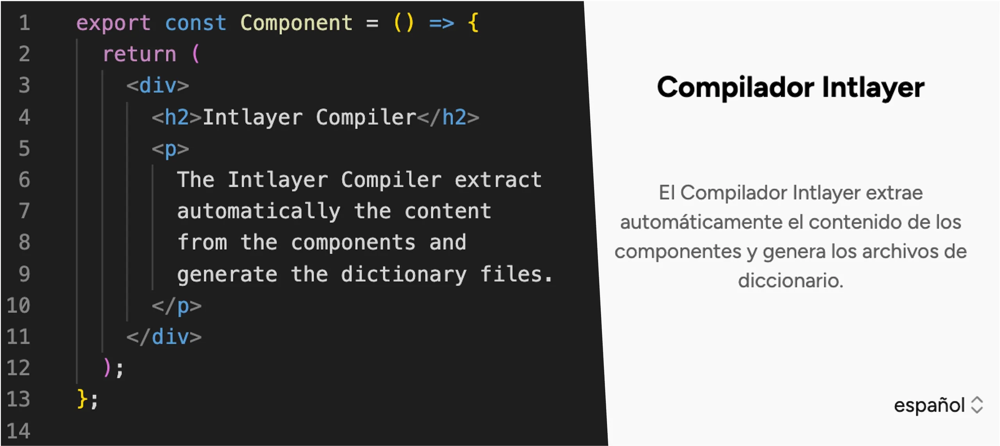

# Lingui מול Intlayer: מבחן ביצועים (i18n) עבור React ו-Next.js

<iframe title="הכול על i18n: המדריך המלא לבינאום ווב" class="m-auto aspect-16/9 w-full overflow-hidden rounded-lg border-0" allow="autoplay; gyroscope;" loading="lazy" width="1080" height="auto" src="https://www.youtube.com/embed/7VtLdbtV1us?autoplay=0&amp;start=1691&amp;origin=https://intlayer.org&amp;controls=0&amp;rel=1"/>

Lingui ו-Intlayer הן שתי הספריות במבחן ביצועים זה המסתמכות על **קומפיילר** ולא על ספריית זמן ריצה (runtime) טהורה. Lingui מחלצת הודעות ממאקרואים בזמן build ומקמפלת קטלוגים לכל שפה. Intlayer מקמפלת מילונים ברמת הקומפוננטה ומבצעת tree-shaking לכל שפה. על הנייר הן אמורות להיות קרובות מאוד. המספרים מראים היכן הן נפרדות.

הנתונים מגיעים מ-[Benchmark Bloom](https://github.com/intlayer-org/benchmark-bloom), חבילת בדיקות קוד פתוח הבונה את אותו יישום בדיוק בכל ספרייה ומתעדת מה שהדפדפן מוריד ומריץ בפועל.

<TOC/>

> **תקציר (tl;dr)**: Lingui היא הקרובה ביותר ל-Intlayer בצריכת JavaScript גולמית לדף: **115-120 KB** לעומת **118.6 KB** ב-TanStack Start ברגע שמוגדרת טעינה עצלה, ו-**148.6 KB** לעומת **141.3 KB** ב-Next.js. הפער נפער במקומות אחרים: קומפוננטת Lingui המקומפלת בבידוד שוקלת **58-153 KB** לעומת **6-8 KB** ב-Intlayer, הידרציה (hydration) לוקחת **28-34 ms** לעומת **11-14 ms**, ברירת המחדל של שפת המקור מדליפה **3-15%** ממחרוזות ה-`en` לתוך דפי `fr` בכל הגדרה ממוטבת, והגעה להגדרה ממוטבת זו דורשת חילוץ, קימפול ומיפוי ידני של קטלוגים לכל נתיב. Intlayer מגיעה לתוצאות אלו ללא צורך בהגדרה מיוחדת.

## בקצרה

- **Lingui** - מבוססת מאקרואים (`` t`...` ``, `<Trans>`, `msg`), פורמט הודעות ICU, קטלוגי `.po` / JSON, ותהליך עבודה של `lingui extract` + `lingui compile`. מקמפלת מזהי הודעות לקודי hash קצרים, ותומכת בטעינת קטלוגים דינמית לפי שפה. ספרייה ותיקה, אינה תלויה בסביבה ספציפית, ובעלת תמיכה חזקה בתהליכי עבודה של מתרגמים סביב קובצי `.po`.
- **Intlayer** - מודל תוכן ממוקד קומפוננטה. מילוני `.content.ts` ממוקמים בצמוד לקומפוננטה שהם משרתים, קומפיילר בזמן build מבצע tree-shaking וטעינה עצלה לפי קומפוננטה ושפה, טיפוסי TypeScript קפדניים נוצרים ישירות מהתוכן שלכם, ותרגומים חסרים מכשילים את הבנייה מראש. כוללת middleware, עזרי SEO, עורך חזותי / CMS ותרגום בסיוע AI.

| ספרייה                | כוכבי GitHub                                                                                                                                                                   | סך ה-Commits                                                                                                                                                                       | Commit אחרון                                                                                                                                        | גרסה ראשונה | גרסת NPM                                                                                                            | הורדות NPM                                                                                                                     |
| --------------------- | ------------------------------------------------------------------------------------------------------------------------------------------------------------------------------ | ---------------------------------------------------------------------------------------------------------------------------------------------------------------------------------- | --------------------------------------------------------------------------------------------------------------------------------------------------- | ----------- | ------------------------------------------------------------------------------------------------------------------- | ------------------------------------------------------------------------------------------------------------------------------ |
| `aymericzip/intlayer` | [](https://github.com/aymericzip/intlayer/stargazers) | [](https://github.com/aymericzip/intlayer/commits) | [](https://github.com/aymericzip/intlayer/commits) | אפריל 2024  | [](https://www.npmjs.com/package/intlayer)         | [](https://www.npmjs.com/package/intlayer)         |
| `lingui/js-lingui`    | [](https://github.com/lingui/js-lingui/stargazers)       | [](https://github.com/lingui/js-lingui/commits)       | [](https://github.com/lingui/js-lingui/commits)       | דצמבר 2016  | [](https://www.npmjs.com/package/@lingui/core) | [](https://www.npmjs.com/package/@lingui/core) |

> התגים מתעדכנים אוטומטית. הנתונים עשויים להשתנות לאורך זמן.

## השוואת תכונות ראש בראש

| תכונה                                       | Intlayer (`react-intlayer` / `next-intlayer`)                            | Lingui (`@lingui/core` / `@lingui/react`)                                       |
| ------------------------------------------- | ------------------------------------------------------------------------ | ------------------------------------------------------------------------------- |
| **תרגומים צמודים לקומפוננטות**              | ✅ כן, קובצי `.content.ts` ממוקמים לצד כל קומפוננטה                      | ⚠️ מחרוזות מקור ב-JSX דרך מאקרואים; תרגומים בקטלוגי `.po` מרכזיים               |
| **אינטגרציה עם TypeScript**                 | ✅ טיפוסים קפדניים שנוצרים אוטומטית מהתוכן                               | ⚠️ המאקרואים בעלי טיפוסים; מזהי הודעות אינם מוקלדים, רשומות חסרות אינן מתגלות   |
| **זיהוי תרגומים חסרים**                     | ✅ שגיאת TypeScript + שגיאה/אזהרה בזמן build                             | ⚠️ ‏`lingui extract` מדווח סטטיסטיקות; זמן הריצה נופל למחרוזת המקור              |
| **תוכן עשיר (JSX / Markdown / קומפוננטות)** | ✅ תמיכה ישירה ומובנית                                                   | ✅ תמיכה ב-`<Trans>` עם קומפוננטות מקוננות                                      |
| **תמיכה ב-ICU**                             | ⚠️ בפיתוח (WIP)                                                          | ✅ כן (מאקרואי `plural`, `select`, `selectOrdinal`)                             |
| **עיצוב (תאריכים, מספרים, מטבעות)**         | ✅ `useNumber`, `useDate`, ... (`Intl` מקורי מתחת למכסה המנוע)           | ✅ `i18n.date()`, `i18n.number()`                                               |
| **ניתוב מתורגם ו-middleware**               | ✅ פרוקסי/middleware מובנים, `getMultilingualUrls`                       | ❌ אינו חלק מליבת הספרייה                                                       |
| **עזרי SEO (hreflang, sitemap, robots)**    | ✅ עזרים מובנים                                                          | ❌ דורש הגדרה ידנית                                                             |
| **Server Components סינכרוניים**            | ✅ `useIntlayer` מ-`next-intlayer/server` עובד בכל קומפוננטת שרת צאצאית  | ⚠️ דורש מופע `I18n` לכל בקשה, המועבר כלפי מטה או מוגדר דרך `setI18n`            |
| **Tree-shaking (שליחת תוכן בשימוש בלבד)**   | ✅ לכל קומפוננטה, לכל שפה, אוטומטי לחלוטין על ידי הקומפיילר              | ⚠️ לכל שפה דרך `lingui compile`; פיצול לפי נתיב דורש חלוקת קטלוגים ידנית        |
| **טעינה עצלה (Lazy loading)**               | ✅ `importMode: 'dynamic'` (שורת הגדרה בודדת)                            | ⚠️ קריאת `import()` ידנית לקטלוגים מקומפלים + `i18n.load()` / `i18n.activate()` |
| **ניקוי תוכן שאינו בשימוש (Purge)**         | ✅ מילונים שאינם בשימוש מוסרים בזמן build                                | ✅ `lingui extract --clean` מסיר הודעות מיושנות                                 |
| **בדיקת תרגומים חסרים (CLI / CI)**          | ✅ `npx intlayer content test`                                           | ⚠️ נתוני `lingui extract` (ללא קוד שגיאה שמכשיל את הבנייה כברירת מחדל)          |
| **תהליך הבנייה (Build pipeline)**           | ✅ תוסף אחד בלבד (`@intlayer/swc` / `@intlayer/babel` / `vite-intlayer`) | ⚠️ תוסף מאקרו (Babel או SWC) + שלבי `extract` + `compile`                       |
| **תרגום מבוסס AI**                          | ✅ מובנה, משתמש במפתחות ה-API האישיים שלכם                               | ❌ אין                                                                          |
| **עורך ויזואלי / CMS**                      | ✅ עורך ויזואלי חינמי + CMS אופציונלי                                    | ❌ אין (`.po` עובד עם מערכות TMS חיצוניות)                                      |
| **שרת MCP וכישורי סוכנים**                  | ✅ כן                                                                    | ❌ אין                                                                          |
| **אקוסיסטם וקהילה**                         | ⚠️ קטן יותר אך בצמיחה מהירה                                              | ✅ מבוסס, מוכח ובלתי תלוי בפריימוורק מסוים                                      |

## מבחן הביצועים (Benchmark)

### מה נמדד

חבילת [Benchmark Bloom](https://github.com/intlayer-org/benchmark-bloom) בונה **את אותו יישום בדיוק** בכל ספרייה: **10 דפים** (home, about, blog, careers, contact, FAQ, pricing, products, settings, team), **10 שפות** (`en`, `fr`, `es`, `de`, `it`, `pt`, `zh`, `ja`, `ko`, `ru`), קומפוננטות זהות ותוכן זהה. הדפים נמדדים ב-`en` וב-`fr`. כל ספרייה מיושמת בעד ארבע **אסטרטגיות טעינה**, מהתצורה הנאיבית ועד האופטימלית:

| אסטרטגיה           | תיאור                                                                            | מי משתמש בזה                           |
| ------------------ | -------------------------------------------------------------------------------- | -------------------------------------- |
| **static**         | הקטלוג המקומפל של כל שפה מיובא ונטען מראש מראש                                   | אבות טיפוס מהירים, קוד שנוצר על ידי AI |
| **dynamic**        | רק הקטלוג של השפה הפעילה נטען ב-`import()`, אך הוא כולל את כל הדפים              | מרבית הפרויקטים                        |
| **scoped-static**  | קטלוג אחד לכל נתיב, כאשר כולם מאוגדים יחד מראש                                   | נדיר                                   |
| **scoped-dynamic** | קטלוג אחד לכל נתיב + טעינה עצלה ב-`import()`. רק הדף הנוכחי והשפה הנוכחית נטענים | יישומים עם תקציב ביצועים קפדני         |

ל-Intlayer אין גרסת "scoped" ייעודית: הקומפיילר תוחם את התוכן **לכל קומפוננטה** באופן אוטומטי, כך ששורות ה-`static` וה-`dynamic` שלה כבר מבודדות וממוטבות מראש.

לכל בנייה, החבילה מודדת:

- **גודל ספרייה (Lib size)**: משקל gzip של קומפוננטה ריקה שמייבאת רק את ספריית ה-i18n (העלות הקבועה של זמן הריצה).
- **ממוצע JS לדף (Page JS)**: משקל ה-JavaScript המורד ב-gzip לכל דף, בממוצע על פני כל הדפים והשפות.
- **אחוז דליפת שפה (Locale leak %)**: חלקן של מחרוזות מתורגמות ב-JS שהורד השייכות לשפה שהמשתמש **אינו** צופה בה (נבדק על `en` ו-`fr`, כך ש-50% משמעותו ששפת הבדיקה האחרת נוכחת במלואה; כאשר מאגדים 10 שפות, הבזבוז בפועל גבוה בהרבה).
- **אחוז דליפת דפים (Page leak %)**: חלקן של מחרוזות מתורגמות ב-JS שהורד השייכות לדף שהמשתמש **אינו** נמצא בו.
- **ממוצע לקומפוננטה (Component avg)**: משקל ממוצע ב-gzip של כל קומפוננטה כשהיא מקומפלת בנפרד ובבידוד. מראה כמה זמן ריצה וקטלוג נגררים על ידי קומפוננטה בודדת.
- **תגובתיות מקצה לקצה (E2E reactivity)**: זמן שעון בין בחירת שפה חדשה לעדכון `html[lang]` ב-DOM (נבדק ב-Playwright, ממוצע של 5 חזרות).
- **הידרציה (Hydration)**: משך שלב ההידרציה של React.

> הנתונים להלן מגיעים מהרצה מיום **12 בספטמבר 2026** עם `@lingui/react` 6.6.0 ו-`intlayer` 9.5.1. יישום הבדיקה קטן במכוון (עשרות בודדות של מחרוזות לשפה), כך שאחוזי הדליפה מתארים **דפוס עקרוני**: הם צומחים ככל שנפח התוכן גדל, בעוד שעלות זמן הריצה נשארת קבועה.

### תוצאות ב-Next.js

בחרו את המדדים ואת הספריות שמעניינות אתכם:

<I18nBenchmark framework="nextjs" packages="lingui,next-intlayer" vertical/>

| ספרייה              | אסטרטגיה       | גודל ספרייה (gz) | ממוצע JS לדף (gz) | דליפת שפה | דליפת דפים | ממוצע לקומפוננטה (gz) | תגובתיות E2E | הידרציה |
| ------------------- | -------------- | ---------------: | ----------------: | --------: | ---------: | --------------------: | -----------: | ------: |
| **בסיס** (ללא i18n) | -              |           0.0 KB |          141.0 KB |      0.0% |       0.0% |                0.9 KB |      13.4 ms | 11.8 ms |
| Lingui              | static         |          11.9 KB |          207.4 KB |     50.0% |      90.0% |               73.3 KB |      15.3 ms | 15.2 ms |
| Lingui              | dynamic        |          11.9 KB |          145.4 KB |      2.8% |      89.9% |               19.9 KB |      15.7 ms | 12.7 ms |
| Lingui              | scoped-static  |          11.9 KB |          148.2 KB |      2.7% |      89.1% |               20.4 KB |      15.1 ms | 13.1 ms |
| Lingui              | scoped-dynamic |          11.9 KB |          148.6 KB |     14.8% |       0.0% |              152.6 KB |      16.1 ms | 14.8 ms |
| **`next-intlayer`** | static         |       **5.5 KB** |      **141.3 KB** |  **0.0%** |   **0.0%** |            **8.5 KB** |  **15.5 ms** | 16.9 ms |
| **`next-intlayer`** | dynamic        |       **5.5 KB** |      **141.3 KB** |  **0.0%** |   **0.0%** |            **6.9 KB** |  **15.3 ms** | 15.9 ms |

**כיצד לקרוא את התוצאות**

- **עלות זמן ריצה:** קומפוננטה ריקה עולה 11.9 KB ב-gzip עם Lingui, לעומת 5.5 KB עם Intlayer. בדף המלא, התצורה הטובה ביותר של Lingui מוסיפה **+7.3 KB** מעל Intlayer (148.6 לעומת 141.3 KB); Intlayer עומדת על **+0.3 KB** בלבד מעל אפליקציית הבסיס.
- **ההגדרה הנאיבית יקרה מאוד:** טעינת כל קטלוג מקומפל מראש מביאה ל-**207.4 KB לדף**, תוספת של 66 KB מעל אפליקציית הבסיס. חצי מהמחרוזות שנבדקו שייכות לשפה הלא נכונה, ו-90% שייכות לדף הלא נכון.
- **טעינה דינמית מתקנת את השפה, אך לא את הדף:** עם קטלוג אחד לכל שפה, דליפת הדפים נשארת סביב ~90%: כל קטלוג ה-`fr` נשלח בכל דף בצרפתית. הגעה ל-0% דליפת דפים דורשת את תצורת ה-`scoped-dynamic`: קטלוג ייעודי לכל נתיב, שחולץ וקומפל בנפרד ונבחר ידנית בכל דף.
- **ברירת המחדל של שפת המקור דולפת:** אפילו בתצורות הממוטבות ביותר, **3-15% ממחרוזות ה-`en` נשלחות בתוך דפי `fr`**. מאקרואי Lingui שומרים את הודעת המקור זמינה כברירת מחדל לזמן ריצה, כך שהיא מגיעה ל-bundle לצד התרגום. Intlayer פותרת ברירות מחדל בזמן build ושולחת אך ורק את השפה הפעילה.
- **גודל הקומפוננטה מתנפח ב-`scoped-dynamic`:** כל קומפוננטה המקומפלת בבידוד שוקלת בממוצע **152.6 KB**, משום שהקטלוג של כל נתיב נגיש מהקומפוננטה שמייבאת אותו. אותה קומפוננטה בדיוק עם `useIntlayer()` שוקלת **6.9 KB**.

<ClickToOpenIframe
src="https://intlayer.org/markdown?url=https%3A%2F%2Fraw.githubusercontent.com%2Fintlayer-org%2Fbenchmark-i18n%2Fmain%2Freport%2Fscripts%2Fsummarize-nextjs.md"
width="100%"
height="600px"
style="border:none;"
/>

> הטבלה המלאה, עבור כל ספרייה ואסטרטגיה, זמינה ב-[דוח ה-benchmark של Next.js](https://github.com/aymericzip/intlayer/blob/main/docs/docs/he-IL/benchmark/nextjs.md).

- [דוח ה-benchmark של Next.js](https://github.com/aymericzip/intlayer/blob/main/docs/docs/he-IL/benchmark/nextjs.md)

### תוצאות ב-TanStack Start

| ספרייה                      | אסטרטגיה       | גודל ספרייה (gz) | ממוצע JS לדף (gz) | דליפת שפה | דליפת דפים | ממוצע לקומפוננטה (gz) | תגובתיות E2E | הידרציה |
| --------------------------- | -------------- | ---------------: | ----------------: | --------: | ---------: | --------------------: | -----------: | ------: |
| **בסיס** (ללא i18n)         | -              |           0.0 KB |          111.0 KB |      0.0% |       0.0% |                0.7 KB |       8.1 ms | 21.6 ms |
| Lingui                      | static         |          11.2 KB |          152.2 KB |     50.0% |      90.0% |               58.0 KB |       3.9 ms | 19.9 ms |
| Lingui                      | dynamic        |          11.2 KB |          115.2 KB |      9.3% |       0.0% |               85.5 KB |       5.9 ms | 28.0 ms |
| Lingui                      | scoped-static  |          11.2 KB |          120.8 KB |      4.0% |       0.0% |              147.9 KB |       7.1 ms | 33.9 ms |
| Lingui                      | scoped-dynamic |          11.2 KB |          120.2 KB |      8.6% |       0.0% |               83.7 KB |      42.1 ms | 32.9 ms |
| **`intlayer`**              | static         |       **5.0 KB** |      **125.8 KB** |     50.0% |   **0.0%** |            **8.1 KB** |   **3.2 ms** | 11.5 ms |
| **`intlayer`**              | dynamic        |       **5.0 KB** |      **118.6 KB** |  **0.0%** |   **0.0%** |            **6.3 KB** |   **3.6 ms** | 14.1 ms |
| `@intlayer/lingui` (תאימות) | dynamic        |          10.3 KB |          137.0 KB |      9.9% |       0.0% |               12.8 KB |       2.9 ms | 19.7 ms |

**כיצד לקרוא את התוצאות**

- **ב-JavaScript לכל דף, Lingui מנצחת במעט:** Lingui במצב `dynamic` מגיעה ל-**115.2 KB**, כלומר 3.4 KB מתחת ל-118.6 KB של Intlayer. הקטלוגים המקומפלים של Lingui עם מזהי ה-hash הם קומפקטיים, והנתב של TanStack Start מפצל נתיבים בצורה יעילה כך שדליפת הדפים עומדת כבר על 0% בשורת ה-`dynamic`.
- **כל שאר המדדים נוטים לטובת Intlayer:** הידרציה לוקחת **28-34 ms** עם Lingui לעומת **11-14 ms** עם Intlayer: ‏`i18n.load()` + `i18n.activate()` רצים בדפדפן לפני ש-React יכולה לבצע הידרציה. קומפוננטות המקומפלות בבידוד שוקלות **58-148 KB** לעומת **6-8 KB**. דליפת השפה אינה מגיעה לעולם ל-0% (4-9%) בשל ברירת המחדל של שפת המקור.
- **החלפת שפה בהגדרה הממוטבת איטית:** ‏Lingui במצב `scoped-dynamic` דורשת **42 ms** לעדכון `html[lang]`: קטלוג הנתיב החדש נדרש לרדת ברשת, להיטען ולהיות מופעל לפני שהשינוי מוצג למשתמש. Intlayer מתחלפת בתוך **3-4 ms** בשני המצבים.
- **שורת ה-`static` של Intlayer כבר כוללת 0% דליפת דפים** מכיוון שרק המילונים המיובאים על ידי קומפוננטות הדף נכללים ב-bundle. שורת הגדרה בודדת (`importMode: 'dynamic'`) מסירה גם את דליפת השפה.
- **`@intlayer/lingui`** שומרת על תחביר המאקרואים של Lingui ומגישה אותו ממילוני Intlayer. היא מתפשרת במעט על גודל הדף (137 KB, מכיוון שזמן הריצה של המאקרואים נשאר) בתמורה לקומפוננטות קטנות בהרבה (12.8 KB) והידרציה מהירה יותר מאשר Lingui המקורית. זהו שלב הגירה מצוין בדרך למעבר מלא.

<ClickToOpenIframe
src="https://intlayer.org/markdown?url=https%3A%2F%2Fraw.githubusercontent.com%2Fintlayer-org%2Fbenchmark-i18n%2Fmain%2Freport%2Fscripts%2Fsummarize-tanstack.md"
width="100%"
height="600px"
style="border:none;"
/>

> הטבלה המלאה זמינה ב-[דוח ה-benchmark של TanStack Start](https://github.com/aymericzip/intlayer/blob/main/docs/docs/he-IL/benchmark/tanstack.md).

- [דוח ה-benchmark של TanStack Start](https://github.com/aymericzip/intlayer/blob/main/docs/docs/he-IL/benchmark/tanstack.md)

## מדוע הפער? שני קומפיילרים, שתי יחידות עבודה



שתי הספריות מבצעות קומפילציה. ההבדל המהותי הוא **מה** הן מקמפלות.

**Lingui מקמפלת קטלוגים.** מאקרואים בקוד המקור שלכם מחולצים לקובץ `.po` לכל שפה, ואז מתקמפלים למודול JS לכל שפה. יחידת הבסיס היא ה-**locale**. פיצול נוסף, לפי נתיב או לפי קומפוננטה, דורש יצירת קטלוגים מרובים, הגדרת `lingui.config.ts` לחילוץ כל אחד מהם מקבוצת קבצים שונה, וטעינת הקטלוג הנכון בכל נתיב. מופע ה-`I18n` בזמן ריצה הוא גלובלי; כל קריאה ל-`useLingui()` רושמת את הקומפוננטה אליו.

```bash
.
├── lingui.config.ts
└── src
    ├── i18n.ts                          # setupI18n(), load(), activate()
    ├── locales
    │   ├── en
    │   │   ├── messages.po
    │   │   └── messages.mjs             # פלט lingui compile
    │   └── fr
    │       ├── messages.po
    │       └── messages.mjs
    ├── components
    │   └── Counter.tsx                  # const { t } = useLingui(); t`Increment`
    └── routes
        └── $locale
            └── about.tsx                # await import(`../locales/${locale}/messages.mjs`)
```

**Intlayer מקמפלת מילונים.** כל קובץ `.content.ts` הוא מילון הקשור למפתח; הקומפיילר מפענח איזו קומפוננטה מייבאת איזה מפתח ומפיק, לכל מילון ולכל שפה, בדיוק את ה-JSON שאותה קומפוננטה צריכה. יחידת הבסיס היא ה-**component**. בידוד הנתיבים הוא תוצאה ישירה וטבעית: דף מושך אך ורק את המילונים של הקומפוננטות שהוא מרנדר בפועל.

```bash
.
├── intlayer.config.ts
└── src
    ├── components
    │   └── Counter
    │       ├── index.tsx                # useIntlayer("counter")
    │       └── index.content.ts
    └── routes
        └── $locale
            ├── about.tsx
            └── about.content.ts
```

זו הסיבה לכך שתבנית `scoped-dynamic` היא פלט בנייה טבעי ב-Intlayer, בעוד שב-Lingui היא פרויקט הגדרה בפני עצמו. הפער מתרחב בשני צירים במקביל, דפים ושפות:


> כדי לקבל את מספרי שורת ה-`dynamic`, הגדירו `dictionary.importMode: 'dynamic'` בתוך `intlayer.config.ts`. ראו את [תיעוד אופטימיזציית bundle](https://github.com/aymericzip/intlayer/blob/main/docs/docs/he-IL/bundle_optimization.md).

- [תיעוד אופטימיזציית bundle](https://github.com/aymericzip/intlayer/blob/main/docs/docs/he-IL/bundle_optimization.md)

## חוויית פיתוח (Developer Experience)

### הגדרה ראשונית

<Tabs defaultTab="intlayer" group="techno">
<Tab label="Lingui" value="lingui">

```ts fileName="lingui.config.ts"
import { defineConfig } from "@lingui/cli";

export default defineConfig({
  sourceLocale: "en",
  locales: ["en", "fr"],
  catalogs: [
    {
      path: "<rootDir>/src/locales/{locale}/messages",
      include: ["src"],
    },
  ],
});
```

```ts fileName="src/i18n.ts"
import { setupI18n } from "@lingui/core";

export const loadCatalog = async (locale: string) => {
  const { messages } = await import(`./locales/${locale}/messages.mjs`);
  const i18n = setupI18n();
  i18n.load(locale, messages);
  i18n.activate(locale);
  return i18n;
};
```

לאחר מכן מוסיפים את `@lingui/babel-plugin-lingui-macro` (או `@lingui/swc-plugin`) ל-bundler, מריצים `lingui extract` לאחר עריכת קוד המקור, `lingui compile` לפני הבנייה, ועוטפים את העץ ב-`<I18nProvider i18n={i18n}>`.

</Tab>
<Tab label="Intlayer" value="intlayer">

```ts fileName="intlayer.config.ts"
import { type IntlayerConfig, Locales } from "intlayer";

const config: IntlayerConfig = {
  internationalization: {
    locales: [Locales.ENGLISH, Locales.FRENCH],
    defaultLocale: Locales.ENGLISH,
  },
};

export default config;
```

מוסיפים את `intlayer()` אל `vite.config.ts` (או `withIntlayer()` אל `next.config.ts`) ועוטפים את העץ ב-`<IntlayerProvider>`. אין צורך בשלבי extract או compile נפרדים: המילונים נבנים אוטומטית כשה-bundler רץ.

</Tab>
</Tabs>

### שימוש בקומפוננטה

<Tabs defaultTab="intlayer" group="techno">
<Tab label="Lingui" value="lingui">

```tsx fileName="src/components/Counter.tsx"
import { useState } from "react";
import { useLingui } from "@lingui/react/macro";
import { Trans } from "@lingui/react/macro";

export const Counter = () => {
  const { t, i18n } = useLingui();
  const [count, setCount] = useState(0);

  return (
    <div>
      <p>{i18n.number(count)}</p>
      <button aria-label={t`Counter`} onClick={() => setCount((c) => c + 1)}>
        <Trans>Increment</Trans>
      </button>
    </div>
  );
};
```

הטקסט באנגלית ממוקם בתוך הקומפוננטה; הטקסט בצרפתית שוכן בתוך `src/locales/fr/messages.po` תחת מזהה hash, לאחר הרצת `lingui extract`. שכחה להריץ extract או compile גורמת לנפילה שקטה לאנגלית.

</Tab>
<Tab label="Intlayer" value="intlayer">

```ts fileName="src/components/Counter/index.content.ts"
import { t, type Dictionary } from "intlayer";

const counterContent = {
  key: "counter",
  content: {
    label: t({ en: "Counter", fr: "Compteur", "he-IL": "מונה" }),
    increment: t({ en: "Increment", fr: "Incrémenter", "he-IL": "הגדל" }),
  },
} satisfies Dictionary;

export default counterContent;
```

```tsx fileName="src/components/Counter/index.tsx"
import { useState } from "react";
import { useIntlayer } from "react-intlayer";
import { useNumber } from "react-intlayer/format";

export const Counter = () => {
  const { label, increment } = useIntlayer("counter");
  const number = useNumber();
  const [count, setCount] = useState(0);

  return (
    <div>
      <p>{number(count)}</p>
      <button aria-label={label} onClick={() => setCount((c) => c + 1)}>
        {increment}
      </button>
    </div>
  );
};
```

שתי השפות שוכנות בקובץ אחד בצמוד לקומפוננטה. ערך חסר ב-`fr` הוא שגיאת בנייה, ומפתח שגוי הוא שגיאת TypeScript מיידית.

</Tab>
</Tabs>

### מחוץ לקומפוננטות

מטא-דאטה, פונקציות טעינה (loaders), פונקציות שרת: כל מקום ללא עץ React.

<Tabs defaultTab="intlayer" group="techno">
<Tab label="Lingui" value="lingui">

```ts fileName="src/routes/$locale/about.tsx"
import { setupI18n } from "@lingui/core";
import { msg } from "@lingui/core/macro";

const title = msg`About us`;

export const loader = async ({ params }: { params: { locale: string } }) => {
  const { messages } = await import(
    `../../locales/${params.locale}/messages.mjs`
  );
  const i18n = setupI18n({
    locale: params.locale,
    messages: { [params.locale]: messages },
  });

  return { title: i18n._(title) };
};
```

מופע `I18n` חדש לכל קריאה, טעינה ידנית של הקטלוג הנכון, ושימוש ב-`msg` + `i18n._()` במקום `t`. כפי שמצוין ב-[הערות הבנצ'מרק](https://github.com/intlayer-org/benchmark-bloom/blob/main/report/NOTE.md), ההבנה מתי להשתמש ב-`t`, ‏`` t` ` ``, `i18n.t()`, `msg` או `<Trans>` "אינה אינטואיטיבית".

</Tab>
<Tab label="Intlayer" value="intlayer">

```ts fileName="src/routes/$locale/about.tsx"
import { getIntlayer } from "intlayer";

export const loader = async ({ params }: { params: { locale: string } }) => {
  const { title } = getIntlayer("about-metadata", params.locale);

  return { title };
};
```

</Tab>
</Tabs>

## שמירה על מאקרואי Lingui וקבלת מילוני Intlayer

`@intlayer/lingui` הוא מתאם drop-in עבור `@lingui/core` ו-`@lingui/react`. המאקרואים ממשיכים להתקמפל כבעבר; פונקציית `i18n._()` שהם מתקמפלים אליה מקבלת את הנתונים ממילוני Intlayer, כאשר תוספי סנכרון `.po` שומרים על הקטלוגים הקיימים כמקור האמת. צורות רבים ומשפטי select ב-ICU מרונדרים בדיוק באותו אופן.

```ts fileName="vite.config.ts"
import { defineConfig } from "vite";
import { lingui } from "@intlayer/lingui/plugin";

export default defineConfig({
  plugins: [lingui()],
});
```

השאירו את `@lingui/babel-plugin-lingui-macro` / `@lingui/swc-plugin` בבנייה, כשהם רצים לפני הקומפיילר של Intlayer. ראו את [תיעוד התאימות של Lingui](https://github.com/aymericzip/intlayer/blob/main/docs/docs/he-IL/compat/lingui.md).

- [תיעוד התאימות של Lingui](https://github.com/aymericzip/intlayer/blob/main/docs/docs/he-IL/compat/lingui.md)

## מתי לבחור בכל אפשרות?

<AccordionGroup>
<Accordion header="בחרו ב-Lingui">

אתם זקוקים ל-**ICU MessageFormat** עם מאקרואים מוקלדים, המתרגמים שלכם עובדים עם **`.po`** בצינור TMS קיים, אתם מעדיפים מחרוזות מקור בתוך ה-JSX, והצוות שלכם מסתדר היטב עם ניהול תהליך ה-extract / compile / פיצול קטלוגים. צריכת ה-JavaScript לדף תחרותית מאוד ברגע שמוגדרת טעינה עצלה.

</Accordion>
<Accordion header="בחרו ב-Intlayer">

אתם רוצים **תוכן מבודד ברמת הקומפוננטה**, **TypeScript קפדני**, **שגיאות בזמן build על מפתחות חסרים**, **tree-shaking וטעינה עצלה ללא מאמץ**, קומפוננטות קטנות, הידרציה מהירה, החלפת שפה מיידית, וכלי עריכה מובנים ([עורך ויזואלי](https://github.com/aymericzip/intlayer/blob/main/docs/docs/he-IL/intlayer_visual_editor.md), [CMS](https://github.com/aymericzip/intlayer/blob/main/docs/docs/he-IL/intlayer_CMS.md), [תרגום ב-AI](https://github.com/aymericzip/intlayer/blob/main/docs/docs/he-IL/autoFill.md), [שרת MCP](https://github.com/aymericzip/intlayer/blob/main/docs/docs/he-IL/mcp_server.md)). רלוונטי במיוחד עבור בסיסי קוד גדולים, מודולריים ומערכות עיצוב (Design Systems).

- [עורך ויזואלי](https://github.com/aymericzip/intlayer/blob/main/docs/docs/he-IL/intlayer_visual_editor.md)
- [CMS](https://github.com/aymericzip/intlayer/blob/main/docs/docs/he-IL/intlayer_CMS.md)
- [תרגום ב-AI](https://github.com/aymericzip/intlayer/blob/main/docs/docs/he-IL/autoFill.md)
- [שרת MCP](https://github.com/aymericzip/intlayer/blob/main/docs/docs/he-IL/mcp_server.md)

</Accordion>
<Accordion header="בחרו ב-@intlayer/lingui">

אתם משתמשים ב-Lingui ורוצים לעבור למילוני Intlayer בצורה הדרגתית מבלי לשנות את המאקרואים. קטלוגי ה-`.po` שלכם נשארים מקור האמת דרך [תוסף סנכרון ה-PO](https://github.com/aymericzip/intlayer/blob/main/docs/docs/he-IL/compat/lingui.md). השוואה מפורטת זה לצד זה מופיעה ב-[Lingui מול @intlayer/lingui](https://github.com/aymericzip/intlayer/blob/main/docs/blog/he-IL/lingui_vs_intlayer-lingui.md).

- [תוסף סנכרון ה-PO](https://github.com/aymericzip/intlayer/blob/main/docs/docs/he-IL/compat/lingui.md)
- [Lingui מול @intlayer/lingui](https://github.com/aymericzip/intlayer/blob/main/docs/blog/he-IL/lingui_vs_intlayer-lingui.md)

</Accordion>
</AccordionGroup>

## שאלות נפוצות (FAQ)

<FAQ>

<Question title="גם Lingui מקמפלת. מדוע הפלט שונה כל כך?">

משום שיחידת הקומפילציה שונה לחלוטין. Lingui מקמפלת **קטלוג אחד לכל שפה**: כל מה שמעבר לכך (קטלוגים לכל נתיב, טעינה עצלה, מניעת כניסת ברירת המחדל ל-bundle) הוא עניין של הגדרה ידנית. Intlayer מקמפלת **מילון אחד לכל קומפוננטה**, כך שבידוד הנתיבים נובע ישירות מהבנייה. זו הסיבה שקומפוננטת Lingui בבידוד שוקלת 58-153 KB לעומת 6-8 KB.

</Question>

<Question title="מדוע דליפת השפה אינה מגיעה לעולם ל-0% ב-Lingui?">

מאקרואים שומרים את הודעת המקור זמינה כברירת מחדל בזמן ריצה, ולכן המחרוזת באנגלית נשלחת לצד התרגום שלה. מבחן הביצועים מודד **3-15% ממחרוזות ה-`en` בתוך דפי `fr`** בכל הגדרה ממוטבת. Intlayer פותרת ברירות מחדל בזמן build ושולחת רק את השפה הפעילה.

</Question>

<Question title="האם ה-JavaScript לדף של Lingui באמת תחרותי?">

כן, וב-TanStack Start היא אף מנצחת במעט: 115.2 KB במצב `dynamic` לעומת 118.6 KB ב-Intlayer. קטלוגים מקומפלים עם מזהי hash הם דחוסים וקטנים. המחיר מתבטא במקומות אחרים: הידרציה של 28-34 ms לעומת 11-14 ms, והחלפת שפה של **42 ms** בתצורת `scoped-dynamic`, שבה יש להוריד, לטעון ולהפעיל את קטלוג הנתיב לפני שהשינוי מוצג.

</Question>

<Question title="האם חייבים לוותר על המאקרואים כדי להגר?">

לא. מתאם `@intlayer/lingui` שומר על קימפול המאקרואים `` t`...` ``, `<Trans>`, `msg`, `plural`, `select` ו-`selectOrdinal` כבעבר; רק הגורם שמולו `i18n._()` מפוענחת משתנה. השאירו את `@lingui/babel-plugin-lingui-macro` או `@lingui/swc-plugin` בבנייה לפני הקומפיילר של Intlayer. ראו את [תיעוד התאימות של Lingui](https://github.com/aymericzip/intlayer/blob/main/docs/docs/he-IL/compat/lingui.md).

- [תיעוד התאימות של Lingui](https://github.com/aymericzip/intlayer/blob/main/docs/docs/he-IL/compat/lingui.md)

</Question>

<Question title="מה קורה לשלבי ה-extract וה-compile?">

הם נשארים עבור המאקרואים, ונעלמים עבור תוכן מקורי של Intlayer. מילוני `.content.ts` נבנים בעת הרצת ה-bundler, ללא צורך בהרצת CLI נפרדת, ו-[`intlayer test`](https://github.com/aymericzip/intlayer/blob/main/docs/docs/he-IL/cli/index.md) מכשיל את ה-CI על מפתח חסר במקום ליפול בשקט למחרוזת המקור.

- [`intlayer test`](https://github.com/aymericzip/intlayer/blob/main/docs/docs/he-IL/cli/index.md)

</Question>

</FAQ>

## השוואות קשורות


אותו מבחן ביצועים, ספריות אחרות:

- [next-intl מול Intlayer](https://github.com/aymericzip/intlayer/blob/main/docs/blog/he-IL/next-intl_vs_intlayer.md)
- [i18next מול Intlayer](https://github.com/aymericzip/intlayer/blob/main/docs/blog/he-IL/i18next_vs_intlayer.md)
- [vue-i18n מול Intlayer](https://github.com/aymericzip/intlayer/blob/main/docs/blog/he-IL/vue-i18n_vs_intlayer.md)
- [next-i18next מול next-intl מול Intlayer](https://github.com/aymericzip/intlayer/blob/main/docs/blog/he-IL/next-i18next_vs_next-intl_vs_intlayer.md)
- [react-i18next מול react-intl מול Intlayer](https://github.com/aymericzip/intlayer/blob/main/docs/blog/he-IL/react-i18next_vs_react-intl_vs_intlayer.md)

להעמקה נוספת:

- [Lingui מול @intlayer/lingui](https://github.com/aymericzip/intlayer/blob/main/docs/blog/he-IL/lingui_vs_intlayer-lingui.md)
- [בינאום מונחה קומפיילר מול בינאום הצהרתי](https://github.com/aymericzip/intlayer/blob/main/docs/blog/he-IL/compiler_vs_declarative_i18n.md)
- [בינאום לפי קומפוננטה מול בינאום מרוכז](https://github.com/aymericzip/intlayer/blob/main/docs/blog/he-IL/per-component_vs_centralized_i18n.md)
- [הסבר על פורמט הודעות ICU](https://github.com/aymericzip/intlayer/blob/main/docs/blog/he-IL/icu_message_format.md)

תיעוד ומקורות:

- [דוח benchmark של Next.js](https://github.com/aymericzip/intlayer/blob/main/docs/docs/he-IL/benchmark/nextjs.md)
- [דוח benchmark של TanStack Start](https://github.com/aymericzip/intlayer/blob/main/docs/docs/he-IL/benchmark/tanstack.md)
- [מתאם תאימות: Lingui](https://github.com/aymericzip/intlayer/blob/main/docs/docs/he-IL/compat/lingui.md)
- [אופטימיזציית bundle](https://github.com/aymericzip/intlayer/blob/main/docs/docs/he-IL/bundle_optimization.md)
- [קומפיילר Intlayer](https://github.com/aymericzip/intlayer/blob/main/docs/docs/he-IL/compiler.md)

> כדי להבין את מקורן של ספריות אלו, קראו על ההיסטוריה של בינאום ב-JavaScript.

- [ההיסטוריה של בינאום ב-JavaScript](https://github.com/aymericzip/intlayer/blob/main/docs/blog/he-IL/history_of_i18n.md)

## כוכבי GitHub

כוכבי GitHub הם אינדיקטור מובהק לפופולריות של פרויקט, לאמון הקהילה ולרלוונטיות ארוכת טווח. למרות שאינם מדד ישיר לאיכות טכנית, הם משקפים כמה מפתחים מוצאים את הפרויקט שימושי, עוקבים אחר התקדמותו ונוטים לאמץ אותו.

[](https://star-history.com/#lingui/js-lingui&aymericzip/intlayer)

## פעילות Commits

כוכבים מעידים על פופולריות. Commits מראים כמה עבודה מושקעת בפרויקט בפועל. במועד כתיבת שורות אלו, Intlayer מונה כ-7,500 commits, יותר ממרבית הספריות המושוות כאן, ובערך פי 5 יותר מ-`next-intl` או `next-i18next`.

<GithubCommits repositories="lingui/js-lingui,aymericzip/intlayer" />

> Intlayer היא monorepo, כך שהספירה כוללת את כל חבילות המסגרות, ה-CLI והתיעוד. קראו commits כסימן לפעילות מתמשכת, ולא כמדד ישיר לאיכות.

## הורדות ב-npm

<NpmDownloads packages="@lingui/core,intlayer" period="last-6-months" />

הורדות מתגמלות את הפתרונות הוותיקים ביותר, ולא בהכרח את הטובים ביותר. ספרייה ששוחררה לפני שנים עדיין מותקנת על ידי כל פרויקט שבחר בה בעבר, בכל הרצת CI ועל ידי כל חבילה שתלויה בה. הספירה משקפת אינרציה יותר מאשר בחירה עדכנית.

עוזרי AI מגבירים את האפקט הזה. `next-intl`, `i18next` ו-`vue-i18n` מופיעות בכל מקום בקוד שעליו הם אומנו, ולכן הם ממליצים עליהן כברירת מחדל, ללא השוואה לחלופות. כל המלצה מוסיפה הורדות, מה שמזין את ההמלצה הבאה. מומלץ להשוות על פי נתוני מבחני הביצועים ולא על פי כמות ההורדות.

## סיכום

Lingui היא ספריית ה-runtime-plus-compiler החזקה ביותר במבחן ביצועים זה. הקטלוגים המקומפלים והמוצפנים שלה ב-hash מעניקים לה צריכת JavaScript לדף הקרובה במספר קילובייטים בודדים ל-Intlayer, ואף מעט נמוכה ממנה ב-TanStack Start. אם כמות הבתים לדף הייתה המדד היחיד, התוצאה הייתה שוויון.

אך היא אינה המדד היחיד. הקומפיילר של Lingui עוצר ברמת השפה; כל מה שמעבר לכך (קטלוגים לכל נתיב, טעינה עצלה, מניעת כניסת שפת המקור ל-bundle) הוא עניין של הגדרה ידנית מורכבת, ומבחן הביצועים מציג את המחיר של גבול זה: קומפוננטות **גדולות פי 10-20**, הידרציה **איטית פי 2-3**, **דליפת שפה של 3-15%** שאינה נעלמת לעולם, והחלפת שפה של **42 ms** בהגדרה הממוטבת. הקומפיילר של Intlayer פועל ברמת הקומפוננטה, כך שתוצאות אלו הן **6-8 KB**, **11-14 ms**, **0%** ו-**3-4 ms** ללא כל צורך בהגדרה מיוחדת.

כל הנתונים הגולמיים, יישומי הבדיקה והסקריפטים זמינים במאגר [Benchmark Bloom](https://github.com/intlayer-org/benchmark-bloom). הריצו אותם בעצמכם.

עיינו במסמך ['למה Intlayer?'](https://github.com/aymericzip/intlayer/blob/main/docs/docs/he-IL/interest_of_intlayer.md) לפרטים נוספים.

- [למה Intlayer? יתרונות על פני ספריות i18n אחרות](https://github.com/aymericzip/intlayer/blob/main/docs/docs/he-IL/interest_of_intlayer.md)
