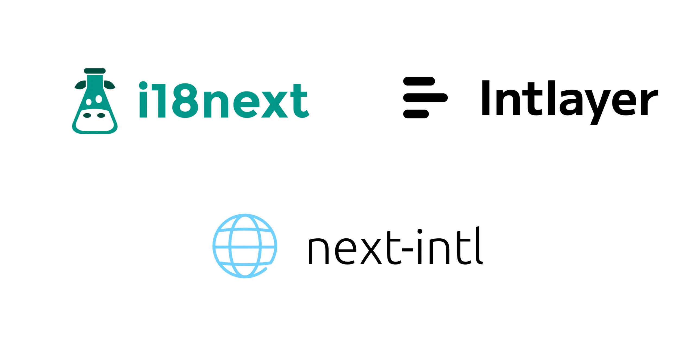

# next-i18next מול next-intl מול Intlayer

<iframe title="הכול על i18n: המדריך המלא לבינאום ווב" class="m-auto aspect-16/9 w-full overflow-hidden rounded-lg border-0" allow="autoplay; gyroscope;" loading="lazy" width="1080" height="auto" src="https://www.youtube.com/embed/7VtLdbtV1us?autoplay=0&amp;start=1465&amp;origin=https://intlayer.org&amp;controls=0&amp;rel=1"/>



בואו נבחן את קווי הדמיון וההבדלים בין שלוש אפשרויות i18n עבור Next.js: ‏next-i18next, ‏next-intl ו-Intlayer.

זהו אינו מדריך שלב אחר שלב, אלא השוואה מקיפה שנועדה לסייע לכם לבחור את הכלי המתאים ביותר.

אנו מתמקדים ב-**Next.js 13+ App Router** (עם **React Server Components**) ומעריכים את היכולות הבאות:

<TOC/>

> **תקציר (tl;dr)**: שלושת הפתרונות מאפשרים לתרגם יישום Next.js. אם אתם מחפשים **תוכן מבודד ברמת הקומפוננטה**, **טיפוסי TypeScript קפדניים**, **בדיקות מפתחות חסרים בזמן build**, **מילונים שעוברים tree-shaking**, ו**תמיכה מובילה ב-App Router ועזרי SEO**, הרי ש-**Intlayer** היא הבחירה השלמה והמודרנית ביותר.

> בלבול נפוץ בקרב מפתחים הוא המחשבה ש-`next-intl` היא גרסת ה-Next.js של `react-intl`. זה אינו המצב: `next-intl` מתוחזקת על ידי [Amann](https://github.com/amannn), בעוד ש-`react-intl` מתוחזקת על ידי [FormatJS](https://github.com/formatjs/formatjs).

## בקצרה

- **next-intl** - עיצוב הודעות קל משקל וישיר עם תמיכה טובה ב-Next.js. נפוץ להשתמש בקטלוגים מרכזיים; חוויית המפתח פשוטה, אך בטיחות ותחזוקה בפרויקטים גדולים נשארות ברובן באחריותכם.
- **next-i18next** - ספריית i18next בלבוש מותאם ל-Next.js. אקוסיסטם בוגר ותכונות רבות באמצעות תוספים (כגון ICU), אך ההגדרה עלולה להיות מסורבלת והקטלוגים נוטים להתנפח ככל שהפרויקט צומח.
- **Intlayer** - מודל תוכן ממוקד קומפוננטה עבור Next.js, **אכיפת טיפוסים קפדנית ב-TypeScript**, **בדיקות בזמן build**, **tree-shaking מובנה**, **middleware מובנה ועזרי SEO**, עורך ויזואלי ו-CMS אופציונליים, ו**תרגומים בסיוע AI**.

| ספרייה                 | כוכבי GitHub                                                                                                                                                                     | סך ה-Commits                                                                                                                                                                         | Commit אחרון                                                                                                                                          | גרסה ראשונה | גרסת NPM                                                                                                            | הורדות NPM                                                                                                                     |
| ---------------------- | -------------------------------------------------------------------------------------------------------------------------------------------------------------------------------- | ------------------------------------------------------------------------------------------------------------------------------------------------------------------------------------ | ----------------------------------------------------------------------------------------------------------------------------------------------------- | ----------- | ------------------------------------------------------------------------------------------------------------------- | ------------------------------------------------------------------------------------------------------------------------------ |
| `aymericzip/intlayer`  | [](https://github.com/aymericzip/intlayer/stargazers)   | [](https://github.com/aymericzip/intlayer/commits)   | [](https://github.com/aymericzip/intlayer/commits)   | אפריל 2024  | [](https://www.npmjs.com/package/intlayer)         | [](https://www.npmjs.com/package/intlayer)         |
| `amannn/next-intl`     | [](https://github.com/amannn/next-intl/stargazers)         | [](https://github.com/amannn/next-intl/commits)         | [](https://github.com/amannn/next-intl/commits)         | נובמבר 2020 | [](https://www.npmjs.com/package/next-intl)       | [](https://www.npmjs.com/package/next-intl)       |
| `i18next/i18next`      | [](https://github.com/i18next/i18next/stargazers)           | [](https://github.com/i18next/i18next/commits)           | [](https://github.com/i18next/i18next/commits)           | ינואר 2012  | [](https://www.npmjs.com/package/i18next)           | [](https://www.npmjs.com/package/i18next)           |
| `i18next/next-i18next` | [](https://github.com/i18next/next-i18next/stargazers) | [](https://github.com/i18next/next-i18next/commits) | [](https://github.com/i18next/next-i18next/commits) | נובמבר 2018 | [](https://www.npmjs.com/package/next-i18next) | [](https://www.npmjs.com/package/next-i18next) |

> התגים מתעדכנים אוטומטית. הנתונים עשויים להשתנות לאורך זמן.

## השוואת תכונות ראש בראש (עבור Next.js)

| תכונה                                     | `next-intlayer` (Intlayer)                                                        | `next-intl`                                                                   | `next-i18next`                                                                |
| ----------------------------------------- | --------------------------------------------------------------------------------- | ----------------------------------------------------------------------------- | ----------------------------------------------------------------------------- |
| **תרגומים צמודים לקומפוננטות**            | ✅ כן, תוכן ממוקם לצד כל קומפוננטה                                                | ❌ לא                                                                         | ❌ לא                                                                         |
| **אינטגרציה עם TypeScript**               | ✅ מתקדמת, טיפוסים קפדניים אוטומטיים                                              | ✅ טובה                                                                       | ⚠️ בסיסית                                                                     |
| **זיהוי תרגומים חסרים**                   | ✅ שגיאת TypeScript + שגיאה/אזהרה בזמן build                                      | ⚠️ ברירת מחדל בזמן ריצה                                                       | ⚠️ ברירת מחדל בזמן ריצה                                                       |
| **תוכן עשיר (JSX/Markdown/קומפוננטות)**   | ✅ תמיכה ישירה ומלאה                                                              | ❌ לא תוכננה לצמתים עשירים                                                    | ⚠️ מוגבלת                                                                     |
| **תרגום מבוסס AI**                        | ✅ כן, תמיכה במספר ספקים עם מפתחות ה-API שלכם. מתחשב בהקשר האפליקציה ובטווח התוכן | ❌ לא                                                                         | ❌ לא                                                                         |
| **עורך ויזואלי**                          | ✅ כן, עורך מקומי + CMS אופציונלי; מאפשר החצנת תוכן הקוד; ניתן להטמעה             | ❌ אין / זמין דרך פלטפורמות לוקליזציה חיצוניות                                | ❌ אין / זמין דרך פלטפורמות לוקליזציה חיצוניות                                |
| **ניתוב מתורגם (Localized Routing)**      | ✅ כן, תמיכה בנתיבים מתורגמים מהקופסה (Next.js ו-Vite)                            | ✅ מובנה, תמיכה במקטע `[locale]` ב-App Router                                 | ✅ מובנה                                                                      |
| **יצירת נתיבים דינמית**                   | ✅ כן                                                                             | ✅ כן                                                                         | ✅ כן                                                                         |
| **כללי רבים (Pluralization)**             | ✅ תבניות מבוססות ספירה (Enumeration)                                             | ✅ טובה                                                                       | ✅ טובה                                                                       |
| **עיצוב (תאריכים, מספרים, מטבעות)**       | ✅ מעבדי פורמט ממוטבים (`Intl` מתחת למכסה המנוע)                                  | ✅ טובה (עזרי Intl)                                                           | ✅ טובה (עזרי Intl)                                                           |
| **פורמט תוכן**                            | ✅ ‎.tsx, .ts, .js, .json, .md, .txt, (.yaml בפיתוח)                               | ✅ ‎.json, .js, .ts                                                            | ⚠️ ‎.json                                                                      |
| **תמיכה ב-ICU**                           | ⚠️ בפיתוח                                                                         | ✅ כן                                                                         | ⚠️ באמצעות תוסף (`i18next-icu`)                                               |
| **עזרי SEO (hreflang, sitemap)**          | ✅ כלים מובנים: מפות אתר, robots.txt ומטא-דאטה                                    | ✅ טובה                                                                       | ✅ טובה                                                                       |
| **אקוסיסטם וקהילה**                       | ⚠️ קטנה יותר אך בצמיחה מהירה ותגובתית                                             | ✅ טובה                                                                       | ✅ טובה                                                                       |
| **רינדור צד שרת ו-Server Components**     | ✅ מותאם בצורה חלקה ל-SSR ו-React Server Components                               | ⚠️ נתמך ברמת הדף אך דורש העברת פונקציות תרגום בעץ עבור קומפוננטות שרת צאצאיות | ⚠️ נתמך ברמת הדף אך דורש העברת פונקציות תרגום בעץ עבור קומפוננטות שרת צאצאיות |
| **Tree-shaking (טעינת תוכן בשימוש בלבד)** | ✅ כן, ברמת הקומפוננטה בזמן build דרך תוספי Babel/SWC                             | ⚠️ חלקי                                                                       | ⚠️ חלקי                                                                       |
| **טעינה עצלה (Lazy loading)**             | ✅ כן, לכל שפה / לכל מילון                                                        | ✅ כן (לכל נתיב/שפה), דורש ניהול namespaces                                   | ✅ כן (לכל נתיב/שפה), דורש ניהול namespaces                                   |
| **ניקוי תוכן שאינו בשימוש (Purge)**       | ✅ כן, לכל מילון בזמן build                                                       | ❌ לא, ניתן לניהול ידני דרך חלוקת namespaces                                  | ❌ לא, ניתן לניהול ידני דרך חלוקת namespaces                                  |
| **ניהול פרויקטים גדולים**                 | ✅ מעודד מודולריות, מתאים במיוחד ל-Design Systems                                 | ✅ מודולרי עם הגדרה מתאימה                                                    | ✅ מודולרי עם הגדרה מתאימה                                                    |
| **בדיקת תרגומים חסרים (CLI/CI)**          | ✅ CLI ייעודי: `npx intlayer content test` (ביקורת מותאמת CI)                     | ⚠️ אינו מובנה; התיעוד מציע את `npx @lingual/i18n-check`                       | ⚠️ אינו מובנה; מסתמך על כלי i18next או `saveMissing` בזמן ריצה                |

## מבוא

Next.js מעניקה תמיכה מובנית בניתוב בינלאומי (כגון מקטעי שפה בכתובת ה-URL). אך תכונה זו אינה מבצעת תרגומים בפני עצמה. אתם עדיין זקוקים לספרייה שתציג תוכן מתורגם למשתמשים שלכם.

ספריות i18n רבות קיימות כיום, אך בעולם ה-Next.js המודרני שלוש ספריות בולטות במיוחד: next-i18next, ‏next-intl ו-Intlayer.

> כדי להבין את מקורן של ספריות אלו, קראו על ההיסטוריה של בינאום ב-JavaScript.

- [ההיסטוריה של בינאום ב-JavaScript](https://github.com/aymericzip/intlayer/blob/main/docs/blog/he-IL/history_of_i18n.md)

## ארכיטקטורה ויכולת הרחבה (Scalability)

- **next-intl / next-i18next**: מתבססות כברירת מחדל על **קטלוגים מרוכזים** לכל שפה (בתוספת **namespaces** ב-i18next). הדבר עובד מצוין בשלבים הראשונים, אך לעיתים קרובות הופך לקובץ ענק ומשותף המגביר תלויות וחיכוכים בין מפתחים סביב מפתחות תרגום.
- **Intlayer**: מעודדת מילונים **לפי קומפוננטה** (או לפי תכונה) ה**צמודים** לקוד שהם משרתים. גישה זו מפחיתה עומס קוגניטיבי, מקלה על שכפול או ניוד של רכיבי ממשק משתמש, ומצמצמת התנגשויות בין צוותים. תוכן שאינו בשימוש קל יותר לזיהוי ולמחיקה.

**מדוע זה חשוב:** בבסיסי קוד גדולים או בהגדרות של Design Systems, **תוכן מודולרי** גדל בצורה בריאה בהרבה מקטלוגים מונוליטיים.

## גדלי Bundle ותלויות

לאחר בניית האפליקציה, ה-bundle הוא ה-JavaScript שהדפדפן יוריד כדי לרנדר את הדף. גודל ה-bundle קריטי לביצועי האפליקציה.

ה-[i18n benchmark](https://github.com/aymericzip/intlayer/blob/main/docs/docs/he-IL/benchmark/nextjs.md) מודד את ההשפעה המדויקת של כל ספרייה על אותו יישום Next.js בעל 10 דפים ו-10 שפות:

<I18nBenchmark framework="nextjs" packages="next-i18next,next-intl,next-intlayer" vertical/>

- [מבחן ביצועי i18n](https://github.com/aymericzip/intlayer/blob/main/docs/docs/he-IL/benchmark/nextjs.md)

<ClickToOpenIframe
  src="https://intlayer.org/markdown?url=https%3A%2F%2Fraw.githubusercontent.com%2Fintlayer-org%2Fbenchmark-i18n%2Fmain%2Freport%2Fscripts%2Fsummarize-nextjs.md"
  width="100%"
  height="600px"
  style="border:none;"
/>

נתונים מרכזיים שנמדדו ב-Next.js App Router (בדחיסת gzip):

| הגדרה                             | גודל ספרייה | ממוצע JS לדף | דליפת שפות אחרות | דליפת דפים אחרים | ממוצע לקומפוננטה |
| :-------------------------------- | ----------: | -----------: | ---------------: | ---------------: | ---------------: |
| בסיס (ללא i18n)                   |           - |     141.0 KB |             0.0% |             0.0% |           0.9 KB |
| `next-intl` (סטטי)                |     14.7 KB |     153.6 KB |             4.2% |            89.8% |          21.8 KB |
| `next-intl` (דינמי)               |     14.7 KB |     153.6 KB |             9.7% |            89.9% |          21.8 KB |
| `@intlayer/next-intl` (תאימות)    |      8.0 KB |     148.7 KB |             0.0% |             0.0% |           8.1 KB |
| `next-i18next` (סטטי)             |     19.7 KB |     218.5 KB |             0.0% |            89.8% |          78.5 KB |
| `next-i18next` (דינמי)            |     19.7 KB |     169.5 KB |            50.0% |            89.8% |          26.1 KB |
| `@intlayer/next-i18next` (תאימות) |      9.4 KB |     150.7 KB |             0.0% |             0.0% |           9.7 KB |
| `next-intlayer` (Intlayer מקורי)  |  **5.5 KB** | **141.3 KB** |         **0.0%** |         **0.0%** |       **6.9 KB** |

> לניתוח המלא, ראו את [דוח ביצועי Next.js](https://github.com/aymericzip/intlayer/blob/main/docs/docs/he-IL/benchmark/nextjs.md) ואת [סקירת ה-benchmark המקיפה](https://github.com/aymericzip/intlayer/blob/main/docs/docs/he-IL/benchmark/index.md).

- [דוח ביצועי Next.js](https://github.com/aymericzip/intlayer/blob/main/docs/docs/he-IL/benchmark/nextjs.md)
- [סקירת ה-benchmark המקיפה](https://github.com/aymericzip/intlayer/blob/main/docs/docs/he-IL/benchmark/index.md)

שני רכיבים חשובים בהקשר של bundle ביישום רב-לשוני:

- קוד האפליקציה
- התוכן הנטען על ידי הדפדפן

## קוד האפליקציה

חשיבות קוד האפליקציה היא מינימלית במקרה זה. כל שלושת הפתרונות תומכים ב-tree-shaking, כלומר חלקים שלא נעשה בהם שימוש אינם נכללים ב-bundle.

הנה השוואה של גודל חבילת ה-JavaScript הנטענת על ידי הדפדפן עבור יישום רב-לשוני בשלושת הפתרונות.

אם אין לנו צורך במעבדי פורמט באפליקציה, רשימת הפונקציות המיוצאות לאחר tree-shaking תהיה:

- **next-intlayer**: ‏`useIntlayer`, ‏`useLocale`, ‏`NextIntlClientProvider`, (גודל ה-bundle הוא 180.6 kB -> 15.24 kB ב-gzip)
- **next-intl**: ‏`useTranslations`, ‏`useLocale`, ‏`NextIntlClientProvider`, (גודל ה-bundle הוא 101.3 kB -> 31.4 kB ב-gzip)
- **next-i18next**: ‏`useTranslation`, ‏`useI18n`, ‏`I18nextProvider`, (גודל ה-bundle הוא 80.7 kB -> 25.5 kB ב-gzip)

פונקציות אלו מהוות בעיקר מעטפת מסביב ל-React context/state, ולכן ההשפעה הכוללת של ספריית ה-i18n על גודל הקוד היא קטנה יחסית.

## תוכן ותרגומים

חלק זה זוכה לעיתים קרובות להתעלמות מצד מפתחים, אך בואו נבחן מקרה של יישום המורכב מ-10 דפים ב-10 שפות. נניח שכל דף כולל 100% תוכן ייחודי כדי לפשט את החישוב (במציאות, חלק ניכר מהתוכן משותף, כגון כותרת עליונה, פוטר וכו').

משתמש המבקר בדף `/fr/about` אמור לטעון תוכן של דף בודד בשפה נתונה. התעלמות מאופטימיזציית תוכן משמעה טעינה של 8,200% `((1 + (((10 דפים - 1) × (10 שפות - 1)))) × 100)` מתוכן האפליקציה ללא כל צורך. האם אתם מזהים את הבעיה? גם אם תוכן זה הוא טקסט בלבד, ואף על פי שסביר שאתם מעדיפים להתמקד באופטימיזציית תמונות, אתם שולחים תוכן מיותר ברחבי הרשת ומאלצים את מחשבי המשתמשים לעבד אותו לשווא.

שני נושאים קריטיים:

- **פיצול לפי נתיב:**

  > אם אני נמצא בדף `/about`, אינני רוצה לטעון את התוכן של דף הבית `/home`

- **פיצול לפי שפה:**

  > אם אני נמצא בדף `/fr/about`, אינני רוצה לטעון את התוכן של דף `/en/about`

הגרף להלן ממחיש כיצד כל סוג פיצול מתבטא באותו יישום של 10 דפים על 10 שפות, עם כ-30 KB טקסט לדף. ייבוא דינמי לפי שפה מסיר את ציר השפות, פיצול תוכן לפי נתיב או קומפוננטה מסיר את ציר הדפים, ורק השילוב ביניהם שומר על נפח נמוך וקבוע.


שלושת הפתרונות מודעים לבעיות אלו ומאפשרים לנהל אופטימיזציות אלו. ההבדל המרכזי הוא חוויית המפתח (DX).

`next-intl` ו-`next-i18next` משתמשות בגישה ריכוזית לניהול תרגומים, המאפשרת לפצל קובצי JSON לפי שפה ולפי תתי-קבצים. ב-`next-i18next` קבצים אלו נקראים 'namespaces'; ב-`next-intl` מגדירים אותם כהודעות (messages). ב-`intlayer`, אנו מכנים קבצים אלו 'מילונים' (dictionaries).

- ב-`next-intl`, בדומה ל-`next-i18next`, התוכן נטען ברמת הדף או ה-layout, ואז מוזן לתוך context provider. המשמעות היא שהמפתח נדרש לנהל ידנית את קובצי ה-JSON הנטענים עבור כל דף.

> בפועל, הדבר גורם למפתחים רבים לוותר על אופטימיזציה זו ולהעדיף לטעון את כל התוכן ב-provider של הדף למען הפשטות.

- ב-`intlayer`, כל התוכן מוגדר לצד הקוד. תוסף קומפיילר (`@intlayer/babel` / `@intlayer/swc`) דואג לאופטימיזציית ה-bundle על ידי טעינת התוכן שנעשה בו שימוש בפועל באותו דף בלבד. המפתח אינו צריך לנהל ידנית את המילונים הנטענים. הדבר מוביל לאופטימיזציה גבוהה יותר, תחזוקתיות מעולה וחיסכון בזמן פיתוח.

ככל שהאפליקציה גדלה (במיוחד כשמספר מפתחים עובדים במקביל), שכיח לשכוח להסיר תוכן שאינו בשימוש מקובצי ה-JSON.

גישתה של Intlayer יעילה יותר: אם קומפוננטה מוסרת מהקוד, המילון שלה אינו נכלל עוד ב-bundle.

אופן הטיפול בברירות מחדל (fallbacks) חשוב לא פחות. נניח שהאפליקציה היא באנגלית כברירת מחדל, ומשתמש גולש לדף `/fr/about`. אם חסרים תרגומים בצרפתית, המערכת תיפול לאנגלית.

ב-`next-intl` וב-`next-i18next`, הספרייה נדרשת לטעון את ה-JSON של השפה הנוכחית, אך גם את זה של שפת ברירת המחדל. כך, גם בהנחה שכל התוכן תורגם במלואו, כל דף טוען 100% תוכן מיותר. **לעומת זאת, Intlayer מעבדת את ברירת המחדל בזמן בניית המילונים. כך כל דף טוען אך ורק את התוכן הנחוץ.**

> הערה: כדי לבצע אופטימיזציה של ה-bundle באמצעות `intlayer`, יש להגדיר `importMode: 'dynamic'` בקובץ `intlayer.config.ts`, ולוודא שהתוסף מותקן כראוי.

## TypeScript ובטיחות טיפוסים

<Columns>
  <Column>

**next-i18next**

- טיפוסים בסיסיים ל-hooks. **הקלדה קפדנית של מפתחות דורשת כלי עבודה והגדרות נוספות**.

  </Column>
  <Column>

**next-intl**

- תמיכה טובה ב-TypeScript, אך **מפתחות אינם מוקלדים באופן קפדני כברירת מחדל**. יש לתחזק תבניות בטיחות באופן ידני.

  </Column>
  <Column>

**intlayer**

- **יוצרת טיפוסים קפדניים אוטומטית** ישירות מהתוכן שלכם. **השלמה אוטומטית ב-IDE** ו**שגיאות בזמן קומפילציה** תופסות שגיאות הקלדה ומפתחות חסרים עוד לפני הפריסה.

  </Column>

</Columns>

**מדוע זה חשוב:** אכיפת טיפוסים חזקה מעבירה את גילוי השגיאות שמאלה (ל-CI ולבנייה) במקום ימינה (לזמן ריצה מול המשתמש).

## טיפול בתרגומים חסרים

<Columns>
  <Column>

**next-i18next**

- מסתמכת על **ברירות מחדל בזמן ריצה**. תהליך הבנייה אינו נכשל.

  </Column>
  <Column>

**next-intl**

- מסתמכת על **ברירות מחדל בזמן ריצה**. תהליך הבנייה אינו נכשל.

  </Column>
  <Column>

**intlayer**

- **זיהוי מוקדם בזמן build** עם **אזהרות ושגיאות קומפילציה** עבור שפות או מפתחות חסרים.

  </Column>

</Columns>

**מדוע זה חשוב:** תפיסת חוסרים בזמן הבנייה מונעת מחרוזות 'undefined' או טקסט שגוי בייצור.

## ניתוב, Middleware ואסטרטגיית כתובות (URL)

<Columns>
  <Column>

**next-i18next**

- מאפשרת ניתוב מתורגם, אך middleware אינו מובנה כחלק מהספרייה.

  </Column>
  <Column>

**next-intl**

- מאפשרת ניתוב מתורגם.
- מספקת middleware מובנה.

  </Column>
  <Column>

**intlayer**

- מאפשרת ניתוב מתורגם.
- מספקת middleware מובנה.

  </Column>

</Columns>

**מדוע זה חשוב:** מסייע לקידום אתרים (SEO), גילוי במנועי חיפוש וחוויית משתמש אינטואיטיבית.

## התאמה ל-Server Components (RSC)

<Columns>
  <Column>

**next-i18next**

- תומכת ב-Server Components ברמת הדף וה-layout.
- אינה מספקת API סינכרוני לקומפוננטות שרת צאצאיות.

  </Column>
  <Column>

**next-intl**

- תומכת ב-Server Components ברמת הדף וה-layout.
- אינה מספקת API סינכרוני לקומפוננטות שרת צאצאיות.

  </Column>
  <Column>

**intlayer**

- תומכת ב-Server Components ברמת הדף וה-layout.
- מספקת API סינכרוני מלא עבור קומפוננטות שרת צאצאיות.

  </Column>

</Columns>

**מדוע זה חשוב:** תמיכה ב-Server Components היא תכונת ליבה של Next.js 13+ המשפרת ביצועים. העברת פרופס של שפה או פונקציות `t` מההורה לקומפוננטות שרת צאצאיות הופכת את הקומפוננטות לפחות מודולריות ולפחות ניתנות לשימוש חוזר.

## אינטגרציה עם פלטפורמות לוקליזציה (TMS)

ארגונים גדולים מסתמכים לעיתים קרובות על מערכות ניהול תרגום (TMS) כגון **Crowdin**, **Phrase**, **Lokalise**, **Localizely** או **Localazy**.

- **מדוע חברות זקוקות לכך**
  - **שיתוף פעולה ותפקידים**: גורמים מרובים מעורבים: מפתחים, מנהלי מוצר, מתרגמים, מבקרים וצוותי שיווק.
  - **קנה מידה ויעילות**: לוקליזציה רציפה וסקירה בהקשר הדף.

- **next-intl / next-i18next**
  - משתמשות לרוב ב**קטלוגי JSON מרוכזים**, כך שייצוא וייבוא מול TMS הוא פשוט ומוכר.
  - אקוסיסטם בוגר עם דוגמאות ואינטגרציות מוכחות לפלטפורמות הנ"ל.

- **Intlayer**
  - מעודדת **מילונים מבוזרים לפי קומפוננטה** ותומכת בתוכן מגוון: **TypeScript/TSX/JS/JSON/MD**.
  - גישה זו משפרת את המודולריות בקוד, אך עשויה לדרוש התאמה מול כלי TMS המצפים לקובצי JSON שטוחים ומרוכזים.
  - Intlayer מציעה חלופות מתקדמות: **תרגום בסיוע AI** (באמצעות מפתחות API אישיים), **עורך ויזואלי / CMS**, ותהליכי **CLI/CI** לזיהוי ומילוי חוסרים.

> הערה: גם `next-intl` ו-`i18next` תומכות בקטלוגי TypeScript. אם הצוות שלכם מאחסן הודעות בקובצי `.ts` או מבזר אותן לפי תכונות, תיתקלו באתגרים דומים מול כלי TMS ישנים.

## חוויית פיתוח (Developer Experience)

חלק זה מציג השוואה מעמיקה בין שלושת הפתרונות. במקום לבחון מקרים פשוטים מדי, נבחן תרחיש שימוש אמיתי הקרוב לפרויקט פרודקשן.

### מבנה האפליקציה

מבנה היישום חיוני להבטחת תחזוקתיות הקוד לאורך זמן.

<Tabs defaultTab="next-intl" group='techno'>

  <Tab label="next-i18next" value="next-i18next">

```bash
.
├── i18n.config.ts
└── src
    ├── locales
    │   ├── en
    │   │  ├── common.json
    │   │  └── about.json
    │   └── fr
    │      ├── common.json
    │      └── about.json
    ├── app
    │   ├── i18n
    │   │   └── server.ts
    │   └── [locale]
    │       ├── layout.tsx
    │       └── about.tsx
    └── components
        ├── I18nProvider.tsx
        ├── ClientComponent.tsx
        └── ServerComponent.tsx
```

  </Tab>
  <Tab label="next-intl" value="next-intl">

```bash
.
├── i18n.ts
├── locales
│   ├── en
│   │  ├── home.json
│   │  └── navbar.json
│   ├── fr
│   │  ├── home.json
│   │  └── navbar.json
│   └── es
│      ├── home.json
│      └── navbar.json
└── src
    ├── middleware.ts
    ├── app
    │   ├── i18n
    │   │   └── server.ts
    │   └── [locale]
    │       └── home.tsx
    └── components
        └── Navbar
            └── index.tsx
```

  </Tab>
  <Tab label="intlayer" value="intlayer">

```bash
.
├── intlayer.config.ts
└── src
    ├── middleware.ts
    ├── app
    │   └── [locale]
    │       ├── layout.tsx
    │       └── home
    │           ├── index.tsx
    │           └── index.content.ts
    └── components
        └── Navbar
            ├── index.tsx
            └── index.content.ts
```

  </Tab>
</Tabs>

#### השוואה

- **next-intl / next-i18next**: קטלוגים מרוכזים (JSON; namespaces או messages). מבנה ברור המשתלב היטב עם פלטפורמות תרגום חיצוניות, אך עלול להוביל לעריכות מרובות קבצים ככל שהאפליקציה גדלה.
- **Intlayer**: מילוני `.content.{ts|js|json}` צמודים ישירות לקומפוננטות שלהם. מקלים על שימוש חוזר בקומפוננטות והבנה מקומית של הקוד; מבוססים על כלי קומפילציה בזמן build.

#### הגדרה וטעינת תוכן

כיצד הספרייה מטפלת בטעינת תוכן:

<Tabs defaultTab="next-intl" group='techno'>
  <Tab label="next-i18next" value="next-i18next">

```ts fileName="i18n.config.ts"
export const locales = ["en", "fr"] as const;
export type Locale = (typeof locales)[number];

export const defaultLocale: Locale = "en";

export const rtlLocales = ["ar", "he", "fa", "ur"] as const;
export const isRtl = (locale: string) =>
  (rtlLocales as readonly string[]).includes(locale);

export function localizedPath(locale: string, path: string) {
  return locale === defaultLocale ? path : "/" + locale + path;
}

const ORIGIN = "https://example.com";
export function abs(locale: string, path: string) {
  return ORIGIN + localizedPath(locale, path);
}
```

```ts fileName="src/app/i18n/server.ts"
import { createInstance } from "i18next";
import { initReactI18next } from "react-i18next/initReactI18next";
import resourcesToBackend from "i18next-resources-to-backend";
import { defaultLocale } from "@/i18n.config";

// טעינת משאבי JSON מתוך src/locales/<locale>/<namespace>.json
const backend = resourcesToBackend(
  (locale: string, namespace: string) =>
    import(`../../locales/${locale}/${namespace}.json`)
);

export async function initI18next(
  locale: string,
  namespaces: string[] = ["common"]
) {
  const i18n = createInstance();
  await i18n
    .use(initReactI18next)
    .use(backend)
    .init({
      lng: locale,
      fallbackLng: defaultLocale,
      ns: namespaces,
      defaultNS: "common",
      interpolation: { escapeValue: false },
      react: { useSuspense: false },
    });
  return i18n;
}
```

```tsx fileName="src/components/I18nProvider.tsx"
"use client";

import * as React from "react";
import { I18nextProvider } from "react-i18next";
import { createInstance } from "i18next";
import { initReactI18next } from "react-i18next/initReactI18next";
import resourcesToBackend from "i18next-resources-to-backend";
import { defaultLocale } from "@/i18n.config";

const backend = resourcesToBackend(
  (locale: string, namespace: string) =>
    import(`../../locales/${locale}/${namespace}.json`)
);

type Props = {
  locale: string;
  namespaces?: string[];
  resources?: Record<string, any>;
  children: React.ReactNode;
};

export default function I18nProvider({
  locale,
  namespaces = ["common"],
  resources,
  children,
}: Props) {
  const [i18n] = React.useState(() => {
    const i = createInstance();

    i.use(initReactI18next)
      .use(backend)
      .init({
        lng: locale,
        fallbackLng: defaultLocale,
        ns: namespaces,
        resources: resources ? { [locale]: resources } : undefined,
        defaultNS: "common",
        interpolation: { escapeValue: false },
        react: { useSuspense: false },
      });

    return i;
  });

  return <I18nextProvider i18n={i18n}>{children}</I18nextProvider>;
}
```

```tsx fileName="src/app/[locale]/layout.tsx"
import type { ReactNode } from "react";
import { locales, defaultLocale, isRtl, type Locale } from "@/i18n.config";

export const dynamicParams = false;

export function generateStaticParams() {
  return locales.map((locale) => ({ locale }));
}

export default function LocaleLayout({
  children,
  params,
}: {
  children: ReactNode;
  params: { locale: string };
}) {
  const locale: Locale = (locales as readonly string[]).includes(params.locale)
    ? params.locale
    : defaultLocale;

  const dir = isRtl(locale) ? "rtl" : "ltr";

  return (
    <html lang={locale} dir={dir}>
      <body>{children}</body>
    </html>
  );
}
```

```tsx fileName="src/app/[locale]/about.tsx"
import I18nProvider from "@/components/I18nProvider";
import { initI18next } from "@/app/i18n/server";
import type { Locale } from "@/i18n.config";
import ClientComponent from "@/components/ClientComponent";
import ServerComponent from "@/components/ServerComponent";

export const dynamic = "force-static";

export default async function AboutPage({
  params: { locale },
}: {
  params: { locale: Locale };
}) {
  const namespaces = ["common", "about"] as const;

  const i18n = await initI18next(locale, [...namespaces]);
  const tAbout = i18n.getFixedT(locale, "about");

  return (
    <I18nProvider locale={locale} namespaces={[...namespaces]}>
      <main>
        <h1>{tAbout("title")}</h1>

        <ClientComponent />
        <ServerComponent t={tAbout} locale={locale} count={0} />
      </main>
    </I18nProvider>
  );
}
```

  </Tab>
   <Tab label="next-intl" value="next-intl">

```tsx fileName="src/i18n.ts"
import { getRequestConfig } from "next-intl/server";
import { notFound } from "next/navigation";

export const locales = ["en", "fr", "es"] as const;
export const defaultLocale = "en" as const;

async function loadMessages(locale: string) {
  const [common, about] = await Promise.all([
    import(`../locales/${locale}/common.json`).then((m) => m.default),
    import(`../locales/${locale}/about.json`).then((m) => m.default),
  ]);

  return { common, about } as const;
}

export default getRequestConfig(async ({ locale }) => {
  if (!locales.includes(locale)) notFound();

  return {
    messages: await loadMessages(locale),
  };
});
```

```tsx fileName="src/app/[locale]/layout.tsx"
import type { ReactNode } from "react";
import { locales } from "@/i18n";
import {
  getLocaleDirection,
  unstable_setRequestLocale,
} from "next-intl/server";

export const dynamic = "force-static";

export function generateStaticParams() {
  return locales.map((locale) => ({ locale }));
}

export default async function LocaleLayout({
  children,
  params,
}: {
  children: ReactNode;
  params: Promise<{ locale: string }>;
}) {
  const { locale } = await params;

  unstable_setRequestLocale(locale);

  const dir = getLocaleDirection(locale);

  return (
    <html lang={locale} dir={dir}>
      <body>{children}</body>
    </html>
  );
}
```

```tsx fileName="src/app/[locale]/about/page.tsx"
import { getTranslations, getMessages, getFormatter } from "next-intl/server";
import { NextIntlClientProvider } from "next-intl";
import pick from "lodash/pick";
import ServerComponent from "@/components/ServerComponent";
import ClientComponentExample from "@/components/ClientComponentExample";

export const dynamic = "force-static";

export default async function AboutPage({
  params,
}: {
  params: Promise<{ locale: string }>;
}) {
  const { locale } = await params;

  const messages = await getMessages();
  const clientMessages = pick(messages, ["common", "about"]);

  const tAbout = await getTranslations("about");
  const tCounter = await getTranslations("about.counter");
  const format = await getFormatter();

  const initialFormattedCount = format.number(0);

  return (
    <NextIntlClientProvider locale={locale} messages={clientMessages}>
      <main>
        <h1>{tAbout("title")}</h1>
        <ClientComponentExample />
        <ServerComponent
          formattedCount={initialFormattedCount}
          label={tCounter("label")}
          increment={tCounter("increment")}
        />
      </main>
    </NextIntlClientProvider>
  );
}
```

  </Tab>
  <Tab label="intlayer" value="intlayer">

```tsx fileName="intlayer.config.ts"
import { type IntlayerConfig, Locales } from "intlayer";

const config: IntlayerConfig = {
  internationalization: {
    locales: [Locales.ENGLISH, Locales.FRENCH, Locales.SPANISH],
    defaultLocale: Locales.ENGLISH,
  },
};

export default config;
```

```tsx fileName="src/app/[locale]/layout.tsx"
import { getHTMLTextDir } from "intlayer";
import {
  IntlayerClientProvider,
  generateStaticParams,
  type NextLayoutIntlayer,
} from "next-intlayer";

export const dynamic = "force-static";

const LocaleLayout: NextLayoutIntlayer = async ({ children, params }) => {
  const { locale } = await params;

  return (
    <html lang={locale} dir={getHTMLTextDir(locale)}>
      <body>
        <IntlayerClientProvider locale={locale}>
          {children}
        </IntlayerClientProvider>
      </body>
    </html>
  );
};

export default LocaleLayout;
```

```tsx fileName="src/app/[locale]/about/page.tsx"
import type { NextPageIntlayer } from "next-intlayer";
import { IntlayerServerProvider, useIntlayer } from "next-intlayer/server";
import { ClientComponent, ServerComponent } from "@components";

const AboutPage: NextPageIntlayer = async ({ params }) => {
  const { locale } = await params;
  const { title } = useIntlayer("about", locale);

  return (
    <IntlayerServerProvider locale={locale}>
      <main>
        <h1>{title}</h1>
        <ClientComponent />
        <ServerComponent />
      </main>
    </IntlayerServerProvider>
  );
};

export default AboutPage;
```

  </Tab>
</Tabs>

#### השוואה

שלושת הפתרונות תומכים בטעינת תוכן לפי שפה וב-providers מתאימים.

- ב-**next-intl/next-i18next**, אתם בדרך כלל טוענים הודעות או namespaces נבחרים לכל נתיב וממקמים providers היכן שנדרש.
- ב-**Intlayer**, ניתוח בזמן build מזהה אוטומטית את השימוש ברכיבים, מה שמצמצם חיווט ידני ומאפשר שימוש ב-provider שורש יחיד.

### שימוש בקומפוננטת לקוח (Client Component)

נבחן דוגמה לקומפוננטת לקוח המרנדרת מונה (counter).

<Tabs defaultTab="next-intl" group='techno'>
  <Tab label="next-i18next" value="next-i18next">

**תרגומים (קובץ JSON אחד לכל namespace תחת `src/locales/...`)**

```json fileName="src/locales/en/about.json"
{
  "title": "About",
  "description": "About page description",
  "counter": {
    "label": "Counter",
    "increment": "Increment"
  }
}
```

```json fileName="src/locales/fr/about.json"
{
  "title": "À propos",
  "description": "Description de la page À propos",
  "counter": {
    "label": "Compteur",
    "increment": "Incrémenter"
  }
}
```

**קומפוננטת לקוח (טוענת רק את ה-namespace הנדרש)**

```tsx fileName="src/components/ClientComponent.tsx"
"use client";

import React, { useState } from "react";
import { useTranslation } from "react-i18next";

const ClientComponent = () => {
  const { t, i18n } = useTranslation("about");
  const [count, setCount] = useState(0);

  const numberFormat = new Intl.NumberFormat(i18n.language);

  return (
    <div>
      <p>{numberFormat.format(count)}</p>
      <button
        aria-label={t("counter.label")}
        onClick={() => setCount((c) => c + 1)}
      >
        {t("counter.increment")}
      </button>
    </div>
  );
};

export default ClientComponent;
```

  </Tab>
  <Tab label="next-intl" value="next-intl">

**תרגומים**

```json fileName="locales/en/about.json"
{
  "counter": {
    "label": "Counter",
    "increment": "Increment"
  }
}
```

```json fileName="locales/fr/about.json"
{
  "counter": {
    "label": "Compteur",
    "increment": "Incrémenter"
  }
}
```

**קומפוננטת לקוח**

```tsx fileName="src/components/ClientComponentExample.tsx"
"use client";

import React, { useState } from "react";
import { useTranslations, useFormatter } from "next-intl";

const ClientComponentExample = () => {
  const t = useTranslations("about.counter");
  const format = useFormatter();
  const [count, setCount] = useState(0);

  return (
    <div>
      <p>{format.number(count)}</p>
      <button
        aria-label={t("label")}
        onClick={() => setCount((count) => count + 1)}
      >
        {t("increment")}
      </button>
    </div>
  );
};
```

  </Tab>
  <Tab label="intlayer" value="intlayer">

**תוכן**

```ts fileName="src/components/ClientComponentExample/index.content.ts"
import { t, type Dictionary } from "intlayer";

const counterContent = {
  key: "counter",
  content: {
    label: t({ en: "Counter", fr: "Compteur", "he-IL": "מונה" }),
    increment: t({ en: "Increment", fr: "Incrémenter", "he-IL": "הגדל" }),
  },
} satisfies Dictionary;

export default counterContent;
```

**קומפוננטת לקוח**

```tsx fileName="src/components/ClientComponentExample/index.tsx"
"use client";

import React, { useState } from "react";
import { useNumber, useIntlayer } from "next-intlayer";

const ClientComponentExample = () => {
  const [count, setCount] = useState(0);
  const { label, increment } = useIntlayer("counter");
  const { number } = useNumber();

  return (
    <div>
      <p>{number(count)}</p>
      <button aria-label={label} onClick={() => setCount((count) => count + 1)}>
        {increment}
      </button>
    </div>
  );
};
```

  </Tab>
</Tabs>

#### השוואה

- **עיצוב מספרים:**
  - **next-i18next**: אין `useNumber`; יש להשתמש ב-`Intl.NumberFormat` ישירות.
  - **next-intl**: ‏`useFormatter().number(value)`.
  - **Intlayer**: ‏`useNumber()` מובנה.
- **מפתחות:**
  - מבנה מקונן (`about.counter.label`) המצריך הגדרת סקופ מתאים ב-hook.
- **מיקום קבצים:**
  - **next-i18next** מצפה ל-JSON ב-`public/locales/{lng}/{ns}.json`.
  - **next-intl** גמישה באופן טעינת ההודעות.
  - **Intlayer** שומרת תוכן במילוני TS/JS צמודים ומפענחת לפי מפתח.

### שימוש בקומפוננטת שרת (Server Component)

נבחן מקרה של קומפוננטת ממשק שהיא Server Component, אך צריכה להיות מוזנת כצאצאית של קומפוננטת לקוח (Page -> ClientComponent -> ServerComponent). מכיוון שהיא מוכנסת כילד של קומפוננטת לקוח, היא אינה יכולה להיות פונקציה אסינכרונית (async).

<Tabs defaultTab="next-intl" group='techno'>
  <Tab label="next-i18next" value="next-i18next">

```tsx fileName="src/components/ServerComponent.tsx"
type ServerComponentProps = {
  t: (key: string) => string;
  locale: string;
  count: number;
};

const ServerComponent = ({ t, locale, count }: ServerComponentProps) => {
  const formatted = new Intl.NumberFormat(locale).format(count);

  return (
    <div>
      <p>{formatted}</p>
      <button aria-label={t("counter.label")}>{t("counter.increment")}</button>
    </div>
  );
};

export default ServerComponent;
```

  </Tab>
  <Tab label="next-intl" value="next-intl">

```tsx fileName="src/components/ServerComponent.tsx"
type ServerComponentProps = {
  t: (key: string) => string;
  locale: string;
  count: number;
  formatter: Intl.NumberFormat;
};

const ServerComponent = ({
  t,
  locale,
  count,
  formatter,
}: ServerComponentProps) => {
  const formatted = formatter.format(count);

  return (
    <div>
      <p>{formatted}</p>
      <button aria-label={t("counter.label")}>{t("counter.increment")}</button>
    </div>
  );
};

export default ServerComponent;
```

> מכיוון שקומפוננטת שרת זו אינה יכולה להיות async, יש להעביר את התרגומים ואת פונקציית העיצוב כפרופס.

  </Tab>
  <Tab label="intlayer" value="intlayer">

```tsx fileName="src/components/ServerComponent.tsx"
import { useIntlayer, useNumber } from "next-intlayer/server";

type ServerComponentProps = {
  count: number;
};

const ServerComponent = ({ count }: ServerComponentProps) => {
  const { label, increment } = useIntlayer("counter");
  const { number } = useNumber();

  return (
    <div>
      <p>{number(count)}</p>
      <button aria-label={label}>{increment}</button>
    </div>
  );
};
```

  </Tab>
</Tabs>

> Intlayer חושפת hooks בטוחים לשרת דרך `next-intlayer/server`. ‏`useIntlayer` ו-`useNumber` פועלים בתחביר דמוי-hooks סינכרוני, אך נשענים מתחת למכסה המנוע על context השרת (`IntlayerServerProvider`).

### מטא-דאטה / Sitemap / Robots

תרגום תוכן הוא נהדר, אך המטרה המרכזית בבינאום היא להפוך את האתר שלכם לנראה ולנגיש יותר לעולם. i18n הוא מנוף אדיר לקידום האתר (SEO).

להלן רשימת נהלים מומלצים ב-SEO רב-לשוני:

- הגדרת תגי מטא `hreflang` בתוך תגית ה-`<head>`
- רישום תרגומי כל הדפים בתוך `sitemap.xml` באמצעות סכמת ה-XML של `http://www.w3.org/1999/xhtml`
- איסור סריקה (disallow) של נתיבים בעלי קידומת ב-`robots.txt` עבור דפים מוגנים (כגון `/dashboard`, וכן `/fr/dashboard`, `/es/dashboard`)
- שימוש בקומפוננטת קישור מותאמת לניתוב לדף המתורגם ביותר

<Tabs defaultTab="next-intl" group='techno'>

  <Tab label="next-i18next" value="next-i18next">

```ts fileName="i18n.config.ts"
export const locales = ["en", "fr"] as const;
export type Locale = (typeof locales)[number];
export const defaultLocale: Locale = "en";

export function localizedPath(locale: string, path: string) {
  return locale === defaultLocale ? path : "/" + locale + path;
}

const ORIGIN = "https://example.com";
export function abs(locale: string, path: string) {
  return ORIGIN + localizedPath(locale, path);
}
```

```tsx fileName="src/app/[locale]/about/layout.tsx"
import type { Metadata } from "next";
import { locales, defaultLocale, localizedPath } from "@/i18n.config";

type GenerateMetadataParams = {
  params: Promise<{
    locale: string;
  }>;
};

export const generateMetadata = async ({
  params,
}: GenerateMetadataParams): Promise<Metadata> => {
  const { locale } = await params;

  const messages = (await import("@/locales/" + locale + "/about.json"))
    .default;

  const languages = Object.fromEntries(
    locales.map((locale) => [locale, localizedPath(locale, "/about")])
  );

  return {
    title: messages.title,
    description: messages.description,
    alternates: {
      canonical: localizedPath(locale, "/about"),
      languages: { ...languages, "x-default": "/about" },
    },
  };
};

export default async function AboutPage() {
  return <h1>About</h1>;
}
```

```ts fileName="src/app/sitemap.ts"
import type { MetadataRoute } from "next";
import { locales, defaultLocale, abs } from "@/i18n.config";

export const sitemap = (): MetadataRoute.Sitemap => {
  const languages = Object.fromEntries(
    locales.map((locale) => [locale, abs(locale, "/about")])
  );
  return [
    {
      url: abs(defaultLocale, "/about"),
      lastModified: new Date(),
      changeFrequency: "monthly",
      priority: 0.7,
      alternates: { languages },
    },
  ];
};
```

```ts fileName="src/app/robots.ts"
import type { MetadataRoute } from "next";
import { locales, defaultLocale, localizedPath } from "@/i18n.config";

const ORIGIN = "https://example.com";

const expandAllLocales = (path: string) => [
  localizedPath(defaultLocale, path),
  ...locales
    .filter((locale) => locale !== defaultLocale)
    .map((locale) => localizedPath(locale, path)),
];

export const robots = (): MetadataRoute.Robots => {
  const disallow = [
    ...expandAllLocales("/dashboard"),
    ...expandAllLocales("/admin"),
  ];

  return {
    rules: { userAgent: "*", allow: ["/"], disallow },
    host: ORIGIN,
    sitemap: ORIGIN + "/sitemap.xml",
  };
};
```

  </Tab>
  <Tab label="next-intl" value="next-intl">

```tsx fileName="src/app/[locale]/about/layout.tsx"
import type { Metadata } from "next";
import { locales, defaultLocale } from "@/i18n";
import { getTranslations } from "next-intl/server";

const localizedPath = (locale: string, path: string) => {
  return locale === defaultLocale ? path : "/" + locale + path;
};

type GenerateMetadataParams = {
  params: Promise<{
    locale: string;
  }>;
};

export const generateMetadata = async ({
  params,
}: GenerateMetadataParams): Promise<Metadata> => {
  const { locale } = await params;
  const t = await getTranslations({ locale, namespace: "about" });

  const url = "/about";
  const languages = Object.fromEntries(
    locales.map((locale) => [locale, localizedPath(locale, url)])
  );

  return {
    title: t("title"),
    description: t("description"),
    alternates: {
      canonical: localizedPath(locale, url),
      languages: { ...languages, "x-default": url },
    },
  };
};
```

```tsx fileName="src/app/sitemap.ts"
import type { MetadataRoute } from "next";
import { locales, defaultLocale } from "@/i18n";

const origin = "https://example.com";

const formatterLocalizedPath = (locale: string, path: string) =>
  locale === defaultLocale ? origin + path : origin + "/" + locale + path;

export const sitemap = (): MetadataRoute.Sitemap => {
  const aboutLanguages = Object.fromEntries(
    locales.map((l) => [l, formatterLocalizedPath(l, "/about")])
  );

  return [
    {
      url: formatterLocalizedPath(defaultLocale, "/about"),
      lastModified: new Date(),
      changeFrequency: "monthly",
      priority: 0.7,
      alternates: { languages: aboutLanguages },
    },
  ];
};
```

```tsx fileName="src/app/robots.ts"
import type { MetadataRoute } from "next";
import { locales, defaultLocale } from "@/i18n";

const origin = "https://example.com";
const withAllLocales = (path: string) => [
  path,
  ...locales
    .filter((locale) => locale !== defaultLocale)
    .map((locale) => "/" + locale + path),
];

export const robots = (): MetadataRoute.Robots => {
  const disallow = [
    ...withAllLocales("/dashboard"),
    ...withAllLocales("/admin"),
  ];

  return {
    rules: { userAgent: "*", allow: ["/"], disallow },
    host: origin,
    sitemap: origin + "/sitemap.xml",
  };
};
```

  </Tab>
  <Tab label="intlayer" value="intlayer">

```typescript fileName="src/app/[locale]/about/layout.tsx"
import { getIntlayer, getMultilingualUrls } from "intlayer";
import type { Metadata } from "next";
import type { LocalPromiseParams } from "next-intlayer";

export const generateMetadata = async ({
  params,
}: LocalPromiseParams): Promise<Metadata> => {
  const { locale } = await params;

  const metadata = getIntlayer("page-metadata", locale);
  const multilingualUrls = getMultilingualUrls("/about");

  return {
    ...metadata,
    alternates: {
      canonical: multilingualUrls[locale as keyof typeof multilingualUrls],
      languages: { ...multilingualUrls, "x-default": "/about" },
    },
  };
};
```

```tsx fileName="src/app/sitemap.ts"
import { getMultilingualUrls } from "intlayer";
import type { MetadataRoute } from "next";

const sitemap = (): MetadataRoute.Sitemap => [
  {
    url: "https://example.com/about",
    alternates: {
      languages: { ...getMultilingualUrls("https://example.com/about") },
    },
  },
];
```

```tsx fileName="src/app/robots.ts"
import { getMultilingualUrls } from "intlayer";
import type { MetadataRoute } from "next";

const getAllMultilingualUrls = (urls: string[]) =>
  urls.flatMap((url) => Object.values(getMultilingualUrls(url)) as string[]);

const robots = (): MetadataRoute.Robots => ({
  rules: {
    userAgent: "*",
    allow: ["/"],
    disallow: getAllMultilingualUrls(["/dashboard"]),
  },
  host: "https://example.com",
  sitemap: "https://example.com/sitemap.xml",
  };
});

export default robots;
```

  </Tab>
</Tabs>

> Intlayer מספקת את הפונקציה `getMultilingualUrls` ליצירה אוטומטית של כתובות רב-לשוניות עבור מפת האתר שלכם.

### Middleware לניתוב שפות

<Tabs defaultTab="next-intl" group='techno'>
  <Tab label="next-i18next" value="next-i18next">

```ts fileName="src/middleware.ts"
import { NextResponse, type NextRequest } from "next/server";
import { defaultLocale, locales } from "@/i18n.config";

const PUBLIC_FILE = /\.[^/]+$/;

export function middleware(request: NextRequest) {
  const { pathname } = request.nextUrl;

  if (
    pathname.startsWith("/_next") ||
    pathname.startsWith("/api") ||
    pathname.startsWith("/static") ||
    PUBLIC_FILE.test(pathname)
  ) {
    return;
  }

  const hasLocale = locales.some(
    (l) => pathname === "/" + l || pathname.startsWith("/" + l + "/")
  );
  if (!hasLocale) {
    const locale = defaultLocale;
    const url = request.nextUrl.clone();
    url.pathname = "/" + locale + (pathname === "/" ? "" : pathname);
    return NextResponse.redirect(url);
  }
}

export const config = {
  matcher: ["/((?!api|_next|static|.*\\..*).*)"],
};
```

  </Tab>
  <Tab label="next-intl" value="next-intl">

```ts fileName="src/middleware.ts"
import createMiddleware from "next-intl/middleware";
import { locales, defaultLocale } from "@/i18n";

export default createMiddleware({
  locales: [...locales],
  defaultLocale,
  localeDetection: true,
});

export const config = {
  matcher: ["/((?!api|_next|.*\\..*).*)"],
};
```

  </Tab>
  <Tab label="intlayer" value="intlayer">

Intlayer מספקת טיפול מובנה ב-middleware דרך הגדרות חבילת `next-intlayer`.

```ts fileName="src/middleware.ts"
import { intlayerProxy } from "next-intlayer/proxy";

export const middleware = intlayerProxy();

export const config = {
  matcher: "/((?!api|_next|static|.*\\..*).*)",
};
```

הגדרת ה-middleware מתבצעת בצורה מרוכזת בקובץ `intlayer.config.ts`.

  </Tab>
</Tabs>

### רשימת נהלים מומלצים

<Tabs defaultTab="next-intl" group='techno'>
  <Tab label="next-i18next" value="next-i18next">

- הגדירו `lang` ו-`dir` ב-`<html>` השורשי ב-`src/app/[locale]/layout.tsx`.
- פצלו תרגומים ל-namespaces (כגון `common.json`, `about.json`) תחת `src/locales/<locale>/`.
- טענו רק את ה-namespaces הנדרשים בקומפוננטות לקוח באמצעות `useTranslation('<ns>')` והגדרת סקופ מתאים ב-`I18nProvider`.
- שמרו על דפים סטטיים במידת האפשר: הגדירו `export const dynamic = 'force-static'` ויישמו `generateStaticParams`.
- בקומפוננטות שרת מקוננות תחת קומפוננטות לקוח, העבירו מחרוזות מוכנות או את פונקציית `t` והשפה כפרופס.
- עבור SEO, הגדירו `alternates.languages` במטא-דאטה, רשמו כתובות מתורגמות ב-`sitemap.ts`, והחריגו נתיבים כפולים ב-`robots.txt`.

  </Tab>
  <Tab label="next-intl" value="next-intl">

- **הגדרת `lang` ו-`dir` ב-HTML**: חשבו את הכיוון דרך `getLocaleDirection(locale)` והגדירו `<html lang={locale} dir={dir}>`.
- **פיצול הודעות לפי namespace**: ארגנו קובצי JSON לפי שפה ו-namespace (כגון `common.json`, `about.json`).
- **צמצום המשקל לצד הלקוח**: שלחו רק namespaces נדרשים ל-`NextIntlClientProvider` (למשל `pick(messages, ['common', 'about'])`).
- **העדפת דפים סטטיים**: ייצאו `export const dynamic = 'force-static'` וצרו פרמטרים סטטיים לכל השפות.
- **Server Components סינכרוניים**: שמרו על קומפוננטות שרת סינכרוניות על ידי העברת מחרוזות מחושבות מראש.

  </Tab>
  <Tab label="intlayer" value="intlayer">

- **תוכן מודולרי**: מקמו מילוני תוכן בצמוד לקומפוננטות באמצעות קובצי `.content.{ts|js|json}`.
- **בטיחות טיפוסים**: נצלו את האינטגרציה עם TypeScript לאימות תוכן בזמן קומפילציה.
- **אופטימיזציה בזמן build**: השתמשו בכלי הבנייה של Intlayer לביצוע אוטומטי של tree-shaking ואופטימיזציית bundle.
- **כלי עבודה מובנים**: נצלו את תמיכת הניתוב המובנית, עזרי ה-SEO, והעורך הוויזואלי.

  </Tab>

</Tabs>

## והמנצחת היא…

אין לכך תשובה פשוטה אחת, שכן לכל אפשרות יש יתרונות וחסרונות:

<Columns>
  <Column>

**next-i18next**

- בוגרת, עשירה בתכונות ובתוספי קהילה, אך בעלת עלות הגדרה גבוהה יותר. מתאימה למי שזקוק ל**אקוסיסטם התוספים של i18next** (כגון כללי ICU מתקדמים דרך תוספים) וצוותו כבר שולט בה, ומקבל על עצמו **יותר הגדרות ידניות** תמורת גמישות זו.

  </Column>
  <Column>

**next-intl**

- פשוטה, קלת משקל, ומחייבת פחות החלטות מורכבות. מתאימה למי שמחפש **פתרון מינימליסטי**, שמרגיש בנוח עם קטלוגים מרכזיים, והאפליקציה שלו היא ב**גודל קטן עד בינוני**.

  </Column>
  <Column>

**Intlayer**

- נבנתה במיוחד עבור Next.js מודרנית, עם תוכן מודולרי, בטיחות טיפוסים מלאה ופחות קוד מסורבל (boilerplate). מתאימה למי שמעריך **תוכן מבודד לקומפוננטה**, **TypeScript קפדני**, **בדיקות בזמן build**, **tree-shaking אוטומטי**, וארגז כלים מלא לניתוב, SEO ועריכה חזותית - במיוחד עבור **Next.js App Router**, ספריות רכיבים ו**בסיסי קוד מודולריים גדולים**.

  </Column>

</Columns>

אם אתם מעדיפים הגדרה מינימלית ומקבלים על עצמכם חיווט ידני מסוים, `next-intl` היא בחירה טובה. אם אתם זקוקים לכל התכונות המסורתיות ולא חוששים ממורכבות, `next-i18next` תספק את הסחורה. אך אם אתם מחפשים פתרון מודרני, מדרגי ומודולרי עם כלי עבודה מתקדמים מהקופסה, Intlayer מספקת בדיוק את המענה הזה.

> **חלופה לצוותים בארגונים גדולים**: אם אתם זקוקים לפתרון ותיק שמשתלב חלקית עם פלטפורמות לוקליזציה מבוססות כגון **Crowdin** או **Phrase**, שקלו את **next-intl** או **next-i18next** בשל האקוסיסטם הבוגר שלהן.

> **מפת דרכים עתידית**: Intlayer מפתחת גם תוספי תאימות הפועלים על גבי פתרונות **i18next** ו-**next-intl**. הדבר מאפשר ליהנות מיתרונות האוטומציה, התחביר וניהול התוכן של Intlayer, תוך שמירה על היציבות של הספריות הקיימות בקוד שלכם.

## כוכבי GitHub

כוכבי GitHub הם אינדיקטור מובהק לפופולריות של פרויקט, לאמון הקהילה ולרלוונטיות ארוכת טווח. למרות שאינם מדד ישיר לאיכות טכנית, הם משקפים כמה מפתחים מוצאים את הפרויקט שימושי, עוקבים אחר התקדמותו ונוטים לאמץ אותו.

[](https://star-history.com/#i18next/next-i18next&amannn/next-intl&aymericzip/intlayer)

## פעילות Commits

כוכבים מעידים על פופולריות. Commits מראים כמה עבודה מושקעת בפרויקט בפועל. במועד כתיבת שורות אלו, Intlayer מונה כ-7,500 commits, יותר ממרבית הספריות המושוות כאן, ובערך פי 5 יותר מ-`next-intl` או `next-i18next`.

<GithubCommits repositories="i18next/next-i18next,amannn/next-intl,aymericzip/intlayer" />

> Intlayer היא monorepo, כך שהספירה כוללת את כל חבילות המסגרות, ה-CLI והתיעוד. קראו commits כסימן לפעילות מתמשכת, ולא כמדד ישיר לאיכות.

## הורדות ב-npm

<NpmDownloads packages="next-i18next,next-intl,next-intlayer" period="last-6-months" />

הורדות מתגמלות את הפתרונות הוותיקים ביותר, ולא בהכרח את הטובים ביותר. ספרייה ששוחררה לפני שנים עדיין מותקנת על ידי כל פרויקט שבחר בה בעבר, בכל הרצת CI ועל ידי כל חבילה שתלויה בה. הספירה משקפת אינרציה יותר מאשר בחירה עדכנית.

עוזרי AI מגבירים את האפקט הזה. `next-intl`, `i18next` ו-`vue-i18n` מופיעות בכל מקום בקוד שעליו הם אומנו, ולכן הם ממליצים עליהן כברירת מחדל, ללא השוואה מעמיקה לחלופות. כל המלצה כזו מוסיפה הורדות, מה שמזין את ההמלצה הבאה. מומלץ להשוות על פי נתוני מבחני הביצועים ולא על פי כמות ההורדות.

## סיכום

שלושת הפתרונות מצליחים במשימת הבינאום הבסיסית. ההבדל המהותי טמון ב-**כמה עבודה ידנית עליכם להשקיע** כדי להשיג מערך יציב ומדרגי ב-**Next.js מודרנית**:

- עם **Intlayer**, **תוכן מודולרי**, **TypeScript קפדני**, **בטיחות בזמן build**, **bundles שעוברים tree-shaking**, ו**כלי עבודה מובנים ל-App Router ול-SEO** הם **ברירת המחדל**, ולא מטלה נוספת.
- אם הצוות שלכם מעריך **תחזוקתיות ומהירות פיתוח** ביישום מונחה קומפוננטות רב-לשוני, Intlayer מציעה כיום את החוויה ה**שלמה ביותר**.

## קריאה נוספת ומבחני ביצועים

- [דוח ביצועי Next.js](https://github.com/aymericzip/intlayer/blob/main/docs/docs/he-IL/benchmark/nextjs.md)
- [סקירת ה-benchmark המקיפה](https://github.com/aymericzip/intlayer/blob/main/docs/docs/he-IL/benchmark/index.md)
- [דוח ביצועי TanStack Start](https://github.com/aymericzip/intlayer/blob/main/docs/docs/he-IL/benchmark/tanstack.md)
- [דוח ביצועי Vue](https://github.com/aymericzip/intlayer/blob/main/docs/docs/he-IL/benchmark/vue.md)
- [דוח ביצועי Solid](https://github.com/aymericzip/intlayer/blob/main/docs/docs/he-IL/benchmark/solid.md)
- [דוח ביצועי Svelte](https://github.com/aymericzip/intlayer/blob/main/docs/docs/he-IL/benchmark/svelte.md)
- [next-intl מול Intlayer](https://github.com/aymericzip/intlayer/blob/main/docs/blog/he-IL/next-intl_vs_intlayer.md)
- [i18next מול Intlayer](https://github.com/aymericzip/intlayer/blob/main/docs/blog/he-IL/i18next_vs_intlayer.md)
- [מתאם תאימות עבור next-intl](https://github.com/aymericzip/intlayer/blob/main/docs/docs/he-IL/compat/next-intl.md)
- [מתאם תאימות עבור next-i18next](https://github.com/aymericzip/intlayer/blob/main/docs/docs/he-IL/compat/next-i18next.md)

עיינו במסמך ['למה Intlayer?'](https://github.com/aymericzip/intlayer/blob/main/docs/docs/he-IL/interest_of_intlayer.md) לפרטים נוספים.

- [למה Intlayer? יתרונות על פני ספריות i18n אחרות](https://github.com/aymericzip/intlayer/blob/main/docs/docs/he-IL/interest_of_intlayer.md)
