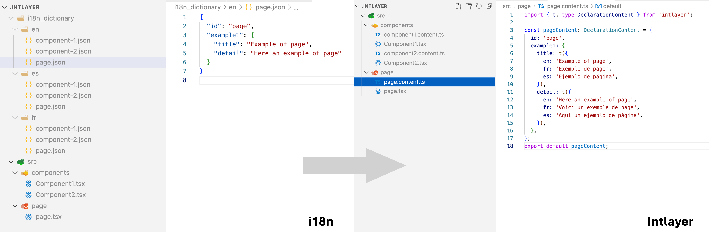

# next-intl מול Intlayer

<iframe title="הכול על i18n: המדריך המלא לבינאום ווב" class="m-auto aspect-16/9 w-full overflow-hidden rounded-lg border-0" allow="autoplay; gyroscope;" loading="lazy" width="1080" height="auto" src="https://www.youtube.com/embed/7VtLdbtV1us?autoplay=0&amp;start=1617&amp;origin=https://intlayer.org&amp;controls=0&amp;rel=1"/>


`next-intl` היא ספריית ה-i18n הפופולרית ביותר עבור Next.js. Intlayer היא חלופה מבוססת קומפיילר עם תוכן מבודד ברמת הקומפוננטה. שתיהן מאפשרות בינאום מלא ביישומי App Router. השאלה המרכזית היא מה העלות שכל אחת מהן גובה ברגע שהאפליקציה נבנית לפרודקשן.

מאמר זה אינו מדריך, אלא השוואה המגובה במספרים מתוך [Benchmark Bloom](https://github.com/intlayer-org/benchmark-bloom), חבילת בדיקות קוד פתוח הבונה את אותו יישום בדיוק בכל ספרייה ומודדת מה שהדפדפן מוריד ומריץ בפועל.

<TOC/>

> **תקציר (tl;dr)**: באותו יישום Next.js, ‏`next-intl` מוסיפה **+12.6 KB ב-gzip** של JavaScript בכל דף, לעומת **+0.3 KB** בלבד עם Intlayer. ללא עבודה ידנית נוספת, `next-intl` שולחת **~90% ממחרוזות הדפים הזרים** בכל דף. הגעה ל-0% דליפה ב-`next-intl` דורשת פיצול ל-namespaces ושימוש ב-`pick(messages, [...])` בכל דף. Intlayer מגיעה ל-0% כברירת מחדל, מפני שהקומפיילר שלה תוחם תוכן ברמת הקומפוננטה. אם אתם מעוניינים ב-API של `next-intl` עם הפלט הממוטב של Intlayer, מתאם `@intlayer/next-intl` הציג **147.5 KB** לדף לעומת **153.6 KB** בספרייה המקורית.

## בקצרה

- **next-intl** - קלת משקל, מתועדת היטב, תומכת בפורמט הודעות ICU, ומציעה תמיכה מובילה ב-App Router עם middleware, מעבדי פורמט ועזרי ניווט. התוכן שמור בקטלוגי JSON מרכזיים; אופטימיזציות ביצועים (ניהול namespaces, סינון הודעות לכל דף וטעינה עצלה) הן באחריותכם.
- **Intlayer** - מודל תוכן ממוקד קומפוננטה. מילוני `.content.ts` ממוקמים בצמוד לקומפוננטה שהם משרתים, קומפיילר בזמן build מבצע tree-shaking וטעינה עצלה לכל קומפוננטה ושפה, טיפוסי TypeScript קפדניים נוצרים ישירות מהתוכן שלכם, ותרגומים חסרים מכשילים את הבנייה. כוללת middleware, עזרי SEO, עורך ויזואלי / CMS ותרגום מבוסס AI.

| ספרייה                | כוכבי GitHub                                                                                                                                                                   | סך ה-Commits                                                                                                                                                                       | Commit אחרון                                                                                                                                        | גרסה ראשונה | גרסת NPM                                                                                                      | הורדות NPM                                                                                                               |
| --------------------- | ------------------------------------------------------------------------------------------------------------------------------------------------------------------------------ | ---------------------------------------------------------------------------------------------------------------------------------------------------------------------------------- | --------------------------------------------------------------------------------------------------------------------------------------------------- | ----------- | ------------------------------------------------------------------------------------------------------------- | ------------------------------------------------------------------------------------------------------------------------ |
| `aymericzip/intlayer` | [](https://github.com/aymericzip/intlayer/stargazers) | [](https://github.com/aymericzip/intlayer/commits) | [](https://github.com/aymericzip/intlayer/commits) | אפריל 2024  | [](https://www.npmjs.com/package/intlayer)   | [](https://www.npmjs.com/package/intlayer)   |
| `amannn/next-intl`    | [](https://github.com/amannn/next-intl/stargazers)       | [](https://github.com/amannn/next-intl/commits)       | [](https://github.com/amannn/next-intl/commits)       | נובמבר 2020 | [](https://www.npmjs.com/package/next-intl) | [](https://www.npmjs.com/package/next-intl) |

> התגים מתעדכנים אוטומטית. הנתונים עשויים להשתנות לאורך זמן.

## השוואת תכונות ראש בראש

| תכונה                                       | `next-intlayer` (Intlayer)                                              | `next-intl`                                                                                    |
| ------------------------------------------- | ----------------------------------------------------------------------- | ---------------------------------------------------------------------------------------------- |
| **תרגומים צמודים לקומפוננטות**              | ✅ כן, קובצי `.content.ts` ממוקמים לצד כל קומפוננטה                     | ❌ לא, קובצי `messages/{locale}.json` מרכזיים                                                  |
| **אינטגרציה עם TypeScript**                 | ✅ טיפוסים קפדניים שנוצרים אוטומטית מהתוכן                              | ✅ טובה, מפתחות מוקלדים דרך הרחבת `global.d.ts`                                                |
| **זיהוי תרגומים חסרים**                     | ✅ שגיאת TypeScript + שגיאה/אזהרה בזמן build                            | ⚠️ ברירת מחדל בזמן ריצה + אזהרה במסוף                                                          |
| **תוכן עשיר (JSX / Markdown / קומפוננטות)** | ✅ תמיכה ישירה ומובנית                                                  | ⚠️ ‏`t.rich()` / `t.markup()` עם תגיות מחזיקות מקום                                             |
| **תמיכה ב-ICU**                             | ⚠️ בפיתוח                                                               | ✅ כן                                                                                          |
| **עיצוב (תאריכים, מספרים, מטבעות)**         | ✅ `useNumber`, `useDate`, ... (`Intl` מתחת למכסה המנוע)                | ✅ `useFormatter()` (`Intl` מתחת למכסה המנוע)                                                  |
| **ניתוב מתורגם ו-middleware**               | ✅ פרוקסי/middleware מובנים, `getMultilingualUrls`                      | ✅ middleware מובנה, `Link`, `redirect`, `usePathname`                                         |
| **עזרי SEO (hreflang, sitemap, robots)**    | ✅ עזרים מובנים                                                         | ⚠️ ידני, מבוסס על תצורת הניתוב                                                                 |
| **Server Components סינכרוניים**            | ✅ `useIntlayer` מ-`next-intlayer/server` עובד בכל קומפוננטת שרת צאצאית | ⚠️ ‏`getTranslations` הוא async; קומפוננטות צאצאיות סינכרוניות דורשות העברת `t` כפרופס          |
| **רינדור סטטי (Static rendering)**          | ✅ אינו חוסם רינדור סטטי                                                | ⚠️ דורש `setRequestLocale()`; במבחנים שלנו קטלוגים עם namespaces ביטלו רינדור סטטי בחלק מהדפים |
| **Tree-shaking (שליחת תוכן בשימוש בלבד)**   | ✅ לכל קומפוננטה, לכל שפה, אוטומטי לחלוטין על ידי הקומפיילר             | ⚠️ ידני: חלוקת namespaces ו-`pick(messages, [...])` לכל דף                                     |
| **טעינה עצלה (Lazy loading)**               | ✅ `importMode: 'dynamic'` (שורת הגדרה בודדת)                           | ⚠️ ייבוא דינמי ידני בתוך `getRequestConfig`                                                    |
| **ניקוי תוכן שאינו בשימוש (Purge)**         | ✅ מילונים שאינם בשימוש מוסרים בזמן build                               | ❌ אינו מובנה                                                                                  |
| **בדיקת תרגומים חסרים (CLI / CI)**          | ✅ `npx intlayer content test`                                          | ⚠️ אינו מובנה; התיעוד מציע את `npx @lingual/i18n-check`                                        |
| **תרגום מבוסס AI**                          | ✅ מובנה, משתמש במפתחות ה-API האישיים שלכם                              | ❌ אין                                                                                         |
| **עורך ויזואלי / CMS**                      | ✅ עורך ויזואלי חינמי + CMS אופציונלי                                   | ❌ אין (מסתמך על פלטפורמות לוקליזציה חיצוניות)                                                 |
| **שרת MCP וכישורי סוכנים**                  | ✅ כן                                                                   | ❌ אין                                                                                         |
| **אקוסיסטם וקהילה**                         | ⚠️ קטן יותר אך בצמיחה מהירה                                             | ✅ גדול ומבוסס, ברירת המחדל המוכרת ב-Next.js                                                   |

## מבחן הביצועים (Benchmark)

### מה נמדד

חבילת [Benchmark Bloom](https://github.com/intlayer-org/benchmark-bloom) בונה **את אותו יישום בדיוק** בכל ספרייה: **10 דפים** (home, about, blog, careers, contact, FAQ, pricing, products, settings, team), **10 שפות** (`en`, `fr`, `es`, `de`, `it`, `pt`, `zh`, `ja`, `ko`, `ru`), קומפוננטות זהות ותוכן זהה. הדפים נמדדים ב-`en` וב-`fr`. כל ספרייה מיושמת בעד ארבע **אסטרטגיות טעינה**:

| אסטרטגיה           | תיאור                                                                          | מי משתמש בזה                      |
| ------------------ | ------------------------------------------------------------------------------ | --------------------------------- |
| **static**         | כל השפות וכל הדפים מאוגדים יחד בחבילה אחת                                      | אבות טיפוס מהירים, קוד שנוצר ב-AI |
| **dynamic**        | רק השפה הפעילה נטענת, אך כל הדפים נטענים יחד בבת אחת                           | מרבית הפרויקטים                   |
| **scoped-static**  | חלוקת namespaces לכל נתיב, ללא טעינה עצלה                                      | נדיר                              |
| **scoped-dynamic** | חלוקת namespaces לכל נתיב + טעינה עצלה. רק הדף הנוכחי בשפה הנוכחית נשלח לדפדפן | יישומים עם תקציב ביצועים קפדני    |

ל-Intlayer אין גרסת "scoped" ייעודית: הקומפיילר תוחם את התוכן **לכל קומפוננטה** באופן אוטומטי, כך ששורות ה-`static` וה-`dynamic` שלה כבר מבודדות וממוטבות מראש.

לכל בנייה, חבילת הבדיקות מודדת:

- **גודל ספרייה (Lib size)**: משקל gzip של קומפוננטה ריקה שמייבאת רק את ספריית ה-i18n (העלות הקבועה של זמן הריצה).
- **ממוצע JS לדף (Page JS)**: משקל ה-JavaScript המורד ב-gzip לכל דף, בממוצע על פני כל הדפים והשפות.
- **אחוז דליפת שפה (Locale leak %)**: חלקן של מחרוזות מתורגמות ב-JS שהורד השייכות לשפה שהמשתמש **אינו** צופה בה.
- **אחוז דליפת דפים (Page leak %)**: חלקן של מחרוזות מתורגמות ב-JS שהורד השייכות לדף שהמשתמש **אינו** נמצא בו.
- **ממוצע לקומפוננטה (Component avg)**: משקל ממוצע ב-gzip של כל קומפוננטה כשהיא מקומפלת בבידוד.
- **תגובתיות מקצה לקצה (E2E reactivity)**: זמן שעון בין בחירת שפה חדשה לעדכון `html[lang]` ב-DOM (נבדק ב-Playwright, ממוצע של 5 חזרות).
- **הידרציה (Hydration)**: משך שלב ההידרציה של React.

> הנתונים להלן מגיעים מהרצה מיום **12 בספטמבר 2026** עם `next-intl` 4.14.2, `use-intl` 4.14.2 ו-`intlayer` 9.5.1. יישום הבדיקה קטן במכוון (עשרות בודדות של מחרוזות לשפה), כך שאחוזי הדליפה מתארים **דפוס עקרוני**: הם צומחים ככל שנפח התוכן גדל, בעוד שעלות זמן הריצה נשארת קבועה.

### תוצאות ב-Next.js (App Router)

<I18nBenchmark framework="nextjs" packages="next-intl,next-intlayer" vertical/>

| ספרייה                         | אסטרטגיה       | גודל ספרייה (gz) | ממוצע JS לדף (gz) | דליפת שפה | דליפת דפים | ממוצע לקומפוננטה (gz) | תגובתיות E2E | הידרציה |
| ------------------------------ | -------------- | ---------------: | ----------------: | --------: | ---------: | --------------------: | -----------: | ------: |
| **בסיס** (ללא i18n)            | -              |           0.0 KB |          141.0 KB |      0.0% |       0.0% |                0.9 KB |      13.4 ms | 11.8 ms |
| `next-intl`                    | static         |          14.7 KB |          153.6 KB |      4.2% |      89.8% |               21.8 KB |      16.0 ms | 14.7 ms |
| `next-intl`                    | dynamic        |          14.7 KB |          153.6 KB |      9.7% |      89.9% |               21.8 KB |      15.6 ms | 14.8 ms |
| `next-intl`                    | scoped-static  |          14.7 KB |          153.6 KB |      0.0% |       0.0% |               80.1 KB |      17.9 ms | 17.4 ms |
| `next-intl`                    | scoped-dynamic |          14.7 KB |          153.6 KB |      0.0% |       0.0% |               22.9 KB |      17.8 ms | 16.8 ms |
| **`next-intlayer`**            | static         |       **5.5 KB** |      **141.3 KB** |  **0.0%** |   **0.0%** |            **8.5 KB** |  **15.5 ms** | 16.9 ms |
| **`next-intlayer`**            | dynamic        |       **5.5 KB** |      **141.3 KB** |  **0.0%** |   **0.0%** |            **6.9 KB** |  **15.3 ms** | 15.9 ms |
| `@intlayer/next-intl` (תאימות) | static         |           8.0 KB |          147.5 KB |      0.0% |       0.0% |                8.1 KB |      14.5 ms | 12.8 ms |
| `@intlayer/next-intl` (תאימות) | dynamic        |           8.0 KB |          148.7 KB |      0.0% |       0.0% |                8.1 KB |      11.7 ms | 12.8 ms |

**כיצד לקרוא את התוצאות**

- **עלות זמן ריצה:** אפליקציית הבסיס שוקלת 141.0 KB לדף. `next-intl` מביאה אותה ל-153.6 KB (**תוספת של 12.6 KB ב-gzip בכל דף**), ו-Intlayer ל-141.3 KB (**תוספת של 0.3 KB בלבד**). פער זה אינו תלוי בכמות המחרוזות שלכם: זהו משקל זמן הריצה של הספרייה.
- **דליפת תוכן:** בשתי התצורות הנפוצות ביותר (`static` ו-`dynamic`), ‏`next-intl` מעבירה **~90% ממחרוזות הדפים הזרים** בכל דף: כל קובץ `en.json` מוזן ל-provider הלקוח. הגעה ל-0% דורשת את תצורות `scoped-*`: פיצול ידני ל-namespaces ושימוש ב-`pick()` בכל דף. Intlayer עומדת על 0% בשתי השורות ללא צורך במאמץ זה.
- **גודל קומפוננטה:** קומפוננטה שקוראת ל-`useTranslations()` מתקמפלת למשקל ממוצע של 21.8 KB; אותה קומפוננטה עם `useIntlayer()` מתקמפלת ל-6.9 KB. בתצורת `scoped-static` קומפוננטות `next-intl` מזנקות ל-80.1 KB משום שכל אחת מהן כוללת את כל קטלוג ה-namespace שלה.
- **תגובתיות והידרציה** דומות מאוד בשתי הספריות על גבי Next.js (15-18 ms). אף אחת מהן אינה מהווה צוואר בקבוק במדד זה.

<ClickToOpenIframe
src="https://intlayer.org/markdown?url=https%3A%2F%2Fraw.githubusercontent.com%2Fintlayer-org%2Fbenchmark-i18n%2Fmain%2Freport%2Fscripts%2Fsummarize-nextjs.md"
width="100%"
height="600px"
style="border:none;"
/>

> הטבלה המלאה זמינה ב-[דוח ה-benchmark של Next.js](https://github.com/aymericzip/intlayer/blob/main/docs/docs/he-IL/benchmark/nextjs.md).

- [דוח ה-benchmark של Next.js](https://github.com/aymericzip/intlayer/blob/main/docs/docs/he-IL/benchmark/nextjs.md)

### תוצאות ב-TanStack Start (`use-intl`)

`use-intl` היא ליבת הספרייה הבלתי תלויה בפריימוורק של `next-intl`. אותו API, אותו פורמט הודעות. השוואתה מול `intlayer` ב-TanStack Start מבודדת את ההבדלים מחוץ להקשר של Next.js.

| ספרייה                        | אסטרטגיה       | גודל ספרייה (gz) | ממוצע JS לדף (gz) | דליפת שפה | דליפת דפים | ממוצע לקומפוננטה (gz) | תגובתיות E2E |
| ----------------------------- | -------------- | ---------------: | ----------------: | --------: | ---------: | --------------------: | -----------: |
| **בסיס** (ללא i18n)           | -              |           0.0 KB |          111.0 KB |      0.0% |       0.0% |                0.7 KB |       8.1 ms |
| `use-intl`                    | static         |          14.1 KB |          179.8 KB |     50.0% |      89.8% |               76.0 KB |       6.7 ms |
| `use-intl`                    | dynamic        |          14.1 KB |          119.4 KB |      0.0% |      89.8% |               75.9 KB |       7.0 ms |
| `use-intl`                    | scoped-static  |          14.1 KB |          128.7 KB |      0.0% |       0.0% |               87.1 KB |      20.9 ms |
| `use-intl`                    | scoped-dynamic |          14.1 KB |          128.7 KB |      0.0% |       0.0% |               87.1 KB |      13.3 ms |
| **`intlayer`**                | static         |       **5.0 KB** |      **125.8 KB** |     50.0% |   **0.0%** |            **8.1 KB** |   **3.2 ms** |
| **`intlayer`**                | dynamic        |       **5.0 KB** |      **118.6 KB** |  **0.0%** |   **0.0%** |            **6.3 KB** |   **3.6 ms** |
| `@intlayer/use-intl` (תאימות) | dynamic        |           7.3 KB |          129.7 KB |      0.0% |       0.0% |                9.3 KB |       8.7 ms |

**כיצד לקרוא את התוצאות**

- ההגדרה הנאיבית של `use-intl` שולחת **68.8 KB יותר JS לכל דף** מאשר אפליקציית הבסיס, כאשר מחצית מהמחרוזות שייכות לשפה הלא נכונה ו-90% שייכות לדף הלא נכון.
- `use-intl` במצב `dynamic` מגיעה ל-119.4 KB, קרוב מאוד ל-118.6 KB של Intlayer, אך עדיין נושאת **89.8% דליפת דפים**: מחרוזות כל הדפים עבור השפה הפעילה נטענות בכל דף. בידודן לפי נתיב (`scoped-*`) מבטל את הדליפה אך מוסיף כ-9 KB של תקורת chunks.
- שורת ה-`static` של Intlayer כוללת כבר **0% דליפת דפים**: הקומפיילר אורז אך ורק את המילונים המשמשים את קומפוננטות הדף. הפעלת `importMode: 'dynamic'` מסירה גם את דליפת השפה.
- **גודל הקומפוננטה משקף את הארכיטקטורה:** 76-87 KB לקומפוננטה עם `use-intl` לעומת 6-8 KB עם Intlayer. ‏`useTranslations()` קושרת כל קומפוננטה לעץ ההודעות הגלובלי; `useIntlayer()` קושרת אותה למילון שלה בלבד.
- **החלפת שפה** מהירה פי 2 עד 4 עם Intlayer (3 ms לעומת 7-21 ms).

<ClickToOpenIframe
src="https://intlayer.org/markdown?url=https%3A%2F%2Fraw.githubusercontent.com%2Fintlayer-org%2Fbenchmark-i18n%2Fmain%2Freport%2Fscripts%2Fsummarize-tanstack.md"
width="100%"
height="600px"
style="border:none;"
/>

> הטבלה המלאה זמינה ב-[דוח ה-benchmark של TanStack Start](https://github.com/aymericzip/intlayer/blob/main/docs/docs/he-IL/benchmark/tanstack.md).

- [דוח ה-benchmark של TanStack Start](https://github.com/aymericzip/intlayer/blob/main/docs/docs/he-IL/benchmark/tanstack.md)

## מדוע הפער? קטלוגים מרכזיים לעומת מילונים מקומפלים



`next-intl` פועלת לפי המודל הקלאסי: קובץ JSON אחד לכל שפה, הנטען ב-`getRequestConfig`, מוזן ל-`NextIntlClientProvider`, ונקרא דרך `t("namespace.key")`.

```bash
.
├── messages
│   ├── en.json
│   └── fr.json
└── src
    ├── i18n
    │   ├── request.ts
    │   └── routing.ts
    ├── middleware.ts
    └── app
        └── [locale]
            ├── layout.tsx
            └── about
                └── page.tsx
```

זמן הריצה אינו יכול לדעת מראש באילו מפתחות דף מסוים ישתמש, ולכן ברירת המחדל הבטוחה היא לשלוח את כל הקטלוג. אופטימיזציה משמעה ש**אתם** מפצלים את הקטלוג ל-namespaces, **אתם** מחליטים אילו namespaces כל דף צריך, ו**אתם** מתחזקים מיפוי זה ככל שהקומפוננטות זזות ומשתנות. שורת ה-`scoped-dynamic` במבחן הביצועים היא התוצאה של עבודה מאומצת זו, ומרבית הצוותים אינם מגיעים אליה בפועל.

המחיר של אי-ביצוע אופטימיזציה זו גדל בשני צירים במקביל:


Intlayer הופכת את כיוון האחריות. התוכן מוגדר בצמוד לקומפוננטה:

```bash
.
├── intlayer.config.ts
└── src
    ├── middleware.ts
    ├── app
    │   └── [locale]
    │       ├── layout.tsx
    │       └── about
    │           ├── page.tsx
    │           └── page.content.ts
    └── components
        └── Counter
            ├── index.tsx
            └── index.content.ts
```

בזמן build, הקומפיילר (`@intlayer/swc` / `@intlayer/babel`) מזהה איזו קומפוננטה מייבאת איזה מילון. הוא אורז אך ורק את המילונים הנדרשים, רק עבור השפה הפעילה, ומסיר את כל השאר. תבנית ה-"scoped-dynamic" הופכת לתוצר אוטומטי של תהליך הבנייה במקום לנוהל ידני מתיש שהצוות נדרש לתחזק.

> כדי להשיג את תוצאות שורת ה-`dynamic`, הגדירו `dictionary.importMode: 'dynamic'` בתוך `intlayer.config.ts`. ראו את [תיעוד אופטימיזציית bundle](https://github.com/aymericzip/intlayer/blob/main/docs/docs/he-IL/bundle_optimization.md).

- [תיעוד אופטימיזציית bundle](https://github.com/aymericzip/intlayer/blob/main/docs/docs/he-IL/bundle_optimization.md)

## חוויית פיתוח (Developer Experience)

### קומפוננטת לקוח

<Tabs defaultTab="intlayer" group="techno">
<Tab label="next-intl" value="next-intl">

```json fileName="messages/en.json"
{
  "counter": {
    "label": "Counter",
    "increment": "Increment"
  }
}
```

```tsx fileName="src/components/Counter.tsx"
"use client";

import { useState } from "react";
import { useTranslations, useFormatter } from "next-intl";

export const Counter = () => {
  const t = useTranslations("counter");
  const format = useFormatter();
  const [count, setCount] = useState(0);

  return (
    <div>
      <p>{format.number(count)}</p>
      <button aria-label={t("label")} onClick={() => setCount((c) => c + 1)}>
        {t("increment")}
      </button>
    </div>
  );
};
```

> זכרו לכלול את ה-namespace בשם `counter` בהודעות המועברות ל-`NextIntlClientProvider` בכל דף שמרנדר קומפוננטה זו.

</Tab>
<Tab label="Intlayer" value="intlayer">

```ts fileName="src/components/Counter/index.content.ts"
import { t, type Dictionary } from "intlayer";

const counterContent = {
  key: "counter",
  content: {
    label: t({ en: "Counter", fr: "Compteur", "he-IL": "מונה" }),
    increment: t({ en: "Increment", fr: "Incrémenter", "he-IL": "הגדל" }),
  },
} satisfies Dictionary;

export default counterContent;
```

```tsx fileName="src/components/Counter/index.tsx"
"use client";

import { useState } from "react";
import { useIntlayer } from "next-intlayer";
import { useNumber } from "next-intlayer/format";

export const Counter = () => {
  const { label, increment } = useIntlayer("counter");
  const number = useNumber();
  const [count, setCount] = useState(0);

  return (
    <div>
      <p>{number(count)}</p>
      <button aria-label={label} onClick={() => setCount((c) => c + 1)}>
        {increment}
      </button>
    </div>
  );
};
```

אין צורך לרשום שום דבר בדף: הקומפוננטה מביאה איתה את התוכן שלה באופן עצמאי.

</Tab>
</Tabs>

### קומפוננטת שרת סינכרונית

רכיבי מערכת עיצוב (navbar, footer, כרטיסים) הם לרוב Server Components המרונדרים כילדים של קומפוננטות לקוח, ולכן אינם יכולים להיות `async`.

<Tabs defaultTab="intlayer" group="techno">
<Tab label="next-intl" value="next-intl">

```tsx fileName="src/components/ServerCounter.tsx"
type ServerCounterProps = {
  t: (key: string) => string;
  formattedCount: string;
};

export const ServerCounter = ({ t, formattedCount }: ServerCounterProps) => (
  <div>
    <p>{formattedCount}</p>
    <button aria-label={t("label")}>{t("increment")}</button>
  </div>
);
```

הדף נדרש לבצע `await getTranslations("counter")` ו-`await getFormatter()`, ואז להעביר את התוצאות כלפי מטה כפרופס. הקומפוננטה אינה עצמאית עוד.

</Tab>
<Tab label="Intlayer" value="intlayer">

```tsx fileName="src/components/ServerCounter.tsx"
import { useIntlayer } from "next-intlayer/server";
import { useNumber } from "next-intlayer/server/format";

export const ServerCounter = ({ count }: { count: number }) => {
  const { label, increment } = useIntlayer("counter");
  const number = useNumber();

  return (
    <div>
      <p>{number(count)}</p>
      <button aria-label={label}>{increment}</button>
    </div>
  );
};
```

</Tab>
</Tabs>

### מטא-דאטה

<Tabs defaultTab="intlayer" group="techno">
<Tab label="next-intl" value="next-intl">

```tsx fileName="src/app/[locale]/about/page.tsx"
import type { Metadata } from "next";
import { getTranslations } from "next-intl/server";
import { routing } from "@/i18n/routing";

const localizedPath = (locale: string, path: string) =>
  locale === routing.defaultLocale ? path : `/${locale}${path}`;

export const generateMetadata = async ({
  params,
}: {
  params: Promise<{ locale: string }>;
}): Promise<Metadata> => {
  const { locale } = await params;
  const t = await getTranslations({ locale, namespace: "about" });

  const languages = Object.fromEntries(
    routing.locales.map((l) => [l, localizedPath(l, "/about")])
  );

  return {
    title: t("title"),
    description: t("description"),
    alternates: {
      canonical: localizedPath(locale, "/about"),
      languages: { ...languages, "x-default": "/about" },
    },
  };
};
```

</Tab>
<Tab label="Intlayer" value="intlayer">

```tsx fileName="src/app/[locale]/about/page.tsx"
import { getIntlayer, getMultilingualUrls } from "intlayer";
import type { Metadata } from "next";
import type { LocalPromiseParams } from "next-intlayer";

export const generateMetadata = async ({
  params,
}: LocalPromiseParams): Promise<Metadata> => {
  const { locale } = await params;
  const metadata = getIntlayer("about-metadata", locale);
  const multilingualUrls = getMultilingualUrls("/about");

  return {
    ...metadata,
    alternates: {
      canonical: multilingualUrls[locale as keyof typeof multilingualUrls],
      languages: { ...multilingualUrls, "x-default": "/about" },
    },
  };
};
```

</Tab>
</Tabs>

## שמירה על ה-API של next-intl עם הפלט של Intlayer

אינכם חייבים לשכתב את הקומפוננטות שלכם כדי לקבל את תוצאות מבחן הביצועים שלעיל. המתאם `@intlayer/next-intl` הוא פתרון drop-in: הוא שומר על `useTranslations`, ‏`getTranslations`, ‏`useFormatter`, ‏`t.rich()`, צורות רבים ב-ICU ועוזרי הניווט של `next-intl/navigation`, ומגיש אותם מתוך מילוני Intlayer שמקומפלים על ידי הקומפיילר.

```ts fileName="next.config.ts"
import type { NextConfig } from "next";
import { createNextIntlPlugin } from "@intlayer/next-intl/plugin";

const withIntlayer = createNextIntlPlugin();

const nextConfig: NextConfig = {};

export default withIntlayer(nextConfig);
```

במבחן הביצועים, בניית התאימות של אותו יישום ירדה מ-**153.6 KB ל-147.5 KB** לדף, מ-**21.8 KB ל-8.1 KB** לקומפוננטה, ומ-**~90% דליפת דפים ל-0%**, מבלי לגעת בקוד האפליקציה. קובצי `messages/{locale}.json` הקיימים שלכם יכולים להישאר מקור האמת דרך [תוסף סנכרון ה-JSON](https://github.com/aymericzip/intlayer/blob/main/docs/docs/he-IL/compat/next-intl.md).

- [תוסף סנכרון ה-JSON](https://github.com/aymericzip/intlayer/blob/main/docs/docs/he-IL/compat/next-intl.md)

ראו את [מדריך ההגירה מ-next-intl](https://github.com/aymericzip/intlayer/blob/main/docs/docs/he-IL/migration_from_next-intl_to_intlayer.md) להנחיות שלב אחר שלב.

- [מדריך ההגירה מ-next-intl](https://github.com/aymericzip/intlayer/blob/main/docs/docs/he-IL/migration_from_next-intl_to_intlayer.md)

## מתי לבחור בכל אפשרות?

<AccordionGroup>
<Accordion header="בחרו ב-next-intl">

אתם מעוניינים בתקן המקובל בקהילת Next.js, מסתמכים על ICU MessageFormat, היישום שלכם בגודל קטן עד בינוני, או שאתם מחוברים לפלטפורמת תרגום (Crowdin, Phrase, Lokalise...) המצפה לקובצי JSON מרוכזים. קחו בחשבון את הזמן הנדרש לחלוקת namespaces ושימוש ב-`pick()` בכל דף אם ביצועים עומדים בראש סדר העדיפויות שלכם.

</Accordion>
<Accordion header="בחרו ב-Intlayer">

אתם רוצים **תוכן מבודד ברמת הקומפוננטה**, **TypeScript קפדני**, **שגיאות בזמן build על מפתחות חסרים**, **tree-shaking וטעינה עצלה ללא מאמץ**, Server Components סינכרוניים, וכלי עריכה מובנים ([עורך ויזואלי](https://github.com/aymericzip/intlayer/blob/main/docs/docs/he-IL/intlayer_visual_editor.md), [CMS](https://github.com/aymericzip/intlayer/blob/main/docs/docs/he-IL/intlayer_CMS.md), [תרגום ב-AI](https://github.com/aymericzip/intlayer/blob/main/docs/docs/he-IL/autoFill.md), [שרת MCP](https://github.com/aymericzip/intlayer/blob/main/docs/docs/he-IL/mcp_server.md)). רלוונטי במיוחד עבור בסיסי קוד מודולריים ומערכות עיצוב רחבות.

- [עורך ויזואלי](https://github.com/aymericzip/intlayer/blob/main/docs/docs/he-IL/intlayer_visual_editor.md)
- [CMS](https://github.com/aymericzip/intlayer/blob/main/docs/docs/he-IL/intlayer_CMS.md)
- [תרגום ב-AI](https://github.com/aymericzip/intlayer/blob/main/docs/docs/he-IL/autoFill.md)
- [שרת MCP](https://github.com/aymericzip/intlayer/blob/main/docs/docs/he-IL/mcp_server.md)

</Accordion>
<Accordion header="בחרו ב-@intlayer/next-intl">

אתם כבר עובדים עם `next-intl` ורוצים את יתרונות ה-bundle הקל ללא שכתוב קוד. [מתאם התאימות](https://github.com/aymericzip/intlayer/blob/main/docs/docs/he-IL/compat/next-intl.md) שומר על הייבואים הקיימים ועל קובצי `messages/{locale}.json` כמקור האמת. השוואה זו נמדדה ב-[next-intl מול @intlayer/next-intl](https://github.com/aymericzip/intlayer/blob/main/docs/blog/he-IL/next-intl_vs_intlayer-next-intl.md).

- [מתאם תאימות](https://github.com/aymericzip/intlayer/blob/main/docs/docs/he-IL/compat/next-intl.md)
- [next-intl מול @intlayer/next-intl](https://github.com/aymericzip/intlayer/blob/main/docs/blog/he-IL/next-intl_vs_intlayer-next-intl.md)

</Accordion>
</AccordionGroup>

## שאלות נפוצות (FAQ)

<FAQ>

<Question title="האם next-intl איטית יותר מ-Intlayer?">

לא בעת הרינדור עצמו. ההבדל טמון במה שנשלח לדפדפן: `next-intl` עולה **+12.6 KB ב-gzip** של זמן ריצה בכל דף, ובמרבית ההגדרות שולחת כ-90% מחרוזות מדפים זרים בכל דף. מהירות החלפת שפה והידרציה דומות מאוד ב-Next.js (15-18 ms); ב-TanStack Start, ‏`use-intl` דורשת 7-21 ms לעומת 3-4 ms ב-Intlayer.

</Question>

<Question title="האם ניתן להגיע ל-0% דליפה עם next-intl?">

כן, בעזרת תצורת `scoped-dynamic`: יש לפצל את `messages/{locale}.json` ל-namespace ייעודי לכל נתיב, להפעיל `pick(messages, [...])` בכל דף, ולתחזק מיפוי זה בקפידה. שורות ה-`scoped-*` במבחן הביצועים משקפות עבודה זו בדיוק. Intlayer מגיעה ל-0% ללא כל מאמץ ידני משום שהקומפיילר מבודד תוכן לכל קומפוננטה. ראו [אופטימיזציית bundle](https://github.com/aymericzip/intlayer/blob/main/docs/docs/he-IL/bundle_optimization.md).

- [אופטימיזציית bundle](https://github.com/aymericzip/intlayer/blob/main/docs/docs/he-IL/bundle_optimization.md)

</Question>

<Question title="האם חייבים לשכתב קומפוננטות כדי להגר?">

לא. המתאם `@intlayer/next-intl` שומר על `useTranslations`, ‏`getTranslations`, ‏`useFormatter`, ‏`t.rich()`, צורות רבים ב-ICU ועוזרי הניווט, ומגיש אותם מתוך מילונים מקומפלים. נדרשת שורת תוסף בודדת ב-`next.config.ts`. פירוט מלא ב-[מדריך ההגירה מ-next-intl](https://github.com/aymericzip/intlayer/blob/main/docs/docs/he-IL/migration_from_next-intl_to_intlayer.md).

- [מדריך ההגירה מ-next-intl](https://github.com/aymericzip/intlayer/blob/main/docs/docs/he-IL/migration_from_next-intl_to_intlayer.md)

</Question>

<Question title="האם Intlayer תומכת ב-ICU MessageFormat?">

תמיכה ב-ICU נמצאת בפיתוח עבור ה-API הטבעי. מתאמי התאימות (`@intlayer/next-intl`, `@intlayer/use-intl`) מריצים ICU באופן מלא: צורות רבים, `select`, `selectordinal`, `#` ו-`{ts, date, long}` מעובדים דרך מפענח ה-ICU של Intlayer. קראו את [הסבר על פורמט הודעות ICU](https://github.com/aymericzip/intlayer/blob/main/docs/blog/he-IL/icu_message_format.md) לפרטים נוספים.

- [הסבר על פורמט הודעות ICU](https://github.com/aymericzip/intlayer/blob/main/docs/blog/he-IL/icu_message_format.md)

</Question>

<Question title="האם אוכל לשמור על קובצי ה-messages/{locale}.json הקיימים?">

כן. [תוסף סנכרון ה-JSON](https://github.com/aymericzip/intlayer/blob/main/docs/docs/he-IL/compat/next-intl.md) קורא אותם, מפצל את המפתחות הראשיים למילונים, וכותב תרגומים בחזרה לאותם קבצים בעת עדכון מה-CLI או מה-CMS. תהליך העבודה של המתרגמים אינו משתנה כלל.

- [תוסף סנכרון ה-JSON](https://github.com/aymericzip/intlayer/blob/main/docs/docs/he-IL/compat/next-intl.md)

</Question>

</FAQ>

## השוואות קשורות

אותו מבחן ביצועים, ספריות אחרות:

- [i18next מול Intlayer](https://github.com/aymericzip/intlayer/blob/main/docs/blog/he-IL/i18next_vs_intlayer.md)
- [Lingui מול Intlayer](https://github.com/aymericzip/intlayer/blob/main/docs/blog/he-IL/lingui_vs_intlayer.md)
- [vue-i18n מול Intlayer](https://github.com/aymericzip/intlayer/blob/main/docs/blog/he-IL/vue-i18n_vs_intlayer.md)
- [next-i18next מול next-intl מול Intlayer](https://github.com/aymericzip/intlayer/blob/main/docs/blog/he-IL/next-i18next_vs_next-intl_vs_intlayer.md)
- [react-i18next מול react-intl מול Intlayer](https://github.com/aymericzip/intlayer/blob/main/docs/blog/he-IL/react-i18next_vs_react-intl_vs_intlayer.md)

להעמקה נוספת ב-next-intl:

- [next-intl מול @intlayer/next-intl](https://github.com/aymericzip/intlayer/blob/main/docs/blog/he-IL/next-intl_vs_intlayer-next-intl.md)
- [האם next-intl מיושנת ב-2026?](https://github.com/aymericzip/intlayer/blob/main/docs/blog/he-IL/is_next-intl_outdated.md)
- [שימוש ב-Intlayer לצד next-intl](https://github.com/aymericzip/intlayer/blob/main/docs/blog/he-IL/intlayer_with_next-intl.md)
- [כיצד לבצע בינאום באפליקציית Next.js עם next-intl](https://github.com/aymericzip/intlayer/blob/main/docs/blog/he-IL/i18n_using_next-intl.md)

תיעוד ומדריכים:

- [מתאם תאימות: next-intl](https://github.com/aymericzip/intlayer/blob/main/docs/docs/he-IL/compat/next-intl.md)
- [מדריך הגירה](https://github.com/aymericzip/intlayer/blob/main/docs/docs/he-IL/migration_from_next-intl_to_intlayer.md)
- [אופטימיזציית bundle](https://github.com/aymericzip/intlayer/blob/main/docs/docs/he-IL/bundle_optimization.md)
- [קומפיילר Intlayer](https://github.com/aymericzip/intlayer/blob/main/docs/docs/he-IL/compiler.md)
- [בינאום לפי קומפוננטה מול בינאום מרוכז](https://github.com/aymericzip/intlayer/blob/main/docs/blog/he-IL/per-component_vs_centralized_i18n.md)
- [בינאום מונחה קומפיילר מול בינאום הצהרתי](https://github.com/aymericzip/intlayer/blob/main/docs/blog/he-IL/compiler_vs_declarative_i18n.md)

דוחות benchmark:

- [סקירת ה-benchmark המקיפה](https://github.com/aymericzip/intlayer/blob/main/docs/docs/he-IL/benchmark/index.md)
- [Next.js](https://github.com/aymericzip/intlayer/blob/main/docs/docs/he-IL/benchmark/nextjs.md)
- [TanStack Start](https://github.com/aymericzip/intlayer/blob/main/docs/docs/he-IL/benchmark/tanstack.md)
- [Vue](https://github.com/aymericzip/intlayer/blob/main/docs/docs/he-IL/benchmark/vue.md)
- [Solid](https://github.com/aymericzip/intlayer/blob/main/docs/docs/he-IL/benchmark/solid.md)
- [Svelte](https://github.com/aymericzip/intlayer/blob/main/docs/docs/he-IL/benchmark/svelte.md)

> כדי להבין את מקורן של ספריות אלו, קראו על ההיסטוריה של בינאום ב-JavaScript.

- [ההיסטוריה של בינאום ב-JavaScript](https://github.com/aymericzip/intlayer/blob/main/docs/blog/he-IL/history_of_i18n.md)

## כוכבי GitHub

כוכבי GitHub הם אינדיקטור מובהק לפופולריות של פרויקט, לאמון הקהילה ולרלוונטיות ארוכת טווח. למרות שאינם מדד ישיר לאיכות טכנית, הם משקפים כמה מפתחים מוצאים את הפרויקט שימושי, עוקבים אחר התקדמותו ונוטים לאמץ אותו.

[](https://star-history.com/#amannn/next-intl&aymericzip/intlayer)

## פעילות Commits

כוכבים מעידים על פופולריות. Commits מראים כמה עבודה מושקעת בפרויקט בפועל. במועד כתיבת שורות אלו, Intlayer מונה כ-7,500 commits, יותר ממרבית הספריות המושוות כאן, ובערך פי 5 יותר מ-`next-intl` או `next-i18next`.

<GithubCommits repositories="amannn/next-intl,aymericzip/intlayer" />

> Intlayer היא monorepo, כך שהספירה כוללת את כל חבילות המסגרות, ה-CLI והתיעוד. קראו commits כסימן לפעילות מתמשכת, ולא כמדד ישיר לאיכות.

## הורדות ב-npm

<NpmDownloads packages="next-intl,next-intlayer" period="last-6-months" />

הורדות מתגמלות את הפתרונות הוותיקים ביותר, ולא בהכרח את הטובים ביותר. ספרייה ששוחררה לפני שנים עדיין מותקנת על ידי כל פרויקט שבחר בה בעבר, בכל הרצת CI ועל ידי כל חבילה שתלויה בה. הספירה משקפת אינרציה יותר מאשר בחירה עדכנית.

עוזרי AI מגבירים את האפקט הזה. `next-intl`, `i18next` ו-`vue-i18n` מופיעות בכל מקום בקוד שעליו הם אומנו, ולכן הם ממליצים עליהן כברירת מחדל, ללא השוואה לחלופות. כל המלצה כזו מוסיפה הורדות, מה שמזין את ההמלצה הבאה. מומלץ להשוות על פי נתוני מבחני הביצועים ולא על פי כמות ההורדות.

## סיכום

`next-intl` היא ספרייה יציבה ומתוחזקת היטב, ומבחן הביצועים מאשר כי היא רחוקה מלהיות האפשרות הגרועה ביותר ב-Next.js. אך מודל הקטלוג המרוכז שלה מטיל את כל משימת האופטימיזציה על המפתח: ההגדרה הנאיבית מדליפה כ-90% מתוכן הדפים הזרים, וזמן הריצה לבדו עולה +12.6 KB ב-gzip בכל דף.

Intlayer מעבירה את העבודה הזו לקומפיילר. מילונים לפי קומפוננטה, טעינה עצלה לכל שפה והסרת תוכן שאינו בשימוש הם תוצרים מובנים של תהליך הבנייה, ולא מוסכמות שצריך לזכור. התוצאה באותו יישום: **+0.3 KB לדף**, **0% דליפת תוכן**, קומפוננטות **קטנות פי 3**, והחלפת שפה **מהירה פי 2 עד 4** ב-TanStack Start.

כל הנתונים הגולמיים, יישומי הבדיקה והסקריפטים זמינים במאגר [Benchmark Bloom](https://github.com/intlayer-org/benchmark-bloom). הריצו אותם בעצמכם.

עיינו במסמך ['למה Intlayer?'](https://github.com/aymericzip/intlayer/blob/main/docs/docs/he-IL/interest_of_intlayer.md) לפרטים נוספים.

- [למה Intlayer? יתרונות על פני ספריות i18n אחרות](https://github.com/aymericzip/intlayer/blob/main/docs/docs/he-IL/interest_of_intlayer.md)
