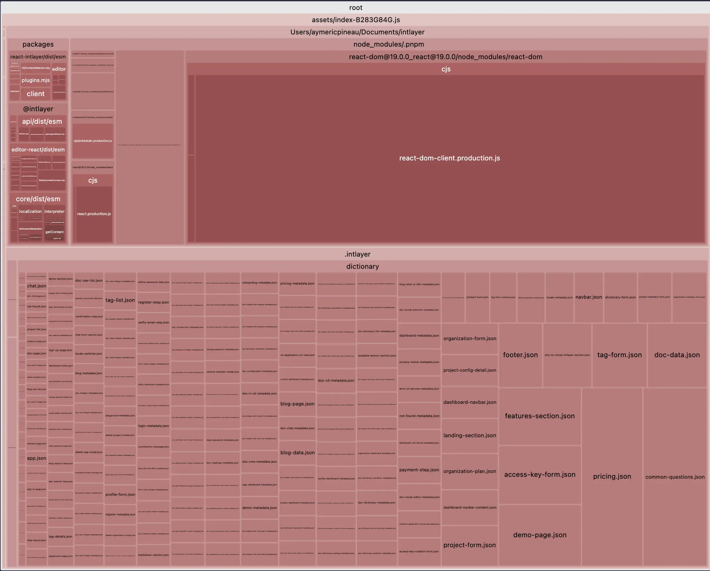
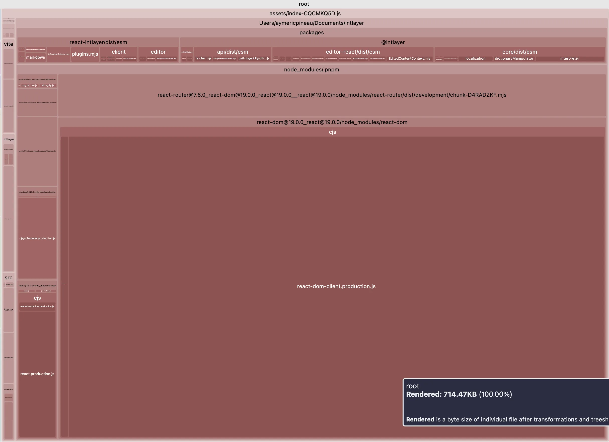

# i18n לפי-רכיב (Per-Component) מול גישה מרוכזת (Centralized)

גישת ה-per-component אינה מושג חדש. לדוגמה, באקוסיסטם של Vue, הספרייה `vue-i18n` תומכת ב-[Single File Component (SFC) i18n](https://vue-i18n.intlify.dev/guide/advanced/sfc.html). גם Nuxt מציעה [תרגומים לפי רכיב](https://i18n.nuxtjs.org/docs/guide/per-component-translations), ו-Angular משתמשת בתבנית דומה באמצעות [Feature Modules](https://v17.angular.io/guide/feature-modules).

אפילו באפליקציות Flutter, ניתן למצוא לעתים קרובות את התבנית הזו:

```bash
lib/
└── features/
    └── login/
        ├── login_screen.dart
        └── login_screen.i18n.dart  # <- התרגומים יושבים כאן
```

```dart fileName='lib/features/login/login_screen.i18n.dart'
import 'package:i18n_extension/i18n_extension.dart';

extension Localization on String {
  static var _t = Translations.byText("en") +
      {
        "Hello": {
          "en": "Hello",
          "he": "שלום",
          "fr": "Bonjour",
        },
      };

  String get i18n => localize(this, _t);
}
```

עם זאת, בעולם של React אנו רואים בעיקר גישות שונות, אותן ניתן לחלק לשתי קטגוריות עיקריות:

<Columns>
  <Column>

**גישה מרוכזת (Centralized approach)** (i18next, next-intl, react-intl, lingui)

- (ללא namespaces) מסתמכת על מקור יחיד לשליפת תוכן. כברירת מחדל, אתם טוענים את התוכן של כל הדפים כאשר האפליקציה נטענת.

  </Column>
  <Column>

**גישה מגורענת (Granular approach)** (intlayer, inlang)

- מחלקת את שליפת התוכן ברזולוציה עדינה לפי מפתח, או לפי רכיב (per-component).

  </Column>

</Columns>

> במאמר זה לא אתמקד בפתרונות מבוססי קומפיילר, אותם כבר סקרתי כאן: [קומפיילר מול i18n הצהרתי](https://github.com/aymericzip/intlayer/blob/main/docs/blog/he-IL/compiler_vs_declarative_i18n.md).
> שימו לב ש-i18n מבוסס קומפיילר (למשל Lingui) פשוט הופך את החילוץ והטעינה של התוכן לאוטומטיים. מתחת למכסה המנוע, פתרונות אלו חולקים לרוב את אותן מגבלות כמו שאר הגישות.

- [קומפיילר מול i18n הצהרתי](https://github.com/aymericzip/intlayer/blob/main/docs/blog/he-IL/compiler_vs_declarative_i18n.md)

> שימו לב שככל ששליפת התוכן מגורענת יותר, כך גובר הסיכון להחדרת state ולוגיקה נוספים לתוך הרכיבים שלכם.

גישות מגורענות גמישות יותר מגישות מרוכזות, אך לרוב מדובר בפשרה (tradeoff). גם אם ספריות מסוימות מפרסמות "tree shaking", בפועל לעתים קרובות תסיימו בטעינת הדף בכל השפות.

באופן כללי, ההחלטה מתמצתת כך:

- **יותר דפים משפות** ← העדיפו גישה מגורענת (granular)
- **יותר שפות מדפים** ← העדיפו גישה מרוכזת (centralized)

כמובן שמפתחי הספריות מודעים למגבלות אלו ומספקים מעקפים.
ביניהם: חלוקה ל-namespaces, טעינה דינמית של קובצי JSON באמצעות (`await import()`), או הסרת תוכן לא בשימוש (purging) בזמן הבנייה (build time).

הנה מה שכל בחירה עולה באפליקציה תיאורטית של 1 עד 10 דפים ב-1 עד 10 שפות, עם כ-30KB של טקסט לכל דף. ייבוא דינמי חותך את ציר השפות, תיחום (scoping) חותך את ציר הדפים, ורק השילוב ביניהם שומר על גרף שטוח ויציב.


במקביל, עליכם לדעת שכאשר אתם טוענים תוכן באופן דינמי, אתם מייצרים בקשות רשת נוספות לשרת שלכם. כל `useState` או hook נוסף עשויים לגרור בקשת שרת נוספת.

> כדי לפתור נקודה זו, Intlayer מציעה לקבץ הגדרות תוכן מרובות תחת אותו מפתח, ו-Intlayer תמזג את התוכן הזה באופן אוטומטי.

אך מבין כל הפתרונות הללו, ברור שהגישה הפופולרית ביותר היא עדיין הגישה המרוכזת.

## מדוע הגישה המרוכזת כה פופולרית?

- ראשית, i18next הייתה הפתרון הראשון שזכה לאימוץ נרחב, לפי פילוסופיה בהשראת ארכיטקטורות PHP ו-Java (MVC), הנשענות על הפרדת רשויות קפדנית (separation of concerns, הפרדת תוכן מקוד). היא הופיעה בשנת 2011 וקבעה סטנדרטים עוד לפני המעבר המאסיבי לארכיטקטורות מבוססות רכיבים (כמו React).
- שנית, ברגע שספרייה מאומצת בהיקף כה רחב, קשה להזיז את האקוסיסטם לתבניות אחרות.
- שימוש בגישה מרוכזת גם מקל על העבודה במערכות ניהול תרגום (TMS) כגון Crowdin, Phrase או Localise.
- הלוגיקה מאחורי גישת per-component מורכבת יותר מזו של גישה מרוכזת ודורשת זמן פיתוח נוסף, במיוחד כאשר צריך לפתור בעיות כמו זיהוי מיקום התוכן.

> כדי להבין מהיכן הגיעו ספריות אלו, קראו על ההיסטוריה של i18n ב-JavaScript.

- [ההיסטוריה של i18n ב-JavaScript](https://github.com/aymericzip/intlayer/blob/main/docs/blog/he-IL/history_of_i18n.md)

## טוב, אז למה לא פשוט להישאר עם הגישה המרוכזת?

הנה הסיבות מדוע גישה זו עלולה להיות בעייתית עבור האפליקציה שלכם:

- **מידע שאינו בשימוש (Unused Data):**
  כאשר דף נטען, לעתים קרובות אתם טוענים את התוכן של כל שאר הדפים. (באפליקציה של 10 דפים, מדובר ב-90% תוכן מיותר שנטען). טוענים חלון מודאלי ב-lazy loading? ספריית ה-i18n אינה מתחשבת בכך, היא תטען את המחרוזות קודם לכן בכל מקרה.
- **ביצועים (Performance):**
  בכל re-render, כל רכיב ורכיב עובר הידרציה עם מטען JSON כבד, מה שפוגע בתגובתיות האפליקציה ככל שהיא גדלה.
- **תחזוקה (Maintenance):**
  תחזוקת קובצי JSON ענקיים היא משימה מייגעת. עליכם לקפוץ בין קבצים שונים כדי להכניס תרגום, לוודא שלא חסרים תרגומים ושלא נותרו **מפתחות יתומים (orphan keys)** מאחור.
- **Design System:**
  הדבר יוצר חוסר התאמה למערכות עיצוב (למשל רכיב `LoginForm`) ומגביל שימוש חוזר ברכיבים בין אפליקציות שונות.

**"אבל המצאנו Namespaces!"**

נכון, וזהו צעד משמעותי קדימה. בואו נבחן את השוואת גודל החבילה הראשית (main bundle size) בסביבת Vite + React + React Router v7 + Intlayer. ביצענו סימולציה לאפליקציה בת 20 דפים.

הדוגמה הראשונה אינה כוללת טעינה עצלה (lazy loading) של תרגומים לכל שפה וללא פיצול ל-namespaces. השנייה כוללת purging של תוכן וטעינה דינמית של תרגומים.

| חבילה מותאמת (Optimized bundle)                                                                                           | חבילה שאינה מותאמת (Bundle not optimized)                                                              |
| ------------------------------------------------------------------------------------------------------------------------- | ------------------------------------------------------------------------------------------------------ |
|  |  |

הודות ל-namespaces, עברנו ממבנה כזה:

```bash
locale/
├── en.json
├── fr.json
└── es.json
```

למבנה כזה:

```bash
locale/
├── en/
│   ├── common.json
│   ├── navbar.json
│   ├── footer.json
│   ├── home.json
│   └── about.json
├── fr/
│   └── ...
└── es/
    └── ...

```

מצוין, אך האם זה מספיק? לא ממש. כעת עליכם לנהל באופן ידני ומדוקדק איזה חלק מתוכן האפליקציה ייטען, והיכן.
המסקנה היא שרוב הפרויקטים פשוט מדלגים על חלק זה בגלל המורכבות (ראו [מדריך next-i18next](https://github.com/aymericzip/intlayer/blob/main/docs/blog/he-IL/i18n_using_next-i18next.md) למשל, כדי לראות את האתגרים שנובעים (רק) מיישום שיטות מומלצות).
כתוצאה מכך, פרויקטים אלו מסיימים עם בעיית טעינת ה-JSON המאסיבית שתוארה קודם לכן.

- [מדריך next-i18next](https://github.com/aymericzip/intlayer/blob/main/docs/blog/he-IL/i18n_using_next-i18next.md)

> שימו לב שבעיה זו אינה ייחודית ל-i18next, אלא לכל הגישות המרוכזות שהוזכרו לעיל.

עם זאת, חשוב לזכור שלא כל הגישות המגורענות פותרות זאת. לדוגמה, גישות כמו `vue-i18n SFC` או `inlang` אינן מבצעות כברירת מחדל lazy loading לתרגומים לפי שפה, כך שאתם פשוט מחליפים בעיית גודל חבילה אחת באחרת.

בנוסף, ללא הפרדת רשויות נאותה, הופך קשה בהרבה לחלץ ולספק את התרגומים למתרגמים לצורך בדיקה.

## כיצד גישת ה-per-component של Intlayer פותרת זאת

Intlayer פועלת בכמה שלבים:

1. **הצהרה (Declaration):** הגדירו את התוכן בכל מקום בקוד שלכם באמצעות קובצי `*.content.{ts|jsx|cjs|json|json5|...}`. הדבר מבטיח הפרדת רשויות תוך שמירה על colocation של התוכן. קובץ תוכן יכול להיות לפי שפה בודדת או רב-לשוני.
2. **עיבוד (Processing):** Intlayer מריצה שלב בנייה כדי לעבד לוגיקת JS, לטפל בנסיגה (fallback) לתרגומים חסרים, לייצר טיפוסי TypeScript, לנהל תוכן כפול, למשוך תוכן מה-CMS שלכם ועוד.
3. **ניקוי (Purging):** כאשר האפליקציה שלכם נבנית, Intlayer מנקה תוכן שאינו בשימוש (בדומה לאופן שבו Tailwind מנהלת מחלקות CSS) על ידי החלפת התוכן כדלקמן:

**הצהרה:**

```tsx
// src/MyComponent.tsx
export const MyComponent = () => {
  const content = useIntlayer("my-key");
  return <h1>{content.title}</h1>;
};
```

```tsx
// src/myComponent.content.ts
export const {
  key: "my-key",
  content: t({
    "he-IL": { title: "הכותרת שלי" },
    en: { title: "My title" },
    fr: { title: "Mon titre" }
  })
}

```

**עיבוד:** Intlayer בונה את המילון בהתבסס על קובץ ה-`.content` ומייצרת:

```json5
// .intlayer/dynamic_dictionary/en/my-key.json
{
  "key": "my-key",
  "content": { "title": "My title" },
}
```

**החלפה:** Intlayer מחלצת את הרכיב שלכם במהלך בניית האפליקציה.

**מצב ייבוא סטטי (Static Import Mode):**

```tsx
// ייצוג הרכיב בתחביר דמוי JSX
export const MyComponent = () => {
  const content = useDictionary({
    key: "my-key",
    content: {
      nodeType: "translation",
      translation: {
        "he-IL": { title: "הכותרת שלי" },
        en: { title: "My title" },
        fr: { title: "Mon titre" },
      },
    },
  });

  return <h1>{content.title}</h1>;
};
```

**מצב ייבוא דינמי (Dynamic Import Mode):**

```tsx
// ייצוג הרכיב בתחביר דמוי JSX
export const MyComponent = () => {
  const content = useDictionaryAsync({
    en: () =>
      import(".intlayer/dynamic_dictionary/en/my-key.json", {
        with: { type: "json" },
      }).then((mod) => mod.default),
    // אותו דבר עבור שפות נוספות
  });

  return <h1>{content.title}</h1>;
};
```

> `useDictionaryAsync` משתמש במנגנון דמוי Suspense כדי לטעון את ה-JSON המתורגם רק בעת הצורך.

**יתרונות מרכזיים בגישת per-component זו:**

- שמירת הצהרת התוכן בצמוד לרכיבים מאפשרת יכולת תחזוקה משופרת (למשל, העברת רכיב לאפליקציה אחרת או ל-design system. מחיקת תיקיית הרכיב מוחקת גם את התוכן הקשור אליו, בדיוק כפי שאתם עושים עם קובצי `.test` ו-`.stories`).

- גישת per-component מונעת מסוכני AI את הצורך לקפוץ בין כל הקבצים השונים. היא מרכזת את כל התרגומים במקום אחד, ובכך מגבילה את מורכבות המשימה ואת כמות ה-tokens הנצרכת.

## מגבלות

כמובן, לגישה זו יש גם פשרות:

- היא עשויה להקשות על חיבור למערכות l10n חיצוניות ולכלים נוספים.
- נוצרת תלות בספרייה (lock-in), מה שקיים למעשה בכל פתרון i18n בשל התחביר הייחודי שלו.

זו הסיבה שבגללה Intlayer מנסה לספק סט כלים מלא עבור i18n (חינמי ובקוד פתוח לחלוטין), כולל תרגום מבוסס AI באמצעות ספק ה-AI ומפתחות ה-API שלכם. Intlayer מספקת בנוסף כלים לסנכרון קובצי ה-JSON שלכם, המתפקדים בדומה למעבדי הודעות של ICU / vue-i18n / i18next כדי למפות את התוכן לפורמטים הספציפיים שלהם.
