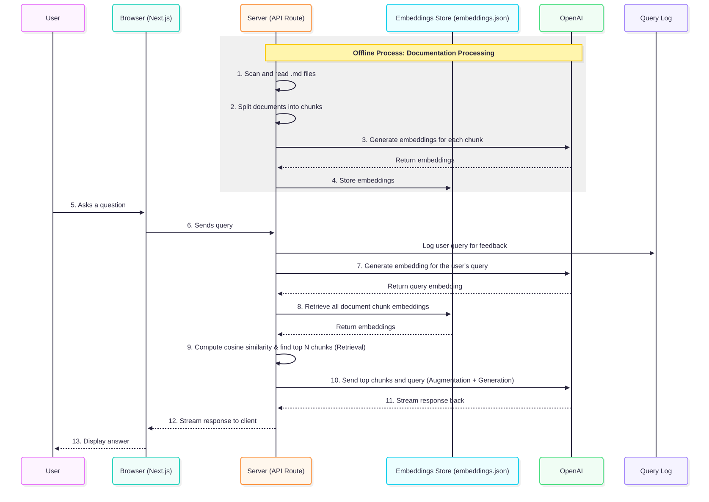

# בניית עוזר תיעוד מבוסס RAG (פיצול למקטעים, Embeddings וחיפוש)

## מה אתם מקבלים

בניתי עוזר תיעוד מבוסס RAG וארזתי אותו ב-boilerplate מוכן שתוכלו להשתמש בו באופן מיידי.

- מגיע עם אפליקציה מוכנה לשימוש (Next.js + OpenAI API)
- כולל צינור RAG (pipeline) עובד (chunking, embeddings, דמיון קוסינוס)
- מספק ממשק צ'אטבוט מלא הבנוי ב-React
- כל רכיבי ה-UI ניתנים לעריכה מלאה באמצעות Tailwind CSS
- מתעד כל שאילתת משתמש כדי לסייע באיתור תיעוד חסר, נקודות כאב של משתמשים והזדמנויות למוצר

👉 [דמו חי](https://github.com/aymericzip/intlayer/blob/main/docs/docs/he-IL/interest_of_intlayer.md) 👉 [קוד ה-boilerplate ב-GitHub](https://github.com/aymericzip/smart_doc_RAG)

- [דמו חי](https://github.com/aymericzip/intlayer/blob/main/docs/docs/he-IL/interest_of_intlayer.md)

## מבוא

אם אי פעם הלכתם לאיבוד בתיעוד טכני, גוללים ללא סוף בחיפוש אחר תשובה אחת, אתם יודעים כמה זה יכול להיות מתסכל. תיעוד הוא כלי שימושי, אך הוא סטטי ולעתים קרובות החיפוש בו מרגיש מסורבל.

כאן נכנס לתמונה **RAG (Retrieval-Augmented Generation)**. במקום להכריח משתמשים לחפור בטקסט, אנו יכולים לשלב בין **אחזור (Retrieval)** (מציאת החלקים הנכונים בתיעוד) לבין **יצירה (Generation)** (מתן אפשרות ל-LLM להסביר זאת בצורה טבעית).

בפוסט זה אסביר כיצד בניתי צ'אטבוט תיעוד מבוסס RAG, וכיצד הוא לא רק עוזר למשתמשים למצוא תשובות מהר יותר, אלא גם מעניק לצוותי מוצר דרך חדשה להבין את נקודות הכאב של המשתמשים.

## מדוע להשתמש ב-RAG עבור תיעוד?

RAG הפך לגישה פופולרית מסיבה טובה: זוהי אחת הדרכים המעשיות ביותר להפוך מודלי שפה גדולים למועילים באמת.

עבור תיעוד, היתרונות ברורים:

- תשובות מיידיות: משתמשים שואלים בשפה טבעית ומקבלים תשובות רלוונטיות.
- הקשר טוב יותר (Better context): המודל רואה רק את חלקי התיעוד הרלוונטיים ביותר, מה שמפחית הזיות (hallucinations).
- חיפוש שמרגיש אנושי: שילוב של Algolia, שאלות נפוצות (FAQ) וצ'אטבוט בחבילה אחת.
- לולאת משוב (Feedback loop): על ידי שמירת שאילתות, אתם מגלים עם מה המשתמשים באמת מתקשים.

הנקודה האחרונה הזו היא קריטית. מערכת RAG אינה רק עונה על שאלות, היא מספרת לכם מה אנשים מחפשים. המשמעות היא:

- אתם מגלים מידע חסר בתיעוד שלכם.
- אתם מזהים בקשות לפיצ'רים חדשים בזמן שהן צצות.
- אתם מזהים דפוסים שיכולים אפילו להנחות את אסטרטגיית המוצר.

לכן, RAG אינו רק כלי תמיכה. הוא גם **מנוע לגילוי מוצרי (product discovery)**.

## כיצד עובד צינור ה-RAG (Pipeline)



ברמה גבוהה, הנה המתכון שבו השתמשתי:

1. **פיצול התיעוד למקטעים (Chunking):** קובצי Markdown גדולים מפוצלים למקטעים קטנים. פיצול זה מאפשר לספק כהקשר רק את החלקים הרלוונטיים של התיעוד.
2. **יצירת Embeddings:** כל מקטע הופך לווקטור באמצעות ה-Embedding API של OpenAI (דגם text-embedding-3-large) או מסד נתונים וקטורי (Chroma, Qdrant, Pinecone).
3. **אינדוקס ואחסון:** ה-Embeddings נשמרים בקובץ JSON פשוט (עבור הדמו שלי), אך בסביבת ייצור (production) סביר להניח שתשתמשו במסד נתונים וקטורי.
4. **אחזור (R ב-RAG):** שאילתת המשתמש מומרת ל-embedding, מחושב דמיון קוסינוס (cosine similarity), והמקטעים בעלי ההתאמה הגבוהה ביותר נשלפים.
5. **העשרה ויצירה (AG ב-RAG):** מקטעים אלו מוזרקים לתוך ההנחיה (prompt) של ChatGPT, כך שהמודל עונה בהתבסס על ההקשר האמיתי מתוך התיעוד.
6. **תיעוד שאילתות למשוב:** כל שאילתת משתמש נשמרת. זהו מכרה זהב להבנת נקודות כאב, תיעוד חסר או הזדמנויות חדשות.

<Steps>
<Step number={1} title="קריאת קובצי התיעוד">

השלב הראשון היה פשוט: הייתי זקוק לדרך לסרוק תיקיית `docs/` עבור כל קובצי ה-`.md`. באמצעות Node.js ו-`glob`, טענתי את התוכן של כל קובץ Markdown לזיכרון.

זה שומר על גמישות הצינור: במקום Markdown, תוכלו למשוך תיעוד ממסד נתונים, CMS או אפילו מ-API.

</Step>
<Step number={2} title="פיצול התיעוד למקטעים (Chunking)">

למה לפצל? מכיוון שלמודלי שפה יש **מגבלות הקשר (context limits)**. הזנת ספר תיעוד שלם בבת אחת לא תעבוד.

הרעיון הוא לחלק את הטקסט למקטעים שניתנים לניהול (למשל 500 tokens כל אחד) עם חפיפה (overlap, למשל 100 tokens). החפיפה מבטיחה המשכיות כדי שלא נאבד משמעות בגבולות שבין המקטעים.

<p align="center">
  
</p>

**דוגמה:**

- מקטע 1 ← "...הספרייה הישנה שרבים שכחו ממנה. המדפים הגבוהים שלה היו מלאים בספרים..."
- מקטע 2 ← "...המדפים היו מלאים בספרים מכל ז'אנר אפשרי, שכל אחד מהם לוחש סיפורים..."

החפיפה מבטיחה ששני המקטעים יכילו הקשר משותף, כך שהאחזור יישאר קוהרנטי.

האיזון הזה (גודל המקטע מול אחוז החפיפה) הוא המפתח ליעילות של RAG:

- קטן מדי ← תקבלו רעש וחוסר הקשר.
- גדול מדי ← תנפחו את גודל ההקשר (context size) שלא לצורך.

</Step>
<Step number={3} title="יצירת Embeddings">

לאחר פיצול התיעוד למקטעים, אנו מייצרים **embeddings**, שהם וקטורים רב-ממדיים המייצגים כל מקטע.

השתמשתי במודל `text-embedding-3-large` של OpenAI, אך ניתן להשתמש בכל מודל embedding מודרני אחר.

**דוגמה ל-Embedding:**

```js
[
  -0.0002630692, -0.029749284, 0.010225477, -0.009224428, -0.0065269712,
  -0.002665544, 0.003214777, 0.04235309, -0.033162255, -0.00080789323,
  //...+1533 elements
];
```

כל וקטור מהווה טביעת אצבע מתמטית של הטקסט, המאפשרת חיפוש דמיון סמנטי.

</Step>
<Step number={4} title="אינדוקס ואחסון Embeddings">

כדי למנוע יצירה מחדש של embeddings בכל פעם, שמרתי אותם ב-`embeddings.json`.

בסביבת ייצור, סביר להניח שתרצו מסד נתונים וקטורי כגון:

- Chroma
- Qdrant
- Pinecone
- FAISS, Weaviate, Milvus וכדומה.

מסדי נתונים וקטוריים מטפלים באינדוקס, סקיילינג וחיפוש מהיר. אך עבור האב-טיפוס שלי, קובץ JSON מקומי עבד מצוין.

</Step>
<Step number={5} title="אחזור באמצעות דמיון קוסינוס (Cosine Similarity)">

כאשר משתמש שואל שאלה:

1. מייצרים embedding עבור השאילתה.
2. משווים אותו לכל ה-embeddings של התיעוד באמצעות **דמיון קוסינוס (cosine similarity)**.
3. שומרים רק את N המקטעים הדומים ביותר.

דמיון קוסינוס מודד את הזווית בין שני וקטורים. התאמה מושלמת מקבלת ציון **1.0**.

בדרך זו, המערכת מוצאת את קטעי התיעוד הקרובים ביותר לשאילתה.

</Step>
<Step number={6} title="העשרה ויצירה (Augmentation + Generation)">

כעת מגיע הקסם. אנו לוקחים את המקטעים המובילים ומזריקים אותם לתוך **הנחיית המערכת (system prompt)** עבור ChatGPT.

המשמעות היא שהמודל עונה כאילו מקטעים אלו היו חלק מהשיחה.

התוצאה: תשובות מדויקות **המעוגנות בתיעוד (doc-grounded)**.

</Step>
<Step number={7} title="תיעוד שאילתות משתמשים">

זהו כוח-העל הנסתר.

כל שאלה שנשאלת נשמרת. עם הזמן, אתם בונים מאגר נתונים הכולל:

- שאלות נפוצות ביותר (מצוין ליצירת עמודי FAQ)
- שאלות ללא מענה (התיעוד חסר או לא ברור)
- בקשות לפיצ'רים המוסוות כשאלות ("האם זה מתממשק עם X?")
- תרחישי שימוש חדשים שלא תכננתם מראש

זה הופך את עוזר ה-RAG שלכם ל**כלי מתמיד למחקר משתמשים**.

</Step>
<Step number={8} title="כמה זה עולה?">

אחת ההתנגדויות הנפוצות ל-RAG היא העלות. בפועל, זה זול להפליא:

- יצירת embeddings עבור כ-200 מסמכים אורכת כ-**5 דקות** ועולה כ-**1–2 אירו**.
- תכונת חיפוש המסמכים היא 100% חינמית.
- עבור שאילתות, אנו משתמשים ב-`gpt-4o-latest` ללא מצב "חשיבה" (thinking). ב-Intlayer, אנו עדים לכ-**300 שאילתות צ'אט בחודש**, וחשבון ה-API של OpenAI מגיע לעתים נדירות למעל **$10**.

מעבר לכך, יש להביא בחשבון את עלויות האחסון והאירוח (hosting).

</Step>
<Step number={9} title="פרטי המימוש">

מחסנית טכנולוגית (Stack):

- Monorepo: סביבת עבודה של pnpm (workspace)
- חבילת תיעוד: Node.js / TypeScript / OpenAI API
- Frontend: Next.js / React / Tailwind CSS
- Backend: נתיב API של Node.js / OpenAI API

החבילה `@smart-doc/docs` היא חבילת TypeScript המטפלת בעיבוד התיעוד. כאשר קובץ markdown מתווסף או משתנה, החבילה כוללת סקריפט `build` הבונה מחדש את רשימת התיעוד בכל שפה, מייצר embeddings ושומר אותם בקובץ `embeddings.json`.

עבור ה-frontend, אנו משתמשים באפליקציית Next.js המספקת:

- רינדור מ-Markdown ל-HTML
- שורת חיפוש לאיתור תיעוד רלוונטי
- ממשק צ'אטבוט לשאלות אודות התיעוד

כדי לבצע חיפוש בתיעוד, אפליקציית ה-Next.js כוללת נתיב API הקורא לפונקציה בחבילת `@smart-doc/docs` כדי לשלוף מקטעי תיעוד התואמים לשאילתה. באמצעות מקטעים אלו, אנו יכולים להחזיר רשימת דפי תיעוד רלוונטיים לחיפוש המשתמש.

עבור פונקציונליות הצ'אטבוט, אנו פועלים לפי אותו תהליך חיפוש, אך בנוסף מזריקים את מקטעי התיעוד שנשלפו לתוך ה-prompt הנשלח ל-ChatGPT.

הנה דוגמה ל-prompt הנשלח ל-ChatGPT:

הנחיית מערכת (System prompt):

```txt
You are a helpful assistant that can answer questions about the Intlayer documentation.

Related chunks :

-----
docName: "getting-started"
docChunk: "1/3"
docUrl: "https://example.com/docs/en/getting-started"
---

# How to get started

...

-----
docName: "another-doc"
docChunk: "1/5"
docUrl: "https://example.com/docs/en/another-doc"
---

# Another doc

...
```

שאילתת משתמש (User query):

```txt
How to get started?
```

אנו משתמשים ב-SSE כדי להזרים (stream) את התשובה מנתיב ה-API.

כפי שצוין, אנו משתמשים ב-gpt-4-turbo ללא מצב "חשיבה". התשובות רלוונטיות, וזמן ההמתנה (latency) נמוך.
ערכנו ניסויים עם gpt-5, אך זמני התגובה היו גבוהים מדי (לעיתים עד 15 שניות לתשובה). נבחן זאת שוב בעתיד.

👉 [נסו את הדמו כאן](https://github.com/aymericzip/intlayer/blob/main/docs/docs/he-IL/interest_of_intlayer.md) 👉 [בדקו את תבנית הקוד ב-GitHub](https://github.com/aymericzip/smart_doc_RAG)

- [נסו את הדמו כאן](https://github.com/aymericzip/intlayer/blob/main/docs/docs/he-IL/interest_of_intlayer.md)

</Step>
<Step number={10} title="להעמיק עוד יותר">

פרויקט זה הוא מימוש מינימלי. אך ניתן להרחיב אותו בדרכים רבות:

- שרת MCP ← חיבור פונקציית מחקר התיעוד לשרת MCP כדי לחבר את התיעוד לכל עוזר AI
- מסדי נתונים וקטוריים ← התאמה למיליוני מקטעי תיעוד
- LangChain / LlamaIndex ← פריימוורקים מוכנים לצינורות RAG
- לוחות בקרה ואנליטיקה ← הדמיה של שאילתות משתמשים ונקודות כאב
- אחזור ממקורות מרובים ← משיכת מידע לא רק מתיעוד, אלא גם ממסדי נתונים, פוסטים בבלוג, כרטיסי תמיכה ועוד
- שיפור ההנחיות ← דירוג מחדש (reranking), סינון וחיפוש היברידי (מילות מפתח + חיפוש סמנטי)

</Step>
<Step number={11} title="מגבלות בהן נתקלנו">

- פיצול למקטעים וחפיפה הם תהליכים אמפיריים. האיזון הנכון (גודל מקטע, אחוז חפיפה, מספר המקטעים הנשלפים) דורש איטרציות ובדיקות.
- Embeddings אינם מיוצרים מחדש אוטומטית כאשר התיעוד משתנה. המערכת שלנו מאפסת embeddings עבור קובץ רק אם מספר המקטעים שונה ממה שנשמר.
- באב-טיפוס זה, ה-embeddings נשמרים ב-JSON. זה עובד מצוין עבור הדגמות אך מעמיס על Git. בסביבת ייצור, מסד נתונים או מאגר וקטורי ייעודי עדיפים בהרבה.

</Step>
<Step number={12} title="מדוע זה משמעותי מעבר לתיעוד">

החלק המעניין אינו רק הצ'אטבוט עצמו, אלא **לולאת המשוב (Feedback loop)**.

באמצעות RAG, אינכם מסתפקים במתן מענה:

- אתם לומדים מה מבלבל את המשתמשים.
- אתם מגלים אילו תכונות הם מצפים לקבל.
- אתם מתאימים את אסטרטגיית המוצר בהתבסס על שאילתות אמיתיות.

**דוגמה:**

תארו לעצמכם שאתם משיקים פיצ'ר חדש ורואים מיד:

- 50% מהשאלות עוסקות באותו שלב התקנה לא ברור
- משתמשים מבקשים שוב ושוב אינטגרציה שאינכם תומכים בה עדיין
- אנשים מחפשים מונחים החושפים תרחיש שימוש חדש

זוהי **תובנת מוצר (product intelligence)** המגיעה ישירות מהמשתמשים שלכם.

</Step>

</Steps>

<Sponsor startDate="2026-07-14" endDate="2027-07-14">

### דלגו על המורכבות עם Sanity

ראוי להזכיר כאן את Sanity כאפשרות ה-CMS שאליה המאמר מכוון. בעוד שקובצי Markdown דורשים פיצול tokens שרירותי, עם הפשרות של גודל מקטע וחפיפה כפי שתוארו במאמר, ה-Content Lake של Sanity שומר את התיעוד כמסמכי JSON בעלי טיפוסים וסכמה מוגדרת מראש. כל שדה, כותרת ובלוק תוכן כבר מהווים יחידה סמנטית, מה שאומר שאחזור ה-RAG פועל על גבולות משמעותיים במקום על ספירת tokens מקורבת.

שפת השאילתות GROQ של Sanity מאפשרת לשלוף בדיוק את שדות המסמך הרלוונטיים לשאילתת המשתמש, כותרת, גוף הטקסט, חלקים קשורים, מבלי למשוך את המסמך כולו. שרת ה-MCP מחבר את ה-Content Lake ישירות לסוכני AI, כך שאותו תוכן מובנה שמניע את אתר התיעוד שלכם מזין גם את צינור ה-RAG שלכם ללא שלב ingestion נפרד.

</Sponsor>

## סיכום

RAG הוא אחת הדרכים הפשוטות והחזקות ביותר להפוך LLMs לשימושיים הלכה למעשה. על ידי שילוב של **אחזור + יצירה**, תוכלו להפוך תיעוד סטטי ל**עוזר חכם** ובמקביל לקבל זרם מתמיד של תובנות מוצר.

מבחינתי, פרויקט זה הוכיח ש-RAG אינו רק טריק טכנולוגי. זוהי דרך להפוך תיעוד ל:

- מערכת תמיכה אינטראקטיבית
- ערוץ משוב ישיר
- כלי לאסטרטגיית מוצר

👉 [נסו את הדמו כאן](https://github.com/aymericzip/intlayer/blob/main/docs/docs/he-IL/interest_of_intlayer.md) 👉 [בדקו את תבנית הקוד ב-GitHub](https://github.com/aymericzip/smart_doc_RAG)

- [נסו את הדמו כאן](https://github.com/aymericzip/intlayer/blob/main/docs/docs/he-IL/interest_of_intlayer.md)

ואם גם אתם מתנסים ב-RAG, נשמח לשמוע כיצד אתם משתמשים בו.
