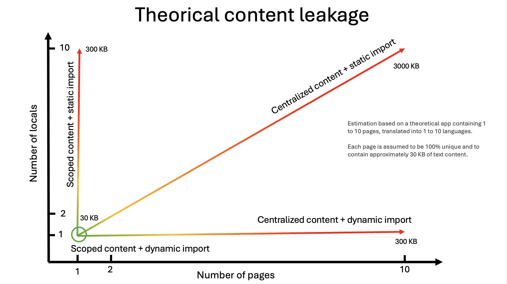

# react-intl מול react-i18next מול Intlayer

מדריך זה משווה בין שלוש אפשרויות i18n מבוססות עבור **React**: **react-intl** (FormatJS), **react-i18next** (i18next) ו-**Intlayer**.
אנו מתמקדים באפליקציות **React טהורות** (כגון Vite, CRA, SPA). אם אתם משתמשים ב-Next.js, ראו את מדריך ההשוואה הייעודי שלנו ל-Next.js.

אנו בוחנים:

- ארכיטקטורה וארגון תוכן
- שילוב עם TypeScript ובטיחות טיפוסים
- טיפול בתרגומים חסרים
- תוכן עשיר ויכולות עיצוב (formatting)
- ביצועים והתנהגות טעינה
- חוויית מפתח (DX), כלי עבודה ותחזוקה
- SEO וניתוב (תלוי פריימוורק)

<TOC/>

> **בקצרה**: כולן מסוגלות לתרגם אפליקציית React. אם אתם מחפשים **תוכן מתוחם לפי-רכיב (component-scoped)**, **טיפוסי TypeScript קפדניים**, **בדיקת מפתחות חסרים בזמן הבנייה**, **מילונים שעוברים tree-shaking** וכלי עריכה מובנים (עורך ויזואלי / CMS מובנה ותרגום אופציונלי באמצעות AI), **Intlayer** היא הבחירה השלמה ביותר עבור בסיסי קוד מודולריים ב-React.

## מיצוב ברמה גבוהה

- **react-intl**: תמיכה מובילה ב-ICU, עיצוב בהתאמה לתקנים (תאריכים/מספרים/רבים) עם API בוגר. הקטלוגים הם לרוב מרוכזים, ובטיחות מפתחות ובדיקות זמן בנייה מוטלות בעיקר על כתפיכם.
- **react-i18next**: פופולרית וגמישה במיוחד. כוללת namespaces, מזהי שפה ותוספים רבים (ICU, backends). חזקה מאוד, אך התצורה עשויה להסתבך ככל שהפרויקט גדל.
- **Intlayer**: מודל תוכן ממוקד-רכיבים עבור React, **בטיחות טיפוסים מחמירה ב-TS**, **בדיקות בזמן בנייה**, **tree-shaking**, בתוספת **עורך ויזואלי/CMS** ו**תרגומים בסיוע AI**. עובדת עם React Router, Vite, CRA ועוד.

> כדי להבין מהיכן הגיעו ספריות אלו, קראו על ההיסטוריה של i18n ב-JavaScript.

- [ההיסטוריה של i18n ב-JavaScript](https://github.com/aymericzip/intlayer/blob/main/docs/blog/he-IL/history_of_i18n.md)

## טבלת השוואת תכונות (מיקוד ב-React)

| תכונה                                         | `react-intlayer` (Intlayer)                                                     | `react-i18next` (i18next)                                                             | `react-intl` (FormatJS)                                                        |
| --------------------------------------------- | ------------------------------------------------------------------------------- | ------------------------------------------------------------------------------------- | ------------------------------------------------------------------------------ |
| **תרגומים בצמוד לרכיבים**                     | ✅ כן, התוכן ממוקם לצד כל רכיב (colocated)                                      | ❌ לא                                                                                 | ❌ לא                                                                          |
| **אינטגרציה עם TypeScript**                   | ✅ מתקדמת, טיפוסים קפדניים שנוצרים אוטומטית                                     | ⚠️ בסיסית, נדרשת הגדרה נוספת לבטיחות                                                  | ✅ טובה, אך פחות קפדנית                                                        |
| **זיהוי תרגומים חסרים**                       | ✅ שגיאות TypeScript ושגיאות/אזהרות בזמן בנייה                                  | ⚠️ לרוב מחרוזות ברירת מחדל בזמן ריצה                                                  | ⚠️ מחרוזות ברירת מחדל                                                          |
| **תוכן עשיר (JSX/Markdown/רכיבים)**           | ✅ תמיכה ישירה                                                                  | ⚠️ מוגבלת / באמצעות אינטרפולציה בלבד                                                  | ⚠️ תחביר ICU, אינו JSX אמיתי                                                   |
| **תרגום מבוסס AI**                            | ✅ כן, תמיכה במספר ספקי AI. שימוש במפתחות API משלכם תוך התחשבות בהקשר האפליקציה | ❌ לא                                                                                 | ❌ לא                                                                          |
| **עורך ויזואלי (Visual Editor)**              | ✅ כן, עורך מקומי + CMS אופציונלי; ניתן להחצין תוכן מקוד המקור; ניתן להטמעה     | ❌ לא / זמין דרך פלטפורמות לוקליזציה חיצוניות                                         | ❌ לא / זמין דרך פלטפורמות לוקליזציה חיצוניות                                  |
| **ניתוב מתורגם (Localized Routing)**          | ✅ כן, תמיכה מובנית בנתיבים מתורגמים (עובד עם Next.js ו-Vite)                   | ⚠️ לא מובנה, דורש תוספים (כגון `next-i18next`) או הגדרת ראוטר מותאמת                  | ❌ לא, עיצוב הודעות בלבד, הניתוב חייב להיעשות ידנית                            |
| **יצירת נתיבים דינמית**                       | ✅ כן                                                                           | ⚠️ דורש תוספים/אקוסיסטם או הגדרה ידנית                                                | ❌ אינו מסופק                                                                  |
| **ריבוי (Pluralization)**                     | ✅ תבניות מבוססות ספירה (Enumeration-based)                                     | ✅ ניתן להגדרה (תוספים כמו i18next-icu)                                               | ✅ (ICU)                                                                       |
| **עיצוב (תאריכים, מספרים, מטבעות)**           | ✅ מעצבים מותאמים (שימוש ב-Intl מתחת למכסה המנוע)                               | ⚠️ באמצעות תוספים או שימוש עצמאי ב-Intl                                               | ✅ מעצבי ICU                                                                   |
| **פורמט תוכן**                                | ✅ .tsx, .ts, .js, .json, .md, .txt, (.yaml בפיתוח)                             | ⚠️ .json                                                                              | ✅ .json, .js                                                                  |
| **תמיכה ב-ICU**                               | ⚠️ בפיתוח                                                                       | ⚠️ באמצעות תוסף (i18next-icu)                                                         | ✅ כן                                                                          |
| **כלי עזר ל-SEO (hreflang, sitemap)**         | ✅ כלים מובנים: פונקציות עזר עבור sitemap, robots.txt, metadata                 | ⚠️ תוספי קהילה / ידני                                                                 | ❌ לא בליבה                                                                    |
| **אקוסיסטם / קהילה**                          | ⚠️ קטנה יותר אך צומחת במהירות ותגובתית                                          | ✅ הגדולה והבוגרת ביותר                                                               | ✅ גדולה                                                                       |
| **Server-side Rendering ו-Server Components** | ✅ כן, מותאם באופן חלק עבור SSR / React Server Components                       | ⚠️ נתמך ברמת הדף, אך נדרש להעביר פונקציות t בעץ הרכיבים עבור server components צאצאים | ❌ אינו נתמך, נדרש להעביר פונקציות t בעץ הרכיבים עבור server components צאצאים |
| **Tree-shaking (טעינת תוכן בשימוש בלבד)**     | ✅ כן, לפי רכיב בזמן בנייה באמצעות תוספי Babel/SWC                              | ⚠️ לרוב טוען הכל (ניתן לשיפור עם namespaces/code-splitting)                           | ⚠️ לרוב טוען הכל                                                               |
| **טעינה עצלה (Lazy loading)**                 | ✅ כן, לפי שפה / לפי מילון                                                      | ✅ כן (למשל, backends/namespaces לפי דרישה)                                           | ✅ כן (פיצול חבילות שפה)                                                       |
| **ניקוי תוכן שאינו בשימוש (Purge)**           | ✅ כן, לפי מילון בזמן בנייה                                                     | ❌ לא, רק באמצעות חלוקה ידנית ל-namespaces                                            | ❌ לא, כל ההודעות שהוגדרו נארזות ב-bundle                                      |
| **ניהול פרויקטים גדולים**                     | ✅ מעודד מודולריות, מתאים במיוחד ל-design systems                               | ⚠️ דורש משמעת קפדנית בארגון קבצים                                                     | ⚠️ קטלוגים מרכזיים עלולים להתנפח                                               |

## השוואה מעמיקה

### 1) ארכיטקטורה ויכולת הרחבה (Scalability)

- **react-intl / react-i18next**: רוב ההגדרות שומרות על **תיקיות שפה מרוכזות** לכל שפה, לעיתים מפוצלות לפי **namespaces** (ב-i18next). זה עובד היטב בשלבים מוקדמים, אך הופך לשטח משותף רגיש ככל שהאפליקציה גדלה.
- **Intlayer**: מקדמת **מילונים לפי-רכיב (או לפי-תכונה)** הממוקמים בצמוד (**co-located**) ל-UI שהם משרתים. הדבר שומר על בעלות ברורה, מקל על שכפול או העברה של רכיבים, ומפחית חיכוך בין צוותים סביב מפתחות תרגום. תוכן שאינו בשימוש קל יותר לזיהוי ולהסרה.

**מדוע זה חשוב:** תוכן מודולרי משקף UI מודולרי. בסיסי קוד גדולים ב-React נשארים נקיים יותר כאשר התרגומים חיים לצד הרכיבים שאליהם הם שייכים.

### 2) TypeScript ובטיחות

- **react-intl**: טיפוסים סבירים, אך **ללא טיפוסי מפתחות אוטומטיים**. עליכם לאכוף תבניות בטיחות בעצמכם.
- **react-i18next**: טיפוסים חזקים עבור ה-hooks. **טיפוסי מפתחות קפדניים** דורשים לרוב תצורה נוספת או מחוללים חיצוניים.
- **Intlayer**: **יוצרת אוטומטית טיפוסים קפדניים** מתוך התוכן שלכם. השלמה אוטומטית ב-IDE ו**שגיאות בזמן הידור** תופסות שגיאות כתיב ומפתחות חסרים עוד לפני זמן הריצה.

**מדוע זה חשוב:** העברת זיהוי שגיאות **שמאלה** (לזמן הבנייה וה-CI) מפחיתה תקלות בייצור ומאיצה את לולאת המשוב של המפתחים.

### 3) טיפול בתרגומים חסרים

- **react-intl / react-i18next**: ברירת המחדל היא **נסיגה בזמן ריצה** (הצגת המפתח או שפת ברירת המחדל). ניתן להוסיף כלי linting או תוספים, אך הדבר אינו מובטח בזמן הבנייה.
- **Intlayer**: **זיהוי בזמן בנייה** עם אזהרות או שגיאות כאשר חסרות שפות או מפתחות נדרשים.

**מדוע זה חשוב:** קריסת ה-CI בעת זיהוי מחרוזות חסרות מונעת זליגה מקרית של אנגלית לתוך ממשקי משתמש בשפות אחרות.

### 4) תוכן עשיר ועיצוב

- **react-intl**: תמיכה מצוינת ב-**ICU** עבור רבים, בחירה, תאריכים, מספרים והרכבת הודעות. ניתן להשתמש ב-JSX, אך המודל המחשבתי נותר ממוקד-הודעות.
- **react-i18next**: אינטרפולציה גמישה ורכיב **`<Trans>`** להטמעת אלמנטים ורכיבים; ICU זמין באמצעות תוסף.
- **Intlayer**: קובצי תוכן יכולים לכלול **צמתי תוכן עשיר** (JSX/Markdown/רכיבים) ו**מטא-דאטה**. העיצוב מתבסס על Intl מתחת למכסה המנוע; תבניות ריבוי הן נוחות וארגונומיות.

**מדוע זה חשוב:** טקסטים מורכבים בממשק (קישורים, הדגשות, רכיבים מוטמעים) פשוטים יותר ליישום כאשר הספרייה מתייחסת לרכיבי React בצורה טבעית.

### 5) ביצועים והתנהגות טעינה

- **react-intl / react-i18next**: בדרך כלל עליכם לנהל **פיצול קטלוגים** ו**טעינה עצלה** באופן ידני (namespaces / dynamic imports). יעיל, אך דורש משמעת.
- **Intlayer**: מבצעת **tree-shaking** למילונים שאינם בשימוש ותומכת ב**טעינה עצלה לפי-מילון ולפי-שפה** היישר מהקופסה.

**מדוע זה חשוב:** חבילות קטנות יותר ופחות מחרוזות מיותרות משפרות את זמני הטעינה הראשונית והניווט.

הגרף להלן מעריך את משקל המידע עבור אפליקציה תיאורטית של 1 עד 10 דפים ב-1 עד 10 שפות, עם כ-30KB טקסט לכל דף. טעינה עצלה לכל שפה מבטלת את ציר השפות, תיחום תוכן לפי רכיב מבטל את ציר הדפים, ורק השילוב ביניהם נשאר שטוח ויציב.

#### תוצאות ביצועים ב-React (TanStack Start / Vite)

הנתונים מתוך [Benchmark Bloom](https://github.com/intlayer-org/benchmark-bloom) המודדים יישומי React סטנדרטיים על גבי TanStack Start:

<I18nBenchmark framework="tanstack" vertical/>

| ספרייה              | אסטרטגיה | משקל ספרייה (gz) | ממוצע JS לדף (gz) | דליפת שפה | דליפת דף | ממוצע לרכיב (gz) | תגובתיות E2E | הידרציה |
| ------------------- | -------- | ---------------: | ----------------: | --------: | -------: | ---------------: | -----------: | ------: |
| **base** (ללא i18n) | -        |           0.0 KB |          111.0 KB |      0.0% |     0.0% |           0.7 KB |       8.1 ms | 21.6 ms |
| `react-i18next`     | dynamic  |          18.4 KB |          136.4 KB |     23.1% |    89.8% |          24.8 KB |     123.1 ms | 32.9 ms |
| **`intlayer`**      | dynamic  |       **5.0 KB** |      **118.6 KB** |  **0.0%** | **0.0%** |       **6.3 KB** |   **3.6 ms** | 14.1 ms |

<ClickToOpenIframe
  src="https://intlayer.org/markdown?url=https%3A%2F%2Fraw.githubusercontent.com%2Fintlayer-org%2Fbenchmark-i18n%2Fmain%2Freport%2Fscripts%2Fsummarize-tanstack.md"
  width="100%"
  height="600px"
  style="border:none;"
/>

> הטבלה המלאה מופיעה ב-[דוח ביצועים של TanStack Start](https://github.com/aymericzip/intlayer/blob/main/docs/docs/he-IL/benchmark/tanstack.md) וב-[סקירת ביצועי i18n כללית](https://github.com/aymericzip/intlayer/blob/main/docs/docs/he-IL/benchmark/index.md).

- [דוח ביצועים של TanStack Start](https://github.com/aymericzip/intlayer/blob/main/docs/docs/he-IL/benchmark/tanstack.md)
- [סקירת ביצועי i18n כללית](https://github.com/aymericzip/intlayer/blob/main/docs/docs/he-IL/benchmark/index.md)

### 6) חוויית מפתח (DX), כלי עבודה ותחזוקה

- **react-intl / react-i18next**: אקוסיסטם קהילתי רחב. לצורך זרימות עבודה של עריכת תוכן, בדרך כלל מאמצים פלטפורמות לוקליזציה חיצוניות.
- **Intlayer**: מגיעה עם **עורך ויזואלי חינמי** ו**CMS אופציונלי** (שמירת התוכן ב-Git או החצנתו). כמו כן מציעה **תוסף ל-VSCode** לכתיבת תוכן ו**תרגום מבוסס AI** באמצעות מפתחות ה-API שלכם.

**מדוע זה חשוב:** כלים מובנים מקצרים את המרחק בין מפתחים לעורכי תוכן, עם פחות קוד מגשר ופחות תלות בספקים חיצוניים.

## מתי לבחור בכל אחת?

- **בחרו ב-react-intl** אם אתם מחפשים עיצוב הודעות **מבוסס ICU** עם API ישיר ומיושר לתקנים, והצוות שלכם מסוגל לתחזק קטלוגים ובדיקות בטיחות באופן ידני.
- **בחרו ב-react-i18next** אם אתם זקוקים ל**רוחב האקוסיסטם של i18next** (זיהוי שפה, backends, תוסף ICU, אינטגרציות) ומוכנים להתמודד עם תצורה מורכבת יותר בתמורה לגמישות.
- **בחרו ב-Intlayer** אם אתם מעריכים **תוכן מתוחם לפי-רכיב**, **TypeScript קפדני**, **ערבויות בזמן בנייה**, **tree-shaking** וכלי עריכה מוכנים היישר מהקופסה, במיוחד עבור אפליקציות React **גדולות ומודולריות**, מערכות עיצוב (design systems) ועוד.

## תאימות הדדית עם `react-intl` ו-`react-i18next`

`intlayer` יכולה גם לסייע בניהול ה-namespaces של `react-intl` ו-`react-i18next`.

באמצעות `intlayer`, תוכלו להצהיר על התוכן בפורמט של ספריית ה-i18n המועדפת עליכם, ו-Intlayer תייצר את ה-namespaces שלכם במיקום שתבחרו (לדוגמה: `/messages/{{locale}}/{{namespace}}.json`).

## קריאה נוספת ומבחני ביצועים

- [i18next מול @intlayer/i18next](https://github.com/aymericzip/intlayer/blob/main/docs/blog/he-IL/i18next_vs_intlayer-i18next.md)
- [next-intl מול Intlayer](https://github.com/aymericzip/intlayer/blob/main/docs/blog/he-IL/next-intl_vs_intlayer.md)
- [אופטימיזציית חבילה (Bundle optimization)](https://github.com/aymericzip/intlayer/blob/main/docs/docs/he-IL/bundle_optimization.md)
- [קומפיילר Intlayer](https://github.com/aymericzip/intlayer/blob/main/docs/docs/he-IL/compiler.md)

דוחות השוואת ביצועים:

- [סקירת ביצועי i18n כללית](https://github.com/aymericzip/intlayer/blob/main/docs/docs/he-IL/benchmark/index.md)
- [TanStack Start](https://github.com/aymericzip/intlayer/blob/main/docs/docs/he-IL/benchmark/tanstack.md)
- [Next.js](https://github.com/aymericzip/intlayer/blob/main/docs/docs/he-IL/benchmark/nextjs.md)
- [Vue](https://github.com/aymericzip/intlayer/blob/main/docs/docs/he-IL/benchmark/vue.md)
- [Solid](https://github.com/aymericzip/intlayer/blob/main/docs/docs/he-IL/benchmark/solid.md)
- [Svelte](https://github.com/aymericzip/intlayer/blob/main/docs/docs/he-IL/benchmark/svelte.md)

## כוכבים ב-GitHub

כוכבי GitHub הם מדד מובהק לפופולריות של פרויקט, אמון הקהילה ורלוונטיות ארוכת טווח. למרות שאינם מדד ישיר לאיכות טכנית, הם משקפים כמה מפתחים מוצאים את הפרויקט שימושי, עוקבים אחר התקדמותו ונוטים לאמץ אותו. לצורך הערכת שווי הפרויקט, כוכבים מסייעים להשוות משיכה (traction) בין חלופות ומספקים תובנות לגבי צמיחת האקוסיסטם.

## פעילות Commits

כוכבים מעידים על פופולריות. Commits מראים כמה עבודה מושקעת בפרויקט. נכון למועד כתיבת שורות אלו, Intlayer מונה כ-7,500 commits, יותר מרוב הספריות המושוות כאן, ובערך פי 5 יותר מ-`next-intl` או `next-i18next`.

<GithubCommits repositories="formatjs/formatjs,i18next/react-i18next,aymericzip/intlayer" />

> Intlayer היא monorepo, כך שהספירה כוללת את כל חבילות הפריימוורקים, ה-CLI והתיעוד. יש לראות ב-commits סימן לפעילות מתמדת, ולא מדד בלעדי לאיכות.

## הורדות ב-npm

<NpmDownloads packages="react-i18next,react-intl,react-intlayer" period="last-6-months" />

הורדות מתגמלות את הפתרונות הוותיקים ביותר, לא בהכרח את הטובים ביותר. ספרייה ששוחררה לפני שנים עדיין מותקנת על ידי כל פרויקט שבחר בה בעבר, בכל הרצת CI ועל ידי כל חבילה שתלויה בה. הספירה מודדת אינרציה יותר מאשר בחירה עדכנית.

עוזרי AI מעצימים את האפקט הזה. `next-intl`, `i18next` ו-`vue-i18n` מופיעות בכל מקום בקוד שעליו הם אומנו, ולכן הם מציעים אותן כברירת מחדל מבלי להשוות חלופות. כל הצעה כזו מוסיפה הורדות, מה שמזין את ההצעה הבאה. השוו על סמך מבחני ביצועים (benchmarks) ולא על סמך ספירת הורדות בלבד.

## סיכום

כל שלוש הספריות מתרגמות אפליקציות React ביעילות. ההבדל המרכזי טמון בכמות ה**תשתית** שעליכם לבנות כדי להגיע להגדרה **בטוחה ויכולת גידול (scalable)**:

- עם **Intlayer**, **תוכן מודולרי**, **בטיחות טיפוסים קפדנית ב-TS**, **בדיקות בזמן בנייה**, **חבילות שעברו tree-shaking** ו**כלי עריכה** מגיעים כברירת מחדל, ולא כמטלות הדורשות פיתוח נפרד.
- אם הצוות שלכם מעריך **תחזוקתיות ומהירות** באפליקציות React מרובות-שפות מונעות-רכיבים, Intlayer מספקת כיום את זרימת העבודה השלמה ביותר עבור מפתחים ועורכי תוכן כאחד.

עיינו במסמך ['למה Intlayer?'](https://github.com/aymericzip/intlayer/blob/main/docs/docs/he-IL/interest_of_intlayer.md) לקבלת פרטים נוספים.

- [למה Intlayer? יתרונות על פני ספריות i18n אחרות](https://github.com/aymericzip/intlayer/blob/main/docs/docs/he-IL/interest_of_intlayer.md)
