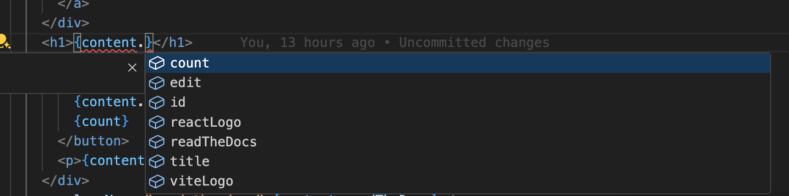
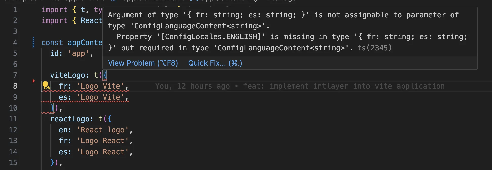

# Traduire votre site vinext avec Intlayer

[vinext](https://github.com/cloudflare/vinext) réimplémente l'API Next.js par-dessus Vite. Votre répertoire `app/`, les imports `next/*` et `proxy.ts` continuent de fonctionner, mais le build passe par Vite au lieu de Turbopack ou webpack.

Intlayer s'intègre à cette configuration avec deux packages : `next-intlayer` pour les hooks, providers et proxy que vos composants utilisent déjà sur Next.js, et `vite-intlayer` pour la partie build (compilation des dictionnaires, watch et optimisation du bundle).

> Vous utilisez Next.js avec sa propre toolchain ? Suivez plutôt le [guide Next.js 16](https://github.com/aymericzip/intlayer/blob/main/docs/docs/fr/intlayer_with_nextjs_16.md).

- [Guide Next.js 16](https://github.com/aymericzip/intlayer/blob/main/docs/docs/fr/intlayer_with_nextjs_16.md)

## Table des matières

<TOC/>

## Pourquoi choisir Intlayer plutôt qu'une alternative ?

Par rapport à des solutions comme `next-intl` ou `i18next`, Intlayer intègre des optimisations natives :

<AccordionGroup>
<Accordion header="Conçu pour l'API Next.js, sur Vite">

Le même code `next-intlayer` fonctionne sur Next.js et sur vinext. Les Server Components résolvent le contenu côté serveur, les Client Components le lisent via le provider, et le routage par locale s'exécute depuis votre `proxy.ts`. Passer d'une toolchain à l'autre ne touche pas vos composants.

</Accordion>
<Accordion header="Taille du bundle">

Au lieu de charger d'énormes fichiers JSON dans vos pages, ne chargez que le contenu nécessaire. Le plugin Vite remplace chaque appel à `useIntlayer` par les entrées que le composant utilise réellement, ce qui **réduit la taille du bundle et des pages jusqu'à 50 %**.

</Accordion>
<Accordion header="Maintenabilité">

Découper le contenu par composant **simplifie la maintenance** des grosses applications. Vous pouvez dupliquer ou supprimer un dossier de fonctionnalité sans relire tout votre contenu, et Intlayer est **entièrement typé** pour garder votre contenu fiable.

</Accordion>
<Accordion header="Agent IA">

Co-localiser le contenu **réduit le contexte nécessaire** aux LLM. Intlayer fournit une **CLI** pour détecter les traductions manquantes, un **[LSP](https://github.com/aymericzip/intlayer/blob/main/docs/docs/fr/lsp.md)**, un **[serveur MCP](https://github.com/aymericzip/intlayer/blob/main/docs/docs/fr/mcp_server.md)** et des **[agent skills](https://github.com/aymericzip/intlayer/blob/main/docs/docs/fr/agent_skills.md)**.

- [LSP](https://github.com/aymericzip/intlayer/blob/main/docs/docs/fr/lsp.md)
- [Serveur MCP](https://github.com/aymericzip/intlayer/blob/main/docs/docs/fr/mcp_server.md)
- [Agent skills](https://github.com/aymericzip/intlayer/blob/main/docs/docs/fr/agent_skills.md)

</Accordion>
<Accordion header="Automatisation">

Traduisez dans votre pipeline CI/CD avec le LLM de votre choix, aux frais de votre fournisseur d'IA. Intlayer propose aussi un **compilateur** pour automatiser l'extraction du contenu, et une [plateforme web](https://github.com/aymericzip/intlayer/blob/main/docs/docs/fr/intlayer_CMS.md) pour **traduire en arrière-plan**.

- [Plateforme web](https://github.com/aymericzip/intlayer/blob/main/docs/docs/fr/intlayer_CMS.md)

</Accordion>
<Accordion header="Collaborer avec des non-développeurs">

Intlayer fournit un **[éditeur visuel](https://github.com/aymericzip/intlayer/blob/main/docs/docs/fr/intlayer_visual_editor.md) auto-hébergé** et un **[CMS complet](https://github.com/aymericzip/intlayer/blob/main/docs/docs/fr/intlayer_CMS.md)** pour gérer le contenu multilingue en **temps réel** avec traducteurs et rédacteurs. Le contenu peut être stocké en local et/ou à distance.

- [Éditeur visuel](https://github.com/aymericzip/intlayer/blob/main/docs/docs/fr/intlayer_visual_editor.md)
- [CMS complet](https://github.com/aymericzip/intlayer/blob/main/docs/docs/fr/intlayer_CMS.md)

</Accordion>
</AccordionGroup>

## Guide pas à pas pour configurer Intlayer dans une application vinext

<Steps>
<Step number={1} title="Installer les dépendances">

Partez d'un projet vinext fonctionnel. Pour en créer un, exécutez `npm create vinext-app@latest`. Pour migrer une application Next.js existante, exécutez `npx vinext init`.

Installez ensuite Intlayer :

```bash packageManager="npm"
npm install intlayer next-intlayer
npm install vite-intlayer --save-dev
```

```bash packageManager="pnpm"
pnpm add intlayer next-intlayer
pnpm add vite-intlayer --save-dev
```

```bash packageManager="yarn"
yarn add intlayer next-intlayer
yarn add vite-intlayer --dev
```

```bash packageManager="bun"
bun add intlayer next-intlayer
bun add vite-intlayer --dev
```

- **intlayer**

  Le package principal qui fournit les outils d'internationalisation : gestion de la configuration, traduction, [déclaration de contenu](https://github.com/aymericzip/intlayer/blob/main/docs/docs/fr/dictionary/content_file.md), transpilation et [commandes CLI](https://github.com/aymericzip/intlayer/blob/main/docs/docs/fr/cli/index.md).

- **next-intlayer**

  Fournit les providers, hooks et proxy pour l'API Next.js. vinext résout `next/navigation`, `next/headers` et `next/server` vers ses propres implémentations, donc `next-intlayer` fonctionne sans modification.

- **vite-intlayer**

  Le plugin Vite qui compile vos déclarations de contenu, les surveille en développement et optimise les dictionnaires dans le bundle de production. Il remplace le plugin Next.js `withIntlayer()`, que vinext n'exécute pas.

</Step>
<Step number={2} title="Configurer votre projet">

Choisissez si votre application utilise des chemins d'URL localisés (par ex. `/en/about`, `/fr/about`) ou sert le contenu sans segment de locale dans le chemin (par ex. `/about`, avec détection de la locale via cookies, en-têtes ou paramètres de requête).

<Tabs group="routing-mode">
<Tab label="Avec chemin de locale" value="with-locale-path">

### Architecture

Toutes les pages localisées sont imbriquées sous un segment dynamique `[locale]`. C'est recommandé pour le SEO et le rendu statique, car chaque langue a sa propre URL :

```bash
.
├── src
│   ├── app
│   │   ├── [locale]
│   │   │   ├── layout.tsx            # Locale layout for the Intlayer provider
│   │   │   ├── page.content.ts
│   │   │   └── page.tsx
│   │   └── layout.tsx                # Root layout for style and global providers
│   ├── components
│   │   ├── client-component-example.content.ts
│   │   ├── ClientComponentExample.tsx
│   │   ├── LocaleSwitcher
│   │   │   ├── localeSwitcher.content.ts
│   │   │   └── LocaleSwitcher.tsx
│   │   ├── server-component-example.content.ts
│   │   └── ServerComponentExample.tsx
│   └── proxy.ts
├── intlayer.config.ts
├── next.config.ts
├── vite.config.ts
├── package.json
└── tsconfig.json
```

### Configuration

Créez un fichier `intlayer.config.ts` pour déclarer les langues prises en charge :

```typescript fileName="intlayer.config.ts" codeFormat={["typescript", "esm", "commonjs"]}
import { Locales, type IntlayerConfig } from "intlayer";

const config: IntlayerConfig = {
  internationalization: {
    locales: [
      Locales.ENGLISH,
      Locales.FRENCH,
      Locales.SPANISH,
      // Your other locales
    ],
    defaultLocale: Locales.ENGLISH,
  },
  routing: {
    mode: "prefix-no-default", // or `prefix-all`
  },
};

export default config;
```

</Tab>
<Tab label="Sans chemin de locale" value="without-locale-path">

### Architecture

Les routes n'incluent pas de segment `[locale]`. Toutes les pages se trouvent directement sous `src/app/`, et la locale provient des cookies, des en-têtes ou des paramètres de requête. Cela convient aux tableaux de bord et aux applications authentifiées :

```bash
.
├── src
│   ├── app
│   │   ├── layout.tsx                # Root layout for Intlayer provider and styling
│   │   ├── page.content.ts
│   │   └── page.tsx
│   ├── components
│   │   ├── client-component-example.content.ts
│   │   ├── ClientComponentExample.tsx
│   │   ├── server-component-example.content.ts
│   │   └── ServerComponentExample.tsx
│   └── proxy.ts
├── intlayer.config.ts
├── next.config.ts
├── vite.config.ts
├── package.json
└── tsconfig.json
```

### Configuration

Définissez `routing.mode` sur `"search-params"` (par ex. `/about?locale=fr`) ou `"no-prefix"` :

```typescript fileName="intlayer.config.ts" codeFormat={["typescript", "esm", "commonjs"]}
import { Locales, type IntlayerConfig } from "intlayer";

const config: IntlayerConfig = {
  internationalization: {
    locales: [
      Locales.ENGLISH,
      Locales.FRENCH,
      Locales.SPANISH,
      // Your other locales
    ],
    defaultLocale: Locales.ENGLISH,
  },
  routing: {
    mode: "search-params", // or `no-prefix`
  },
};

export default config;
```

</Tab>
</Tabs>

> Ce fichier permet aussi de définir la redirection du proxy, les noms de cookies, l'emplacement et l'extension de vos déclarations de contenu, les logs, et plus encore. Consultez la [documentation de configuration](https://github.com/aymericzip/intlayer/blob/main/docs/docs/fr/configuration.md) pour la liste complète.

- [Documentation de configuration](https://github.com/aymericzip/intlayer/blob/main/docs/docs/fr/configuration.md)

</Step>
<Step number={3} title="Intégrer Intlayer dans votre configuration Vite">

Ajoutez le plugin `intlayer()` à côté de `vinext()` dans `vite.config.ts` :

```typescript fileName="vite.config.ts" codeFormat={["typescript", "esm"]}
import { defineConfig } from "vite";
import vinext from "vinext";
import { intlayer } from "vite-intlayer";

export default defineConfig({
  plugins: [
    vinext(),
    intlayer({
      // Locale routing is handled by `src/proxy.ts` (step 7)
      proxy: { ignore: () => true },
    }),
  ],
});
```

> Le plugin `intlayer()` compile vos dictionnaires avant le début du build, surveille les fichiers de contenu en développement, et configure les alias et optimisations utilisés par `next-intlayer` dans les environnements RSC, SSR et client.

> `intlayer()` fournit aussi un middleware de routage par locale pour le serveur de dev Vite. Sur vinext, `src/proxy.ts` remplit déjà ce rôle, en développement comme sur votre runtime de production, donc l'option `ignore` désactive celui de Vite pour éviter de router chaque requête deux fois.

> N'ajoutez pas `withIntlayer()` dans `next.config.ts`. vinext lit `next.config.ts` pour des options comme `redirects`, `rewrites` et `headers`, mais n'exécute pas les plugins webpack ni Turbopack.

Si vous déployez sur Cloudflare Workers, conservez le plugin `cloudflare()` généré par `vinext init` :

```typescript fileName="vite.config.ts" codeFormat={["typescript", "esm"]}
import { cloudflare } from "@cloudflare/vite-plugin";
import { defineConfig } from "vite";
import vinext from "vinext";
import { intlayer } from "vite-intlayer";

export default defineConfig({
  plugins: [
    vinext(),
    intlayer({ proxy: { ignore: () => true } }),
    cloudflare({
      viteEnvironment: { name: "rsc", childEnvironments: ["ssr"] },
    }),
  ],
});
```

</Step>
<Step number={4} title="Définir les routes de locale dynamiques">

<Tabs group="routing-mode">
<Tab label="Avec chemin de locale" value="with-locale-path">

Supprimez tout le contenu de `RootLayout` et remplacez-le par le code suivant :

```tsx {3} fileName="src/app/layout.tsx" codeFormat={["typescript", "esm"]}
import type { PropsWithChildren, FC } from "react";
import "./globals.css";

const RootLayout: FC<PropsWithChildren> = ({ children }) => (
  // You can still wrap the children with other providers, like `next-themes` or `react-query`
  <>{children}</>
);

export default RootLayout;
```

> En laissant `RootLayout` vide, le layout de locale peut définir les attributs [`lang`](https://developer.mozilla.org/en-US/docs/Web/HTML/Global_attributes/lang) et [`dir`](https://developer.mozilla.org/en-US/docs/Web/HTML/Global_attributes/dir) sur la balise `<html>`.

Ajoutez un layout dans votre répertoire `[locale]` :

```tsx fileName="src/app/[locale]/layout.tsx" codeFormat={["typescript", "esm"]}
import { getHTMLTextDir } from "intlayer";
import type { NextLayoutIntlayer } from "next-intlayer";
import { IntlayerProvider } from "next-intlayer/server";

export { generateStaticParams } from "next-intlayer";

const LocaleLayout: NextLayoutIntlayer = async ({ children, params }) => {
  const { locale } = await params;

  return (
    <html lang={locale} dir={getHTMLTextDir(locale)}>
      <body>
        <IntlayerProvider locale={locale}>{children}</IntlayerProvider>
      </body>
    </html>
  );
};

export default LocaleLayout;
```

> Un seul `IntlayerProvider` couvre les deux moitiés de l'arbre : il fournit la locale aux Server Components et monte le provider client pour que les Client Components reçoivent la même locale.

> Le segment `[locale]` contient la locale : `/en-US/about` correspond à `en-US`, `/fr/about` à `fr`. L'ancien `src/app/page.tsx` n'est plus utilisé et peut être supprimé. Le proxy (étape 7) sert la locale par défaut à la racine.

> `generateStaticParams` fait pré-rendre à vinext chaque page pour chaque locale. vinext applique aussi `dynamicParams`, donc une locale inconnue renvoie une 404 lorsque vous définissez `export const dynamicParams = false`.

</Tab>
<Tab label="Sans chemin de locale" value="without-locale-path">

Il n'y a pas de répertoire `[locale]`. Configurez `src/app/layout.tsx` pour lire la locale depuis la requête et envelopper votre application avec `IntlayerProvider` :

```tsx fileName="src/app/layout.tsx" codeFormat={["typescript", "esm"]}
import type { Metadata } from "next";
import type { ReactNode } from "react";
import "./globals.css";
import { getHTMLTextDir, getIntlayer } from "intlayer";
import { getLocale, IntlayerProvider } from "next-intlayer/server";

export const generateMetadata = async (): Promise<Metadata> => {
  const locale = await getLocale();
  const { title, description, keywords } = getIntlayer("metadata", locale);

  return {
    title,
    description,
    keywords,
  };
};

const RootLayout = async ({
  children,
}: Readonly<{
  children: ReactNode;
}>) => {
  const locale = await getLocale();

  return (
    <html lang={locale} dir={getHTMLTextDir(locale)}>
      <body>
        <IntlayerProvider locale={locale}>{children}</IntlayerProvider>
      </body>
    </html>
  );
};

export default RootLayout;
```

</Tab>
</Tabs>

</Step>
<Step number={5} title="Déclarer votre contenu">

Créez des déclarations de contenu pour stocker vos traductions :

```tsx fileName="src/app/[locale]/page.content.ts" contentDeclarationFormat={["typescript", "esm", "commonjs"]}
import { t, type Dictionary } from "intlayer";

const pageContent = {
  key: "page",
  content: {
    getStarted: {
      main: t({
        fr: "Commencez par éditer",
        en: "Get started by editing",
        es: "Comience por editar",
      }),
      pageLink: "src/app/page.tsx",
    },
  },
} satisfies Dictionary;

export default pageContent;
```

```json fileName="src/app/[locale]/page.content.json" contentDeclarationFormat="json"
{
  "$schema": "https://intlayer.org/schema.json",
  "key": "page",
  "content": {
    "getStarted": {
      "main": {
        "nodeType": "translation",
        "translation": {
          "en": "Get started by editing",
          "fr": "Commencez par éditer",
          "es": "Comience por editar"
        }
      },
      "pageLink": "src/app/page.tsx"
    }
  }
}
```

> Les déclarations de contenu peuvent se trouver n'importe où dans le répertoire `contentDir` (par défaut, `./src`), tant qu'elles respectent l'extension des déclarations de contenu (par défaut, `.content.{json,ts,tsx,js,jsx,mjs,cjs,md,mdx,yaml,yml}`).

> Pour plus de détails, consultez la [documentation sur la déclaration de contenu](https://github.com/aymericzip/intlayer/blob/main/docs/docs/fr/dictionary/content_file.md).

- [Documentation sur la déclaration de contenu](https://github.com/aymericzip/intlayer/blob/main/docs/docs/fr/dictionary/content_file.md)

</Step>
<Step number={6} title="Utiliser le contenu dans votre code">

Accédez à vos dictionnaires depuis n'importe quel composant :

```tsx fileName="src/app/[locale]/page.tsx" codeFormat={["typescript", "esm"]}
import type { FC } from "react";
import { ClientComponentExample } from "@components/ClientComponentExample";
import { ServerComponentExample } from "@components/ServerComponentExample";
import { type NextPageIntlayer, useIntlayer } from "next-intlayer";

const PageContent: FC = () => {
  const content = useIntlayer("page");

  return (
    <>
      <p>{content.getStarted.main}</p>
      <code>{content.getStarted.pageLink}</code>
    </>
  );
};

const Page: NextPageIntlayer = () => (
  <>
    <PageContent />
    <ServerComponentExample />
    <ClientComponentExample />
  </>
);

export default Page;
```

```tsx {4,7} fileName="src/components/ClientComponentExample.tsx" codeFormat={["typescript", "esm"]}
"use client";

import type { FC } from "react";
import { useIntlayer } from "next-intlayer";

export const ClientComponentExample: FC = () => {
  const content = useIntlayer("client-component-example"); // Create related content declaration

  return (
    <div>
      <h2>{content.title}</h2>
      <p>{content.content}</p>
    </div>
  );
};
```

```tsx {2} fileName="src/components/ServerComponentExample.tsx" codeFormat={["typescript", "esm"]}
import type { FC } from "react";
import { useIntlayer } from "next-intlayer";

export const ServerComponentExample: FC = () => {
  const content = useIntlayer("server-component-example"); // Create related content declaration

  return (
    <div>
      <h2>{content.title}</h2>
      <p>{content.content}</p>
    </div>
  );
};
```

> `next-intlayer` est isomorphe : la condition d'export `react-server`, que vinext applique à son environnement RSC, donne aux Server Components l'implémentation serveur, tandis que les Client Components obtiennent celle basée sur le contexte. Le même appel fonctionne des deux côtés.

> Pour utiliser votre contenu dans un attribut de type `string`, comme `alt`, `title`, `href` ou `aria-label`, lisez sa valeur :
>
> ```tsx
> 
> ```

> Pour en savoir plus, consultez la [documentation de `useIntlayer`](https://github.com/aymericzip/intlayer/blob/main/docs/docs/fr/packages/next-intlayer/useIntlayer.md).

- [Documentation de `useIntlayer`](https://github.com/aymericzip/intlayer/blob/main/docs/docs/fr/packages/next-intlayer/useIntlayer.md)

> Si votre application existe déjà, le [compilateur Intlayer](https://github.com/aymericzip/intlayer/blob/main/docs/docs/fr/compiler.md) et la [commande extract](https://github.com/aymericzip/intlayer/blob/main/docs/docs/fr/cli/extract.md) transforment des milliers de composants en une seconde.

- [Compilateur Intlayer](https://github.com/aymericzip/intlayer/blob/main/docs/docs/fr/compiler.md)
- [Commande extract](https://github.com/aymericzip/intlayer/blob/main/docs/docs/fr/cli/extract.md)

</Step>
<Step number={7} title="Configurer le proxy pour la détection de la locale">

vinext exécute `proxy.ts` (et `middleware.ts`) comme Next.js 16, en développement et en production, y compris sur Cloudflare Workers. Exportez le proxy Intlayer :

```typescript fileName="src/proxy.ts" codeFormat={["typescript", "esm", "commonjs"]}
export { intlayerProxy as proxy } from "next-intlayer/proxy";

export const config = {
  matcher:
    "/((?!api|static|assets|robots|sitemap|sw|service-worker|manifest|.*\\..*|_next).*)",
};
```

> `intlayerProxy` détecte la locale préférée de l'utilisateur, redirige vers l'URL correspondante selon la [configuration](https://github.com/aymericzip/intlayer/blob/main/docs/docs/fr/configuration.md), et stocke la locale dans un cookie. Il transmet aussi la locale à `getLocale()` et aux hooks serveur, donc conservez-le même avec l'architecture sans chemin de locale.

- [Configuration](https://github.com/aymericzip/intlayer/blob/main/docs/docs/fr/configuration.md)

> Pour chaîner plusieurs proxies (par exemple `intlayerProxy` avec de l'authentification), utilisez `multipleProxies` :

```ts
import { multipleProxies, intlayerProxy } from "next-intlayer/proxy";
import { customProxy } from "@utils/customProxy";

export const proxy = multipleProxies([intlayerProxy, customProxy]);
```

</Step>
<Step number={8} title="Internationalisation de vos métadonnées" isOptional={true}>

vinext prend en charge l'API Metadata. Utilisez `generateMetadata` avec `getIntlayer` pour traduire les métadonnées de vos pages :

```typescript fileName="src/app/[locale]/metadata.content.ts" contentDeclarationFormat={["typescript", "esm", "commonjs"]}
import { type Dictionary, t } from "intlayer";
import type { Metadata } from "next";

const metadataContent = {
  key: "page-metadata",
  content: {
    title: t({
      fr: "Mon application vinext",
      en: "My vinext app",
      es: "Mi aplicación vinext",
    }),
    description: t({
      fr: "Une application Next.js qui tourne sur Vite",
      en: "A Next.js app running on Vite",
      es: "Una aplicación Next.js que funciona con Vite",
    }),
  },
} satisfies Dictionary<Metadata>;

export default metadataContent;
```

````typescript fileName="src/app/[locale]/layout.tsx or src/app/[locale]/page.tsx" codeFormat={["typescript", "esm"]}
import { getIntlayer, getMultilingualUrls } from "intlayer";
import type { Metadata } from "next";
import type { LocalPromiseParams } from "next-intlayer";

export const generateMetadata = async ({
  params,
}: LocalPromiseParams): Promise<Metadata> => {
  const { locale } = await params;

  const metadata = getIntlayer("page-metadata", locale);

  /**
   * Generates an object containing all url for each locale.
   *
   * Example:
   * ```ts
   *  getMultilingualUrls('/about');
   *
   *  // Returns
   *  // {
   *  //   en: '/about',
   *  //   fr: '/fr/about',
   *  //   es: '/es/about',
   *  // }
   * ```
   */
  const multilingualUrls = getMultilingualUrls("/");
  const localizedUrl =
    multilingualUrls[locale as keyof typeof multilingualUrls];

  return {
    ...metadata,
    alternates: {
      canonical: localizedUrl,
      languages: { ...multilingualUrls, "x-default": "/" },
    },
    openGraph: {
      url: localizedUrl,
    },
  };
};

// ... Rest of the code
````

> La fonction `getIntlayer` importée depuis `intlayer` renvoie des valeurs brutes, prêtes pour l'objet de métadonnées. Celle de `next-intlayer` les enveloppe pour l'éditeur visuel.

</Step>
<Step number={9} title="Internationalisation de votre sitemap.xml et robots.txt" isOptional={true}>

`sitemap.ts` et `robots.ts` fonctionnent comme sur Next.js. Utilisez `getMultilingualUrls` pour lister chaque URL localisée :

```tsx fileName="src/app/sitemap.ts" codeFormat={["typescript", "esm", "commonjs"]}
import { getMultilingualUrls } from "intlayer";
import type { MetadataRoute } from "next";

const sitemap = (): MetadataRoute.Sitemap => [
  {
    url: "https://example.com",
    alternates: {
      languages: {
        ...getMultilingualUrls("https://example.com"),
        "x-default": "https://example.com",
      },
    },
  },
  {
    url: "https://example.com/login",
    alternates: {
      languages: {
        ...getMultilingualUrls("https://example.com/login"),
        "x-default": "https://example.com/login",
      },
    },
  },
];

export default sitemap;
```

```tsx fileName="src/app/robots.ts" codeFormat={["typescript", "esm", "commonjs"]}
import type { MetadataRoute } from "next";
import { getMultilingualUrls } from "intlayer";

const getAllMultilingualUrls = (urls: string[]) =>
  urls.flatMap((url) => Object.values(getMultilingualUrls(url)) as string[]);

const robots = (): MetadataRoute.Robots => ({
  rules: {
    userAgent: "*",
    allow: ["/"],
    disallow: getAllMultilingualUrls(["/login", "/register"]),
  },
  host: "https://example.com",
  sitemap: `https://example.com/sitemap.xml`,
});

export default robots;
```

</Step>
<Step number={10} title="Changer la langue de votre contenu" isOptional={true}>

Utilisez `next/link` pour naviguer vers la page localisée. vinext conserve la navigation côté client et le prefetching, donc le changement s'effectue sans rechargement complet :

```tsx fileName="src/components/LocaleSwitcher.tsx" codeFormat={["typescript", "esm"]}
"use client";

import type { FC } from "react";
import {
  Locales,
  getHTMLTextDir,
  getLocaleName,
  getLocalizedUrl,
} from "intlayer";
import { useLocale } from "next-intlayer";
import Link from "next/link";

export const LocaleSwitcher: FC = () => {
  const { locale, pathWithoutLocale, availableLocales, setLocale } =
    useLocale();

  return (
    <div>
      <button popoverTarget="localePopover">{getLocaleName(locale)}</button>
      <div id="localePopover" popover="auto">
        {availableLocales.map((localeItem) => (
          <Link
            href={getLocalizedUrl(pathWithoutLocale, localeItem)}
            key={localeItem}
            aria-current={locale === localeItem ? "page" : undefined}
            onClick={() => setLocale(localeItem)}
            replace // The browser "back" button returns to the previous page
          >
            <span>
              {/* Locale - e.g. FR */}
              {localeItem}
            </span>
            <span>
              {/* Language in its own Locale - e.g. Français */}
              {getLocaleName(localeItem, locale)}
            </span>
            <span dir={getHTMLTextDir(localeItem)} lang={localeItem}>
              {/* Language in current Locale - e.g. Francés with current locale set to Locales.SPANISH */}
              {getLocaleName(localeItem)}
            </span>
            <span dir="ltr" lang={Locales.ENGLISH}>
              {/* Language in English - e.g. French */}
              {getLocaleName(localeItem, Locales.ENGLISH)}
            </span>
          </Link>
        ))}
      </div>
    </div>
  );
};
```

> Références de documentation :
>
> - [Hook `useLocale`](https://github.com/aymericzip/intlayer/blob/main/docs/docs/fr/packages/next-intlayer/useLocale.md)
> - [Fonction `getLocaleName`](https://github.com/aymericzip/intlayer/blob/main/docs/docs/fr/packages/intlayer/getLocaleName.md)
> - [Fonction `getLocalizedUrl`](https://github.com/aymericzip/intlayer/blob/main/docs/docs/fr/packages/intlayer/getLocalizedUrl.md)
> - [Fonction `getHTMLTextDir`](https://github.com/aymericzip/intlayer/blob/main/docs/docs/fr/packages/intlayer/getHTMLTextDir.md)

</Step>
<Step number={11} title="Créer un composant de lien localisé" isOptional={true}>

Un composant `Link` personnalisé préfixe les URL internes avec la locale courante, de sorte qu'un utilisateur français qui clique sur `/about` arrive sur `/fr/about` :

```tsx fileName="src/components/Link.tsx" codeFormat={["typescript", "esm"]}
"use client";

import { getLocalizedUrl } from "intlayer";
import NextLink, { type LinkProps as NextLinkProps } from "next/link";
import { useLocale } from "next-intlayer";
import type { PropsWithChildren, FC } from "react";

/**
 * Checks whether a URL is external (starts with http:// or https://).
 */
export const checkIsExternalLink = (href?: string): boolean =>
  /^https?:\/\//.test(href ?? "");

/**
 * Link that localizes internal URLs with the current locale.
 */
export const Link: FC<PropsWithChildren<NextLinkProps>> = ({
  href,
  children,
  ...props
}) => {
  const { locale } = useLocale();
  const isExternalLink = checkIsExternalLink(href.toString());

  const hrefI18n: NextLinkProps["href"] =
    href && !isExternalLink ? getLocalizedUrl(href.toString(), locale) : href;

  return (
    <NextLink href={hrefI18n} {...props}>
      {children}
    </NextLink>
  );
};
```

</Step>
<Step number={12} title="Obtenir la locale courante dans les Server Actions" isOptional={true}>

Appelez `getLocale` depuis `next-intlayer/server` dans une Server Action :

```tsx fileName="src/app/actions/getLocale.ts" codeFormat="typescript"
"use server";

import { getLocale } from "next-intlayer/server";

export const myServerAction = async () => {
  const locale = await getLocale();

  // Do something with the locale
};
```

> `getLocale` lit la locale définie par le proxy dans les en-têtes de la requête, puis le cookie de locale, puis l'en-tête `Accept-Language` du navigateur, et se rabat sur la locale par défaut.

</Step>
<Step number={13} title="Déployer sur Cloudflare Workers" isOptional={true}>

Intlayer compile les dictionnaires dans le bundle au moment du build, donc rien ne lit le système de fichiers à l'exécution et l'application tourne telle quelle dans workerd. Compilez et déployez avec la CLI vinext :

```bash packageManager="npm"
npx @vinext/cloudflare deploy
```

```bash packageManager="pnpm"
pnpm dlx @vinext/cloudflare deploy
```

```bash packageManager="yarn"
yarn dlx @vinext/cloudflare deploy
```

```bash packageManager="bun"
bunx @vinext/cloudflare deploy
```

> Pour déployer ailleurs (Vercel, Netlify, AWS, Node.js), ajoutez le plugin Vite [Nitro](https://v3.nitro.build/) à côté de `vinext()`, ou définissez `output: "standalone"` dans `next.config.ts`. La configuration d'Intlayer ne change pas.

</Step>
<Step number={14} title="Extraire le contenu de vos composants" isOptional={true}>

Sur une codebase existante, Intlayer fournit un [compilateur](https://github.com/aymericzip/intlayer/blob/main/docs/docs/fr/compiler.md) et un [extracteur](https://github.com/aymericzip/intlayer/blob/main/docs/docs/fr/cli/extract.md) pour déplacer les chaînes écrites en dur vers des déclarations de contenu.

- [Compilateur](https://github.com/aymericzip/intlayer/blob/main/docs/docs/fr/compiler.md)
- [Extracteur](https://github.com/aymericzip/intlayer/blob/main/docs/docs/fr/cli/extract.md)

Activez le compilateur dans `intlayer.config.ts` :

```typescript fileName="intlayer.config.ts" codeFormat={["typescript", "esm", "commonjs"]}
import { type IntlayerConfig } from "intlayer";

const config: IntlayerConfig = {
  // ... Rest of your config
  compiler: {
    /**
     * Indicates if the compiler should be enabled.
     */
    enabled: true,

    /**
     * Defines the output files path
     */
    output: ({ fileName, extension }) => `./${fileName}${extension}`,

    /**
     * If `true`, the compiler rewrites the component files on disk.
     * If `false`, the transformation stays in the build output only.
     */
    saveComponents: false,

    /**
     * Dictionary key prefix
     */
    dictionaryKeyPrefix: "",
  },
};

export default config;
```

<Tabs>
 <Tab value='Extract command'>

Exécutez l'extracteur pour transformer vos composants et extraire le contenu :

```bash packageManager="npm"
npx intlayer extract
```

```bash packageManager="pnpm"
pnpm intlayer extract
```

```bash packageManager="yarn"
yarn intlayer extract
```

```bash packageManager="bun"
bun x intlayer extract
```

 </Tab>
 <Tab value='Vite compiler'>

Le plugin Vite `intlayer()` inclut le compilateur. Une fois `compiler.enabled` défini, lancez votre serveur de dev ou votre build comme d'habitude :

```bash packageManager="npm"
npm run build # Or npm run dev
```

```bash packageManager="pnpm"
pnpm run build # Or pnpm run dev
```

```bash packageManager="yarn"
yarn build # Or yarn dev
```

```bash packageManager="bun"
bun run build # Or bun run dev
```

 </Tab>
</Tabs>
</Step>

</Steps>

### Configurer TypeScript

Intlayer utilise l'augmentation de module pour typer vos clés et valeurs de contenu.





Incluez les types générés dans votre configuration TypeScript :

```json5 fileName="tsconfig.json"
{
  // ... Your existing TypeScript configurations
  "include": [
    // ... Your existing TypeScript configurations
    ".intlayer/**/*.ts", // Include the auto-generated types
  ],
}
```

### Configuration Git

Ignorez les fichiers générés par Intlayer :

```plaintext fileName=".gitignore"
# Ignore the files generated by Intlayer
.intlayer
```

### Extension VS Code

Installez l'**[extension VS Code Intlayer](https://marketplace.visualstudio.com/items?itemName=intlayer.intlayer-vs-code-extension)** officielle pour l'autocomplétion des clés, les erreurs de traduction manquante, les aperçus en ligne et les actions rapides. Consultez la [documentation de l'extension](https://github.com/aymericzip/intlayer/blob/main/docs/docs/fr/vs_code_extension.md).

- [Documentation de l'extension](https://github.com/aymericzip/intlayer/blob/main/docs/docs/fr/vs_code_extension.md)

### Aller plus loin

Ajoutez l'[éditeur visuel](https://github.com/aymericzip/intlayer/blob/main/docs/docs/fr/intlayer_visual_editor.md) ou externalisez votre contenu avec le [CMS](https://github.com/aymericzip/intlayer/blob/main/docs/docs/fr/intlayer_CMS.md).

- [Éditeur visuel](https://github.com/aymericzip/intlayer/blob/main/docs/docs/fr/intlayer_visual_editor.md)
- [CMS](https://github.com/aymericzip/intlayer/blob/main/docs/docs/fr/intlayer_CMS.md)

## Foire aux questions

<FAQ>

<Question title="Qu'est-ce que vinext ?">

vinext est un plugin Vite open source, maintenu par Cloudflare, qui réimplémente l'API publique de Next.js : App Router et Pages Router, React Server Components, Server Actions, `proxy.ts`, route handlers et les modules `next/*`. Votre code Next.js s'exécute sur Vite, et se déploie nativement sur Cloudflare Workers ou sur d'autres plateformes via Nitro.

</Question>
<Question title="Qu'est-ce qui change par rapport à la configuration Next.js ?">

Uniquement l'intégration au build. Sur Next.js, `withIntlayer()` enveloppe `next.config.ts`. Sur vinext, c'est le plugin `intlayer()` de `vite-intlayer` qui se place dans `vite.config.ts`. Providers, hooks, `proxy.ts`, métadonnées et code du sitemap restent identiques, vous pouvez donc suivre le [guide Next.js 16](https://github.com/aymericzip/intlayer/blob/main/docs/docs/fr/intlayer_with_nextjs_16.md) pour tout ce que cette page ne couvre pas.

- [Guide Next.js 16](https://github.com/aymericzip/intlayer/blob/main/docs/docs/fr/intlayer_with_nextjs_16.md)

</Question>
<Question title="Ai-je besoin de la config i18n de Next.js ou du plugin SWC ?">

Non. Le champ `i18n` de `next.config.ts` ne couvre que les préfixes de locale du Pages Router sur vinext, et Intlayer fait son propre routage via `proxy.ts`. Le plugin `@intlayer/swc` n'est pas nécessaire non plus : le plugin Vite remplace déjà les appels à `useIntlayer` pour que chaque page n'embarque que les dictionnaires qu'elle utilise. Voir [l'optimisation du bundle](https://github.com/aymericzip/intlayer/blob/main/docs/docs/fr/bundle_optimization.md).

- [Optimisation du bundle](https://github.com/aymericzip/intlayer/blob/main/docs/docs/fr/bundle_optimization.md)

</Question>
<Question title="Ai-je besoin de `intlayer watch` en développement ?">

Non. Le plugin Vite `intlayer()` démarre le watcher de contenu avec `vite dev`, et une modification de contenu ne met à jour à chaud que les composants qui lisent le dictionnaire modifié.

</Question>
<Question title="Puis-je migrer depuis `next-intl` ou `i18next` sans réécrire mes composants ?">

Oui. Suivez le [guide de migration depuis next-intl](https://github.com/aymericzip/intlayer/blob/main/docs/docs/fr/migration_from_next-intl_to_intlayer.md) ou le [guide de migration depuis i18next](https://github.com/aymericzip/intlayer/blob/main/docs/docs/fr/migration_from_i18next_to_intlayer.md), ou conservez votre API actuelle avec les [adaptateurs de compatibilité](https://github.com/aymericzip/intlayer/blob/main/docs/docs/fr/compat/index.md), qui exposent les API `next-intl`, `react-i18next` et `react-intl` servies par des dictionnaires Intlayer.

- [Guide de migration depuis next-intl](https://github.com/aymericzip/intlayer/blob/main/docs/docs/fr/migration_from_next-intl_to_intlayer.md)
- [Guide de migration depuis i18next](https://github.com/aymericzip/intlayer/blob/main/docs/docs/fr/migration_from_i18next_to_intlayer.md)
- [Adaptateurs de compatibilité](https://github.com/aymericzip/intlayer/blob/main/docs/docs/fr/compat/index.md)

</Question>
<Question title="Dois-je mettre la locale dans l'URL, comme /fr/about ?">

Non. `routing.mode` accepte :

- `"prefix-no-default"` (par défaut) : `/about` pour la locale par défaut, `/fr/about` pour les autres.
- `"prefix-all"` : chaque locale est préfixée, `/en/about` et `/fr/about`.
- `"no-prefix"` : aucune locale dans le chemin, résolue depuis un cookie ou un en-tête.
- `"search-params"` : `/about?locale=fr`.

Consultez la [référence de configuration](https://github.com/aymericzip/intlayer/blob/main/docs/docs/fr/configuration.md) et l'architecture sans chemin de locale à l'étape 2.

- [Référence de configuration](https://github.com/aymericzip/intlayer/blob/main/docs/docs/fr/configuration.md)

</Question>
<Question title="Comment traduire mon application automatiquement avec l'IA ?">

Exécutez `npx intlayer fill`. La CLI détecte les traductions manquantes et les complète avec le LLM de votre choix, via votre propre fournisseur et votre propre clé API. Voir la [commande fill](https://github.com/aymericzip/intlayer/blob/main/docs/docs/fr/cli/fill.md) et l'[intégration CI/CD](https://github.com/aymericzip/intlayer/blob/main/docs/docs/fr/CI_CD.md).

- [Commande fill](https://github.com/aymericzip/intlayer/blob/main/docs/docs/fr/cli/fill.md)
- [Intégration CI/CD](https://github.com/aymericzip/intlayer/blob/main/docs/docs/fr/CI_CD.md)

</Question>
<Question title="Comment détecter les traductions manquantes avant la mise en production ?">

Exécutez `npx intlayer test` en CI. Le build échoue lorsqu'une locale déclarée manque de contenu. L'[extension VS Code](https://github.com/aymericzip/intlayer/blob/main/docs/docs/fr/vs_code_extension.md) affiche les mêmes erreurs pendant la saisie, et le [plugin ESLint](https://github.com/aymericzip/intlayer/blob/main/docs/docs/fr/eslint.md) signale les chaînes écrites en dur.

- [Extension VS Code](https://github.com/aymericzip/intlayer/blob/main/docs/docs/fr/vs_code_extension.md)
- [Plugin ESLint](https://github.com/aymericzip/intlayer/blob/main/docs/docs/fr/eslint.md)

</Question>
<Question title="Intlayer est-il gratuit et open source ?">

Oui. Intlayer est open source sous licence Apache 2.0, et la bibliothèque, la CLI, l'éditeur visuel et le compilateur sont gratuits, y compris pour un usage commercial. Le CMS hébergé est un service payant optionnel, et il peut aussi être [auto-hébergé](https://github.com/aymericzip/intlayer/blob/main/docs/docs/fr/self_hosting.md).

- [Auto-hébergé](https://github.com/aymericzip/intlayer/blob/main/docs/docs/fr/self_hosting.md)

</Question>

</FAQ>
