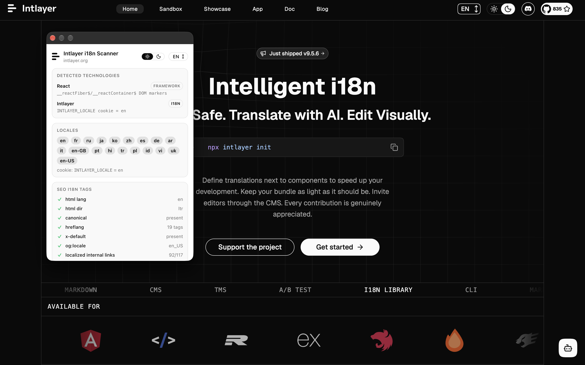
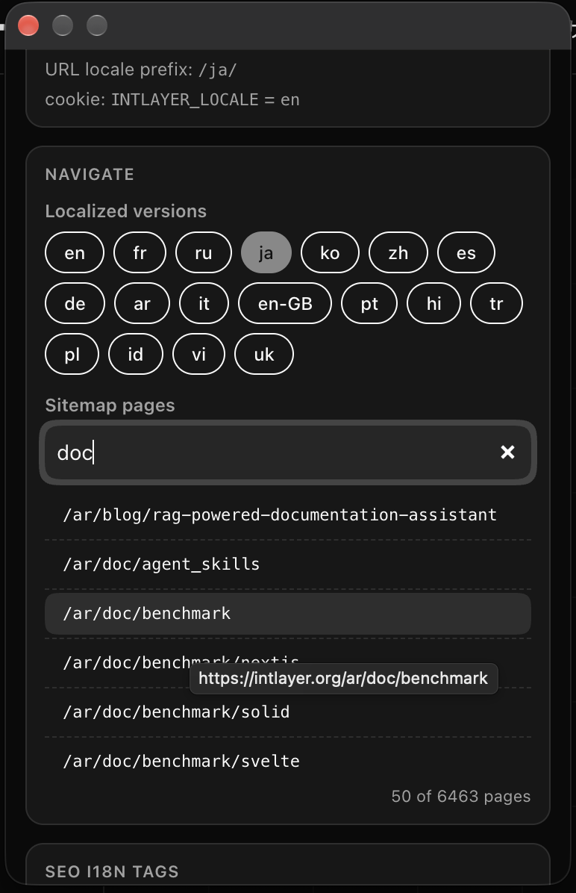
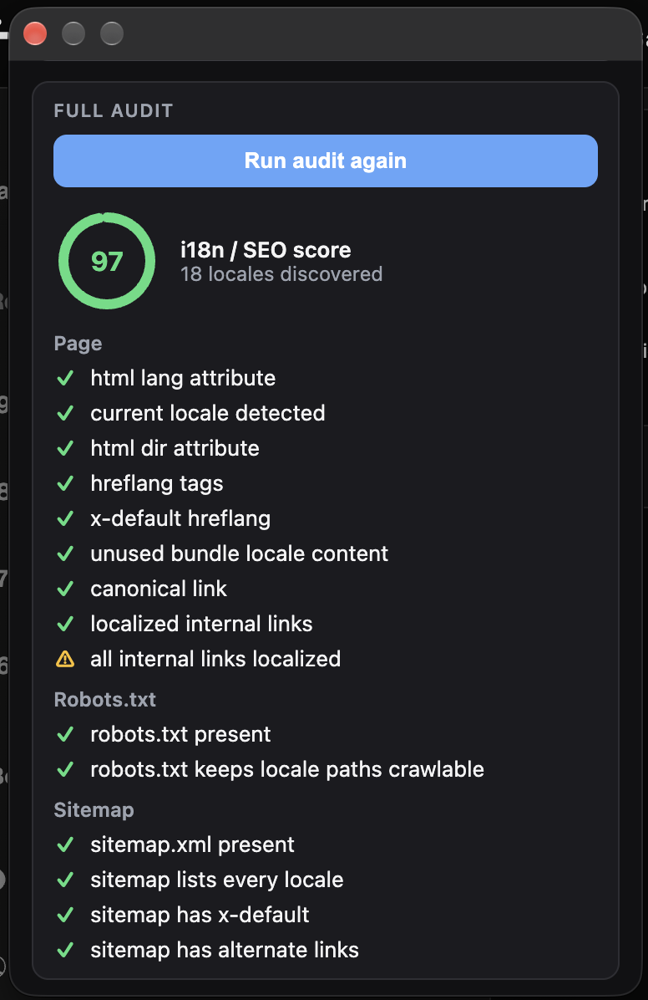

# הרחבה ל-Chrome ו-Firefox: סורק i18n ו-SEO

## סקירה כללית

[**Intlayer i18n Scanner**](https://chromewebstore.google.com/detail/intlayer_i18n_scanner/pmlehcgmjmfimmjnembihbakhnheiabc) היא הרחבת Chrome הרשמית עבור **Intlayer**. פתח אותה בכל אתר כדי לראות כיצד האתר מטפל בבינאום: באיזה פריימוורק ובאיזו ספריית i18n הוא משתמש, אילו שפות הוא חושף והאם תגיות ה-SEO הרב-לשוניות שלו מוגדרות כהלכה.

ההרחבה פועלת בכל אתר אינטרנט, בין אם הוא משתמש ב-Intlayer ובין אם לא.

[קישור להרחבת Chrome](https://chromewebstore.google.com/detail/intlayer_i18n_scanner/pmlehcgmjmfimmjnembihbakhnheiabc)

[קישור לתוסף Firefox](https://addons.mozilla.org/en-US/firefox/addon/intlayer-i18n-scanner/)

## תכונות

- **זיהוי טכנולוגיות**: מזהה את הפריימוורק (Next.js, Nuxt, Astro, SvelteKit, Angular, Vue.js, Qwik, React, Gatsby, WordPress) ואת ספריית ה-i18n (כגון Intlayer, i18next, Vue I18n, @nuxtjs/i18n, Angular @angular/localize, next-intl / next-i18next, Weglot, Localize, WPML, Polylang). כל זיהוי מציג את הראיה שהפעילה אותו, כגון משתנה גלובלי, עוגייה (cookie) או סמן DOM.
- **שפות (Locales)**: מציג את השפות שנמצאו במאפיין ה-`lang`, תגיות hreflang ו-`og:locale`, קידומת השפה ב-URL, וכן עוגיות שפה או רשומות אחסון.
- **תגיות SEO i18n**: בודק את `html lang`, `html dir`, הקישור הקנוני, תגיות hreflang, `x-default`, `og:locale` ואת יחס הקישורים הפנימיים המתורגמים.
- **ניווט בין שפות**: מעביר את הדף הנוכחי לכל אחת מגרסאות השפה שלו בלחיצה אחת, בהתבסס על תגיות ה-hreflang שלו.
- **חיפוש במפת אתר**: מחפש בכל עמוד הרשום במפת האתר (sitemap) ופותח אותו בלשונית הנוכחית.
- **ביקורת מלאה (Full audit)**: מריץ את אותה ביקורת כמו [סורק ה-i18n SEO](https://intlayer.org/i18n-seo-scanner) ומציג ציון חי.
- **כלי סוכן AI (WebMCP)**: מאפשר לסוכן AI הרץ בדפדפן לבדוק, לנווט ולבצע ביקורת של האתר הנוכחי עבורך.

## התקנה

<Tabs group="browser">
  <Tab label="Chrome" value="chrome">

התקן את [**Intlayer i18n Scanner**](https://chromewebstore.google.com/detail/intlayer_i18n_scanner/pmlehcgmjmfimmjnembihbakhnheiabc) מחנות האינטרנט של Chrome, ולאחר מכן הצמד אותה לסרגל הכלים שלך.

ההרחבה פועלת ב-Chrome ובכל דפדפן מבוסס Chromium התומך בהרחבות מחנות האינטרנט של Chrome (כגון Edge, Brave, Arc, Opera).

  </Tab>
  <Tab label="Firefox" value="firefox">

התקן את [**Intlayer i18n Scanner**](https://addons.mozilla.org/en-US/firefox/addon/intlayer-i18n-scanner/) מתוספי Firefox, ולאחר מכן הצמד אותה לסרגל הכלים שלך.

  </Tab>
</Tabs>

## שימוש

### בדיקת דף

1. פתח את אתר האינטרנט שברצונך לבדוק.
2. לחץ על סמל **Intlayer i18n Scanner** בסרגל הכלים.
3. החלון הקופץ מציג את הסעיפים **טכנולוגיות שזוהו**, **שפות** ו**תגיות SEO i18n** עבור הדף הנוכחי.

הזיהוי רץ מקומית בדפדפן שלך, בלשונית הנוכחית בלבד.

### ניווט בין שפות

סעיף **Navigate** מפרט את ה**גרסאות המתורגמות** של הדף הנוכחי, כפי שנקראו מתוך תגיות ה-hreflang שלו. לחץ על שפה כדי לפתוח את אותה גרסה בלשונית הנוכחית.

תחת **Sitemap pages**, הקלד כדי לחפש בכתובות ה-URL של מפת האתר, ולאחר מכן לחץ על תוצאה כדי לפתוח אותה.

### הרצת ביקורת מלאה

גלול לסעיף **Full audit** ולחץ על **Run full i18n audit**. התוצאות מוזרמות עם השלמת כל בדיקה, מקובצות לפי:

- **דף (Page)**: מאפייני `html lang` ו-`dir`, שפה נוכחית, תגיות hreflang, `x-default`, קישור קנוני, קישורים פנימיים מותאמים לשפה, בורר שפות, סמלי דגלים ותוכן שפה שאינו בשימוש שנשלח בבאנדל ה-JavaScript.
- **Robots.txt**: נוכחות, והאם נתיבי השפה נשארים נגישים לסריקה.
- **מפת אתר (Sitemap)**: נוכחות, פירוט כל השפות, קישורי חלופות ו-`x-default`.
- **דומיין**: מספר השפות שהתגלו בכל רחבי האתר.

כל בדיקה מסומנת כעברה בהצלחה, אזהרה או נכשלה, והציון מסכם את תקינות ה-i18n SEO הכוללת של הדף.

### שימוש עם סוכן AI (WebMCP)

ההרחבה תומכת ב-[WebMCP](https://webmachinelearning.github.io/webmcp/), תקן הדפדפן המאפשר לאתרים ולהרחבות לחשוף כלים לסוכני AI הרצים בדפדפן. בזמן שהחלון הקופץ פתוח, סוכן יכול להשתמש בהרחבה באותו אופן שבו אתה משתמש בה, למשל כדי:

- להסביר כיצד האתר הנוכחי מטפל בבינאום, ואיזה מדריך הגירה של Intlayer מתאים לספריית ה-i18n שלו.
- לגלוש באתר: לעבור לגרסה מתורגמת של הדף, או למצוא ולפתוח דף המופיע במפת האתר.
- להריץ ביקורת מלאה, לסכם את הבדיקות שנכשלו ולהציע כיצד לתקן אותן.
- לענות על שאלות לגבי Intlayer מתוך התיעוד שלו.

## פרטיות והרשאות

ההרחבה מבקשת הרשאות מינימליות בלבד:

- **activeTab** ו-**scripting**: מנגנון הזיהוי רץ רק על הלשונית שבה אתה צופה, ורק כאשר אתה פותח את החלון הקופץ.
- **back.intlayer.org**: בשימוש רק כאשר אתה מריץ ביקורת מלאה. כתובת ה-URL של הדף הנוכחי נשלחת ל-API של Intlayer לצורך סריקה.
- **mcp.intlayer.org**: פנייה מתבצעת רק כאשר סוכן דפדפן WebMCP זמין, כדי לטעון את כלי התיעוד של Intlayer.

אין איסוף של היסטוריית גלישה ודבר אינו פועל ברקע.

## שאלות נפוצות (FAQ)

<FAQ>

<Question title="האם האתר חייב להשתמש ב-Intlayer?">

לא. ההרחבה בודקת כל אתר אינטרנט, ללא קשר לפריימוורק או לספריית ה-i18n שבהם הוא משתמש.

</Question>
<Question title="מדוע טכנולוגיה מסוימת אינה מזוהה?">

הזיהוי מסתמך על מה שהדף חושף בדפדפן: משתנים גלובליים, עוגיות, תגיות מטא וסמני DOM. חלק מתהליכי הבנייה לסביבת ייצור (production) מסירים סמנים אלו, ולכן ייתכן שספרייה נמצאת בשימוש מבלי להשאיר עקבות גלויים.

</Question>
<Question title="כיצד ניתן לתקן את הבעיות שנמצאו בביקורת?">

רוב הבדיקות ממופות להגדרת ניתוב או מטא-דאטה. עם Intlayer, תגיות hreflang, קנוניות, `x-default`, קישורים מותאמים, מפת אתר ו-robots.txt מופקים מתוך ה[תצורה](https://github.com/aymericzip/intlayer/blob/main/docs/docs/he-IL/configuration.md) שלך. עיין במדריך השילוב עבור הפריימוורק שלך, למשל [Next.js](https://github.com/aymericzip/intlayer/blob/main/docs/docs/he-IL/intlayer_with_nextjs_16.md), [Nuxt](https://github.com/aymericzip/intlayer/blob/main/docs/docs/he-IL/intlayer_with_nuxt.md) או [TanStack Start](https://github.com/aymericzip/intlayer/blob/main/docs/docs/he-IL/intlayer_with_tanstack.md).

- [תצורה](https://github.com/aymericzip/intlayer/blob/main/docs/docs/he-IL/configuration.md)
- [Next.js](https://github.com/aymericzip/intlayer/blob/main/docs/docs/he-IL/intlayer_with_nextjs_16.md)
- [Nuxt](https://github.com/aymericzip/intlayer/blob/main/docs/docs/he-IL/intlayer_with_nuxt.md)
- [TanStack Start](https://github.com/aymericzip/intlayer/blob/main/docs/docs/he-IL/intlayer_with_tanstack.md)

</Question>

</FAQ>

## כלים קשורים

- [הרחבה ל-VS Code](https://github.com/aymericzip/intlayer/blob/main/docs/docs/he-IL/vs_code_extension.md)
- [שרת MCP](https://github.com/aymericzip/intlayer/blob/main/docs/docs/he-IL/mcp_server.md)
- [שרת LSP](https://github.com/aymericzip/intlayer/blob/main/docs/docs/he-IL/lsp.md)
