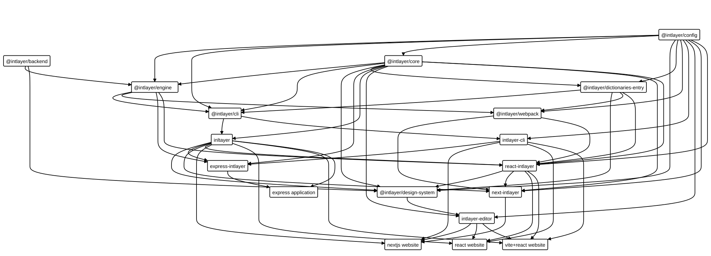

# כיצד Intlayer פועל

## תוכן עניינים

<TOC/>

## סקירה כללית

הרעיון המרכזי העומד מאחורי Intlayer הוא אימוץ ניהול תוכן לפי רכיב (per-component). הרעיון מאחורי Intlayer הוא לאפשר לכם להצהיר על התוכן שלכם בכל מקום בבסיס הקוד, למשל באותה התיקייה של הרכיב שלכם.

```bash
.
└── Components
    └── MyComponent
        ├── index.content.ts
        └── index.tsx
```

לשם כך, תפקידו של Intlayer הוא לאתר את כל `קובצי הצהרת התוכן` (content declaration files), בכל הפורמטים השונים הקיימים בפרויקט שלכם, ולאחר מכן לייצר מהם את ה-`dictionaries` (מילונים).

לפיכך, ישנם שני שלבים עיקריים:

- שלב הבנייה (Build step)
- שלב הפיענוח (Interpretation step)

### שלב בניית המילונים

שלב הבנייה יכול להתבצע בשלוש דרכים:

- באמצעות ה-CLI עם `npx intlayer build`
- באמצעות [תוסף vscode](https://github.com/aymericzip/intlayer/blob/main/docs/docs/he/vs_code_extension.md)
- באמצעות תוספי אפליקציה כגון חבילת [`vite-intlayer`](https://github.com/aymericzip/intlayer/blob/main/docs/docs/he/packages/vite-intlayer/exports.md), או המקבילים שלהם עבור [Next.js](https://github.com/aymericzip/intlayer/blob/main/docs/docs/he/packages/next-intlayer/exports.md). בעת שימוש באחד מתוספים אלו, Intlayer יבנה אוטומטית את המילונים שלכם בעת הפעלת האפליקציה (בפיתוח - dev) או בבנייתה (בייצור - prod).

1. הצהרת קובצי תוכן
   - קובצי תוכן יכולים להיות מוגדרים במגוון פורמטים, כגון TypeScript, ECMAScript, CommonJS, או JSON.
   - קובצי תוכן יכולים להיות מוגדרים בכל מקום בפרויקט, מה שמאפשר תחזוקה טובה יותר ומדרגיות (scalability). חשוב להקפיד על מוסכמות סיומת הקבצים עבור קובצי תוכן. סיומת זו היא כברירת מחדל `*.content.{js|cjs|mjs|ts|tsx|json}`, אך ניתן לשנותה ב[קובץ ההגדרות](https://github.com/aymericzip/intlayer/blob/main/docs/docs/he/configuration.md).

2. יצירת `dictionaries` (מילונים)
   - מילונים נוצרים מתוך קובצי התוכן. כברירת מחדל, מילוני Intlayer נוצרים בתיקיית `.intlayer/dictionaries` של הפרויקט.
   - מילונים אלו נוצרים בפורמטים שונים כדי להתאים לכל הצרכים ולמקסם את ביצועי האפליקציה.

3. יצירת טיפוסי מילון (Dictionary types)

על סמך ה-`dictionaries` שלכם, Intlayer מייצר טיפוסים כדי להפוך אותם לשימושיים ובטוחים באפליקציה שלכם.

- טיפוסי מילון נוצרים מתוך `קובצי הצהרת התוכן` של Intlayer. כברירת מחדל, טיפוסי מילון של Intlayer נוצרים בתיקיית `.intlayer/types` של הפרויקט.
- ה-[module augmentation](https://www.typescriptlang.org/docs/handbook/declaration-merging.html) של Intlayer הוא מאפיין של TypeScript המאפשר להגדיר טיפוסים נוספים עבור Intlayer. הדבר מקל על חוויית הפיתוח על ידי הצעת ארגומנטים זמינים או ארגומנטים נדרשים.
  בין הטיפוסים שנוצרו, טיפוסי מילון של Intlayer או אף טיפוסי תצורת שפות מתווספים לקובץ `types/intlayer.d.ts`, ומשמשים חבילות אחרות. לשם כך, יש צורך שקובץ `tsconfig.json` יוגדר לכלול את תיקיית `types` של הפרויקט.

### שלב פענוח המילונים

בשימוש ב-Intlayer, תיגשו לתוכן שלכם באפליקציה באמצעות ה-hook‏ `useIntlayer`.

```tsx
const MyComponent = () => {
  const content = useIntlayer("my-component");
  return <div>{content.title}</div>;
};
```

ה-hook מנהל את זיהוי השפה (locale detection) עבורכם ומחזיר את התוכן עבור השפה הנוכחית. באמצעות hook זה, תוכלו גם לפענח markdown, לנהל ריבוי (pluralization) ועוד.

> כדי לראות את כל התכונות של Intlayer, תוכלו לקרוא את [תיעוד המילונים](https://github.com/aymericzip/intlayer/blob/main/docs/docs/he/dictionary/content_file.md).

- [תיעוד מילונים](https://github.com/aymericzip/intlayer/blob/main/docs/docs/he/dictionary/content_file.md)

## תוכן מרוחק (Distant content)

Intlayer מאפשר לכם להצהיר על תוכן מקומית, ולאחר מכן לייצא אותו ל-CMS כדי להפוך אותו לנגיש לעריכה על ידי צוות שאינו טכני.

כך תוכלו לבצע push ו-pull של תוכן מה-CMS לאפליקציה שלכם, באופן דומה לפעולות שאתם מבצעים עם Git עבור הקוד שלכם.

עבור מילונים מוחצנים המשתמשים ב-CMS,‏ Intlayer מבצע פעולת fetch פשוטה כדי לשלוף מילונים מרוחקים וממזג אותם עם המקומיים שלכם. אם מוגדר בפרויקט שלכם, Intlayer ינהל אוטומטית את שליפת התוכן מה-CMS בעת הפעלת האפליקציה (בפיתוח) או בבנייתה (בייצור).

## עורך ויזואלי (Visual editor)

Intlayer מספק בנוסף עורך ויזואלי המאפשר לכם לערוך את התוכן שלכם באופן חזותי. [עורך ויזואלי](https://github.com/aymericzip/intlayer/blob/main/docs/docs/he/intlayer_visual_editor.md) זה זמין בחבילה החיצונית `intlayer-editor`.

- [עורך ויזואלי](https://github.com/aymericzip/intlayer/blob/main/docs/docs/he/intlayer_visual_editor.md)


- השרת הוא אפליקציית Express פשוטה שמאזינה לבקשות מהלקוח ושולפת את תוכן האפליקציה שלכם, כגון ה-`dictionaries` והתצורה, כדי להנגישם בצד הלקוח.
- מצד שני, הלקוח הוא אפליקציית React המשמשת לאינטראקציה עם התוכן שלכם באמצעות ממשק ויזואלי.

כאשר אתם קוראים לתוכן שלכם באמצעות `useIntlayer` והעורך מופעל, הוא עוטף אוטומטית את המחרוזות שלכם באובייקט Proxy בשם `IntlayerNode`. צומת זה משתמש ב-`window.postMessage` כדי לתקשר עם iframe עטוף המכיל את ממשק העורך הוויזואלי.
בצד העורך, העורך מאזין להודעות אלו ומדמה אינטראקציה אמיתית עם התוכן שלכם, מה שמאפשר לכם לערוך טקסט ישירות בהקשר של האפליקציה שלכם.

## אופטימיזציית בניית האפליקציה

כדי לבצע אופטימיזציה לגודל ה-bundle של האפליקציה שלכם, Intlayer מספק שני תוספים לייעול הבנייה: תוספי `@intlayer/babel` ו-`@intlayer/swc`.

תוספי Babel ו-SWC פועלים על ידי ניתוח עץ התחביר המופשט (AST) של האפליקציה שלכם כדי להחליף קריאות לפונקציות של Intlayer בקוד מותאם וממוטב. תהליך זה הופך את ה-bundle הסופי שלכם לקל יותר בייצור על ידי הבטחה שרק המילונים שנמצאים בשימוש בפועל ייובאו, תוך אופטימיזציה של פיצול מקטעים (chunking) והקטנת גודל ה-bundle.

במצב פיתוח, Intlayer משתמש בייבוא סטטי מרכזי עבור מילונים כדי לפשט את חוויית הפיתוח.

על ידי הפעלת האפשרות `importMode = "dynamic"` בהגדרות `dictionary` בתוך [קובץ ההגדרות](https://github.com/aymericzip/intlayer/blob/main/docs/docs/he/configuration.md) שלכם, Intlayer ישתמש בייבוא דינמי לטעינת המילונים. אפשרות זו מושבתת כברירת מחדל כדי למנוע עיבוד אסינכרוני בעת רינדור האפליקציה.

- [קובץ ההגדרות](https://github.com/aymericzip/intlayer/blob/main/docs/docs/he/configuration.md)

> `@intlayer/babel` זמין כברירת מחדל בחבילת `vite-intlayer`.

> `@intlayer/swc` אינו מותקן כברירת מחדל בחבילת `next-intlayer` מכיוון שתוספי SWC עדיין ניסיוניים ב-Next.js.

כדי לראות כיצד להגדיר את בניית האפליקציה שלכם, תוכלו לקרוא את [תיעוד ההגדרות](https://github.com/aymericzip/intlayer/blob/main/docs/docs/he/configuration.md).

- [תיעוד ההגדרות](https://github.com/aymericzip/intlayer/blob/main/docs/docs/he/configuration.md)

## חבילות (Packages)

Intlayer מורכב ממספר חבילות, שלכל אחת מהן תפקיד מוגדר בתהליך התרגום. להלן ייצוג גרפי של מבנה החבילות:



### intlayer

חבילת `intlayer` משמשת באפליקציות להצהרת תוכן בקובצי תוכן.

### שלדי פיתוח צד-לקוח (Frontend Frameworks)

<Tabs group="framework">
  <Tab label="React" value="react">

חבילת `react-intlayer` משמשת לפענוח מילוני Intlayer והנגשתם לשימוש באפליקציות React.

  </Tab>
  <Tab label="Next.js" value="nextjs">

חבילת `next-intlayer` משמשת כשכבה מעל `react-intlayer` כדי להנגיש את מילוני Intlayer באפליקציות Next.js. היא משלבת תכונות חיוניות להפעלת Intlayer בסביבת Next.js, כגון middleware לתרגום, ניתוב, והגדרות בקובץ `next.config.js`.

  </Tab>
  <Tab label="Vue" value="vue">

חבילת `vue-intlayer` משמשת לפענוח מילוני Intlayer והנגשתם לשימוש באפליקציות Vue.

  </Tab>
  <Tab label="Nuxt" value="nuxt">

חבילת `nuxt-intlayer` משמשת כמודול Nuxt להנגשת מילוני Intlayer באפליקציות Nuxt. היא משלבת תכונות חיוניות להפעלת Intlayer בסביבת Nuxt, כגון middleware לתרגום, ניתוב, והגדרות בקובץ `nuxt.config.js`.

  </Tab>
  <Tab label="Svelte" value="svelte">

חבילת `svelte-intlayer` משמשת לפענוח מילוני Intlayer והנגשתם באפליקציות Svelte.

  </Tab>
  <Tab label="Solid" value="solid">

חבילת `solid-intlayer` משמשת לפענוח מילוני Intlayer והנגשתם באפליקציות Solid.js.

  </Tab>
  <Tab label="Preact" value="preact">

חבילת `preact-intlayer` משמשת לפענוח מילוני Intlayer והנגשתם באפליקציות Preact.

  </Tab>
  <Tab label="Angular" value="angular">

חבילת `angular-intlayer` משמשת לפענוח מילוני Intlayer והנגשתם באפליקציות Angular.

  </Tab>
  <Tab label="Astro" value="astro">

חבילת `astro-intlayer` מספקת את הכלים הנדרשים לשילוב Intlayer באפליקציות Astro. היא מגדירה ניתוב מבוסס שפה וניהול מילונים.

  </Tab>
  <Tab label="Remix" value="remix">

חבילת `remix-intlayer` מספקת את הכלים הנדרשים לשילוב Intlayer באפליקציות Remix. היא מגדירה ניתוב מבוסס שפה, הקשר צד-שרת וניהול מילונים.

  </Tab>
  <Tab label="React Native" value="react-native">

חבילת `react-native-intlayer` מספקת כלים המשלבים תוספים עבור Intlayer לעבודה עם ה-bundler של Metro.

  </Tab>
  <Tab label="Lit" value="lit">

חבילת `lit-intlayer` מספקת כלים ורכיבים לפענוח ושימוש במילוני Intlayer באפליקציות Lit.

  </Tab>
  <Tab label="Vanilla JS" value="vanilla">

חבילת `vanilla-intlayer` מספקת כלים לשילוב Intlayer באפליקציות JavaScript רגילות (vanilla), HTML או PHP.

  </Tab>
</Tabs>

### שלדי פיתוח צד-שרת (Backend Frameworks)

<Tabs group="backend">
  <Tab label="Express" value="express">

חבילת `express-intlayer` משמשת להפעלת Intlayer ב-backend של Express.js.

  </Tab>
  <Tab label="Fastify" value="fastify">

חבילת `fastify-intlayer` מספקת תוסף עבור אפליקציות Fastify לטיפול בבינאום. היא מזהה את שפת המשתמש ומעשירה את אובייקט ה-request.

  </Tab>
  <Tab label="Hono" value="hono">

חבילת `hono-intlayer` מספקת middleware עבור אפליקציות Hono לטיפול בבינאום. היא מזהה את שפת המשתמש ומאכלסת את אובייקט ה-context.

  </Tab>
  <Tab label="Elysia" value="elysia">

חבילת `elysia-intlayer` מספקת תוסף עבור אפליקציות Elysia לטיפול בבינאום. היא מזהה את שפת המשתמש ומזריקה אובייקט `intlayer` לתוך הקשר הנתיב (route context).

  </Tab>
  <Tab label="AdonisJS" value="adonis">

חבילת `adonis-intlayer` מספקת middleware עבור אפליקציות AdonisJS לטיפול בבינאום. היא מזהה את שפת המשתמש ומספקת פונקציות תרגום.

  </Tab>
</Tabs>

### vite-intlayer

כולל את תוסף Vite לשילוב Intlayer עם [Vite bundler](https://vite.dev/guide/why.html#why-bundle-for-production), וכן middleware לזיהוי השפה המועדפת על המשתמש, ניהול cookies וטיפול בהפניות URL.

### react-scripts-intlayer

כולל פקודות ותוספים של `react-scripts-intlayer` לשילוב Intlayer באפליקציות המבוססות על Create React App. תוספים אלו מבוססים על [craco](https://craco.js.org/) וכוללים הגדרות נוספות עבור ה-bundler של [Webpack](https://webpack.js.org/).

### eslint-plugin-intlayer

חבילת `eslint-plugin-intlayer` מספקת כללי ESLint ו-oxlint לזיהוי מחרוזות שלא תורגמו, אימות הגדרות מילון, ואכיפת best practices של i18n לאורך כל בסיס הקוד שלכם.

### intlayer-editor

חבילת `intlayer-editor` משמשת להפעלת העורך הוויזואלי. חבילה זו, שהיא אופציונלית, ניתנת להתקנה באפליקציות ותשמש את חבילת `react-intlayer`.
היא מורכבת משני חלקים: השרת והלקוח.

הלקוח מכיל רכיבי ממשק משתמש (UI) שישמשו את `react-intlayer`.

השרת, המבוסס על Express, משמש לקבלת בקשות העורך הוויזואלי ולניהול או עדכון קובצי תוכן.

### intlayer-cli

ניתן להשתמש בחבילת `intlayer-cli` לבניית מילונים באמצעות הפקודה `npx intlayer dictionaries build`. אם `intlayer` כבר מותקן, ה-CLI מותקן אוטומטית ואין צורך בחבילה נפרדת זו.

### @intlayer/core

חבילת `@intlayer/core` היא חבילת הליבה הראשית של Intlayer. היא מכילה פונקציות תרגום וניהול מילונים. החבילה פועלת בכל הפלטפורמות ומשמשת חבילות אחרות לביצוע פענוח של מילונים.

### @intlayer/config

חבילת `@intlayer/config` משמשת לקביעת הגדרות Intlayer, כגון שפות זמינות, פרמטרים של Next.js middleware, או הגדרות העורך המשולב.

### @intlayer/webpack

חבילת `@intlayer/webpack` משמשת לאספקת הגדרות Webpack כדי לאפשר לאפליקציה מבוססת Webpack לפעול עם Intlayer. החבילה מספקת בנוסף תוסף להוספה לאפליקציית Webpack קיימת.

### @intlayer/cli

חבילת `@intlayer/cli` היא חבילת NPM המשמשת להצהרת הסקריפטים הקשורים לממשק שורת הפקודה של Intlayer. היא מבטיחה אחידות של כל פקודות ה-CLI של Intlayer. חבילה זו נצרכת במיוחד על ידי חבילות [intlayer-cli](https://github.com/aymericzip/intlayer/blob/main/docs/docs/he/packages/intlayer-cli/exports.md) ו-[intlayer](https://github.com/aymericzip/intlayer/blob/main/docs/docs/he/packages/intlayer/exports.md).

### @intlayer/mcp

חבילת `@intlayer/mcp` מספקת שרת MCP (Model Context Protocol) המספק סיוע מבוסס AI בסביבת הפיתוח המותאם לאקוסיסטם של Intlayer. היא טוענת אוטומטית תיעוד ומשתלבת עם ה-CLI של Intlayer.

### @intlayer/lsp

חבילת `@intlayer/lsp` מספקת שרת Language Server Protocol (LSP) המותאם אישית עבור Intlayer. היא מביאה תכונות IDE כגון Go to Definition, Find References, תצוגה מקדימה בריחוף, השלמה אוטומטית של מפתחות מילון ואזהרות דיאגנוסטיקה לכל עורך התומך ב-LSP.

### @intlayer/ai

חבילת `@intlayer/ai` מספקת יכולות SDK עבור אפליקציות Intlayer, ומאפשרת תרגום אוטומטי ויצירת תוכן מבוססת AI.

### @intlayer/analytics

חבילת `@intlayer/analytics` מספקת כלים לאיסוף מדדי חשיפת תוכן, אנליטיקה ברמת הדף, השפה והצומת הבודד, ומפעילה בדיקות A/B של תוכן.

### @intlayer/dictionaries-entry

חבילת `@intlayer/dictionaries-entry` מחזירה את נתיב הכניסה של מילוני Intlayer: המילונים הממוזגים מהשורש שלו, והמילונים הלא ממוזגים, המרוחקים, הדינמיים והנשלפים מנתיבי המשנה `/unmerged`,‏ `/remote`,‏ `/dynamic` ו-`/fetch`. מאחר שחיפוש במערכת הקבצים מתוך הדפדפן אינו אפשרי, שימוש ב-bundlers כמו Webpack או Rollup לאחזור נתיב הכניסה של המילונים אינו ישים ישירות. החבילה ונתיבי המשנה שלה תוכננו להיות מוגדרים ככינויים (aliased), מה שמאפשר אופטימיזציית bundling לאורך מגוון כלי בנייה כגון Vite, Webpack ו-Turbopack.

### @intlayer/engine

חבילת `@intlayer/engine` משמשת לניטור קובצי תוכן ובנייה מחדש של המילון שהשתנה בכל שינוי.

### @intlayer/editor

חבילת `@intlayer/editor` מספקת כלי עזר הקשורים לעורך המילונים. היא כוללת במיוחד את ה-API לממשק אפליקציה עם עורך Intlayer, וכלי שירות למניפולציה של מילונים. חבילה זו פועלת בכל הפלטפורמות.

### @intlayer/editor-react

חבילת `@intlayer/editor-react` מספקת מצבים (states), קונטקסטים, hooks ורכיבים לממשוק אפליקציית React עם עורך Intlayer.

### @intlayer/babel

חבילת `@intlayer/babel` מספקת כלים המייעלים את אריזת ה-bundle של מילונים עבור אפליקציות מבוססות Vite ו-Webpack.

### @intlayer/swc

חבילת `@intlayer/swc` מספקת כלים המייעלים את אריזת ה-bundle של מילונים עבור אפליקציות Next.js.

### @intlayer/api

חבילת `@intlayer/api` היא SDK של API לביצוע אינטראקציה עם ה-backend.

### @intlayer/design-system

חבילת `@intlayer/design-system` משמשת לשיתוף אלמנטים עיצוביים בין ה-CMS לבין העורך הוויזואלי.

### @intlayer/backend

חבילת `@intlayer/backend` מייצאת טיפוסי backend ובעתיד תציע את ה-backend כחבילה עצמאית.

## שיחה עם התיעוד החכם שלנו

- [שאלו שאלות את התיעוד החכם שלנו](https://intlayer.org/doc/chat)

## שאלות נפוצות

<FAQ>

<Question title="מתי מילונים נבנים, בזמן בנייה או בזמן ריצה?">

בזמן בנייה (build time). תוסף ה-bundler, או הפקודה `npx intlayer build`, סורק את קובצי ה-`.content.ts` שלכם, פותר אותם למילונים בתיקיית `.intlayer`, ומייצר את טיפוסי ה-TypeScript התואמים. בזמן ריצה הרכיבים שלכם קוראים אך ורק את התוצאה, כך שלא מתרחש שום ניתוח תחבירי (parsing) או טעינת קבצים במסלול הבקשה.

</Question>
<Question title="כמה בינאום (i18n) מוסיף לגודל ה-bundle שלי?">

הרבה פחות מהגדרה המבוססת על namespaces, מכיוון שדף אינו מוריד לעולם קטלוג שאינו מרונדר בו. תוכן מרונדר בשרת פותר את התוכן שלו בשרת, והמהדר בזמן הבנייה מחליף קריאות `useIntlayer` בערכי המילון המדויקים שבהם הרכיב משתמש, כך שמפתחות ושפות שאינם בשימוש מושמטים. [מילונים דינמיים](https://github.com/aymericzip/intlayer/blob/main/docs/docs/he/dynamic_dictionaries/index.md) מפצלים את השאר לפי שפה. בהשוואה לחלופות המקובלות, Intlayer מפחית את גודל ה-bundle וגודל הדף בעד 50%. ראו [אופטימיזציית bundle](https://github.com/aymericzip/intlayer/blob/main/docs/docs/he/bundle_optimization.md) ואת ה-[benchmark](https://github.com/aymericzip/intlayer/blob/main/docs/docs/he/benchmark/index.md).

- [מילונים דינמיים](https://github.com/aymericzip/intlayer/blob/main/docs/docs/he/dynamic_dictionaries/index.md)
- [אופטימיזציית bundle](https://github.com/aymericzip/intlayer/blob/main/docs/docs/he/bundle_optimization.md)
- [benchmark](https://github.com/aymericzip/intlayer/blob/main/docs/docs/he/benchmark/index.md)

</Question>
<Question title="האם ניתן להגר מ-`i18next`,‏ `next-intl` או `react-i18next` מבלי לשכתב את הרכיבים שלי?">

כן, וישנם שני מסלולים. ניתן להגר את התוכן בהדרגה באמצעות [מדריך ההגירה מ-i18next](https://github.com/aymericzip/intlayer/blob/main/docs/docs/he/migration_from_i18next_to_intlayer.md) או [מדריך ההגירה מ-next-intl](https://github.com/aymericzip/intlayer/blob/main/docs/docs/he/migration_from_next-intl_to_intlayer.md). לחלופין, תוכלו לשמור על ה-API הנוכחי שלכם לחלוטין: [מתאמי התאימות (compat adapters)](https://github.com/aymericzip/intlayer/blob/main/docs/docs/he/compat/index.md) חושפים בדיוק את אותו ה-API של `i18next`,‏ `react-i18next`,‏ `next-intl`,‏ `next-i18next`,‏ `react-intl`,‏ `use-intl`,‏ `vue-i18n` ו-`Lingui`, אך מופעלים על ידי מילוני Intlayer, כך שרק ה-imports משתנים וקוד הרכיב נשאר ללא שינוי.

- [מדריך ההגירה מ-i18next](https://github.com/aymericzip/intlayer/blob/main/docs/docs/he/migration_from_i18next_to_intlayer.md)
- [מדריך ההגירה מ-next-intl](https://github.com/aymericzip/intlayer/blob/main/docs/docs/he/migration_from_next-intl_to_intlayer.md)
- [מתאמי תאימות](https://github.com/aymericzip/intlayer/blob/main/docs/docs/he/compat/index.md)

</Question>
<Question title="האם ניתן לשמור על קובצי תרגום ה-JSON הקיימים שלי?">

כן. ה-[תוסף לסנכרון JSON](https://github.com/aymericzip/intlayer/blob/main/docs/docs/he/plugins/sync-json.md) שומר על קובצי ה-`/messages/{locale}/{namespace}.json` שלכם כמקור האמת ומייצר מהם מילוני Intlayer, בשני הכיוונים. [תוסף לסנכרון PO](https://github.com/aymericzip/intlayer/blob/main/docs/docs/he/plugins/sync-po.md) עושה את אותו הדבר עבור קטלוגי gettext, ו-[קבצים לפי שפה (per locale files)](https://github.com/aymericzip/intlayer/blob/main/docs/docs/he/per_locale_file.md) מאפשרים לפצל תוכן לפי שפה במקום לקבץ את כל השפות בקובץ יחיד.

- [תוסף לסנכרון JSON](https://github.com/aymericzip/intlayer/blob/main/docs/docs/he/plugins/sync-json.md)
- [תוסף לסנכרון PO](https://github.com/aymericzip/intlayer/blob/main/docs/docs/he/plugins/sync-po.md)
- [קבצים לפי שפה](https://github.com/aymericzip/intlayer/blob/main/docs/docs/he/per_locale_file.md)

</Question>
<Question title="האם עליי להעביר את התוכן שלי מפתח אחר מפתח?">

לא. הריצו `npx intlayer extract` ו-Intlayer יקרא את קובצי המקור שלכם, ישלוף את המחרוזות הפונות למשתמש ויכתוב קובץ `.content` לצד כל אחד מהם, כך שתוכלו לבדוק diff במקום להעתיק מחרוזות לקטלוג אחת אחת. עיינו ב[פקודת extract](https://github.com/aymericzip/intlayer/blob/main/docs/docs/he/cli/extract.md).

- [פקודת extract](https://github.com/aymericzip/intlayer/blob/main/docs/docs/he/cli/extract.md)

עבור צינור אוטומטי לחלוטין, ה-[Intlayer Compiler](https://github.com/aymericzip/intlayer/blob/main/docs/docs/he/compiler.md) מבצע את אותה פעולה בזמן הבנייה על קוד מקור של JSX, TSX, Vue ו-Svelte, ומייצר את המילונים בכל שינוי כך שאין מפתחות לתחזק ידנית. הוא פועל באמצעות ניתוח סטטי, ולכן מחרוזות שקיימות רק בזמן ריצה נותרות מחוץ להישג ידו, והוא דורש מעט הערות (annotations) כדי להבדיל בין טקסט הפונה למשתמש לבין לוגיקת אפליקציה.

- [Intlayer Compiler](https://github.com/aymericzip/intlayer/blob/main/docs/docs/he/compiler.md)

</Question>
<Question title="אילו כלי עורך וסוכני AI זמינים?">

חמישה כלים, כולם אופציונליים:

- **[תוסף VS Code](https://github.com/aymericzip/intlayer/blob/main/docs/docs/he/vs_code_extension.md)**: קפיצה ישירה ממפתח ב-`useIntlayer` אל קובץ התוכן שמצהיר עליו, חילוץ תוכן מרכיב, והרצת build, fill, test, push ו-pull מלוח הפקודות או מלשונית Intlayer ייעודית.
- **[שרת LSP](https://github.com/aymericzip/intlayer/blob/main/docs/docs/he/lsp.md)**: אותה מודעות בכל עורך התומך ב-LSP, עם go to definition, חיפוש כל ההפניות, תצוגה מקדימה בריחוף של ערך מתורגם, השלמה אוטומטית של מפתחות ושדות, והתרעה כאשר מפתח אינו מוצהר בשום מקום. הוא גם מפענח קריאות של `i18next`,‏ `react-i18next`,‏ `next-intl` ו-`use-intl`, מה שמסייע בזמן תהליך ההגירה.
- **[שרת MCP](https://github.com/aymericzip/intlayer/blob/main/docs/docs/he/mcp_server.md)**: חושף את התיעוד וה-CLI של Intlayer עבור Cursor, VS Code, Claude Desktop, Claude Code ו-ChatGPT, כך שעוזר יכול לענות מתוך התיעוד העדכני במקום לנחש, ויכול להריץ פקודות כגון `intlayer fill` בעצמו.
- **[Agent skills](https://github.com/aymericzip/intlayer/blob/main/docs/docs/he/agent_skills.md)**: מיומנויות ממוקדות כגון `intlayer-config`,‏ `intlayer-cli` ו-`intlayer-content`, בתוספת מיומנות ייעודית לכל framework, המלמדות סוכן על תצורת הניתוב שלכם ועל סוגי צומתי התוכן.
- **[תוסף ESLint](https://github.com/aymericzip/intlayer/blob/main/docs/docs/he/eslint.md)**: כלל `no-raw-text` מתריע על מחרוזות מוטמעות בקוד (hardcoded), עם כללים נוספים למפתחות מילון סטטיים ולתוכן שאינו בשימוש.

</Question>
<Question title="מהי תיקיית .intlayer והאם עליי לבצע עליה commit?">

זהו הפלט שנוצר: המילונים המהודרים והטיפוסים שנוצרו. הוא נגזר מקובצי התוכן שלכם, ולכן יש לכלול אותו ב-`.gitignore` ולבנות אותו מחדש בשלב הבנייה שלכם, בדיוק כמו תיקיית `dist`.

</Question>
<Question title="כיצד נקבעת השפה הפעילה?">

מהמקורות המפורטים ב-`routing.storage`, לפי הסדר: קידומת ה-URL כאשר `routing.mode` משתמש באחת, לאחר מכן cookie, לאחר מכן כותרת `Accept-Language`, ולבסוף שפת ברירת המחדל שלכם. שפה שהמשתמש בוחר במפורש נשמרת, כך שהיא שורדת את הביקור הבא. עיינו ב[מדריך ההגדרות](https://github.com/aymericzip/intlayer/blob/main/docs/docs/he/configuration.md).

- [מדריך ההגדרות](https://github.com/aymericzip/intlayer/blob/main/docs/docs/he/configuration.md)

</Question>
<Question title="מה ההבדל בין מילונים מקומיים ומרוחקים?">

מילון מקומי מוצהר בבסיס הקוד שלכם ומהודר יחד עם האפליקציה שלכם. מילון מרוחק מנוהל ב-[CMS](https://github.com/aymericzip/intlayer/blob/main/docs/docs/he/intlayer_CMS.md) ומפוענח בזמן ריצה, כך שהוא יכול להשתנות ללא צורך ב-deployment. שניהם נקראים דרך אותם ה-hooks, ותוכן מרוחק נסוג להצהרה המקומית כאשר אינו זמין.

- [CMS](https://github.com/aymericzip/intlayer/blob/main/docs/docs/he/intlayer_CMS.md)

</Question>
<Question title="האם Intlayer פועל ללא TypeScript?">

כן. קובצי תוכן יכולים להיכתב ב-TypeScript, JavaScript, ESM, CommonJS או JSON. ‏TypeScript הוא זה שפותח את היכולת ליהנות מטיפוסים שנוצרו ומהשלמה אוטומטית, ולכן זוהי התצורה המומלצת, אך היא אינה מחייבת.

</Question>
<Question title="כיצד רינדור שרת ורינדור לקוח חולקים את אותו התוכן?">

השרת פותר את התוכן של רכיבים מרונדרי שרת ישירות, כך שלא נשלח מילון ללקוח עבור markup זה. רכיבי לקוח קוראים את אותם המילונים דרך ה-provider, שמקבל את השפה שנפתרה בשרת, כך שהרינדור הראשון של הלקוח תואם ל-HTML של השרת ואינו מהבהב שפה אחרת.

</Question>
<Question title="כיצד Intlayer מונע אי-התאמת הידרציה (hydration mismatch) בשפה?">

השפה נפתרת פעם אחת בשרת ומועברת ל-provider, במקום להיות מזוהה מחדש בדפדפן. מכיוון שהלקוח מתחיל מאותה השפה שהשרת רינדר, ה-markup תואם, וזה מה שלרוב נשבר עם זיהוי שפה בצד הלקוח.

</Question>
<Question title="האם ניתן להשתמש ב-Intlayer ללא provider גלובלי?">

כן. הפונקציות `getIntlayer` ו-`getDictionary` הן פונקציות רגילות שאינן זקוקות ל-provider, ו-`useIntlayer` עובד גם מחוצה לו. כאשר לא מועברת שפה, הן פותרות את שפת הבקשה הנוכחית בשרת (דרך ה-middleware של Intlayer עבור Express, Fastify, Hono, AdonisJS, Elysia, Remix ו-Astro, או `IntlayerProvider` ב-React Server Components), לאחר מכן את השפה השמורה בדפדפן על ידי בורר השפות שלכם, ולבסוף את `defaultLocale`. הפונקציה `getIntlayerAsync` יכולה גם להמתין לשפת הבקשה היכן שהיא ניתנת לקריאה אסינכרונית בלבד, כגון `headers()` ו-`cookies()` ב-Next.js. כל בקשה פותרת את ה-cookies וה-headers שלה, כך שמשתמשים במקביל לעולם אינם חולקים שפה. ראו [`getIntlayer`](https://github.com/aymericzip/intlayer/blob/main/docs/docs/he/packages/intlayer/getIntlayer.md#without-a-locale).

- [`getIntlayer`](https://github.com/aymericzip/intlayer/blob/main/docs/docs/he/packages/intlayer/getIntlayer.md#without-a-locale)

ההבדל נוגע לתגובתיות (reactivity) ועלות רינדור, ולא לתוכן עצמו:

- **עם provider**, השפה שוכנת ב-state של ה-framework. כל `useIntlayer` נרשם אליו כמנוי (subscribes), כך שהחלפת שפה מרנדרת מחדש את הרכיבים במקום, ללא טעינה מחדש של הדף. בדף מרונדר שרת, ה-provider מוסר ללקוח את השפה שהשרת רינדר, כך שה-markup תמיד תואם. העלות היא קוד ה-provider ב-bundle ורינדור מחדש של צרכניו בכל החלפה.
- **ללא provider**, קריאה היא קריאת פונקציה עם memoization: ללא חיפוש context, ללא הרשמה למנוי, ואותו האובייקט מוחזר עבור אותו `key + locale`. שום דבר אינו מתרנדר מחדש בהחלפת שפה: השפה החדשה תוצג בקריאה הבאה, בדרך כלל לאחר ניווט או טעינה מחדש של הדף. השפה השמורה נקראת פעם אחת ונשמרת במטמון עד לשינוי השפה, מה שמוסיף כ-100 בייטים (ב-gzip) ל-bundle שכבר כולל את Intlayer. הפשרה היא בדפים מרונדרי שרת מחוץ לכל אינטגרציית בקשה: השרת מרנדר את ה-`defaultLocale` בעוד הדפדפן קורא את השפה השמורה, מה שעלול לגרום לאי-התאמת הידרציה.

שמרו על ה-provider עבור אפליקציות אינטראקטיביות המחליפות שפה במקום או מרנדרות בשרת. ותרו עליו עבור backends, סקריפטים, דפים סטטיים ששפתם מגיעה מה-URL (העבירו אותה במפורש), או קוד שקורא תוכן פעם אחת בלבד.

</Question>
<Question title="האם עליי לבצע בנייה מחדש בעת הוספת תרגום?">

בפיתוח, לא: התוסף מאזין לקובצי התוכן שלכם ובונה מחדש את המילונים שהושפעו בעת שמירה. בייצור המילונים הם חלק מהבנייה, אלא אם כן התוכן הוא מרוחק, ובמקרה זה ה-[CMS](https://github.com/aymericzip/intlayer/blob/main/docs/docs/he/intlayer_CMS.md) וה-[סנכרון החי (live sync)](https://github.com/aymericzip/intlayer/blob/main/docs/docs/he/cli/live.md) מחילים את השינוי ללא צורך ב-deployment.

- [CMS](https://github.com/aymericzip/intlayer/blob/main/docs/docs/he/intlayer_CMS.md)
- [סנכרון חי](https://github.com/aymericzip/intlayer/blob/main/docs/docs/he/cli/live.md)

</Question>

</FAQ>
