# מדוע כדאי לשקול את Intlayer?

## מה זה Intlayer?

**Intlayer** היא ספריית בינאום (internationalization) שתוכננה במיוחד עבור מפתחי JavaScript. היא מאפשרת להגדיר את התוכן שלכם בכל מקום בקוד. היא ממירה הצהרות תוכן רב-לשוני למילונים מובנים המשתלבים בקלות בקוד שלכם. באמצעות TypeScript, **Intlayer** הופכת את הפיתוח שלכם לבטוח, חזק ויעיל יותר.

## מדוע Intlayer על פני חלופות?

בהשוואה לפתרונות מרכזיים כמו `next-intl` או `i18next`,‏ Intlayer מציע פתרון שמגיע עם אופטימיזציות מובנות כגון:

<AccordionGroup>
<Accordion header="גודל ה-Bundle">

במקום לטעון קובצי JSON עצומים לתוך הדפים שלכם, טענו רק את התוכן הנחוץ. Intlayer מסייע **להפחית את גודל ה-bundle והדפים שלכם בעד 50%**.

</Accordion>
<Accordion header="תחזוקתיות">

הגבלת היקף התוכן (scoping) ברמת הרכיב **מפשטת את התחזוקה** באפליקציות בקנה מידה גדול. ניתן לשכפל או למחוק תיקיית פיצ'ר אחת מבלי הנטל המנטלי של סקירת כל בסיס קוד התוכן שלכם. בנוסף, Intlayer הוא **בעל טיפוסיות מלאה (fully typed)** כדי להבטיח את תקינות התוכן שלכם.

</Accordion>
<Accordion header="סוכני AI">

מיקום תוכן בסמוך לקוד (co-location) **מפחית את ההקשר הדרוש** למודלי שפה גדולים (LLMs). Intlayer מגיע גם עם חבילת כלים, כגון **CLI** לבדיקת תרגומים חסרים, **[LSP](https://github.com/aymericzip/intlayer/blob/main/docs/docs/he/lsp.md)**, **[MCP](https://github.com/aymericzip/intlayer/blob/main/docs/docs/he/mcp_server.md)**, ו-**[agent skills](https://github.com/aymericzip/intlayer/blob/main/docs/docs/he/agent_skills.md)**, כדי להפוך את חוויית המפתח (DX) לחלקה אף יותר עבור סוכני AI.

- [LSP](https://github.com/aymericzip/intlayer/blob/main/docs/docs/he/lsp.md)
- [MCP](https://github.com/aymericzip/intlayer/blob/main/docs/docs/he/mcp_server.md)
- [agent skills](https://github.com/aymericzip/intlayer/blob/main/docs/docs/he/agent_skills.md)

</Accordion>
<Accordion header="תכונות מתקדמות">

Intlayer מציע מגוון תכונות נוספות שאין בפתרונות i18n אחרים, כגון [תמיכה ב-Markdown](https://github.com/aymericzip/intlayer/blob/main/docs/docs/he/dictionary/markdown.md), [שליפת תוכן חיצוני](https://github.com/aymericzip/intlayer/blob/main/docs/docs/he/dictionary/function_fetching.md), [טעינת תוכן מקבצים](https://github.com/aymericzip/intlayer/blob/main/docs/docs/he/dictionary/file.md), [עדכון תוכן חי](https://github.com/aymericzip/intlayer/blob/main/docs/docs/he/cli/live.md), [עורך ויזואלי](https://github.com/aymericzip/intlayer/blob/main/docs/docs/he/intlayer_visual_editor.md) ועוד.

- [תמיכה ב-Markdown](https://github.com/aymericzip/intlayer/blob/main/docs/docs/he/dictionary/markdown.md)
- [שליפת תוכן חיצוני](https://github.com/aymericzip/intlayer/blob/main/docs/docs/he/dictionary/function_fetching.md)
- [טעינת תוכן מקבצים](https://github.com/aymericzip/intlayer/blob/main/docs/docs/he/dictionary/file.md)
- [עדכון תוכן חי](https://github.com/aymericzip/intlayer/blob/main/docs/docs/he/cli/live.md)
- [עורך ויזואלי](https://github.com/aymericzip/intlayer/blob/main/docs/docs/he/intlayer_visual_editor.md)

</Accordion>
<Accordion header="אוטומציה">

השתמשו באוטומציה כדי לתרגם בתוך תהליך ה-CI/CD שלכם באמצעות ה-LLM המועדף עליכם בעלות ישירה מול ספק ה-AI שלכם. Intlayer מציע גם **מהדר (compiler)** לאוטומציה של חילוץ תוכן, וכן [פלטפורמת ווב](https://github.com/aymericzip/intlayer/blob/main/docs/docs/he/intlayer_CMS.md) המסייעת **לתרגם ברקע**.

- [פלטפורמת ווב](https://github.com/aymericzip/intlayer/blob/main/docs/docs/he/intlayer_CMS.md)

</Accordion>
<Accordion header="ביצועים">

חיבור קובצי JSON עצומים לרכיבים עלול להוביל לבעיות ביצועים ותגובתיות (reactivity). Intlayer מבצע אופטימיזציה לטעינת התוכן שלכם בזמן הבנייה.

</Accordion>
<Accordion header="הרחבת העבודה לאנשי תוכן שאינם מפתחים">

יותר מסתם פתרון i18n,‏ Intlayer מספק **[עורך ויזואלי](https://github.com/aymericzip/intlayer/blob/main/docs/docs/he/intlayer_visual_editor.md) באירוח עצמי (self-hosted)** ו-**[CMS מלא](https://github.com/aymericzip/intlayer/blob/main/docs/docs/he/intlayer_CMS.md)** שיעזרו לכם לנהל את התוכן הרב-לשוני שלכם ב**זמן אמת**, מה שהופך את שיתוף הפעולה עם מתרגמים, כותבי תוכן וחברי צוות אחרים לחלק ופשוט. ניתן לשמור תוכן מקומית ו/או מרחוק.

- [עורך ויזואלי](https://github.com/aymericzip/intlayer/blob/main/docs/docs/he/intlayer_visual_editor.md)
- [CMS מלא](https://github.com/aymericzip/intlayer/blob/main/docs/docs/he/intlayer_CMS.md)

</Accordion>
<Accordion header="ארכיטקטורה חוצת-Frameworks">

אם אתם משתמשים ב-frameworks שונים עבור חלקים שונים של האפליקציה שלכם (למשל React, React Native, Vue, Angular, Svelte וכו'), Intlayer מספק דרך **להשתמש בתחביר ובמימוש אחידים בכל שלדי הפיתוח המובילים**. תוכלו גם לשתף את הצהרות התוכן שלכם בין מערכת העיצוב (design system), האפליקציות, ה-backend ועוד.

</Accordion>
</AccordionGroup>

## מדוע נוצר Intlayer?

Intlayer נוצר כדי לפתור בעיה נפוצה המשפיעה על כל ספריות ה-i18n הנפוצות כגון `next-intl`,‏ `react-i18next`,‏ `react-intl`,‏ `next-i18next`,‏ `react-intl` ו-`vue-i18n`.

כל הפתרונות הללו מאמצים גישה מרכזית לרישום וניהול התוכן שלכם. לדוגמה:

```bash
.
├── locales
│   ├── en.json
│   ├── es.json
│   └── fr.json
├── i18n.ts
└── src
    └── components
        └── MyComponent
            └── index.tsx
```

או כאן בשימוש ב-namespaces:

```bash
.
├── locales
│   ├── en
│   │  ├── footer.json
│   │  └── navbar.json
│   ├── fr
│   │  ├── footer.json
│   │  └── navbar.json
│   └── es
│      ├── footer.json
│      └── navbar.json
├── i18n.ts
└── src
    └── components
        └── MyComponent
            └── index.tsx
```

סוג זה של ארכיטקטורה מאט את תהליך הפיתוח והופך את בסיס הקוד למורכב יותר לתחזוקה מכמה סיבות:

1. **עבור כל רכיב חדש שנוצר, עליכם:**
   - ליצור את המשאב/namespace החדש בתיקיית `locales`
   - לזכור לייבא את ה-namespace החדש בדף שלכם
   - לתרגם את התוכן שלכם (לעיתים קרובות ידנית בהעתקה והדבקה מספקי AI)

2. **עבור כל שינוי שנעשה ברכיבים שלכם, עליכם:**
   - לחפש את המשאב/namespace הרלוונטי (הרחק מהרכיב)
   - לתרגם את התוכן שלכם
   - לוודא שהתוכן שלכם מעודכן עבור כל שפה
   - לוודא שה-namespace שלכם אינו כולל מפתחות/ערכים שאינם בשימוש
   - לוודא שמבנה קובצי ה-JSON זהה בכל השפות

בפרויקטים מקצועיים המשתמשים בפתרונות אלו, נעשה לעיתים קרובות שימוש בפלטפורמות לוקליזציה חיצוניות לניהול תרגום התוכן. עם זאת, הדבר עלול להפוך במהירות ליקר מאוד בפרויקטים גדולים.

כדי לפתור בעיה זו, Intlayer מאמץ גישה המגדירה את היקף התוכן (scope) לפי רכיב ושומרת על התוכן צמוד לרכיב, כפי שאנו נוהגים לעשות עם CSS (`styled-components`), טיפוסים, תיעוד (`storybook`), או בדיקות יחידה (`jest`).

```bash codeFormat="typescript"
.
└── components
    └── MyComponent
        ├── index.content.ts
        ├── index.test.tsx
        ├── index.stories.tsx
        └── index.tsx
```

```bash codeFormat="commonjs"
.
└── components
    └── MyComponent
        ├── index.content.cjs
        ├── index.test.mjs
        ├── index.stories.mjs
        └── index.tsx
```

```bash codeFormat="esm"
.
└── components
    └── MyComponent
        ├── index.content.mjs
        ├── index.test.mjs
        ├── index.stories.mjs
        └── index.tsx
```

```tsx fileName="./components/MyComponent/index.content.ts" codeFormat={["typescript", "esm", "commonjs"]}
import { t, type Dictionary } from "intlayer";

const componentExampleContent = {
  key: "component-example",
  content: {
    myTranslatedContent: t({
      he: "שלום עולם",
      en: "Hello World",
      es: "Hola Mundo",
      fr: "Bonjour le monde",
    }),
  },
} satisfies Dictionary;

export default componentExampleContent;
```

```tsx fileName="./components/MyComponent/index.tsx" codeFormat={["typescript", "esm"]}
import { useIntlayer } from "react-intlayer";

export const ComponentExample = () => {
  const { myTranslatedContent } = useIntlayer("component-example");

  return <span>{myTranslatedContent}</span>;
};
```

גישה זו מאפשרת לכם:

1. **להאיץ את קצב הפיתוח**
   - קובצי `.content.{ts|js|mjs|cjs|json|tsx|jsx|md|mdx|yaml|yml}` ניתנים ליצירה באמצעות תוסף VSCode
   - כלי השלמה אוטומטית מבוססי AI ב-IDE שלכם (כמו GitHub Copilot) יכולים לעזור בהגדרת התוכן ולצמצם העתקה והדבקה

2. **לשמור על בסיס קוד נקי**
   - הפחתת המורכבות
   - הגברת התחזוקתיות

3. **לשכפל רכיבים ואת התוכן הקשור אליהם בקלות רבה יותר (לדוגמה: רכיבי התחברות/הרשמה וכו')**
   - צמצום הסיכון להשפיע על תוכן של רכיבים אחרים
   - העתקה והדבקה של תוכן מאפליקציה אחת לאחרת ללא תלויות חיצוניות

4. **להימנע מלזהם את בסיס הקוד במפתחות/ערכים שאינם בשימוש עבור רכיבים שנמחקו**
   - אם אינכם משתמשים ברכיב, Intlayer לא ייבא את התוכן הקשור אליו
   - אם מחקתם רכיב, תזכרו בקלות רבה יותר להסיר את התוכן שלו מכיוון שהוא נמצא באותה התיקייה

5. **להפחית את עלות ה-Reasoning של סוכני AI בהגדרת תוכן רב-לשוני**
   - סוכן ה-AI לא יצטרך לסרוק את כל בסיס הקוד כדי לדעת היכן להטמיע את התוכן
   - תרגומים יכולים להתבצע בקלות באמצעות כלי השלמה אוטומטית מבוססי AI בסביבת הפיתוח

6. **לייעל את ביצועי הטעינה**
   - אם רכיב נטען בטעינה עצלה (lazy-loaded), התוכן המשויך אליו ייטען בדיוק באותו הזמן

> כדי להבין מהיכן הגיעו ספריות אלו, קראו על ההיסטוריה של בינאום ב-JavaScript.

- [ההיסטוריה של בינאום ב-JavaScript](https://github.com/aymericzip/intlayer/blob/main/docs/blog/he/history_of_i18n.md)

## תכונות נוספות של Intlayer

| תכונה                                                                                                                     | תיאור                                                                                                                                                                                                                                                                                                                                                                                                                                                                                                                                                                                                                              |
| ------------------------------------------------------------------------------------------------------------------------- | ---------------------------------------------------------------------------------------------------------------------------------------------------------------------------------------------------------------------------------------------------------------------------------------------------------------------------------------------------------------------------------------------------------------------------------------------------------------------------------------------------------------------------------------------------------------------------------------------------------------------------------- |
| 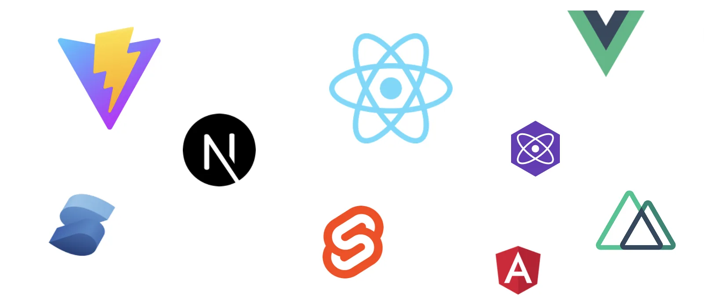                         | **תמיכה חוצת-Frameworks**<br><br>Intlayer תואם לכל הספריות ושלדי הפיתוח המובילים, כולל Next.js, React, Vite, Vue.js, Nuxt, Preact, Express ועוד.                                                                                                                                                                                                                                                                                                                                                                                                                                                                                   |
| 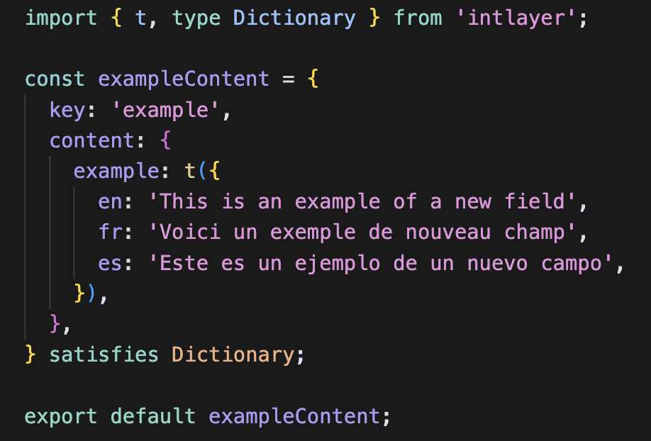       | **ניהול תוכן מבוסס JavaScript**<br><br>רתמו את הגמישות של JavaScript כדי להגדיר ולנהל את התוכן שלכם ביעילות.<br><br> - [הצהרת תוכן](https://github.com/aymericzip/intlayer/blob/main/docs/docs/he/dictionary/content_file.md)                                                                                                                                                                                                                                                                                                                                                                                                      |
|  | **מהדר (Compiler)**<br><br>המהדר של Intlayer מחלץ אוטומטית את התוכן מתוך הרכיבים ומייצר את קובצי המילון.<br><br> - [מהדר](https://github.com/aymericzip/intlayer/blob/main/docs/docs/he/compiler.md)                                                                                                                                                                                                                                                                                                                                                                                                                               |
| 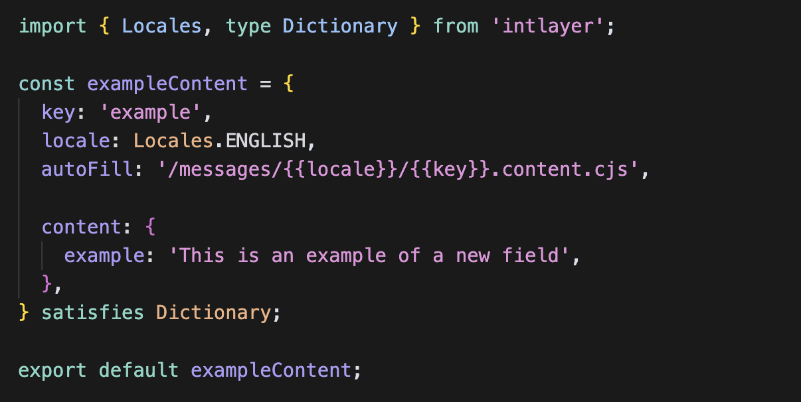 | **קובץ הצהרת תוכן לפי שפה**<br><br>האיצו את הפיתוח על ידי הגדרת התוכן שלכם פעם אחת, לפני יצירה אוטומטית.<br><br> - [קובץ הצהרת תוכן לפי שפה](https://github.com/aymericzip/intlayer/blob/main/docs/docs/he/per_locale_file.md)                                                                                                                                                                                                                                                                                                                                                                                                     |
|                       | **סביבה בטוחה מבחינת טיפוסים (Type-Safe)**<br><br>מנפו את TypeScript כדי להבטיח שהגדרות התוכן והקוד שלכם נקיים משגיאות, תוך הנאה מהשלמה אוטומטית ב-IDE.<br><br> - [הגדרות TypeScript](https://github.com/aymericzip/intlayer/blob/main/docs/docs/he/intlayer_with_vite+react.md#configure-typescript)                                                                                                                                                                                                                                                                                                                              |
| 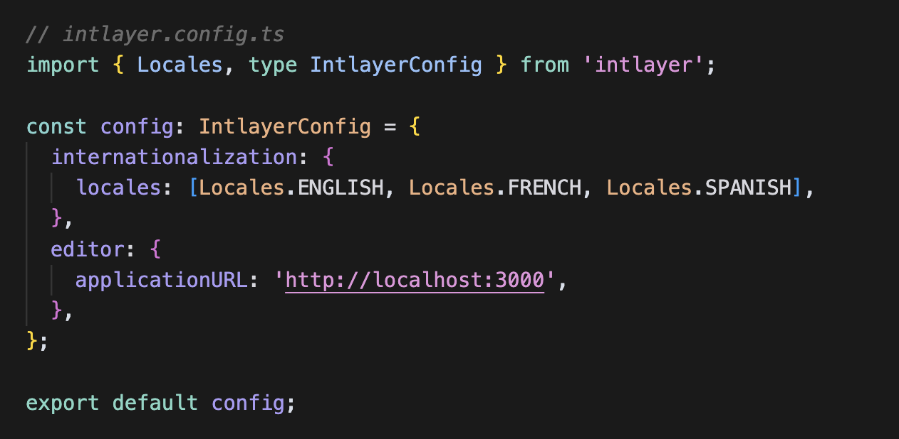                         | **הגדרה פשוטה ונוחה**<br><br>התחילו לעבוד במהירות עם קונפיגורציה מינימלית. התאימו הגדרות בינאום, ניתוב, AI, בנייה וטיפול בתוכן בקלות.<br><br> - [סקירת אינטגרציה עם Next.js](https://github.com/aymericzip/intlayer/blob/main/docs/docs/he/intlayer_with_nextjs_16.md)                                                                                                                                                                                                                                                                                                                                                             |
| 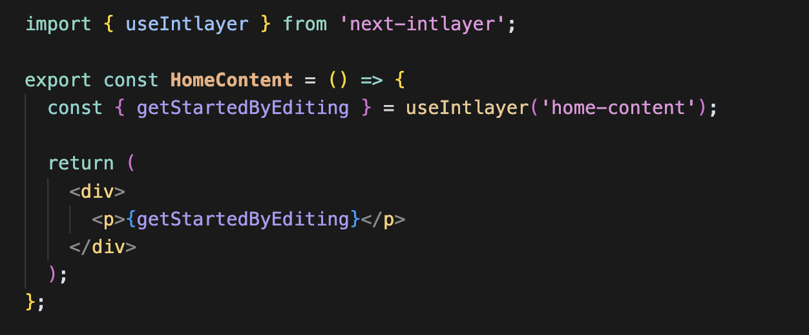                   | **שליפת תוכן מפושטת**<br><br>אין צורך לקרוא לפונקציית ה-`t` שלכם עבור כל פיסת תוכן. שלפו את כל התוכן שלכם ישירות באמצעות hook יחיד.<br><br> - [אינטגרציה עם React](https://github.com/aymericzip/intlayer/blob/main/docs/docs/he/intlayer_with_create_react_app.md)                                                                                                                                                                                                                                                                                                                                                                |
| 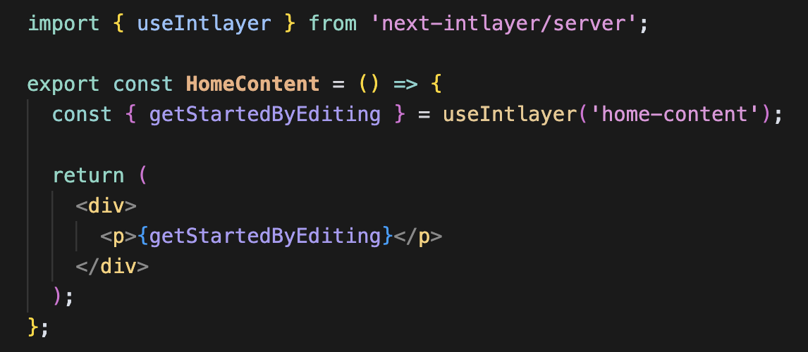                    | **מימוש עקבי עבור Server Components**<br><br>מתאים באופן מושלם ל-Server Components ב-Next.js: השתמשו באותו המימוש עבור רכיבי לקוח ושרת כאחד, ללא צורך להעביר פונקציית `t` לאורך עץ הרכיבים.<br><br> - [רכיבי שרת](https://github.com/aymericzip/intlayer/blob/main/docs/docs/he/intlayer_with_nextjs_16.md#step-7-utilize-content-in-your-code)                                                                                                                                                                                                                                                                                    |
| 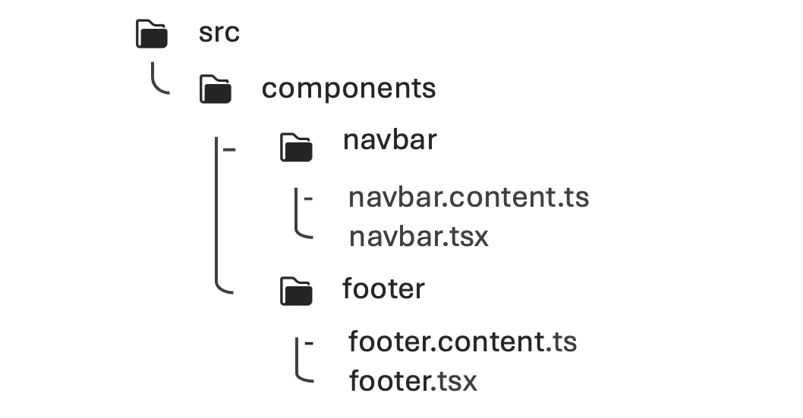                           | **בסיס קוד מאורגן**<br><br>שמרו על בסיס קוד מסודר: רכיב 1 = מילון 1 באותה התיקייה. תרגומים בסמוך לרכיבים שלהם משפרים את התחזוקתיות והבהירות.<br><br> - [כיצד Intlayer עובד](https://github.com/aymericzip/intlayer/blob/main/docs/docs/he/how_works_intlayer.md)                                                                                                                                                                                                                                                                                                                                                                   |
|                          | **ניתוב משופר**<br><br>תמיכה מלאה בניתוב אפליקציה, תוך התאמה חלקה למבני יישום מורכבים ב-Next.js, React, Vite, Vue.js ועוד.<br><br> - [סקירת אינטגרציה עם Next.js](https://github.com/aymericzip/intlayer/blob/main/docs/docs/he/intlayer_with_nextjs_16.md)                                                                                                                                                                                                                                                                                                                                                                        |
| 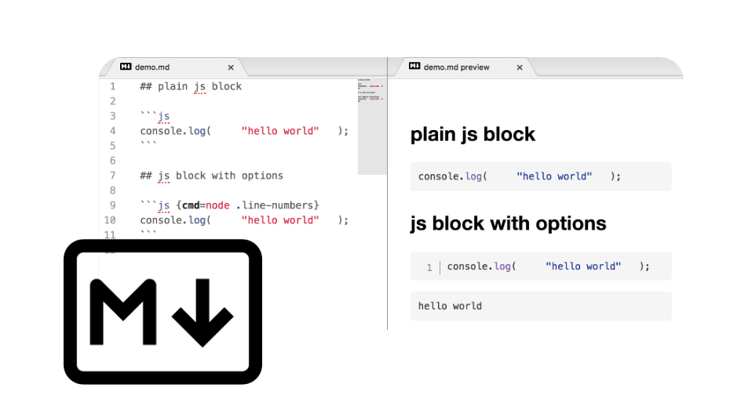                            | **תמיכה ב-Markdown**<br><br>ייבאו ופענחו קובצי שפה ו-Markdown מרוחק עבור תוכן רב-לשוני כגון מדיניות פרטיות, תיעוד ועוד. קבלו גישה ישירה למטא-דאטה של Markdown בקוד שלכם.<br><br> - [קובצי תוכן](https://github.com/aymericzip/intlayer/blob/main/docs/docs/he/dictionary/file.md)                                                                                                                                                                                                                                                                                                                                                  |
| 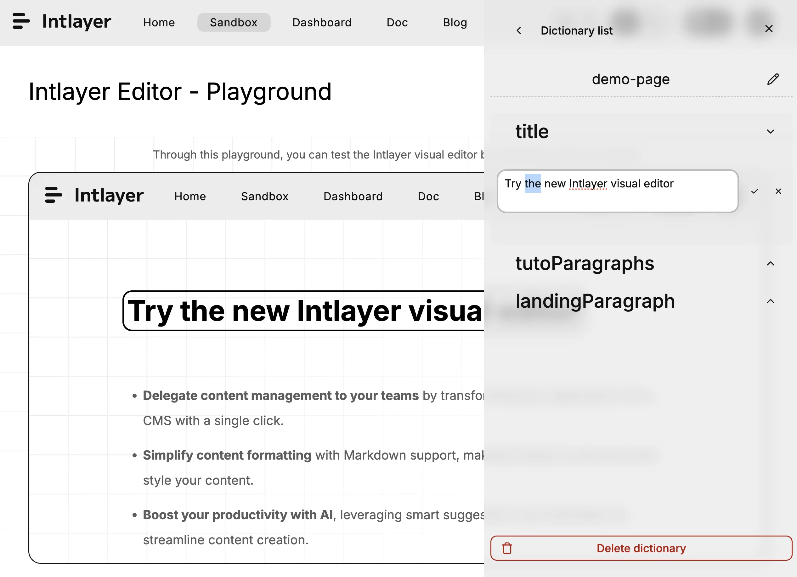                      | **עורך ויזואלי ו-CMS חינמיים**<br><br>עורך ויזואלי ו-CMS חינמיים זמינים לכותבי תוכן, מה שמייתר את הצורך בפלטפורמת לוקליזציה חיצונית. סנכרנו תוכן בעזרת Git, או הוציאו אותו החוצה באופן מלא או חלקי עם ה-CMS.<br><br> - [עורך Intlayer](https://github.com/aymericzip/intlayer/blob/main/docs/docs/he/intlayer_visual_editor.md) <br> - [Intlayer CMS](https://github.com/aymericzip/intlayer/blob/main/docs/docs/he/intlayer_CMS.md)                                                                                                                                                                                               |
| 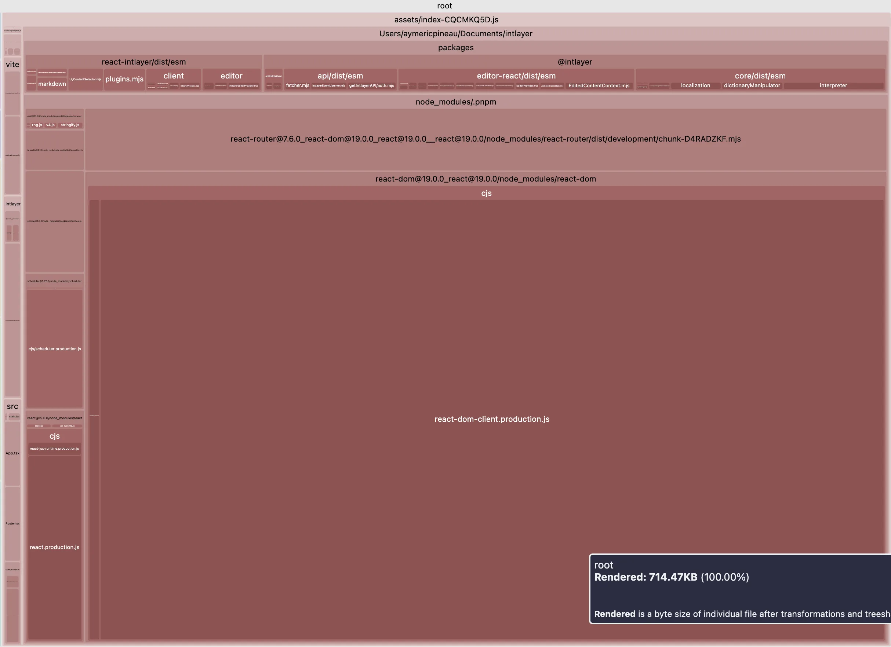                             | **תוכן הניתן לניפוי (Tree-shakable)**<br><br>תוכן הניתן ל-tree-shaking, המפחית את גודל ה-bundle הסופי. טוען תוכן לפי רכיב ומשמיט כל תוכן שאינו בשימוש מה-bundle. תומך בטעינה עצלה (lazy loading) להגברת יעילות טעינת האפליקציה.<br><br> - [אופטימיזציית בנייה](https://github.com/aymericzip/intlayer/blob/main/docs/docs/he/how_works_intlayer.md#app-build-optimization)                                                                                                                                                                                                                                                         |
| 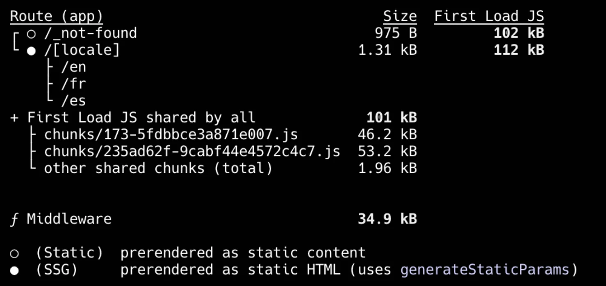                   | **רינדור סטטי (Static Rendering)**<br><br>אינו חוסם רינדור סטטי כלל.<br><br> - [אינטגרציה עם Next.js](https://github.com/aymericzip/intlayer/blob/main/docs/docs/he/intlayer_with_nextjs_16.md)                                                                                                                                                                                                                                                                                                                                                                                                                                    |
| 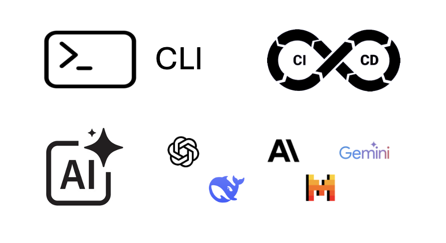                      | **תרגום מבוסס AI**<br><br>תרגמו את האתר שלכם ל-231 שפות בלחיצת כפתור אחת בעזרת כלי התרגום המתקדמים של Intlayer המונעים ב-AI, תוך שימוש בספק ובמפתח ה-API שלכם.<br><br> - [שילוב ב-CI/CD](https://github.com/aymericzip/intlayer/blob/main/docs/docs/he/CI_CD.md) <br> - [Intlayer CLI](https://github.com/aymericzip/intlayer/blob/main/docs/docs/he/cli/index.md) <br> - [מילוי אוטומטי](https://github.com/aymericzip/intlayer/blob/main/docs/docs/he/autoFill.md)                                                                                                                                                               |
| 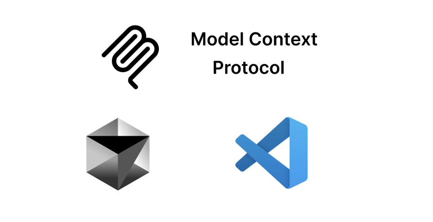                                 | **אינטגרציית שרת MCP**<br><br>מספק שרת MCP (Model Context Protocol) לאוטומציה בסביבת הפיתוח, המאפשר ניהול תוכן ותהליכי i18n חלקים ישירות בתוך סביבת העבודה שלכם.<br><br> - [שרת MCP](https://github.com/aymericzip/intlayer/blob/main/docs/docs/he/mcp_server.md)                                                                                                                                                                                                                                                                                                                                                                  |
| 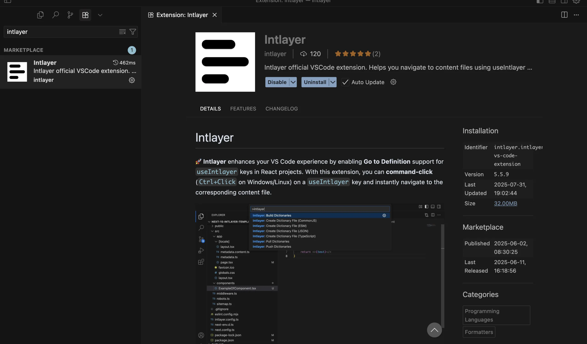                   | **תוסף VSCode**<br><br>Intlayer מספק תוסף VSCode שיעזור לכם לנהל את התוכן והתרגומים שלכם, לבנות מילונים, לתרגם תוכן ועוד.<br><br> - [תוסף VSCode](https://github.com/aymericzip/intlayer/blob/main/docs/docs/he/vs_code_extension.md)                                                                                                                                                                                                                                                                                                                                                                                              |
| 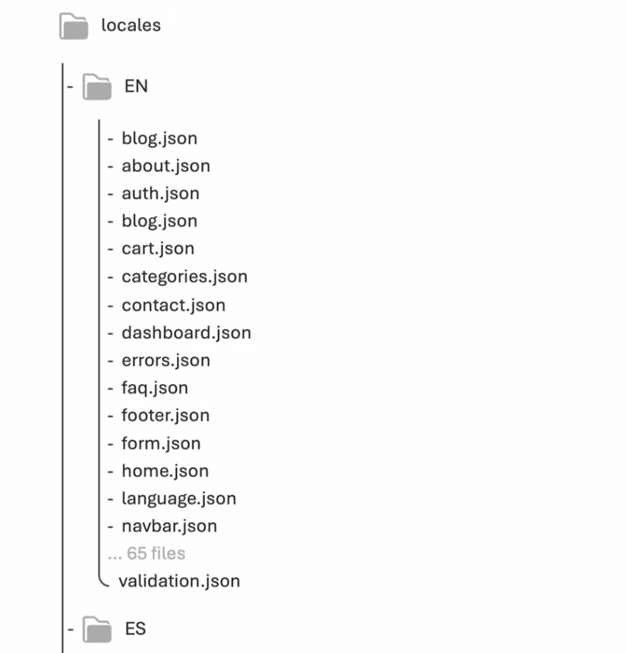                    | **יכולת פעולה הדדית (Interoperability)**<br><br>מאפשר אינטר-אופרביליות עם react-i18next, next-i18next, next-intl ו-react-intl.<br><br> - [Intlayer ו-react-intl](https://github.com/aymericzip/intlayer/blob/main/docs/blog/he/intlayer_with_react-intl.md) <br> - [Intlayer ו-next-intl](https://github.com/aymericzip/intlayer/blob/main/docs/blog/he/intlayer_with_next-intl.md) <br> - [Intlayer ו-next-i18next](https://github.com/aymericzip/intlayer/blob/main/docs/blog/he/intlayer_with_next-i18next.md) <br> - [מתאמי תאימות של Intlayer](https://github.com/aymericzip/intlayer/blob/main/docs/docs/he/compat/index.md) |
| בדיקת תרגומים חסרים (CLI/CI)                                                                                              | ✅ CLI: npx intlayer content test (ביקורת מותאמת ל-CI)                                                                                                                                                                                                                                                                                                                                                                                                                                                                                                                                                                             |

## השוואת Intlayer מול פתרונות אחרים

| תכונה                                      | `intlayer`                                                                                     | `react-i18next`                                                          | `react-intl` (FormatJS)                                                          | `lingui`                                          | `next-intl`                                                    | `next-i18next`                                                 | `vue-i18n`                                            |
| ------------------------------------------ | ---------------------------------------------------------------------------------------------- | ------------------------------------------------------------------------ | -------------------------------------------------------------------------------- | ------------------------------------------------- | -------------------------------------------------------------- | -------------------------------------------------------------- | ----------------------------------------------------- |
| **תרגומים בסמוך לרכיבים**                  | ✅ כן, תוכן ממוקם לצד כל רכיב                                                                  | ❌ לא                                                                    | ❌ לא                                                                            | ❌ לא                                             | ❌ לא                                                          | ❌ לא                                                          | ✅ כן, באמצעות `Single File Components` (SFCs)        |
| **אינטגרציה עם TypeScript**                | ✅ מתקדמת, טיפוסים קפדניים שנוצרים אוטומטית                                                    | ⚠️ בסיסית, דורש הגדרות נוספות לבטיחות                                    | ✅ טובה, אך פחות קפדנית                                                          | ⚠️ טיפוסים קיימים, דורש הגדרה                     | ✅ טובה                                                        | ⚠️ בסיסית                                                      | ✅ טובה (טיפוסים זמינים, בטיחות מפתחות דורשת הגדרה)   |
| **זיהוי תרגומים חסרים**                    | ✅ שגיאות טיפוס ב-TypeScript ושגיאות/אזהרות בזמן בנייה                                         | ⚠️ לרוב מחרוזות גיבוי (fallback) בזמן ריצה                               | ⚠️ מחרוזות גיבוי                                                                 | ⚠️ דורש הגדרה נוספת                               | ⚠️ גיבוי בזמן ריצה                                             | ⚠️ גיבוי בזמן ריצה                                             | ⚠️ גיבוי/אזהרות בזמן ריצה (ניתן להגדרה)               |
| **תוכן עשיר (JSX/Markdown/רכיבים)**        | ✅ תמיכה ישירה                                                                                 | ⚠️ מוגבל / אינטרפולציה בלבד                                              | ⚠️ תחביר ICU, לא JSX אמיתי                                                       | ⚠️ מוגבל                                          | ❌ לא תוכנן לצמתים עשירים                                      | ⚠️ מוגבל                                                       | ⚠️ מוגבל (רכיבים דרך `<i18n-t>`, Markdown דרך תוספים) |
| **תרגום מבוסס AI**                         | ✅ כן, תמיכה במספר ספקי AI. ניתן לשימוש עם מפתחות API שלכם. מתחשב בהקשר האפליקציה ובהיקף התוכן | ❌ לא                                                                    | ❌ לא                                                                            | ❌ לא                                             | ❌ לא                                                          | ❌ לא                                                          | ❌ לא                                                 |
| **עורך ויזואלי**                           | ✅ כן, עורך ויזואלי מקומי + CMS אופציונלי; ניתן להוציא תוכן מבסיס הקוד החוצה; ניתן להטמעה      | ❌ לא / זמין דרך פלטפורמות לוקליזציה חיצוניות                            | ❌ לא / זמין דרך פלטפורמות לוקליזציה חיצוניות                                    | ❌ לא / זמין דרך פלטפורמות לוקליזציה חיצוניות     | ❌ לא / זמין דרך פלטפורמות לוקליזציה חיצוניות                  | ❌ לא / זמין דרך פלטפורמות לוקליזציה חיצוניות                  | ❌ לא / זמין דרך פלטפורמות לוקליזציה חיצוניות         |
| **ניתוב מותאם שפה**                        | ✅ כן, תומך בנתיבים מתורגמים out of the box (עובד עם Next.js ו-Vite)                           | ⚠️ לא מובנה, דורש תוספים (כגון `next-i18next`) או הגדרת נתב מותאמת       | ❌ לא, רק פירמוט הודעות, הניתוב חייב להיות ידני                                  | ⚠️ לא מובנה, דורש תוספים או הגדרה ידנית           | ✅ מובנה, App Router תומך במקטע `[locale]`                     | ✅ מובנה                                                       | ✅ מובנה                                              |
| **יצירת נתיבים דינמית**                    | ✅ כן                                                                                          | ⚠️ תוסף/אקוסיסטם או הגדרה ידנית                                          | ❌ אינו מסופק                                                                    | ⚠️ תוסף/ידני                                      | ✅ כן                                                          | ✅ כן                                                          | ❌ אינו מסופק (מסופק על ידי Nuxt i18n)                |
| **ריבוי (Pluralization)**                  | ✅ תבניות מבוססות enumeration                                                                  | ✅ ניתן להגדרה (תוספים כמו i18next-icu)                                  | ✅ (ICU)                                                                         | ✅ (ICU/messageformat)                            | ✅ טוב                                                         | ✅ טוב                                                         | ✅ חוקי רבים מובנים                                   |
| **עיצוב (תאריכים, מספרים, מטבעות)**        | ✅ מעצבים מותאמים (Intl מאחורי הקלעים)                                                         | ⚠️ באמצעות תוספים או שימוש ישיר ב-Intl                                   | ✅ מעצבי ICU                                                                     | ✅ עזרי ICU/CLI                                   | ✅ טוב (עזרי Intl)                                             | ✅ טוב (עזרי Intl)                                             | ✅ מעצבי תאריך/מספר מובנים (Intl)                     |
| **פורמט תוכן**                             | ✅ .tsx, .ts, .js, .json, .md, .txt, (.yaml בפיתוח)                                            | ⚠️ .json                                                                 | ✅ .json, .js                                                                    | ⚠️ .po, .json                                     | ✅ .json, .js, .ts                                             | ⚠️ .json                                                       | ✅ .json, .js                                         |
| **תמיכה ב-ICU**                            | ⚠️ בפיתוח                                                                                      | ⚠️ דרך תוסף (i18next-icu)                                                | ✅ כן                                                                            | ✅ כן                                             | ✅ כן                                                          | ⚠️ דרך תוסף (`i18next-icu`)                                    | ⚠️ דרך מעצב/מהדר מותאם                                |
| **כלי עזר ל-SEO (hreflang, sitemap)**      | ✅ כלים מובנים: עזרים ל-sitemap, robots.txt, metadata                                          | ⚠️ תוספי קהילה/ידני                                                      | ❌ לא בליבה                                                                      | ❌ לא בליבה                                       | ✅ טוב                                                         | ✅ טוב                                                         | ❌ לא בליבה (Nuxt i18n מספק עזרים)                    |
| **אקוסיסטם וקהילה**                        | ⚠️ קטנה יותר אך צומחת במהירות ומגיבה                                                           | ✅ הגדולה והבוגרת ביותר                                                  | ✅ גדולה                                                                         | ⚠️ קטנה יותר                                      | ✅ בינונית, ממוקדת Next.js                                     | ✅ בינונית, ממוקדת Next.js                                     | ✅ גדולה באקוסיסטם של Vue                             |
| **רינדור בצד שרת ו-Server Components**     | ✅ כן, מותאם במיוחד עבור SSR ו-React Server Components                                         | ⚠️ נתמך ברמת הדף אך דורש העברת פונקציות t במורד העץ עבור רכיבי שרת ילדים | ⚠️ נתמך ברמת הדף עם הגדרות נוספות, אך דורש העברת פונקציות t עבור רכיבי שרת ילדים | ✅ נתמך, דורש הגדרה                               | ⚠️ נתמך ברמת הדף אך דורש העברת פונקציות t עבור רכיבי שרת ילדים | ⚠️ נתמך ברמת הדף אך דורש העברת פונקציות t עבור רכיבי שרת ילדים | ✅ SSR דרך Nuxt/Vue SSR (ללא RSC)                     |
| **Tree-shaking (טעינת תוכן שבשימוש בלבד)** | ✅ כן, לפי רכיב בזמן הבנייה באמצעות תוספי Babel/SWC                                            | ⚠️ בדרך כלל טוען הכול (ניתן לשיפור עם namespaces ופיצול קוד)             | ⚠️ בדרך כלל טוען הכול                                                            | ❌ לא ברירת מחדל                                  | ⚠️ חלקי                                                        | ⚠️ חלקי                                                        | ⚠️ חלקי (עם פיצול קוד/הגדרה ידנית)                    |
| **טעינה עצלה (Lazy loading)**              | ✅ כן, לפי שפה / לפי מילון                                                                     | ✅ כן (למשל backends/namespaces לפי דרישה)                               | ✅ כן (פיצול חבילות שפה)                                                         | ✅ כן (ייבוא קטלוג דינמי)                         | ✅ כן (לפי נתיב/לפי שפה), דורש ניהול namespaces                | ✅ כן (לפי נתיב/לפי שפה), דורש ניהול namespaces                | ✅ כן (הודעות שפה אסינכרוניות)                        |
| **ניקוי תוכן שאינו בשימוש (Purge)**        | ✅ כן, לפי מילון בזמן הבנייה                                                                   | ❌ לא, רק באמצעות חלוקה ידנית של namespaces                              | ❌ לא, כל ההודעות המוצהרות נארזות                                                | ✅ כן, מפתחות שאינם בשימוש מזוהים ומושמטים בבנייה | ❌ לא, ניתן לניהול ידני עם namespaces                          | ❌ לא, ניתן לניהול ידני עם namespaces                          | ❌ לא, אפשרי רק דרך טעינה עצלה ידנית                  |
| **ניהול פרויקטים גדולים**                  | ✅ מעודד מודולריות, מתאים במיוחד למערכות עיצוב                                                 | ⚠️ דורש משמעת קבצים קפדנית                                               | ⚠️ קטלוגים מרכזיים עלולים לגדול לממדי ענק                                        | ⚠️ עלול להפוך למורכב                              | ✅ מודולרי עם הגדרה מתאימה                                     | ✅ מודולרי עם הגדרה מתאימה                                     | ✅ מודולרי עם הגדרת Vue Router/Nuxt i18n              |

## כוכבי GitHub

כוכבי GitHub הם אינדיקטור מובהק לפופולריות של פרויקט, לאמון הקהילה ולרלוונטיות שלו לטווח ארוך. אף שאינם מדד ישיר לאיכות טכנית, הם משקפים כמה מפתחים מוצאים את הפרויקט שימושי, עוקבים אחר התקדמותו ונוטים לאמץ אותו. לצורך הערכת שווי של פרויקט, כוכבים מסייעים להשוות משיכה (traction) בין חלופות ומספקים תובנות לגבי צמיחת האקוסיסטם.

[](https://star-history.com/#aymericzip/intlayer&formatjs/formatjs&i18next/react-i18next&i18next/i18next&i18next/next-i18next&lingui/js-lingui&amannn/next-intl&intlify/vue-i18n&codingcommons/typesafe-i18n&opral/paraglide-js)

## פעילות Commits

כוכבים מעידים על פופולריות. קומיטים מראים כמה עבודה מושקעת בפרויקט. נכון לעת כתיבת שורות אלו, ב-Intlayer נספרו כ-7,500 קומיטים, יותר מרוב הספריות המושוות כאן, וכפי 5 יותר מ-`next-intl` או `next-i18next`.

<GithubCommits repositories="aymericzip/intlayer,formatjs/formatjs,i18next/i18next,lingui/js-lingui,amannn/next-intl,intlify/vue-i18n,codingcommons/typesafe-i18n,opral/paraglide-js" />

> Intlayer הוא monorepo, ולכן הספירה כוללת את כל חבילות ה-frameworks, ה-CLI והתיעוד. קראו קומיטים כאיתות לפעילות, ולא בהכרח לאיכות.

## הורדות npm

<NpmDownloads packages="intlayer,i18next,react-intl,@lingui/core,next-intl,vue-i18n,typesafe-i18n,@inlang/paraglide-js" period="last-6-months" />

הורדות מתגמלות את הפתרונות הוותיקים ביותר, לאו דווקא את הטובים ביותר. ספרייה ששוחררה לפני שנים עדיין מותקנת על ידי כל פרויקט שבחר בה אז, על ידי כל הרצת CI ועל ידי כל חבילה התלויה בה. הספירה מודדת אינרציה יותר מאשר בחירה עדכנית.

עוזרי AI מעצימים את האפקט. `next-intl`,‏ `i18next` ו-`vue-i18n` נפוצים בכל מקום בקוד שעליו הם אומנו, ולכן הם ממליצים עליהם כברירת מחדל מבלי להשוות חלופות. כל המלצה כזו מוסיפה הורדות, מה שמזין את ההמלצה הבאה. השוו על סמך מבחני ביצועים (benchmark) ולא על סמך ספירת הורדות.

## יכולת פעולה הדדית (Interoperability)

`intlayer` יכול גם לסייע בניהול ה-namespaces של `react-intl`,‏ `react-i18next`,‏ `next-intl`,‏ `next-i18next` ו-`vue-i18n`.

באמצעות `intlayer`, תוכלו להצהיר על התוכן שלכם בפורמט של ספריית ה-i18n המועדפת עליכם, ו-intlayer ייצר את ה-namespaces במיקום שתבחרו (לדוגמה: `/messages/{{locale}}/{{namespace}}.json`).

אם ברצונכם להמשיך להשתמש ב-API של ספריית ה-i18n הנוכחית שלכם, `intlayer` מספק גם **מתאמי תאימות (compat adapters)**: חבילות החושפות בדיוק את אותו ה-API של `react-i18next`,‏ `next-intl`,‏ `react-intl`,‏ `vue-i18n` ועוד, אך מופעלות באמצעות מילוני Intlayer. הדבר מאפשר לכם להגר בהדרגה מבלי לשכתב את הקוד שלכם. עיינו ב[תיעוד מתאמי התאימות](https://github.com/aymericzip/intlayer/blob/main/docs/docs/he/compat/index.md).

- [תיעוד מתאמי תאימות](https://github.com/aymericzip/intlayer/blob/main/docs/docs/he/compat/index.md)

## שאלות נפוצות

<FAQ>

<Question title="מהם הפתרונות השונים הזמינים לבינאום אפליקציית JavaScript?">

שלושה דורות מתקיימים במקביל:

- **ספריות קטלוג בזמן ריצה (Runtime catalog libraries)**: `i18next`,‏ `react-i18next`,‏ `next-i18next`,‏ `vue-i18n`,‏ `ngx-translate`,‏ `svelte-i18n`. ‏namespaces של JSON הנטענים בזמן ריצה. פתרונות בוגרים, בלתי תלויים ב-framework, ללא טיפוסיות, ונשלחים במלואם לדף.
- **ספריות הודעות בזמן הידור (Compile time message libraries)**: `Lingui`,‏ `Paraglide`, ו-`next-intl` או `react-intl` עם שלב חילוץ (extraction). התנהגות bundle טובה יותר וטיפוסיות חלקית, אך עדיין קטלוג מרכזי.
- **ספריות שכבת תוכן (Content layer libraries)**: `Intlayer`. תוכן מוצהר ומהודר לפי רכיב, כך שטיפוסיות, ניפוי קוד מת (tree shaking), כלי עריכה ותרגום AI מגיעים כולם מאותן ההצהרות.

</Question>
<Question title="כמה בינאום (i18n) מוסיף לגודל ה-bundle שלי?">

הרבה פחות מהגדרה המבוססת על namespaces, מכיוון שדף אינו מוריד לעולם קטלוג שאינו מרונדר בו. תוכן מרונדר בשרת פותר את התוכן שלו בשרת, והמהדר בזמן הבנייה מחליף קריאות `useIntlayer` בערכי המילון המדויקים שבהם הרכיב משתמש, כך שמפתחות ושפות שאינם בשימוש מושמטים. [מילונים דינמיים](https://github.com/aymericzip/intlayer/blob/main/docs/docs/he/dynamic_dictionaries/index.md) מפצלים את השאר לפי שפה. בהשוואה לחלופות המקובלות, Intlayer מפחית את גודל ה-bundle וגודל הדף בעד 50%. ראו [אופטימיזציית bundle](https://github.com/aymericzip/intlayer/blob/main/docs/docs/he/bundle_optimization.md) ואת ה-[benchmark](https://github.com/aymericzip/intlayer/blob/main/docs/docs/he/benchmark/index.md).

- [מילונים דינמיים](https://github.com/aymericzip/intlayer/blob/main/docs/docs/he/dynamic_dictionaries/index.md)
- [אופטימיזציית bundle](https://github.com/aymericzip/intlayer/blob/main/docs/docs/he/bundle_optimization.md)
- [benchmark](https://github.com/aymericzip/intlayer/blob/main/docs/docs/he/benchmark/index.md)

</Question>
<Question title="האם ניתן להגר מ-`i18next`,‏ `next-intl` או `react-i18next` מבלי לשכתב את הרכיבים שלי?">

כן, וישנם שני מסלולים. ניתן להגר את התוכן בהדרגה באמצעות [מדריך ההגירה מ-i18next](https://github.com/aymericzip/intlayer/blob/main/docs/docs/he/migration_from_i18next_to_intlayer.md) או [מדריך ההגירה מ-next-intl](https://github.com/aymericzip/intlayer/blob/main/docs/docs/he/migration_from_next-intl_to_intlayer.md). לחלופין, תוכלו לשמור על ה-API הנוכחי שלכם לחלוטין: [מתאמי התאימות (compat adapters)](https://github.com/aymericzip/intlayer/blob/main/docs/docs/he/compat/index.md) חושפים בדיוק את אותו ה-API של `i18next`,‏ `react-i18next`,‏ `next-intl`,‏ `next-i18next`,‏ `react-intl`,‏ `use-intl`,‏ `vue-i18n` ו-`Lingui`, אך מופעלים על ידי מילוני Intlayer, כך שרק ה-imports משתנים וקוד הרכיב נשאר זהה.

- [מדריך ההגירה מ-i18next](https://github.com/aymericzip/intlayer/blob/main/docs/docs/he/migration_from_i18next_to_intlayer.md)
- [מדריך ההגירה מ-next-intl](https://github.com/aymericzip/intlayer/blob/main/docs/docs/he/migration_from_next-intl_to_intlayer.md)
- [מתאמי תאימות](https://github.com/aymericzip/intlayer/blob/main/docs/docs/he/compat/index.md)

</Question>
<Question title="האם ניתן לשמור על קובצי תרגום ה-JSON הקיימים שלי?">

כן. ה-[תוסף לסנכרון JSON](https://github.com/aymericzip/intlayer/blob/main/docs/docs/he/plugins/sync-json.md) שומר על קובצי ה-`/messages/{locale}/{namespace}.json` שלכם כמקור האמת ומייצר מהם מילוני Intlayer, בשני הכיוונים. [תוסף לסנכרון PO](https://github.com/aymericzip/intlayer/blob/main/docs/docs/he/plugins/sync-po.md) עושה את אותו הדבר עבור קטלוגי gettext, ו-[קבצים לפי שפה (per locale files)](https://github.com/aymericzip/intlayer/blob/main/docs/docs/he/per_locale_file.md) מאפשרים לפצל תוכן לפי שפה במקום לקבץ את כל השפות בקובץ יחיד.

- [תוסף לסנכרון JSON](https://github.com/aymericzip/intlayer/blob/main/docs/docs/he/plugins/sync-json.md)
- [תוסף לסנכרון PO](https://github.com/aymericzip/intlayer/blob/main/docs/docs/he/plugins/sync-po.md)
- [קבצים לפי שפה](https://github.com/aymericzip/intlayer/blob/main/docs/docs/he/per_locale_file.md)

</Question>
<Question title="האם עליי להעביר את התוכן שלי מפתח אחר מפתח?">

לא. הריצו `npx intlayer extract` ו-Intlayer יקרא את קובצי המקור שלכם, ישלוף את המחרוזות הפונות למשתמש ויכתוב קובץ `.content` לצד כל אחד מהם, כך שתוכלו לבדוק diff במקום להעתיק מחרוזות לקטלוג אחת אחת. עיינו ב[פקודת extract](https://github.com/aymericzip/intlayer/blob/main/docs/docs/he/cli/extract.md).

- [פקודת extract](https://github.com/aymericzip/intlayer/blob/main/docs/docs/he/cli/extract.md)

עבור צינור אוטומטי לחלוטין, ה-[Intlayer Compiler](https://github.com/aymericzip/intlayer/blob/main/docs/docs/he/compiler.md) מבצע את אותה פעולה בזמן הבנייה על קוד מקור של JSX, TSX, Vue ו-Svelte, ומייצר את המילונים בכל שינוי כך שאין מפתחות לתחזק ידנית. הוא פועל באמצעות ניתוח סטטי, ולכן מחרוזות שקיימות רק בזמן ריצה נותרות מחוץ להישג ידו, והוא דורש מעט הערות (annotations) כדי להבדיל בין טקסט הפונה למשתמש לבין לוגיקת אפליקציה.

- [Intlayer Compiler](https://github.com/aymericzip/intlayer/blob/main/docs/docs/he/compiler.md)

</Question>
<Question title="אילו כלי עורך וסוכני AI זמינים?">

חמישה כלים, כולם אופציונליים:

- **[תוסף VS Code](https://github.com/aymericzip/intlayer/blob/main/docs/docs/he/vs_code_extension.md)**: קפיצה ישירה ממפתח ב-`useIntlayer` אל קובץ התוכן שמצהיר עליו, חילוץ תוכן מרכיב, והרצת build, fill, test, push ו-pull מלוח הפקודות או מלשונית Intlayer ייעודית.
- **[שרת LSP](https://github.com/aymericzip/intlayer/blob/main/docs/docs/he/lsp.md)**: אותה מודעות בכל עורך התומך ב-LSP, עם go to definition, חיפוש כל ההפניות, תצוגה מקדימה בריחוף של ערך מתורגם, השלמה אוטומטית של מפתחות ושדות, והתרעה כאשר מפתח אינו מוצהר בשום מקום. הוא גם מפענח קריאות של `i18next`,‏ `react-i18next`,‏ `next-intl` ו-`use-intl`, מה שמסייע בזמן תהליך ההגירה.
- **[שרת MCP](https://github.com/aymericzip/intlayer/blob/main/docs/docs/he/mcp_server.md)**: חושף את התיעוד וה-CLI של Intlayer עבור Cursor, VS Code, Claude Desktop, Claude Code ו-ChatGPT, כך שעוזר יכול לענות מתוך התיעוד העדכני במקום לנחש, ויכול להריץ פקודות כגון `intlayer fill` בעצמו.
- **[Agent skills](https://github.com/aymericzip/intlayer/blob/main/docs/docs/he/agent_skills.md)**: מיומנויות ממוקדות כגון `intlayer-config`,‏ `intlayer-cli` ו-`intlayer-content`, בתוספת מיומנות ייעודית לכל framework, המלמדות סוכן על תצורת הניתוב שלכם ועל סוגי צומתי התוכן.
- **[תוסף ESLint](https://github.com/aymericzip/intlayer/blob/main/docs/docs/he/eslint.md)**: כלל `no-raw-text` מתריע על מחרוזות מוטמעות בקוד (hardcoded), עם כללים נוספים למפתחות מילון סטטיים ולתוכן שאינו בשימוש.

</Question>
<Question title="במה Intlayer שונה מ-next-intl?">

`next-intl` היא שכבת הודעות עבור Next.js: אתם שומרים קובצי הודעות JSON לכל שפה וקוראים אותם באמצעות `useTranslations`. ‏Intlayer היא שכבת תוכן (content layer): ההצהרות ממוקמות בסמוך לרכיב, בעלות טיפוסיות ישירות מההצהרה עצמה, ומהודרות לפי רכיב כך שדף שולח רק את מה שהוא מרנדר. בנוסף, Intlayer מכסה תחומים ש-`next-intl` משאיר לטיפולכם, כגון תרגום AI, עורך ויזואלי, CMS ובדיקות תרגומים חסרים ב-CI. אם ברצונכם לשמור על ה-API של `next-intl`, [מתאם התאימות](https://github.com/aymericzip/intlayer/blob/main/docs/docs/he/compat/index.md) מגיש אותו מתוך מילוני Intlayer.

- [מתאם תאימות](https://github.com/aymericzip/intlayer/blob/main/docs/docs/he/compat/index.md)

</Question>
<Question title="במה Intlayer שונה מ-i18next ומ-react-i18next?">

`i18next` מפענח מפתחות מחרוזת מול namespaces בזמן ריצה, מה שאומר שמפתח ששמו שונה או נכתב בשגיאת כתיב נכשל בשקט, וכל namespace שדף נוגע בו מורד במלואו. Intlayer מפענח תוכן בזמן הבנייה מול טיפוסים שנוצרו, כך שמפתח שגוי מהווה שגיאת קומפילציה, ורק הערכים שרכיב מרנדר מגיעים ל-bundle. ל-`i18next` יש אקוסיסטם תוספים גדול יותר והיסטוריה ארוכה יותר; ל-Intlayer יש טיפוסיות חזקה, גודל bundle מופחת, וכלי עריכה ואוטומציה מתקדמים. עיינו ב[מדריך ההגירה מ-i18next](https://github.com/aymericzip/intlayer/blob/main/docs/docs/he/migration_from_i18next_to_intlayer.md) או ב[מתאם התאימות](https://github.com/aymericzip/intlayer/blob/main/docs/docs/he/compat/index.md).

- [מדריך ההגירה מ-i18next](https://github.com/aymericzip/intlayer/blob/main/docs/docs/he/migration_from_i18next_to_intlayer.md)
- [מתאם תאימות](https://github.com/aymericzip/intlayer/blob/main/docs/docs/he/compat/index.md)

</Question>
<Question title="האם Intlayer מהיר יותר או קל יותר מהחלופות?">

מבחינת גודל ה-bundle והדף, כן: אי-טעינת קטלוגים שדף אינו מרנדר חותכת את גודל ה-bundle והדף בעד 50% בהשוואה להגדרות מבוססות namespace. ה-[benchmark](https://github.com/aymericzip/intlayer/blob/main/docs/docs/he/benchmark/index.md) מפרסם את המתודולוגיה והמספרים לכל framework, כולל [Next.js](https://github.com/aymericzip/intlayer/blob/main/docs/docs/he/benchmark/nextjs.md), [TanStack Start](https://github.com/aymericzip/intlayer/blob/main/docs/docs/he/benchmark/tanstack.md), [Vue](https://github.com/aymericzip/intlayer/blob/main/docs/docs/he/benchmark/vue.md) ו-[Svelte](https://github.com/aymericzip/intlayer/blob/main/docs/docs/he/benchmark/svelte.md), כך שתוכלו לשחזר אותם בעצמכם ולא להסתמך על הבטחות בעלמא.

- [benchmark](https://github.com/aymericzip/intlayer/blob/main/docs/docs/he/benchmark/index.md)
- [Next.js](https://github.com/aymericzip/intlayer/blob/main/docs/docs/he/benchmark/nextjs.md)
- [TanStack Start](https://github.com/aymericzip/intlayer/blob/main/docs/docs/he/benchmark/tanstack.md)
- [Vue](https://github.com/aymericzip/intlayer/blob/main/docs/docs/he/benchmark/vue.md)
- [Svelte](https://github.com/aymericzip/intlayer/blob/main/docs/docs/he/benchmark/svelte.md)

</Question>
<Question title="האם כדאי להגר אפליקציה קיימת?">

הדבר תלוי בנקודות הכאב הנוכחיות שלכם. אם הקושי העיקרי שלכם הוא גודל ה-bundle, תרגומים חסרים שנכשלים בשקט, או מתרגמים שאינם יכולים לעבוד ללא סיוע מפתח, ההגירה תחזיר את ההשקעה במהירות. אם הקטלוגים שלכם קטנים ויציבים, הרווח יהיה צנוע יותר. בכל מקרה, ההגירה אינה מחייבת שכתוב מלא: [מתאמי התאימות (compat adapters)](https://github.com/aymericzip/intlayer/blob/main/docs/docs/he/compat/index.md) שומרים על ה-API הנוכחי שלכם, וה-[תוסף לסנכרון JSON](https://github.com/aymericzip/intlayer/blob/main/docs/docs/he/plugins/sync-json.md) שומר על קובצי ה-JSON הקיימים כמקור האמת בזמן ששתי השכבות מתקיימות זו לצד זו.

- [מתאמי תאימות](https://github.com/aymericzip/intlayer/blob/main/docs/docs/he/compat/index.md)
- [תוסף לסנכרון JSON](https://github.com/aymericzip/intlayer/blob/main/docs/docs/he/plugins/sync-json.md)

</Question>
<Question title="מה Intlayer מציע שספריות i18n אחרות אינן מציעות?">

[תוכן Markdown](https://github.com/aymericzip/intlayer/blob/main/docs/docs/he/dictionary/markdown.md), [תוכן שנשלף ממקור חיצוני](https://github.com/aymericzip/intlayer/blob/main/docs/docs/he/dictionary/content_file.md), טעינת תוכן מקבצים, [עדכוני תוכן חיים](https://github.com/aymericzip/intlayer/blob/main/docs/docs/he/cli/live.md), [עורך ויזואלי](https://github.com/aymericzip/intlayer/blob/main/docs/docs/he/intlayer_visual_editor.md), [CMS](https://github.com/aymericzip/intlayer/blob/main/docs/docs/he/intlayer_CMS.md), [מהדר (compiler)](https://github.com/aymericzip/intlayer/blob/main/docs/docs/he/compiler.md) שמחלץ תוכן מרכיבים קיימים, [וריאנטים של תוכן](https://github.com/aymericzip/intlayer/blob/main/docs/docs/he/dynamic_dictionaries/variants.md) עבור בדיקות A/B, [אנליטיקה](https://github.com/aymericzip/intlayer/blob/main/docs/docs/he/analytics.md) על חשיפת תוכן, [שרת MCP](https://github.com/aymericzip/intlayer/blob/main/docs/docs/he/mcp_server.md), שרת [LSP](https://github.com/aymericzip/intlayer/blob/main/docs/docs/he/lsp.md) ו-[agent skills](https://github.com/aymericzip/intlayer/blob/main/docs/docs/he/agent_skills.md).

- [תוכן Markdown](https://github.com/aymericzip/intlayer/blob/main/docs/docs/he/dictionary/markdown.md)
- [תוכן שנשלף ממקור חיצוני](https://github.com/aymericzip/intlayer/blob/main/docs/docs/he/dictionary/content_file.md)
- [עדכוני תוכן חיים](https://github.com/aymericzip/intlayer/blob/main/docs/docs/he/cli/live.md)
- [עורך ויזואלי](https://github.com/aymericzip/intlayer/blob/main/docs/docs/he/intlayer_visual_editor.md)
- [CMS](https://github.com/aymericzip/intlayer/blob/main/docs/docs/he/intlayer_CMS.md)
- [מהדר](https://github.com/aymericzip/intlayer/blob/main/docs/docs/he/compiler.md)
- [וריאנטים של תוכן](https://github.com/aymericzip/intlayer/blob/main/docs/docs/he/dynamic_dictionaries/variants.md)
- [אנליטיקה](https://github.com/aymericzip/intlayer/blob/main/docs/docs/he/analytics.md)
- [שרת MCP](https://github.com/aymericzip/intlayer/blob/main/docs/docs/he/mcp_server.md)
- [LSP](https://github.com/aymericzip/intlayer/blob/main/docs/docs/he/lsp.md)
- [agent skills](https://github.com/aymericzip/intlayer/blob/main/docs/docs/he/agent_skills.md)

</Question>
<Question title="האם ניתן להשתמש ב-Intlayer כמנהל תרגומים בלבד ולשמור על הספרייה הנוכחית שלי?">

כן. Intlayer יכול לייצר את ה-namespaces שלכם בפורמט ובמיקום שהספרייה הנוכחית שלכם מצפה להם, למשל `/messages/{locale}/{namespace}.json`, וכך תקבלו תרגום AI, עורך ויזואלי ובדיקות CI, בעוד קוד האפליקציה שלכם ממשיך להשתמש בספריית ה-i18n הקיימת שלו.

</Question>
<Question title="האם Intlayer הוא חינמי ובקוד פתוח?">

כן, תחת רישיון Apache 2.0, כולל שימוש מסחרי. ה-CMS המנוהל הוא שירות אופציונלי בתשלום שניתן גם [לארח עצמאית (self-hosted)](https://github.com/aymericzip/intlayer/blob/main/docs/docs/he/self_hosting.md).

- [אירוח עצמי](https://github.com/aymericzip/intlayer/blob/main/docs/docs/he/self_hosting.md)

</Question>

</FAQ>
