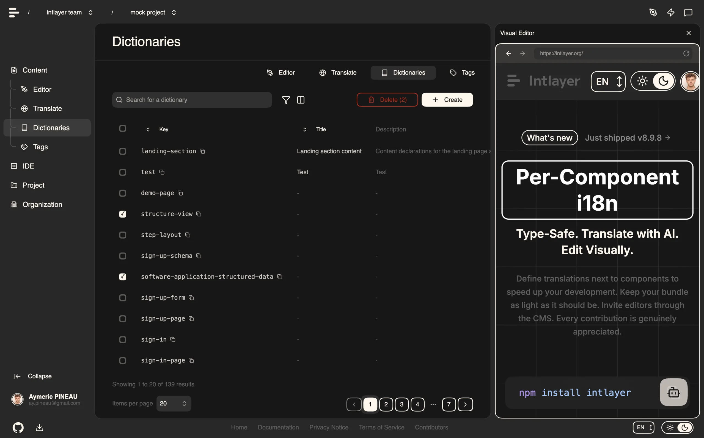

# תיעוד מערכת ניהול התוכן של Intlayer (CMS)

<iframe title="Visual Editor + CMS for Your Web App: Intlayer Explained" class="m-auto aspect-16/9 w-full overflow-hidden rounded-lg border-0" allow="autoplay; gyroscope;" loading="lazy" width="1080" height="auto" src="https://www.youtube.com/embed/UDDTnirwi_4?autoplay=0&amp;origin=https://intlayer.org&amp;controls=0&amp;rel=1"/>

ה-CMS של Intlayer הוא אפליקציה המאפשרת לכם להחצין (externalize) את התוכן של פרויקט Intlayer.

לשם כך, Intlayer מציג את המושג 'מילונים מרוחקים' (distant dictionaries).



## תוכן עניינים

<TOC/>

## הבנת מילונים מרוחקים

Intlayer מבדיל בין מילונים 'מקומיים' (local) ל'מרוחקים' (remote).

- מילון 'מקומי' הוא מילון המוצהר בתוך פרויקט ה-Intlayer שלכם, כגון קובץ ההצהרה של כפתור או של סרגל הניווט שלכם. החצנת התוכן במקרה זה אינה הגיונית, כיוון שתוכן זה אינו אמור להשתנות לעיתים קרובות.
- מילון 'מרוחק' הוא מילון המנוהל דרך ה-CMS של Intlayer. הוא שימושי כדי לאפשר לצוות שלכם לנהל את התוכן ישירות באתר שלכם, ומיועד גם לשימוש בתכונות בדיקות A/B ואופטימיזציית SEO אוטומטית.

## עורך ויזואלי מול CMS

ה-[עורך הוויזואלי של Intlayer](https://github.com/aymericzip/intlayer/blob/main/docs/docs/he/intlayer_visual_editor.md) הוא כלי המאפשר לכם לנהל את התוכן שלכם בעורך ויזואלי עבור מילונים מקומיים. ברגע שמתבצע שינוי, התוכן מוחלף בבסיס הקוד. פירוש הדבר הוא שהאפליקציה תיבנה מחדש והדף ייטען מחדש כדי להציג את התוכן החדש.

- [עורך ויזואלי של Intlayer](https://github.com/aymericzip/intlayer/blob/main/docs/docs/he/intlayer_visual_editor.md)

לעומת זאת, ה-CMS של Intlayer הוא כלי המאפשר לכם לנהל את התוכן שלכם בעורך ויזואלי עבור מילונים מרוחקים. ברגע שמתבצע שינוי, התוכן **אינו** משפיע על בסיס הקוד שלכם, והאתר יציג אוטומטית את התוכן שהשתנה.

## אינטגרציה

לפרטים נוספים על התקנת החבילה, עיינו בסעיף המתאים להלן:

### אינטגרציה עם Next.js

לאינטגרציה עם Next.js, עיינו ב[מדריך ההגדרה](https://github.com/aymericzip/intlayer/blob/main/docs/docs/he/intlayer_with_nextjs_15.md).

- [בינאום Next.js 15, מדריך מלא לתרגום האפליקציה שלכם](https://github.com/aymericzip/intlayer/blob/main/docs/docs/he/intlayer_with_nextjs_15.md)

### אינטגרציה עם Create React App

לאינטגרציה עם Create React App, עיינו ב[מדריך ההגדרה](https://github.com/aymericzip/intlayer/blob/main/docs/docs/he/intlayer_with_create_react_app.md).

- [בינאום Create React App, מדריך תרגום מלא](https://github.com/aymericzip/intlayer/blob/main/docs/docs/he/intlayer_with_create_react_app.md)

### אינטגרציה עם Vite + React

לאינטגרציה עם Vite + React, עיינו ב[מדריך ההגדרה](https://github.com/aymericzip/intlayer/blob/main/docs/docs/he/intlayer_with_vite+react.md).

- [בינאום Vite + React, מדריך מלא לתרגום האפליקציה שלכם](https://github.com/aymericzip/intlayer/blob/main/docs/docs/he/intlayer_with_vite+react.md)

## הגדרות (Configuration)

הריצו את הפקודה הבאה כדי להתחבר ל-Intlayer CMS:

```bash packageManager="npm"
npx intlayer login
```

```bash packageManager="yarn"
yarn intlayer login
```

```bash packageManager="pnpm"
pnpm intlayer login
```

```bash packageManager="bun"
bun x intlayer login
```

פקודה זו תפתח את דפדפן ברירת המחדל שלכם להשלמת תהליך האימות וקבלת האישורים הנדרשים (Client ID ו-Client Secret) לשימוש בשירותי Intlayer.

בקובץ ההגדרות של Intlayer, תוכלו להתאים אישית את הגדרות ה-CMS:

```typescript fileName="intlayer.config.ts" codeFormat={["typescript", "esm", "commonjs"]}
import type { IntlayerConfig } from "intlayer";

const config: IntlayerConfig = {
  // ... הגדרות תצורה נוספות
  editor: {
    /**
     * שדה חובה
     *
     * כתובת ה-URL של האפליקציה.
     * זוהי כתובת ה-URL שאליה מכוון העורך הוויזואלי.
     */
    applicationURL: process.env.INTLAYER_APPLICATION_URL,

    /**
     * שדה חובה
     *
     * Client ID ו-client secret נדרשים להפעלת העורך.
     * הם מאפשרים לזהות את המשתמש העורך את התוכן.
     * ניתן להשיגם על ידי יצירת לקוח חדש בלוח הבקרה של Intlayer - Projects (https://app.intlayer.org/projects).
     * clientId: process.env.INTLAYER_CLIENT_ID,
     * clientSecret: process.env.INTLAYER_CLIENT_SECRET,
     */
    clientId: process.env.INTLAYER_CLIENT_ID,
    clientSecret: process.env.INTLAYER_CLIENT_SECRET,

    /**
     * אופציונלי
     *
     * במקרה שבו אתם מארחים את Intlayer CMS בעצמכם, תוכלו להגדיר את כתובת ה-URL של ה-CMS.
     *
     * כתובת ה-URL של ה-CMS של Intlayer.
     * כברירת מחדל, מוגדר ל-https://intlayer.org
     */
    cmsURL: process.env.INTLAYER_CMS_URL,

    /**
     * אופציונלי
     *
     * במקרה שבו אתם מארחים את Intlayer CMS בעצמכם, תוכלו להגדיר את כתובת ה-URL של ה-backend.
     *
     * כתובת ה-URL של ה-backend.
     * כברירת מחדל, מוגדר ל-https://back.intlayer.org
     */
    backendURL: process.env.INTLAYER_BACKEND_URL,
  },
};

export default config;
```

> אם אין לכם client ID ו-client secret, תוכלו להשיגם על ידי יצירת לקוח חדש ב-[לוח הבקרה של Intlayer - פרויקטים](https://app.intlayer.org/projects).

> כדי לראות את כל הפרמטרים הזמינים, עיינו ב[תיעוד ההגדרות](https://github.com/aymericzip/intlayer/blob/main/docs/docs/he/configuration.md).

- [תיעוד ההגדרות](https://github.com/aymericzip/intlayer/blob/main/docs/docs/he/configuration.md)

## שימוש ב-CMS

### העלאת ההגדרות שלכם (Push)

כדי להגדיר את ה-CMS של Intlayer, תוכלו להשתמש בפקודות ה-[Intlayer CLI](https://github.com/aymericzip/intlayer/blob/main/docs/docs/he/cli/index.md).

```bash packageManager="npm"
npx intlayer config push
```

```bash packageManager="yarn"
yarn intlayer config push
```

```bash packageManager="pnpm"
pnpm intlayer config push
```

```bash packageManager="bun"
bun x intlayer config push
```

> אם אתם משתמשים במשתני סביבה בקובץ ההגדרות `intlayer.config.ts`, תוכלו לציין את הסביבה הרצויה באמצעות הארגומנט `--env`:

```bash packageManager="npm"
npx intlayer config push --env production
```

```bash packageManager="yarn"
yarn intlayer config push --env production
```

```bash packageManager="pnpm"
pnpm intlayer config push --env production
```

```bash packageManager="bun"
bun x intlayer config push --env production
```

פקודה זו מעלה את התצורה שלכם אל ה-CMS של Intlayer.

### העלאת מילון (Push)

כדי להמיר את המילונים המקומיים שלכם למילון מרוחק, תוכלו להשתמש בפקודות ה-[Intlayer CLI](https://github.com/aymericzip/intlayer/blob/main/docs/docs/he/cli/index.md).

```bash packageManager="npm"
npx intlayer dictionary push -d my-first-dictionary-key
```

```bash packageManager="yarn"
yarn intlayer dictionary push -d my-first-dictionary-key
```

```bash packageManager="pnpm"
pnpm intlayer dictionary push -d my-first-dictionary-key
```

```bash packageManager="bun"
bun x intlayer dictionary push -d my-first-dictionary-key
```

> אם אתם משתמשים במשתני סביבה בקובץ ההגדרות `intlayer.config.ts`, תוכלו לציין את הסביבה הרצויה באמצעות הארגומנט `--env`:

```bash packageManager="npm"
npx intlayer dictionary push -d my-first-dictionary-key --env production
```

```bash packageManager="yarn"
yarn intlayer dictionary push -d my-first-dictionary-key --env production
```

```bash packageManager="pnpm"
pnpm intlayer dictionary push -d my-first-dictionary-key --env production
```

```bash packageManager="bun"
bun x intlayer dictionary push -d my-first-dictionary-key --env production
```

פקודה זו מעלה את מילוני התוכן הראשוניים שלכם, והופכת אותם לזמינים לשליפה אסינכרונית ועריכה דרך פלטפורמת Intlayer.

### עריכת המילון

לאחר מכן תוכלו לצפות ולנהל את המילון שלכם ב-[Intlayer CMS](https://app.intlayer.org/content).

## גישה תכנותית באמצעות ה-SDK של `@intlayer/api`

מעבר ל-CLI ולעורך הוויזואלי, Intlayer מספק SDK בעל טיפוסיות בחבילת [`@intlayer/api`](https://www.npmjs.com/package/@intlayer/api). הוא מאפשר לכם להתייחס ל-CMS כאל **מאגר תוכן ללא ראש (headless content database)**: תוכלו לשלוף פרויקטים, לשלוף מילונים, ולהעלות או לעדכן אותם ישירות מתוך האפליקציה, הסקריפטים או צינור ה-CI שלכם.

ה-SDK מטפל באימות עבורכם. כל עוד ה-`clientId` וה-`clientSecret` שלכם זמינים (בתצורת Intlayer או בסביבה שלכם), הוא מקבל ומרענן טוקן גישה של OAuth2 אוטומטית וחותם על כל בקשה.

### התקנה

```bash packageManager="npm"
npm install @intlayer/api
```

```bash packageManager="yarn"
yarn add @intlayer/api
```

```bash packageManager="pnpm"
pnpm add @intlayer/api
```

```bash packageManager="bun"
bun add @intlayer/api
```

### כיצד זה עובד: מאמת (authenticator) + נקודות קצה (endpoints)

ה-SDK מחולק ל**שני ייבואים נפרדים** במכוון, כדי לשמור על גודל bundle קטן:

1. `createIntlayerCMS`: יוצר **מאמת (authenticator)** קל משקל. הוא נושא רק את האישורים ואת טוקן הגישה המנוהל, ואינו יודע דבר על תחום ספציפי.
2. `dictionaryEndpoint`, `projectEndpoint`, … כורכי נקודות קצה ייעודיים לכל תחום, שכל אחד מהם מיובא מנתיב משנה משלו (`@intlayer/api/dictionary`, `@intlayer/api/project`, …). אתם מעבירים את המאמת לנקודת הקצה הדרושה לכם.

מכיוון שכל נקודת קצה מיובאת בנפרד, ה-bundle שלכם כולל רק את התחומים שבהם אתם משתמשים בפועל. ייבוא של `dictionaryEndpoint` לעולם אינו מושך לקוחות עבור פרויקטים, AI או כל תחום אחר.

```typescript fileName="cms.ts" codeFormat="typescript"
import { createIntlayerCMS } from "@intlayer/api";

// התצורה היא אופציונלית: כאשר היא מושמטת, האישורים נקראים מתוך
// `@intlayer/config/built`, המפענח את משתני הסביבה
// INTLAYER_CLIENT_ID ו-INTLAYER_CLIENT_SECRET.
export const cmsAuthenticator = createIntlayerCMS();
```

> [!WARNING]
> אישורי ה-CMS‏ (`clientId` / `clientSecret`) מעניקים **הרשאת כתיבה** לתוכן שלכם. צרו את המאמת אך ורק **בצד השרת** (server actions, route handlers, סקריפטים, CI). לעולם אל תייבאו אותו לקוד צד-לקוח ואל תחשפו את האישורים שלכם לדפדפן.

אם אתם מעדיפים לא להסתמך על תצורת זמן הבנייה, העבירו את האישורים במפורש:

```typescript fileName="cms.ts" codeFormat="typescript"
import { createIntlayerCMS } from "@intlayer/api";

export const cmsAuthenticator = createIntlayerCMS({
  editor: {
    clientId: process.env.INTLAYER_CLIENT_ID,
    clientSecret: process.env.INTLAYER_CLIENT_SECRET,
    // אופציונלי, עבור backends באירוח עצמי:
    // backendURL: process.env.INTLAYER_BACKEND_URL,
  },
});
```

> השיגו את האישורים שלכם על ידי יצירת מפתח גישה חדש ב-[לוח הבקרה של Intlayer - פרויקטים](https://app.intlayer.org/projects).

### שליפת פרויקטים

```typescript fileName="projects.ts" codeFormat="typescript"
import { createIntlayerCMS } from "@intlayer/api";
import { projectEndpoint } from "@intlayer/api/project";

const cmsAuthenticator = createIntlayerCMS();

// רשימת הפרויקטים הנגישים עם האישורים שלכם
const { data: projects } =
  await projectEndpoint(cmsAuthenticator).getProjects();

// קריאת תובנות לוקליזציה מצטברות של הפרויקט הנבחר
const { data: insights } =
  await projectEndpoint(cmsAuthenticator).getProjectInsights();
```

### שליפת מילונים

```typescript fileName="read-dictionaries.ts" codeFormat="typescript"
import { createIntlayerCMS } from "@intlayer/api";
import { dictionaryEndpoint } from "@intlayer/api/dictionary";

const cmsAuthenticator = createIntlayerCMS();

// רישום כל מילון מרוחק בפרויקט
const { data: dictionaries } =
  await dictionaryEndpoint(cmsAuthenticator).getDictionaries();

// או קבלת מילון יחיד לפי מפתח
const { data: dictionary } = await dictionaryEndpoint(
  cmsAuthenticator
).getDictionary("my-first-dictionary-key");
```

### העלאה ועדכון של מילונים

השתמשו ב-CMS כמסד נתונים לכתיבת תוכן בחזרה:

```typescript fileName="write-dictionaries.ts" codeFormat="typescript"
import { createIntlayerCMS } from "@intlayer/api";
import { dictionaryEndpoint } from "@intlayer/api/dictionary";

const cmsAuthenticator = createIntlayerCMS();

// יצירת מילון חדש
await dictionaryEndpoint(cmsAuthenticator).addDictionary({
  key: "my-first-dictionary-key",
  content: { title: "Hello world" },
});

// עדכון/יצירה במקבץ (Upsert) של מילונים בפנייה אחת
await dictionaryEndpoint(cmsAuthenticator).pushDictionaries([
  { key: "home", content: { title: "Home" } },
  { key: "about", content: { title: "About" } },
]);

// עדכון מילון קיים
await dictionaryEndpoint(cmsAuthenticator).updateDictionary({
  id: "<dictionary-id>",
  key: "home",
  content: { title: "Updated title" },
});
```

> טיפ: השתמשו שוב בנקודת הקצה הכרוכה כדי להימנע מחזרות:
>
> ```typescript codeFormat="typescript"
> const dictionary = dictionaryEndpoint(cmsAuthenticator);
> await dictionary.pushDictionaries([myDictionary]);
> const { data } = await dictionary.getDictionaries();
> ```

### חילוץ מתודה בודדת

כל מתודת נקודת קצה היא עצמאית ומאומתת מראש (היא נושאת טיפול בטוקן משל עצמה), כך שתוכלו לחלץ אחת ולהעביר אותה, למשל להזרקת תלויות:

```typescript fileName="push.ts" codeFormat="typescript"
import { createIntlayerCMS } from "@intlayer/api";
import { dictionaryEndpoint } from "@intlayer/api/dictionary";

const dictionary = dictionaryEndpoint(createIntlayerCMS());

// מאומת מראש, מרענן את הטוקן אוטומטית בכל קריאה
export const pushDictionaries = dictionary.pushDictionaries;

// שימוש
await pushDictionaries([{ key: "home", content: { title: "Home" } }]);
```

## סנכרון חי (Live sync)

Live Sync מאפשר לאפליקציה שלכם לשקף שינויי תוכן מה-CMS בזמן ריצה, ללא צורך בבנייה מחדש או ב-deployment. כאשר הוא מופעל, עדכונים מוזרמים לשרת Live Sync המרענן את המילונים שהאפליקציה שלכם קוראת.

למדריך ההגדרה המלא (תצורה, הפעלת שרת Live Sync, זרימת העבודה בפיתוח מקומי ומגבלות), עיינו ב[תיעוד Live Sync](https://github.com/aymericzip/intlayer/blob/main/docs/docs/he/live-sync.md).

- [תיעוד Live Sync](https://github.com/aymericzip/intlayer/blob/main/docs/docs/he/live-sync.md)

## אירוח עצמי (Self-Hosting)

Intlayer יכול לרוץ כולו על התשתית שלכם. פקודת שורה אחת מאתחלת את ה-stack המלא (לוח בקרה, API, מסד נתונים, אחסון אובייקטים ודוא"ל) בעזרת Docker Compose:

```sh
curl -fsSL https://intlayer.org/install.sh | sh
```

למדריך ההגדרה המלא, פירוט משתני סביבה, הוראות שדרוג ונוהלי גיבוי ושחזור, עיינו ב[מדריך לאירוח עצמי](https://github.com/aymericzip/intlayer/blob/main/docs/docs/he/self_hosting.md).

- [מדריך לאירוח עצמי](https://github.com/aymericzip/intlayer/blob/main/docs/docs/he/self_hosting.md)

## פתרון בעיות (Debug)

אם אתם נתקלים בבעיות כלשהן עם ה-CMS, בדקו את הנקודות הבאות:

- האפליקציה פועלת.
- הגדרות ה-[`editor`](https://github.com/aymericzip/intlayer/blob/main/docs/docs/he/configuration.md#editor-configuration) מוגדרות כהלכה בקובץ ההגדרות של Intlayer שלכם.
  - שדות חובה:
    - כתובת ה-URL של האפליקציה צריכה להתאים לזו שהגדרתם בתצורת העורך (`applicationURL`).
    - כתובת ה-URL של ה-CMS
- ודאו שתצורת הפרויקט הועלתה אל ה-CMS של Intlayer.
- העורך הוויזואלי משתמש ב-iframe כדי להציג את האתר שלכם. ודאו שמדיניות אבטחת התוכן (CSP) של האתר שלכם מאפשרת את כתובת ה-CMS תחת `frame-ancestors` ('https://app.intlayer.org' כברירת מחדל). בדקו את קונסולת העורך עבור שגיאות כלשהן.

## שאלות נפוצות

<FAQ>

<Question title="מה ההבדל בין ה-CMS של Intlayer לעורך הוויזואלי?">

ה-[עורך הוויזואלי](https://github.com/aymericzip/intlayer/blob/main/docs/docs/he/intlayer_visual_editor.md) עורך מילונים מקומיים וכותב את השינוי בחזרה לבסיס הקוד שלכם, כך שהאפליקציה נבנית מחדש והשינוי עובר דרך תהליכי הסקירה וה-deployment הרגילים שלכם. ה-CMS עורך מילונים מרוחקים: השינוי אינו נוגע בבסיס הקוד שלכם והאתר הפועל קולט אותו ללא צורך ב-deployment. צוותים משתמשים לעיתים קרובות בשניהם, העורך עבור תוכן שבבעלות מפתחים וה-CMS עבור תוכן שצוות השיווק מעדכן בתדירות שבועית.

- [עורך ויזואלי](https://github.com/aymericzip/intlayer/blob/main/docs/docs/he/intlayer_visual_editor.md)

</Question>
<Question title="כמה בינאום (i18n) מוסיף לגודל ה-bundle שלי?">

הרבה פחות מהגדרה המבוססת על namespaces, מכיוון שדף אינו מוריד לעולם קטלוג שאינו מרונדר בו. תוכן מרונדר בשרת פותר את התוכן שלו בשרת, והמהדר בזמן הבנייה מחליף קריאות `useIntlayer` בערכי המילון המדויקים שבהם הרכיב משתמש, כך שמפתחות ושפות שאינם בשימוש מושמטים. [מילונים דינמיים](https://github.com/aymericzip/intlayer/blob/main/docs/docs/he/dynamic_dictionaries/index.md) מפצלים את השאר לפי שפה. בהשוואה לחלופות המקובלות, Intlayer מפחית את גודל ה-bundle וגודל הדף בעד 50%. ראו [אופטימיזציית bundle](https://github.com/aymericzip/intlayer/blob/main/docs/docs/he/bundle_optimization.md) ואת ה-[benchmark](https://github.com/aymericzip/intlayer/blob/main/docs/docs/he/benchmark/index.md).

- [מילונים דינמיים](https://github.com/aymericzip/intlayer/blob/main/docs/docs/he/dynamic_dictionaries/index.md)
- [אופטימיזציית bundle](https://github.com/aymericzip/intlayer/blob/main/docs/docs/he/bundle_optimization.md)
- [benchmark](https://github.com/aymericzip/intlayer/blob/main/docs/docs/he/benchmark/index.md)

</Question>
<Question title="האם ניתן להגר מ-`i18next`,‏ `next-intl` או `react-i18next` מבלי לשכתב את הרכיבים שלי?">

כן, וישנם שני מסלולים. ניתן להגר את התוכן בהדרגה באמצעות [מדריך ההגירה מ-i18next](https://github.com/aymericzip/intlayer/blob/main/docs/docs/he/migration_from_i18next_to_intlayer.md) או [מדריך ההגירה מ-next-intl](https://github.com/aymericzip/intlayer/blob/main/docs/docs/he/migration_from_next-intl_to_intlayer.md). לחלופין, תוכלו לשמור על ה-API הנוכחי שלכם לחלוטין: [מתאמי התאימות (compat adapters)](https://github.com/aymericzip/intlayer/blob/main/docs/docs/he/compat/index.md) חושפים בדיוק את אותו ה-API של `i18next`,‏ `react-i18next`,‏ `next-intl`,‏ `next-i18next`,‏ `react-intl`,‏ `use-intl`,‏ `vue-i18n` ו-`Lingui`, אך מופעלים על ידי מילוני Intlayer, כך שרק ה-imports משתנים וקוד הרכיב נשאר זהה.

- [מדריך ההגירה מ-i18next](https://github.com/aymericzip/intlayer/blob/main/docs/docs/he/migration_from_i18next_to_intlayer.md)
- [מדריך ההגירה מ-next-intl](https://github.com/aymericzip/intlayer/blob/main/docs/docs/he/migration_from_next-intl_to_intlayer.md)
- [מתאמי תאימות](https://github.com/aymericzip/intlayer/blob/main/docs/docs/he/compat/index.md)

</Question>
<Question title="האם ניתן לשמור על קובצי תרגום ה-JSON הקיימים שלי?">

כן. ה-[תוסף לסנכרון JSON](https://github.com/aymericzip/intlayer/blob/main/docs/docs/he/plugins/sync-json.md) שומר על קובצי ה-`/messages/{locale}/{namespace}.json` שלכם כמקור האמת ומייצר מהם מילוני Intlayer, בשני הכיוונים. [תוסף לסנכרון PO](https://github.com/aymericzip/intlayer/blob/main/docs/docs/he/plugins/sync-po.md) עושה את אותו הדבר עבור קטלוגי gettext, ו-[קבצים לפי שפה (per locale files)](https://github.com/aymericzip/intlayer/blob/main/docs/docs/he/per_locale_file.md) מאפשרים לפצל תוכן לפי שפה במקום לקבץ את כל השפות בקובץ יחיד.

- [תוסף לסנכרון JSON](https://github.com/aymericzip/intlayer/blob/main/docs/docs/he/plugins/sync-json.md)
- [תוסף לסנכרון PO](https://github.com/aymericzip/intlayer/blob/main/docs/docs/he/plugins/sync-po.md)
- [קבצים לפי שפה](https://github.com/aymericzip/intlayer/blob/main/docs/docs/he/per_locale_file.md)

</Question>
<Question title="האם עליי להעביר את התוכן שלי מפתח אחר מפתח?">

לא. הריצו `npx intlayer extract` ו-Intlayer יקרא את קובצי המקור שלכם, ישלוף את המחרוזות הפונות למשתמש ויכתוב קובץ `.content` לצד כל אחד מהם, כך שתוכלו לבדוק diff במקום להעתיק מחרוזות לקטלוג אחת אחת. עיינו ב[פקודת extract](https://github.com/aymericzip/intlayer/blob/main/docs/docs/he/cli/extract.md).

- [פקודת extract](https://github.com/aymericzip/intlayer/blob/main/docs/docs/he/cli/extract.md)

עבור צינור אוטומטי לחלוטין, ה-[Intlayer Compiler](https://github.com/aymericzip/intlayer/blob/main/docs/docs/he/compiler.md) מבצע את אותה פעולה בזמן הבנייה על קוד מקור של JSX, TSX, Vue ו-Svelte, ומייצר את המילונים בכל שינוי כך שאין מפתחות לתחזק ידנית. הוא פועל באמצעות ניתוח סטטי, ולכן מחרוזות שקיימות רק בזמן ריצה נותרות מחוץ להישג ידו, והוא דורש מעט הערות (annotations) כדי להבדיל בין טקסט הפונה למשתמש לבין לוגיקת אפליקציה.

- [Intlayer Compiler](https://github.com/aymericzip/intlayer/blob/main/docs/docs/he/compiler.md)

</Question>
<Question title="אילו כלי עורך וסוכני AI זמינים?">

חמישה כלים, כולם אופציונליים:

- **[תוסף VS Code](https://github.com/aymericzip/intlayer/blob/main/docs/docs/he/vs_code_extension.md)**: קפיצה ישירה ממפתח ב-`useIntlayer` אל קובץ התוכן שמצהיר עליו, חילוץ תוכן מרכיב, והרצת build, fill, test, push ו-pull מלוח הפקודות או מלשונית Intlayer ייעודית.
- **[שרת LSP](https://github.com/aymericzip/intlayer/blob/main/docs/docs/he/lsp.md)**: אותה מודעות בכל עורך התומך ב-LSP, עם go to definition, חיפוש כל ההפניות, תצוגה מקדימה בריחוף של ערך מתורגם, השלמה אוטומטית של מפתחות ושדות, והתרעה כאשר מפתח אינו מוצהר בשום מקום. הוא גם מפענח קריאות של `i18next`,‏ `react-i18next`,‏ `next-intl` ו-`use-intl`, מה שמסייע בזמן תהליך ההגירה.
- **[שרת MCP](https://github.com/aymericzip/intlayer/blob/main/docs/docs/he/mcp_server.md)**: חושף את התיעוד וה-CLI של Intlayer עבור Cursor, VS Code, Claude Desktop, Claude Code ו-ChatGPT, כך שעוזר יכול לענות מתוך התיעוד העדכני במקום לנחש, ויכול להריץ פקודות כגון `intlayer fill` בעצמו.
- **[Agent skills](https://github.com/aymericzip/intlayer/blob/main/docs/docs/he/agent_skills.md)**: מיומנויות ממוקדות כגון `intlayer-config`,‏ `intlayer-cli` ו-`intlayer-content`, בתוספת מיומנות ייעודית לכל framework, המלמדות סוכן על תצורת הניתוב שלכם ועל סוגי צומתי התוכן.
- **[תוסף ESLint](https://github.com/aymericzip/intlayer/blob/main/docs/docs/he/eslint.md)**: כלל `no-raw-text` מתריע על מחרוזות מוטמעות בקוד (hardcoded), עם כללים נוספים למפתחות מילון סטטיים ולתוכן שאינו בשימוש.

</Question>
<Question title="איזה תוכן כדאי להעביר ל-CMS?">

תוכן שמשתנה לעיתים קרובות ואינו שייך לגרסת שחרור (release) ספציפית: טקסטים של דפי נחיתה, ניסוחי תמחור, הודעות וכל מה שנמצא בבעלות צוות השיווק. תוכן המהווה חלק אינטגרלי מהממשק, כגון תוויות כפתורים ושגיאות טפסים, עדיף להשאיר כמילונים מקומיים, שבהם הוא נסקר יחד עם הקוד המשתמש בו.

</Question>
<Question title="מה קורה אם ה-CMS אינו זמין?">

האפליקציה נסוגה להצהרה המקומית של המילון (fallback), כך שכשל ברשת או השבתה מובילים להצגת התוכן שנשלח עם הבנייה שלכם במקום להציג דף ריק. זו הסיבה ששמירה על הצהרה מקומית לכל מילון מרוחק היא כה חשובה.

</Question>
<Question title="האם ניתן לארח את ה-CMS עצמאית (Self-host)?">

כן. ה-CMS יכול לפעול על התשתית שלכם, וזהו הפתרון המקובל כאשר התוכן אינו מורשה לצאת מהרשת הארגונית שלכם. ראו [אירוח עצמי של Intlayer](https://github.com/aymericzip/intlayer/blob/main/docs/docs/he/self_hosting.md).

- [אירוח עצמי של Intlayer](https://github.com/aymericzip/intlayer/blob/main/docs/docs/he/self_hosting.md)

</Question>
<Question title="האם עורכי תוכן זקוקים למפתח כדי לפרסם שינוי?">

לא. זו המטרה המרכזית של מילונים מרוחקים: עורך משנה את הטקסט ב-CMS והאתר משקף זאת, כאשר [סנכרון חי (live sync)](https://github.com/aymericzip/intlayer/blob/main/docs/docs/he/cli/live.md) מחיל את העדכון בזמן ריצה במקום להמתין לבנייה מחדש.

- [סנכרון חי](https://github.com/aymericzip/intlayer/blob/main/docs/docs/he/cli/live.md)

</Question>
<Question title="האם ניתן לבצע אוטומציה של ה-CMS במקום להשתמש בממשק?">

כן. ה-SDK של `@intlayer/api` חושף את אותן נקודות הקצה כמו הממשק, כך שתוכלו לשלוף פרויקטים, לקרוא מילונים ולהעלות עדכונים מתוך סקריפט או צינור אוטומציה. הסעיף לעיל מציג את המאמת ואת נקודות הקצה.

</Question>
<Question title="האם ה-CMS תומך בבדיקות A/B של תרגומים?">

כן. מילונים מרוחקים תומכים ב-[וריאנטים של תוכן](https://github.com/aymericzip/intlayer/blob/main/docs/docs/he/dynamic_dictionaries/variants.md), ו-[אנליטיקה](https://github.com/aymericzip/intlayer/blob/main/docs/docs/he/analytics.md) מדווחת כיצד כל וריאנט נחשף למשתמשים, כך ששינוי ניסוח נמדד על פי נתונים ולא על סמך השערות.

- [וריאנטים של תוכן](https://github.com/aymericzip/intlayer/blob/main/docs/docs/he/dynamic_dictionaries/variants.md)
- [אנליטיקה](https://github.com/aymericzip/intlayer/blob/main/docs/docs/he/analytics.md)

</Question>
<Question title="האם ה-CMS הוא חינמי?">

הספרייה, ה-CLI, המהדר והעורך הוויזואלי של Intlayer הם חינמיים ובקוד פתוח תחת רישיון Apache 2.0. ה-CMS המנוהל (hosted) הוא שירות אופציונלי בתשלום, וניתן לחלופין [לארח אותו עצמאית](https://github.com/aymericzip/intlayer/blob/main/docs/docs/he/self_hosting.md).

- [אירוח עצמי](https://github.com/aymericzip/intlayer/blob/main/docs/docs/he/self_hosting.md)

</Question>

</FAQ>
