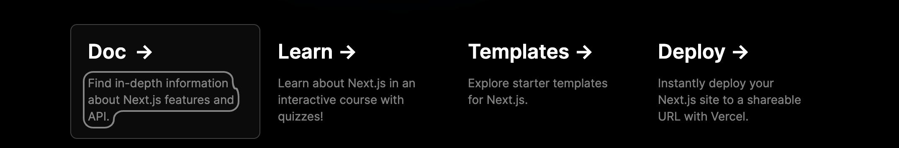

# תיעוד העורך הוויזואלי של Intlayer

<iframe title="Visual Editor + CMS for Your Web App: Intlayer Explained" class="m-auto aspect-16/9 w-full overflow-hidden rounded-lg border-0" allow="autoplay; gyroscope;" loading="lazy" width="1080" height="auto" src="https://www.youtube.com/embed/UDDTnirwi_4?autoplay=0&amp;origin=https://intlayer.org&amp;controls=0&amp;rel=1"/>

העורך הוויזואלי של Intlayer הוא כלי שעוטף את האתר שלכם כדי לאפשר אינטראקציה עם קובצי הצהרת התוכן שלכם באמצעות עורך ויזואלי.


חבילת `intlayer-editor` מבוססת על Intlayer וזמינה עבור יישומי JavaScript, כגון React (Create React App), Vite + React, ו-Next.js.

## עורך ויזואלי לעומת CMS

העורך הוויזואלי של Intlayer הוא כלי המאפשר לכם לנהל את התוכן שלכם בעורך ויזואלי עבור מילונים מקומיים. ברגע שמבוצע שינוי, התוכן יוחלף ישירות בבסיס הקוד שלכם. המשמעות היא שהאפליקציה תיבנה מחדש והדף יתרענן כדי להציג את התוכן החדש.

לעומת זאת, [Intlayer CMS](https://github.com/aymericzip/intlayer/blob/main/docs/docs/he-IL/intlayer_CMS.md) הוא כלי המאפשר לכם לנהל את התוכן שלכם בעורך ויזואלי עבור מילונים מרוחקים. ברגע שמבוצע שינוי, התוכן **לא** ישפיע על בסיס הקוד שלכם, והאתר יציג אוטומטית את התוכן המעודכן.

- [Intlayer CMS](https://github.com/aymericzip/intlayer/blob/main/docs/docs/he-IL/intlayer_CMS.md)

## שילוב Intlayer באפליקציה שלכם

לפרטים נוספים על אופן שילוב Intlayer, עיינו בסעיף הרלוונטי להלן:

### שילוב עם Next.js

עבור שילוב עם Next.js, עיינו ב[מדריך ההתקנה](https://github.com/aymericzip/intlayer/blob/main/docs/docs/he-IL/intlayer_with_nextjs_15.md).

- [i18n ב-Next.js 15, מדריך מלא לתרגום האפליקציה שלכם](https://github.com/aymericzip/intlayer/blob/main/docs/docs/he-IL/intlayer_with_nextjs_15.md)

### שילוב עם Create React App

עבור שילוב עם Create React App, עיינו ב[מדריך ההתקנה](https://github.com/aymericzip/intlayer/blob/main/docs/docs/he-IL/intlayer_with_create_react_app.md).

- [i18n ב-Create React App, מדריך תרגום מלא](https://github.com/aymericzip/intlayer/blob/main/docs/docs/he-IL/intlayer_with_create_react_app.md)

### שילוב עם Vite + React

עבור שילוב עם Vite + React, עיינו ב[מדריך ההתקנה](https://github.com/aymericzip/intlayer/blob/main/docs/docs/he-IL/intlayer_with_vite+react.md).

- [i18n ב-Vite + React, מדריך מלא לתרגום האפליקציה שלכם](https://github.com/aymericzip/intlayer/blob/main/docs/docs/he-IL/intlayer_with_vite+react.md)

## כיצד עובד העורך של Intlayer

העורך הוויזואלי הוא אפליקציה הכוללת שני מרכיבים:

- אפליקציית Frontend המציגה את האתר שלכם בתוך iframe. אם האתר שלכם משתמש ב-Intlayer, העורך הוויזואלי יזהה אוטומטית את התוכן שלכם ויאפשר לכם ליצור איתו אינטראקציה. לאחר ביצוע שינוי, תוכלו להוריד או לשמור את השינויים שלכם.

- ברגע שלחצתם על כפתור ההורדה/שמירה, העורך הוויזואלי ישלח בקשה לשרת כדי להחליף את קובצי הצהרת התוכן שלכם בתוכן החדש (בכל מקום שבו קבצים אלה מוצהרים בפרויקט שלכם).

> שימו לב ש-Intlayer Editor יכתוב את קובצי הצהרת התוכן שלכם כ-JSON אם סיומת הקובץ היא `.json`. אם סיומת הקובץ היא `.ts`, `.tsx`, `.js`, `.jsx`, `.mjs`, `.cjs`, הוא יכתוב את הקובץ כקובץ JavaScript באמצעות Babel transformer.

## התקנה

לאחר ש-Intlayer מוגדר בפרויקט שלכם, פשוט התקינו את `intlayer-editor` כתלות פיתוח (development dependency):

```bash packageManager="npm"
npm install intlayer-editor --save-dev
```

```bash packageManager="yarn"
yarn add intlayer-editor --save-dev
```

```bash packageManager="pnpm"
pnpm add intlayer-editor --save-dev
```

```bash packageManager="bun"
bun add intlayer-editor --dev
```

בעזרת הדגל `--with`, תוכלו להפעיל את העורך במקביל לפקודה אחרת:

```json5 fileName="package.json"
{
  "scripts": {
    "start:editor": "npx intlayer-editor start --with 'next dev --turbopack'",
  },
}
```

## הגדרה

בקובץ התצורה של Intlayer, תוכלו להתאים אישית את הגדרות העורך:

```typescript fileName="intlayer.config.ts" codeFormat={["typescript", "esm", "commonjs"]}
import type { IntlayerConfig } from "intlayer";

const config: IntlayerConfig = {
  // ... הגדרות תצורה נוספות
  editor: {
    /**
     * חובה
     * כתובת ה-URL של האפליקציה.
     * זוהי כתובת ה-URL שאליה מכוון העורך הוויזואלי.
     * דוגמה: 'http://localhost:3000'
     */
    applicationURL: process.env.INTLAYER_APPLICATION_URL,
    /**
     * אופציונלי
     * ברירת המחדל היא `true`. אם `false`, העורך אינו פעיל ולא ניתן לגשת אליו.
     * ניתן להשתמש כדי להשבית את העורך בסביבות מסוימות מטעמי אבטחה, כגון ייצור (production).
     */
    enabled: process.env.INTLAYER_ENABLED,
    /**
     * אופציונלי
     * ברירת המחדל היא `8000`.
     * הפורט של שרת העורך.
     */
    port: process.env.INTLAYER_PORT,
    /**
     * אופציונלי
     * ברירת המחדל היא "http://localhost:8000"
     * כתובת ה-URL של שרת העורך.
     */
    editorURL: process.env.INTLAYER_EDITOR_URL,
  },
};

export default config;
```

> כדי לראות את כל הפרמטרים הזמינים, עיינו ב[תיעוד התצורה](https://github.com/aymericzip/intlayer/blob/main/docs/docs/he-IL/configuration.md).

- [תיעוד התצורה](https://github.com/aymericzip/intlayer/blob/main/docs/docs/he-IL/configuration.md)

## שימוש בעורך

1. לאחר התקנת העורך, תוכלו להפעיל אותו באמצעות הפקודה הבאה:

   ```bash packageManager="npm"
   npx intlayer-editor start
   ```

   ```bash packageManager="yarn"
   yarn intlayer-editor start
   ```

   ```bash packageManager="pnpm"
   pnpm intlayer-editor start
   ```

   > **שימו לב שעליכם להפעיל את האפליקציה שלכם במקביל.** כתובת ה-URL של האפליקציה צריכה להתאים לזו שהגדרתם בתצורת העורך (`applicationURL`).

   > **שימו לב שהפקודה מיוצאת מחדש על ידי חבילת `intlayer`. תוכלו להשתמש ב-`npx intlayer editor start` במקום זאת.**

2. לאחר מכן, פתחו את כתובת ה-URL שסופקה. כברירת מחדל `http://localhost:8000`.

   תוכלו לצפות בכל שדה שמאונדקס על ידי Intlayer על ידי ריחוף עם העכבר מעל התוכן שלכם.

   

3. אם התוכן שלכם מוקף במסגרת, תוכלו ללחוץ עליו לחיצה ארוכה כדי לפתוח את מגירת העריכה (edit drawer).

## תצורת סביבה (Environment configuration)

ניתן להגדיר את העורך להשתמש בקובץ סביבה ספציפי. זה שימושי כאשר ברצונכם להשתמש באותו קובץ תצורה עבור פיתוח וייצור.

כדי להשתמש בקובץ סביבה ספציפי, תוכלו להשתמש בדגל `--env-file` או `-f` בעת הפעלת העורך:

```bash packageManager="npm"
npx intlayer-editor start -f .env.development
```

```bash packageManager="yarn"
yarn intlayer-editor start -f .env.development
```

```bash packageManager="pnpm"
pnpm intlayer-editor start -f .env.development
```

> שימו לב שקובץ הסביבה צריך להיות ממוקם בתיקיית השורש של הפרויקט שלכם.

או שתוכלו להשתמש בדגל `--env` או `-e` כדי לציין את הסביבה:

```bash packageManager="npm"
npx intlayer-editor start -e development
```

```bash packageManager="yarn"
yarn intlayer-editor start -e development
```

```bash packageManager="pnpm"
pnpm intlayer-editor start -e development
```

## ניפוי שגיאות (Debug)

אם אתם נתקלים בבעיות כלשהן בעורך הוויזואלי, בדקו את הנקודות הבאות:

- העורך הוויזואלי והאפליקציה פועלים שניהם.

- הגדרות ה-[`editor`](https://github.com/aymericzip/intlayer/blob/main/docs/docs/he-IL/configuration.md#editor-configuration) מוגדרות כהלכה בקובץ התצורה של Intlayer.
  - שדות חובה:
    - כתובת ה-URL של האפליקציה צריכה להתאים לזו שהגדרתם בתצורת העורך (`applicationURL`).

- העורך הוויזואלי משתמש ב-iframe כדי להציג את האתר שלכם. ודאו שמדיניות אבטחת התוכן (Content Security Policy - CSP) של האתר שלכם מאפשרת את ה-URL של העורך בתור `frame-ancestors` (`http://localhost:8000` כברירת מחדל). בדקו את מסוף העורך (console) עבור שגיאות כלשהן.

## שאלות נפוצות

<FAQ>

<Question title="מה ההבדל בין העורך הוויזואלי ל-CMS?">

העורך הוויזואלי עורך מילונים מקומיים וכותב את השינויים ישירות בחזרה לבסיס הקוד שלכם, כך שהם עוברים את תהליך הסקירה וה-deployment הרגיל שלכם. ה-[CMS](https://github.com/aymericzip/intlayer/blob/main/docs/docs/he-IL/intlayer_CMS.md) עורך מילונים מרוחקים, שמשתנים באתר הפעיל ללא צורך ב-deployment. העורך מתאים לתוכן שמנוהל על ידי מפתחים, בעוד ה-CMS מתאים לתוכן שמנוהל על ידי צוות שיווק או תוכן.

- [CMS](https://github.com/aymericzip/intlayer/blob/main/docs/docs/he-IL/intlayer_CMS.md)

</Question>
<Question title="כמה i18n מוסיף לגודל ה-bundle שלי?">

הרבה פחות מהגדרה מבוססת namespaces, מכיוון שדף לעולם אינו מוריד קטלוג שהוא אינו מרנדר. Markup שמרונדר בשרת פותר את התוכן שלו בשרת, והקומפיילר בזמן ה-build מחליף קריאות `useIntlayer` בערכי המילון המדויקים שרכיב משתמש בהם, כך שמפתחות שאינם בשימוש ושפות שאינן בשימוש מושמטים לחלוטין. [מילונים דינמיים](https://github.com/aymericzip/intlayer/blob/main/docs/docs/he-IL/dynamic_dictionaries/index.md) מפצלים את השאר לפי שפה. בהשוואה לחלופות הנפוצות, Intlayer מקטין את גודל ה-bundle והדף בעד 50%. ראו [אופטימיזציית bundle](https://github.com/aymericzip/intlayer/blob/main/docs/docs/he-IL/bundle_optimization.md) ואת ה-[benchmark](https://github.com/aymericzip/intlayer/blob/main/docs/docs/he-IL/benchmark/index.md).

- [מילונים דינמיים](https://github.com/aymericzip/intlayer/blob/main/docs/docs/he-IL/dynamic_dictionaries/index.md)
- [אופטימיזציית bundle](https://github.com/aymericzip/intlayer/blob/main/docs/docs/he-IL/bundle_optimization.md)
- [benchmark](https://github.com/aymericzip/intlayer/blob/main/docs/docs/he-IL/benchmark/index.md)

</Question>
<Question title="האם ניתן להגר מ-`i18next`, `next-intl` או `react-i18next` מבלי לשכתב את הרכיבים שלי?">

כן, ויש שני נתיבים. תוכלו להגר את התוכן באופן הדרגתי עם [מדריך ההגירה מ-i18next](https://github.com/aymericzip/intlayer/blob/main/docs/docs/he-IL/migration_from_i18next_to_intlayer.md) או [מדריך ההגירה מ-next-intl](https://github.com/aymericzip/intlayer/blob/main/docs/docs/he-IL/migration_from_next-intl_to_intlayer.md). לחלופין, תוכלו לשמור על ה-API הנוכחי שלכם במלואו: [מתאמי התאימות (compat adapters)](https://github.com/aymericzip/intlayer/blob/main/docs/docs/he-IL/compat/index.md) חושפים בדיוק את אותו ה-API כמו `i18next`, `react-i18next`, `next-intl`, `next-i18next`, `react-intl`, `use-intl`, `vue-i18n` ו-`Lingui`, אך מוגשים על ידי מילוני Intlayer, כך שרק ה-imports משתנים וקוד הרכיבים נשאר ללא שינוי.

- [מדריך ההגירה מ-i18next](https://github.com/aymericzip/intlayer/blob/main/docs/docs/he-IL/migration_from_i18next_to_intlayer.md)
- [מדריך ההגירה מ-next-intl](https://github.com/aymericzip/intlayer/blob/main/docs/docs/he-IL/migration_from_next-intl_to_intlayer.md)
- [מתאמי תאימות](https://github.com/aymericzip/intlayer/blob/main/docs/docs/he-IL/compat/index.md)

</Question>
<Question title="האם ניתן לשמור על קובצי תרגום ה-JSON הקיימים שלי?">

כן. [תוסף ה-sync JSON](https://github.com/aymericzip/intlayer/blob/main/docs/docs/he-IL/plugins/sync-json.md) שומר על קובצי `/messages/{locale}/{namespace}.json` שלכם כמקור האמת ומייצר מהם מילוני Intlayer בשני הכיוונים. [תוסף sync PO](https://github.com/aymericzip/intlayer/blob/main/docs/docs/he-IL/plugins/sync-po.md) עושה את אותו הדבר עבור קטלוגי gettext, ו[קבצים לפי שפה](https://github.com/aymericzip/intlayer/blob/main/docs/docs/he-IL/per_locale_file.md) מאפשרים לכם לפצל תוכן לפי שפה במקום לקבץ את כל השפות בקובץ יחיד.

- [תוסף sync JSON](https://github.com/aymericzip/intlayer/blob/main/docs/docs/he-IL/plugins/sync-json.md)
- [תוסף sync PO](https://github.com/aymericzip/intlayer/blob/main/docs/docs/he-IL/plugins/sync-po.md)
- [קבצים לפי שפה](https://github.com/aymericzip/intlayer/blob/main/docs/docs/he-IL/per_locale_file.md)

</Question>
<Question title="האם עליי להעביר את התוכן שלי מפתח אחר מפתח?">

לא. הריצו `npx intlayer extract` ו-Intlayer יקרא את קובצי המקור שלכם, יחלץ את המחרוזות המוצגות למשתמש ויכתוב קובץ `.content` לצד כל אחת מהן, כך שתוכלו לסקור diff במקום להעתיק מחרוזות לקטלוג אחת אחת. עיינו ב[פקודת extract](https://github.com/aymericzip/intlayer/blob/main/docs/docs/he-IL/cli/extract.md).

- [פקודת extract](https://github.com/aymericzip/intlayer/blob/main/docs/docs/he-IL/cli/extract.md)

עבור תהליך עבודה אוטומטי לחלוטין, ה-[Intlayer Compiler](https://github.com/aymericzip/intlayer/blob/main/docs/docs/he-IL/compiler.md) מבצע את אותה פעולה בזמן build על מקורות JSX, TSX, Vue ו-Svelte, ומייצר את המילונים בכל שינוי כך שאין צורך לתחזק מפתחות ידנית. הוא פועל באמצעות ניתוח סטטי (static analysis), כך שמחרוזות שקיימות רק בזמן ריצה נשארות מחוץ להישג ידו, והוא דורש מעט annotations כדי להבדיל בין טקסט המוצג למשתמש לבין לוגיקת האפליקציה.

- [Intlayer Compiler](https://github.com/aymericzip/intlayer/blob/main/docs/docs/he-IL/compiler.md)

</Question>
<Question title="אילו כלי עורך וסוכני AI זמינים?">

חמישה כלים, כולם אופציונליים:

- **[הרחבת VS Code](https://github.com/aymericzip/intlayer/blob/main/docs/docs/he-IL/vs_code_extension.md)**: קפיצה ישירות ממפתח `useIntlayer` לקובץ התוכן שמצהיר עליו, חילוץ תוכן מרכיב, והרצת build, fill, test, push ו-pull מלוח הפקודות או מלשונית Intlayer ייעודית.
- **[שרת LSP](https://github.com/aymericzip/intlayer/blob/main/docs/docs/he-IL/lsp.md)**: אותה מודעות בכל עורך שתומך ב-LSP, עם go to definition, find all references, תצוגה מקדימה בריחוף (hover) של ערך מתורגם, השלמה אוטומטית של מפתחות ושדות, ואזהרה כאשר מפתח אינו מוצהר בשום מקום. הוא גם מפענח קריאות של `i18next`, `react-i18next`, `next-intl` ו-`use-intl`, מה שעוזר במהלך ההגירה.
- **[שרת MCP](https://github.com/aymericzip/intlayer/blob/main/docs/docs/he-IL/mcp_server.md)**: חושף את התיעוד וה-CLI של Intlayer ל-Cursor, VS Code, Claude Desktop, Claude Code ו-ChatGPT, כך שעוזר AI עונה מתוך התיעוד העדכני במקום לנחש, ויכול להריץ פקודות כמו `intlayer fill` בעצמו.
- **[Agent skills](https://github.com/aymericzip/intlayer/blob/main/docs/docs/he-IL/agent_skills.md)**: מיומנויות ממוקדות כגון `intlayer-config`, `intlayer-cli` ו-`intlayer-content`, בתוספת מיומנות לכל framework, שמלמדות סוכן AI את הגדרות הניתוב וסוגי צמתי התוכן שלכם.
- **[תוסף ESLint](https://github.com/aymericzip/intlayer/blob/main/docs/docs/he-IL/eslint.md)**: כלל `no-raw-text` מסמן מחרוזות מוקלדות ישירות בקוד (hardcoded), עם כללים נוספים עבור מפתחות מילון סטטיים ותוכן שאינו בשימוש.

</Question>
<Question title="היכן פועל העורך הוויזואלי?">

בתשתית שלכם. הוא טוען את האפליקציה שלכם בתוך iframe ומתקשר עם שרת עורך מקומי, כך שהתוכן שלכם לעולם אינו עוזב את הסביבה שלכם. זה מה שהופך אותו למתאים במיוחד עבור פרויקטים שאינם יכולים לשלוח טקסטים לשירות מתארח חיצוני.

</Question>
<Question title="האם עורכי תוכן צריכים לדעת לתכנת?">

לא. הם פותחים את האתר, לוחצים על קטע טקסט ועורכים אותו במקום. העורך מזהה איזה ערך מילון מגבה את הטקסט הזה וכותב את השינוי לקובץ התוכן הנכון, כך שמתרגם או עורך תוכן אינו צריך לחפש את הקובץ או להכיר את המפתח.

</Question>
<Question title="האם עריכה דרך העורך הוויזואלי משנה את קובצי המקור שלי?">

כן, זו בדיוק המטרה. השינוי נרשם בקובץ הצהרת התוכן בבסיס הקוד שלכם, כך שהוא מופיע כ-diff רגיל שתוכלו לסקור ולבצע לו commit, והאפליקציה נבנית מחדש כדי להציג אותו.

</Question>
<Question title="העורך מציג דף ריק או מסרב לטעון את האתר שלי. מה עליי לבדוק?">

העורך מציג את האפליקציה שלכם בתוך iframe, לכן ה-Content Security Policy שלכם חייב לאפשר את ה-origin של העורך בתור `frame-ancestors`, שהוא `http://localhost:8000` כברירת מחדל. כמו כן, ודאו ש-`applicationURL` בתצורת העורך שלכם תואם ל-URL שממנו האפליקציה שלכם מוגשת בפועל. מסוף העורך (console) מדווח על שני הכשלים הללו.

</Question>
<Question title="האם ניתן להשתמש בעורך הוויזואלי ב-production?">

הוא מיועד לפיתוח (development) ו-staging, שבהם בנייה מחדש (rebuild) לאחר עריכה היא מקובלת. לצורך עריכת תוכן באתר פעיל ללא צורך ב-deployment, השתמשו ב-[CMS](https://github.com/aymericzip/intlayer/blob/main/docs/docs/he-IL/intlayer_CMS.md) ובמילונים המרוחקים שלו במקום זאת.

- [CMS](https://github.com/aymericzip/intlayer/blob/main/docs/docs/he-IL/intlayer_CMS.md)

</Question>
<Question title="מהי עלות הביצועים של העורך הוויזואלי? האם זה עומס מיותר אם אינני זקוק לו?">

לעורך הוויזואלי של Intlayer יש **אפס השפעה (zero cost)** על האפליקציה שלכם אם הוא אינו מוגדר. הלוגיקה הנוספת נטענת רק אם היא מופעלת במפורש ונחוצה.

אם הוא מופעל, ההשפעה קלה ביותר (כ-5 KB, נטענים דינמית רק בעת הפעלה) מכיוון שהלוגיקה הראשית מנוהלת על ידי שרת העורך ב-[app.intlayer.org](https://app.intlayer.org) או דרך חבילת `intlayer-editor`. אם אתם זקוקים רק להגדרת תרגום פשוטה ללא עריכה ויזואלית, Intlayer אינו מוסיף שום תקורה לאפליקציה שלכם.

</Question>
<Question title="האם העורך הוויזואלי חינמי?">

כן. העורך הוויזואלי הוא חלק מפרויקט הקוד הפתוח, תחת רישיון Apache 2.0, כולל שימוש מסחרי. רק שירות ה-[CMS](https://github.com/aymericzip/intlayer/blob/main/docs/docs/he-IL/intlayer_CMS.md) המתארח הוא שירות בתשלום, וגם אותו ניתן [לארח באופן עצמאי (self hosted)](https://github.com/aymericzip/intlayer/blob/main/docs/docs/he-IL/self_hosting.md).

- [CMS](https://github.com/aymericzip/intlayer/blob/main/docs/docs/he-IL/intlayer_CMS.md)
- [אירוח עצמי](https://github.com/aymericzip/intlayer/blob/main/docs/docs/he-IL/self_hosting.md)

</Question>

</FAQ>
