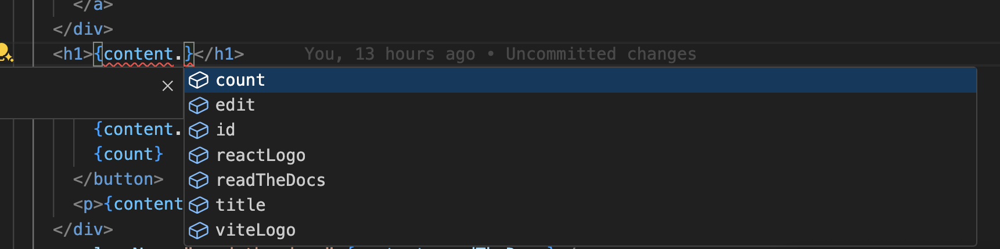
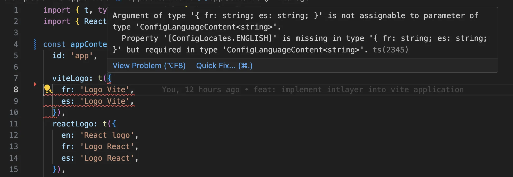

# תרגום אתר Vite ו-React באמצעות Intlayer

## תוכן עניינים

<TOC/>

## מדוע לבחור ב-Intlayer על פני חלופות?

בהשוואה לפתרונות המובילים כמו `react-i18next` או `i18next`,‏ Intlayer מגיעה עם אופטימיזציות מובנות כגון:

<AccordionGroup>
<Accordion header="כיסוי מלא עבור Vite ו-React">

Intlayer מותאמת לפעול בצורה מושלמת עם Vite ו-React על ידי מתן **הגדרת תוכן ברמת הרכיב (component-level scoping)**, **טעינת תרגומים עצלה (lazy-loading)** וכל התכונות הנדרשות להרחבת בינאום (i18n) בקנה מידה רחב.

</Accordion>
<Accordion header="גודל ה-Bundle">

במקום לטעון קובצי JSON עצומים לתוך הדפים שלכם, טענו רק את התוכן הנחוץ. Intlayer מסייעת **להפחית את גודל ה-bundle והדפים שלכם בעד 50%**.

</Accordion>
<Accordion header="תחזוקתיות">

הגדרת תחום התוכן ברמת הרכיב **מפשטת את התחזוקה** באפליקציות גדולות. ניתן לשכפל או למחוק תיקיית פיצ'ר בודדת מבלי לשאת בעומס המנטלי של סקירת כל בסיס קוד התוכן שלכם. בנוסף, Intlayer מספקת **טיפוסיות מלאה (fully typed)** כדי להבטיח את תקינות התוכן.

</Accordion>
<Accordion header="סוכני AI">

מיקום התוכן לצד הרכיבים **מצמצם את ההקשר הנדרש** עבור מודלי שפה גדולים (LLMs). Intlayer מספקת גם חבילת כלים כגון **CLI** לבדיקת תרגומים חסרים, **[LSP](https://github.com/aymericzip/intlayer/blob/main/docs/docs/he-IL/lsp.md)**, **[MCP](https://github.com/aymericzip/intlayer/blob/main/docs/docs/he-IL/mcp_server.md)** ו-**[agent skills](https://github.com/aymericzip/intlayer/blob/main/docs/docs/he-IL/agent_skills.md)**, כדי להפוך את חוויית הפיתוח לחלקה עוד יותר עבור סוכני AI.

- [LSP](https://github.com/aymericzip/intlayer/blob/main/docs/docs/he-IL/lsp.md)
- [MCP](https://github.com/aymericzip/intlayer/blob/main/docs/docs/he-IL/mcp_server.md)
- [agent skills](https://github.com/aymericzip/intlayer/blob/main/docs/docs/he-IL/agent_skills.md)

</Accordion>
<Accordion header="אוטומציה">

השתמשו באוטומציה לתרגום בצינור ה-CI/CD שלכם באמצעות ה-LLM שבחרתם, בעלות ספק ה-AI שלכם. Intlayer מציעה בנוסף **מהדר (compiler)** לאוטומציה של חילוץ תוכן, וכן [פלטפורמת ווב](https://github.com/aymericzip/intlayer/blob/main/docs/docs/he-IL/intlayer_CMS.md) המאפשרת **תרגום ברקע**.

- [פלטפורמת ווב](https://github.com/aymericzip/intlayer/blob/main/docs/docs/he-IL/intlayer_CMS.md)

</Accordion>
<Accordion header="ביצועים">

חיבור קובצי JSON גדולים לרכיבים עלול לגרום לבעיות ביצועים ותגובתיות. Intlayer מבצעת אופטימיזציה של טעינת התוכן בזמן הבנייה.

</Accordion>
<Accordion header="התרחבות בשיתוף צוותים ללא רקע בפיתוח">

מעבר להיותה פתרון i18n,‏ Intlayer מספקת **[עורך חזותי](https://github.com/aymericzip/intlayer/blob/main/docs/docs/he-IL/intlayer_visual_editor.md) באחסון עצמי** ו-**[מערכת CMS מלאה](https://github.com/aymericzip/intlayer/blob/main/docs/docs/he-IL/intlayer_CMS.md)** המסייעים לנהל תוכן רב-לשוני ב**זמן אמת**, ומאפשרים שיתוף פעולה חלק עם מתרגמים, כותבי תוכן וחברי צוות נוספים. ניתן לאחסן תוכן באופן מקומי ו/או מרוחק.

- [עורך חזותי](https://github.com/aymericzip/intlayer/blob/main/docs/docs/he-IL/intlayer_visual_editor.md)
- [מערכת CMS מלאה](https://github.com/aymericzip/intlayer/blob/main/docs/docs/he-IL/intlayer_CMS.md)

</Accordion>
</AccordionGroup>

## מדריך שלב אחר שלב להגדרת Intlayer באפליקציית Vite ו-React

<Tabs defaultTab="video">
  <Tab label="וידאו" value="video">

<iframe title="The best i18n solution for Vite and React? Discover Intlayer" class="m-auto aspect-16/9 w-full overflow-hidden rounded-lg border-0" allow="autoplay; gyroscope;" loading="lazy" width="1080" height="auto" src="https://www.youtube.com/embed/dS9L7uJeak4?si=VaKmrYMmXjo3xpk2"/>

  </Tab>
  <Tab label="קוד" value="code">

<iframe
  src="https://ide.intlayer.org/aymericzip/intlayer-vite-react-template?file=intlayer.config.ts"
  className="m-auto overflow-hidden rounded-lg border-0 max-md:size-full max-md:h-[700px] md:aspect-16/9 md:w-full"
  title="Demo CodeSandbox - How to Internationalize your application using Intlayer"
  sandbox="allow-forms allow-modals allow-popups allow-presentation allow-same-origin allow-scripts"
  loading="lazy"
/>

  </Tab>
  <Tab label="דמו" value="demo">

<iframe
  src="https://intlayer-vite-react-template.vercel.app"
  className="m-auto overflow-hidden rounded-lg border-0 max-md:size-full max-md:h-[700px] md:aspect-16/9 md:w-full"
  title="Demo - intlayer-vite-react-template"
  sandbox="allow-forms allow-modals allow-popups allow-presentation allow-same-origin allow-scripts"
  loading="lazy"
/>

  </Tab>
</Tabs>

ראו את [תבנית האפליקציה](https://github.com/aymericzip/intlayer-vite-react-template) ב-GitHub.

<Steps>
<Step number={1} title="התקנת תלויות">

התקינו את החבילות הנדרשות באמצעות npm:

```bash packageManager="npm"
npx intlayer init --interactive
```

```bash packageManager="pnpm"
pnpm dlx intlayer init --interactive
```

```bash packageManager="yarn"
yarn dlx intlayer init --interactive
```

```bash packageManager="bun"
bunx intlayer init --interactive
```

> הדגל `--interactive` הוא אופציונלי. השתמשו ב-`intlayer-cli init` אם אתם סוכן AI.

> פקודה זו תזהה את הסביבה שלכם ותתקין את החבילות הנדרשות. לדוגמה:

```bash packageManager="npm"
npm install intlayer react-intlayer
npm install vite-intlayer --save-dev
```

```bash packageManager="pnpm"
pnpm add intlayer react-intlayer
pnpm add vite-intlayer --save-dev
```

```bash packageManager="yarn"
yarn add intlayer react-intlayer
yarn add vite-intlayer --save-dev
```

```bash packageManager="bun"
bun add intlayer react-intlayer
bun add vite-intlayer --dev
```

- **intlayer**
  חבילת הליבה המספקת כלי בינאום לניהול תצורה, תרגום, [הצהרת תוכן](https://github.com/aymericzip/intlayer/blob/main/docs/docs/he-IL/dictionary/content_file.md), טרנספילציה ו-[פקודות CLI](https://github.com/aymericzip/intlayer/blob/main/docs/docs/he-IL/cli/index.md).

- **react-intlayer**
  החבילה המשלבת את Intlayer באפליקציית React. היא מספקת ספקי הקשר (context providers) ו-hooks עבור בינאום ב-React.

- **vite-intlayer**
  כוללת את תוסף Vite לשילוב Intlayer עם [הבאנדלר Vite](https://vite.dev/guide/why.html#why-bundle-for-production), וכן middleware לזיהוי השפה המועדפת על המשתמש, ניהול עוגיות וטיפול בהפניות URL.

</Step>
<Step number={2} title="הגדרת הפרויקט שלכם">

### ארכיטקטורה

בארכיטקטורה זו, החבילה `react-intlayer` מספקת את `IntlayerProvider` המותקן ב-`main.tsx` כדי לעטוף את עץ ה-React. הצהרות התוכן ממוקמות לצד הרכיבים ב-`src/`, ו-Vite מטפל בבנייה מחדש של התוכן וב-HMR באמצעות `vite-intlayer`.

```bash
.
├── src
│   ├── app.content.tsx               # App content declaration
│   ├── App.css
│   ├── App.tsx                       # Main application component
│   ├── components
│   │   ├── LocaleSwitcher.content.ts
│   │   └── LocaleSwitcher.tsx
│   ├── index.css
│   ├── main.tsx                      # Entry point with IntlayerProvider
│   └── vite-env.d.ts
├── index.html
├── intlayer.config.ts
├── package.json
├── tsconfig.json
└── vite.config.ts
```

### הגדרות

צרו קובץ תצורה כדי להגדיר את שפות האפליקציה שלכם:

```typescript fileName="intlayer.config.ts" codeFormat={["typescript", "esm", "commonjs"]}
import { Locales, type IntlayerConfig } from "intlayer";

const config: IntlayerConfig = {
  internationalization: {
    locales: [
      Locales.ENGLISH,
      Locales.FRENCH,
      Locales.SPANISH,
      // שאר השפות שלכם
    ],
    defaultLocale: Locales.ENGLISH,
  },
};

export default config;
```

> באמצעות קובץ תצורה זה, תוכלו להגדיר כתובות URL מקומיות, הפניות middleware, שמות עוגיות, מיקום וסיומות של קובצי הצהרת התוכן, ביטול לוגים של Intlayer במסוף ועוד. לרשימה המלאה של הפרמטרים הזמינים, עיינו ב[תיעוד התצורה](https://github.com/aymericzip/intlayer/blob/main/docs/docs/he-IL/configuration.md).

- [תיעוד התצורה](https://github.com/aymericzip/intlayer/blob/main/docs/docs/he-IL/configuration.md)

</Step>
<Step number={3} title="שילוב Intlayer בהגדרות ה-Vite שלכם">

הוסיפו את תוסף ה-intlayer לתצורה שלכם.

```typescript fileName="vite.config.ts" codeFormat={["typescript", "esm", "commonjs"]}
import { defineConfig } from "vite";
import react from "@vitejs/plugin-react-swc";
import { intlayer } from "vite-intlayer";

// https://vitejs.dev/config/
export default defineConfig({
  plugins: [react(), intlayer()],
});
```

> תוסף ה-Vite בשם `intlayer()` משמש לשילוב Intlayer עם Vite. הוא דואג לבניית קובצי הצהרת התוכן ועוקב אחריהם במצב פיתוח. הוא מגדיר משתני סביבה של Intlayer בתוך אפליקציית Vite. בנוסף, הוא מספק כינויים (aliases) לשיפור הביצועים.

</Step>
<Step number={4} title="הצהרה על התוכן שלכם">

צרו ונהלו את הצהרות התוכן שלכם לאחסון התרגומים:

```tsx fileName="src/app.content.tsx" contentDeclarationFormat={["typescript", "esm", "commonjs"]}
import { t, type Dictionary } from "intlayer";
import type { ReactNode } from "react";

const appContent = {
  key: "app",
  content: {
    viteLogo: t({
      he: "לוגו של Vite",
      en: "Vite logo",
      fr: "Logo Vite",
      es: "Logo Vite",
    }),
    reactLogo: t({
      he: "לוגו של React",
      en: "React logo",
      fr: "Logo React",
      es: "Logo React",
    }),

    title: "Vite + React",

    count: t({
      he: "הספירה היא ",
      en: "count is ",
      fr: "le compte est ",
      es: "el recuento es ",
    }),

    edit: t<ReactNode>({
      he: (
        <>
          ערכו את <code>src/App.tsx</code> ושמרו כדי לבדוק HMR
        </>
      ),
      en: (
        <>
          Edit <code>src/App.tsx</code> and save to test HMR
        </>
      ),
      fr: (
        <>
          Éditez <code>src/App.tsx</code> et enregistrez pour tester HMR
        </>
      ),
      es: (
        <>
          Edita <code>src/App.tsx</code> y guarda para probar HMR
        </>
      ),
    }),

    readTheDocs: t({
      he: "לחצו על הלוגו של Vite ו-React כדי ללמוד עוד",
      en: "Click on the Vite and React logos to learn more",
      fr: "Cliquez sur les logos Vite et React pour en savoir plus",
      es: "Haga clic en los logotipos de Vite y React para obtener más información",
    }),
  },
} satisfies Dictionary;

export default appContent;
```

```json fileName="src/app.content.json" contentDeclarationFormat="json"
{
  "$schema": "https://intlayer.org/schema.json",
  "key": "app",
  "content": {
    "viteLogo": {
      "nodeType": "translation",
      "translation": {
        "he": "לוגו של Vite",
        "en": "Vite logo",
        "fr": "Logo Vite",
        "es": "Logo Vite"
      }
    },
    "reactLogo": {
      "nodeType": "translation",
      "translation": {
        "he": "לוגו של React",
        "en": "React logo",
        "fr": "Logo React",
        "es": "Logo React"
      }
    },
    "title": {
      "nodeType": "translation",
      "translation": {
        "he": "Vite + React",
        "en": "Vite + React",
        "fr": "Vite + React",
        "es": "Vite + React"
      }
    },
    "count": {
      "nodeType": "translation",
      "translation": {
        "he": "הספירה היא ",
        "en": "count is ",
        "fr": "le compte est ",
        "es": "el recuento es "
      }
    },
    "edit": {
      "nodeType": "translation",
      "translation": {
        "he": "ערכו את src/App.tsx ושמרו כדי לבדוק HMR",
        "en": "Edit src/App.tsx and save to test HMR",
        "fr": "Éditez src/App.tsx et enregistrez pour tester HMR",
        "es": "Edita src/App.tsx y guarda para probar HMR"
      }
    },
    "readTheDocs": {
      "nodeType": "translation",
      "translation": {
        "he": "לחצו על הלוגו של Vite ו-React כדי ללמוד עוד",
        "en": "Click on the Vite and React logos to learn more",
        "fr": "Cliquez sur les logos Vite et React pour en savoir plus",
        "es": "Haga clic en los logotipos de Vite y React para取得 más información"
      }
    }
  }
}
```

> הצהרות התוכן שלכם יכולות להיות מוגדרות בכל מקום באפליקציה, כל עוד הן כלולות בספריית `contentDir` (כברירת מחדל, `./src`) ותואמות לסיומת קובץ הצהרת התוכן (כברירת מחדל, `.content.{json,ts,tsx,js,jsx,mjs,cjs,md,mdx,yaml,yml}`).

> לפרטים נוספים, עיינו ב[תיעוד הצהרת תוכן](https://github.com/aymericzip/intlayer/blob/main/docs/docs/he-IL/dictionary/content_file.md).

- [תיעוד הצהרת תוכן](https://github.com/aymericzip/intlayer/blob/main/docs/docs/he-IL/dictionary/content_file.md)

> אם קובץ התוכן שלכם כולל קוד TSX, מומלץ לייבא `import React from "react";` בקובץ התוכן.

</Step>
<Step number={5} title="שימוש ב-Intlayer בקוד שלכם">

גשו למילוני התוכן שלכם בכל רחבי האפליקציה:

```tsx {5,9} fileName="src/App.tsx" codeFormat={["typescript", "esm"]}
import { useState, type FC } from "react";
import reactLogo from "./assets/react.svg";
import viteLogo from "/vite.svg";
import "./App.css";
import { IntlayerProvider, useIntlayer } from "react-intlayer";

const AppContent: FC = () => {
  const [count, setCount] = useState(0);
  const content = useIntlayer("app");

  return (
    <>
      <div>
        <a href="https://vitejs.dev" target="_blank">
          
        </a>
        <a href="https://react.dev" target="_blank">
          
        </a>
      </div>
      <h1>{content.title}</h1>
      <div className="card">
        <button onClick={() => setCount((count) => count + 1)}>
          {content.count}
          {count}
        </button>
        <p>{content.edit}</p>
      </div>
      <p className="read-the-docs">{content.readTheDocs}</p>
    </>
  );
};

const App: FC = () => (
  <IntlayerProvider>
    <AppContent />
  </IntlayerProvider>
);

export default App;
```

> אם ברצונכם להשתמש בתוכן שלכם במאפיין מחרוזתי (`string`), כגון `alt`, `title`, `href`, `aria-label` וכדומה, תוכלו להשתמש בערך של הפונקציה, כגון:

> ```tsx
> 
> 
> 
> ```

> למידע נוסף על ה-hook בשם `useIntlayer`, עיינו ב[תיעוד](https://github.com/aymericzip/intlayer/blob/main/docs/docs/he-IL/packages/react-intlayer/useIntlayer.md).

- [תיעוד ה-Hook useIntlayer | react-intlayer](https://github.com/aymericzip/intlayer/blob/main/docs/docs/he-IL/packages/react-intlayer/useIntlayer.md)

> אם האפליקציה שלכם כבר קיימת, תוכלו להשתמש ב-[Intlayer Compiler](https://github.com/aymericzip/intlayer/blob/main/docs/docs/he-IL/compiler.md) וכן ב-[פקודת extract](https://github.com/aymericzip/intlayer/blob/main/docs/docs/he-IL/cli/extract.md) כדי להמיר אלפי רכיבים בשניות.

- [Intlayer Compiler](https://github.com/aymericzip/intlayer/blob/main/docs/docs/he-IL/compiler.md)
- [פקודת extract](https://github.com/aymericzip/intlayer/blob/main/docs/docs/he-IL/cli/extract.md)

</Step>
<Step number={6} title="שינוי שפת התוכן שלכם" isOptional={true}>

כדי לשנות את שפת התוכן, תוכלו להשתמש בפונקציה `setLocale` המסופקת על ידי ה-hook בשם `useLocale`. פונקציה זו מאפשרת לקבוע את שפת האפליקציה ולעדכן את התוכן בהתאם.

```tsx fileName="src/components/LocaleSwitcher.tsx" codeFormat={["typescript", "esm"]}
import type { FC } from "react";
import { Locales } from "intlayer";
import { useLocale } from "react-intlayer";

const LocaleSwitcher: FC = () => {
  const { setLocale } = useLocale();

  return (
    <button onClick={() => setLocale(Locales.English)}>
      Change Language to English
    </button>
  );
};
```

> למידע נוסף על ה-hook בשם `useLocale`, עיינו ב[תיעוד](https://github.com/aymericzip/intlayer/blob/main/docs/docs/he-IL/packages/react-intlayer/useLocale.md).

- [תיעוד ה-Hook useLocale | react-intlayer](https://github.com/aymericzip/intlayer/blob/main/docs/docs/he-IL/packages/react-intlayer/useLocale.md)

</Step>
<Step number={7} title="הוספת ניתוב מותאם שפה לאפליקציה שלכם" isOptional={true}>

מטרת שלב זה היא ליצור נתיבים ייחודיים לכל שפה. הדבר שימושי עבור SEO וכתובות URL מותאמות למנועי חיפוש.
דוגמה:

```plaintext
- https://example.com/about
- https://example.com/es/about
- https://example.com/fr/about
```

> כברירת מחדל, הנתיבים אינם כוללים קידומת עבור שפת ברירת המחדל. אם ברצונכם להוסיף קידומת לשפת ברירת המחדל, תוכלו להגדיר את האפשרות `middleware.prefixDefault` ל-`true` בהגדרות שלכם. ראו את [תיעוד התצורה](https://github.com/aymericzip/intlayer/blob/main/docs/docs/he-IL/configuration.md) למידע נוסף.

- [תיעוד התצורה](https://github.com/aymericzip/intlayer/blob/main/docs/docs/he-IL/configuration.md)

כדי להוסיף ניתוב מותאם שפה לאפליקציה שלכם, תוכלו ליצור רכיב `LocaleRouter` שעוטף את נתיבי האפליקציה ומנהל ניתוב מבוסס שפה. הנה דוגמה באמצעות [React Router](https://reactrouter.com/home):

```tsx fileName="src/components/LocaleRouter.tsx" codeFormat={["typescript", "esm"]}
import { localeMap } from "intlayer"; // פונקציות עזר וטיפוסים מ-intlayer
import type { FC, PropsWithChildren } from "react"; // טיפוסי React עבור רכיבים פונקציונליים ו-props
import { IntlayerProvider } from "react-intlayer"; // Provider עבור הקשר בינאום
import { BrowserRouter, Route, Routes } from "react-router-dom"; // רכיבי Router לניהול ניווט

/**
 * רכיב ראוטר המגדיר נתיבים ספציפיים לכל שפה.
 * הוא משתמש ב-React Router כדי לנהל ניווט ולרנדר רכיבים מותאמים לשפה.
 */
export const LocaleRouter: FC<PropsWithChildren> = ({ children }) => (
  <BrowserRouter>
    <Routes>
      {localeMap(({ locale, urlPrefix }) => (
        <Route
          // תבנית נתיב ללכידת השפה (למשל /en/, /fr/) והתאמה לכל הנתיבים שאחריה
          path={`${urlPrefix}/*`}
          key={locale}
          element={
            <IntlayerProvider locale={locale}>{children}</IntlayerProvider>
          } // עטיפת הילדים בניהול שפה
        />
      ))}
    </Routes>
  </BrowserRouter>
);
```

> הערה: אם אתם משתמשים ב-`routing.mode: 'no-prefix' | 'search-params'`, סביר להניח שאינכם זקוקים לשימוש בפונקציה `localeMap`.

לאחר מכן, תוכלו להשתמש ברכיב `LocaleRouter` באפליקציה שלכם:

```tsx fileName="src/App.tsx" codeFormat={["typescript", "esm"]}
import { LocaleRouter } from "./components/LocaleRouter";
import type { FC } from "react";

// ... רכיב ה-AppContent שלכם

const App: FC = () => (
  <LocaleRouter>
    <AppContent />
  </LocaleRouter>
);
```

במקביל, תוכלו גם להשתמש ב-`intlayerProxy` כדי להוסיף ניתוב צד-שרת לאפליקציה שלכם. תוסף זה יזהה אוטומטית את השפה הנוכחית על פי כתובת ה-URL ויגדיר את עוגיית השפה המתאימה. אם לא צוינה שפה, התוסף יקבע את השפה המתאימה ביותר על פי העדפות הדפדפן של המשתמש. אם לא זוהתה שפה, הוא יפנה לשפת ברירת המחדל.

> שימו לב שכדי להשתמש ב-`intlayerProxy` בסביבת ייצור (production), עליכם להעביר את החבילה `vite-intlayer` מ-`devDependencies` ל-`dependencies`.

> החל מ-Intlayer גרסה 9,‏ `intlayerProxy()` מצורף ישירות לתוך התוסף `intlayer()` ומופעל כברירת מחדל באמצעות האפשרות `routing.enableProxy` (`true` כברירת מחדל). רישומו בנפרד כפי שמוצג להלן הוא כעת אופציונלי. הוא נשמר לתאימות לאחור ועבור הגדרות הדורשות שליטה בסדר התוספים. הגדירו `routing.enableProxy: false` כדי לבטל זאת. ראו את [הערות הגרסה של v9](https://github.com/aymericzip/intlayer/blob/main/docs/docs/he-IL/releases/v9.md).

- [הערות הגרסה של v9](https://github.com/aymericzip/intlayer/blob/main/docs/docs/he-IL/releases/v9.md)

```typescript {3,7} fileName="vite.config.ts" codeFormat={["typescript", "esm", "commonjs"]}
import { defineConfig } from "vite";
import react from "@vitejs/plugin-react-swc";
import { intlayer } from "vite-intlayer";

// https://vitejs.dev/config/
export default defineConfig({
  plugins: [
    react(),
    intlayer({
      proxy: {
        ignore: (req) => req.url?.startsWith("/api"),
      },
    }),
  ],
});
```

</Step>
<Step number={8} title="שינוי ה-URL בעת שינוי שפה" isOptional={true}>

כדי לשנות את ה-URL כאשר השפה משתנה, תוכלו להשתמש ב-prop בשם `onLocaleChange` המסופק על ידי ה-hook בשם `useLocale`. במקביל, ניתן להשתמש ב-hooks בשם `useLocation` ו-`useNavigate` מ-`react-router-dom` כדי לעדכן את נתיב ה-URL.

```tsx fileName="src/components/LocaleSwitcher.tsx" codeFormat={["typescript", "esm"]}
import { useLocation, useNavigate } from "react-router-dom";
import {
  Locales,
  getHTMLTextDir,
  getLocaleName,
  getLocalizedUrl,
} from "intlayer";
import { useLocale } from "react-intlayer";
import { type FC } from "react";

const LocaleSwitcher: FC = () => {
  const { pathname, search } = useLocation(); // קבלת נתיב ה-URL הנוכחי. לדוגמה: /fr/about?foo=bar
  const navigate = useNavigate();

  const { locale, availableLocales, setLocale } = useLocale({
    onLocaleChange: (locale) => {
      // בניית כתובת ה-URL עם השפה המעודכנת
      // לדוגמה: /es/about?foo=bar
      const pathWithLocale = getLocalizedUrl(`${pathname}${search}`, locale);

      // עדכון נתיב ה-URL
      navigate(pathWithLocale);
    },
  });

  return (
    <div>
      <button popoverTarget="localePopover">{getLocaleName(locale)}</button>
      <div id="localePopover" popover="auto">
        {availableLocales.map((localeItem) => (
          <a
            href={getLocalizedUrl(location.pathname, localeItem)}
            hrefLang={localeItem}
            aria-current={locale === localeItem ? "page" : undefined}
            onClick={(e) => {
              e.preventDefault();
              setLocale(localeItem);
            }}
            key={localeItem}
          >
            <span>
              {/* השפה - למשל FR */}
              {localeItem}
            </span>
            <span>
              {/* שם השפה בשפה עצמה - למשל Français */}
              {getLocaleName(localeItem, locale)}
            </span>
            <span dir={getHTMLTextDir(localeItem)} lang={localeItem}>
              {/* שם השפה בשפה הנוכחית - למשל Francés כשהשפה הנוכחית מוגדרת כ-Locales.SPANISH */}
              {getLocaleName(localeItem)}
            </span>
            <span dir="ltr" lang={Locales.ENGLISH}>
              {/* שם השפה באנגלית - למשל French */}
              {getLocaleName(localeItem, Locales.ENGLISH)}
            </span>
          </a>
        ))}
      </div>
    </div>
  );
};
```

> הפניות לתיעוד:
>
> - [ה-Hook `useLocale`](https://github.com/aymericzip/intlayer/blob/main/docs/docs/he-IL/packages/react-intlayer/useLocale.md)
> - [הפונקציה `getLocaleName`](https://github.com/aymericzip/intlayer/blob/main/docs/docs/he-IL/packages/intlayer/getLocaleName.md)
> - [הפונקציה `getLocalizedUrl`](https://github.com/aymericzip/intlayer/blob/main/docs/docs/he-IL/packages/intlayer/getLocalizedUrl.md)
> - [הפונקציה `getHTMLTextDir`](https://github.com/aymericzip/intlayer/blob/main/docs/docs/he-IL/packages/intlayer/getHTMLTextDir.md)
> - [המאפיין `hrefLang`](https://developers.google.com/search/docs/specialty/international/localized-versions?hl=fr)
> - [המאפיין `lang`](https://developer.mozilla.org/en-US/docs/Web/HTML/Global_attributes/lang)
> - [המאפיין `dir`](https://developer.mozilla.org/en-US/docs/Web/HTML/Global_attributes/dir)
> - [המאפיין `aria-current`](https://developer.mozilla.org/en-US/docs/Web/Accessibility/ARIA/Attributes/aria-current)

- [ה-Hook `useLocale`](https://github.com/aymericzip/intlayer/blob/main/docs/docs/he-IL/packages/react-intlayer/useLocale.md)
- [הפונקציה `getLocaleName`](https://github.com/aymericzip/intlayer/blob/main/docs/docs/he-IL/packages/intlayer/getLocaleName.md)
- [הפונקציה `getLocalizedUrl`](https://github.com/aymericzip/intlayer/blob/main/docs/docs/he-IL/packages/intlayer/getLocalizedUrl.md)
- [הפונקציה `getHTMLTextDir`](https://github.com/aymericzip/intlayer/blob/main/docs/docs/he-IL/packages/intlayer/getHTMLTextDir.md)

</Step>
<Step number={9} title="עדכון מאפייני שפה וכיוון ב-HTML" isOptional={true}>

כאשר האפליקציה שלכם תומכת במספר שפות, חיוני לעדכן את המאפיינים `lang` ו-`dir` בתגית `<html>` כדי שיתאימו לשפה הנוכחית. פעולה זו מבטיחה:

- **נגישות (Accessibility)**: קוראי מסך וטכנולוגיות מסייעות מסתמכים על המאפיין `lang` הנכון כדי להגות ולפרש את התוכן במדויק.
- **רינדור טקסט**: המאפיין `dir` (כיוון) מבטיח שהטקסט ירונדר בסדר הנכון (למשל משמאל לימין באנגלית, ומימין לשמאל בעברית או בערבית), מה שחיוני לקריאות.
- **SEO**: מנועי חיפוש משתמשים במאפיין `lang` כדי לקבוע את שפת הדף, מה שעוזר להציג את התוכן המותאם הנכון בתוצאות החיפוש.

באמצעות עדכון דינמי של מאפיינים אלה בעת שינוי שפה, אתם מבטיחים חוויה עקבית ונגישה למשתמשים בכל השפות הנתמכות.

#### מימוש ה-Hook

צרו hook מותאם אישית לניהול מאפייני ה-HTML. ה-hook מאזין לשינויי שפה ומעדכן את המאפיינים בהתאם:

```tsx fileName="src/hooks/useI18nHTMLAttributes.tsx" codeFormat={["typescript", "esm"]}
import { useEffect } from "react";
import { useLocale } from "react-intlayer";
import { getHTMLTextDir } from "intlayer";

/**
 * מעדכן את מאפייני `lang` ו-`dir` של אלמנט ה-<html> ב-HTML בהתאם לשפה הנוכחית.
 * - `lang`: מיידע דפדפנים ומנועי חיפוש לגבי שפת הדף.
 * - `dir`: מבטיח כיוון קריאה נכון (למשל 'ltr' לאנגלית, 'rtl' לעברית ולערבית).
 *
 * עדכון דינמי זה חיוני לרינדור טקסט תקין, נגישות ו-SEO.
 */
export const useI18nHTMLAttributes = () => {
  const { locale } = useLocale();

  useEffect(() => {
    // עדכון מאפיין השפה לשפה הנוכחית.
    document.documentElement.lang = locale;

    // הגדרת כיוון הטקסט בהתאם לשפה הנוכחית.
    document.documentElement.dir = getHTMLTextDir(locale);
  }, [locale]);
};
```

#### שימוש ב-Hook באפליקציה שלכם

שלבו את ה-hook ברכיב הראשי שלכם כך שמאפייני ה-HTML יתעדכנו בכל שינוי שפה:

```tsx fileName="src/App.tsx" codeFormat={["typescript", "esm"]}
import type { FC } from "react";
import { IntlayerProvider, useIntlayer } from "react-intlayer";
import { useI18nHTMLAttributes } from "./hooks/useI18nHTMLAttributes";
import "./App.css";

const AppContent: FC = () => {
  // הפעלת ה-hook לעדכון מאפייני lang ו-dir בתגית <html> בהתאם לשפה.
  useI18nHTMLAttributes();

  // ... שאר הרכיב שלכם
};

const App: FC = () => (
  <IntlayerProvider>
    <AppContent />
  </IntlayerProvider>
);

export default App;
```

באמצעות החלת שינויים אלה, האפליקציה שלכם:

- תבטיח שמאפיין **השפה** (`lang`) משקף כראוי את השפה הנוכחית, דבר החשוב ל-SEO ולהתנהגות הדפדפן.
- תתאים את **כיוון הטקסט** (`dir`) בהתאם לשפה, ותשפר את הקריאות והשימושיות עבור שפות בעלות כיווני קריאה שונים.
- תספק חוויה **נגישה** יותר, שכן טכנולוגיות מסייעות תלויות במאפיינים אלה כדי לפעול בצורה מיטבית.

</Step>
<Step number={10} title="יצירת רכיב קישור מותאם שפה" isOptional={true}>

כדי להבטיח שהניווט באפליקציה שלכם יכבד את השפה הנוכחית, תוכלו ליצור רכיב `Link` מותאם אישית. רכיב זה מוסיף אוטומטית קידומת של השפה הנוכחית לכתובות URL פנימיות. לדוגמה, כאשר משתמש הדובר צרפתית לוחץ על קישור לדף "About", הוא מופנה אל `/fr/about` במקום אל `/about`.

התנהגות זו מועילה מכמה סיבות:

- **SEO וחוויית משתמש**: כתובות URL מקומיות עוזרות למנועי חיפוש לאנדקס כראוי דפים לפי שפה ומספקות למשתמשים תוכן בשפה המועדפת עליהם.
- **עקביות**: שימוש בקישור מותאם שפה בכל רחבי האפליקציה מבטיח שהניווט יישאר בהקשר השפה הנוכחית, ומונע מעברי שפה בלתי צפויים.
- **תחזוקתיות**: ריכוז לוגיקת הלוקליזציה ברכיב בודד מפשט את ניהול כתובות ה-URL, והופך את בסיס הקוד שלכם לקל יותר לתחזוקה ולהרחבה ככל שהאפליקציה גדלה.

להלן מימוש רכיב `Link` מותאם שפה ב-TypeScript:

```tsx fileName="src/components/Link.tsx" codeFormat={["typescript", "esm"]}
import { getLocalizedUrl } from "intlayer";
import {
  forwardRef,
  type DetailedHTMLProps,
  type AnchorHTMLAttributes,
} from "react";
import { useLocale } from "react-intlayer";

export interface LinkProps extends DetailedHTMLProps<
  AnchorHTMLAttributes<HTMLAnchorElement>,
  HTMLAnchorElement
> {}

/**
 * פונקציית עזר לבדיקה אם כתובת URL נתונה היא חיצונית.
 * אם ה-URL מתחיל ב-http:// או ב-https://, הוא נחשב חיצוני.
 */
export const checkIsExternalLink = (href?: string): boolean =>
  /^https?:\/\//.test(href ?? "");

/**
 * רכיב Link מותאם אישית שמתאים את מאפיין ה-href לפי השפה הנוכחית.
 * עבור קישורים פנימיים, הוא משתמש ב-`getLocalizedUrl` כדי להוסיף קידומת שפה לנתיב (למשל /fr/about).
 * הדבר מבטיח שהניווט יישאר באותו הקשר שפה.
 */
export const Link = forwardRef<HTMLAnchorElement, LinkProps>(
  ({ href, children, ...props }, ref) => {
    const { locale } = useLocale();
    const isExternalLink = checkIsExternalLink(href);

    // אם הקישור פנימי וסופק href תקין, קבל את ה-URL המקומי.
    const hrefI18n =
      href && !isExternalLink ? getLocalizedUrl(href, locale) : href;

    return (
      <a href={hrefI18n} ref={ref} {...props}>
        {children}
      </a>
    );
  }
);

Link.displayName = "Link";
```

#### כיצד זה פועל

- **זיהוי קישורים חיצוניים**:  
  פונקציית העזר `checkIsExternalLink` קובעת האם ה-URL חיצוני. קישורים חיצוניים נותרים ללא שינוי מכיוון שאינם דורשים לוקליזציה.

- **אחזור השפה הנוכחית**:  
  ה-hook בשם `useLocale` מספק את השפה הנוכחית (למשל `fr` עבור צרפתית).

- **לוקליזציה של ה-URL**:  
  עבור קישורים פנימיים (שאינם חיצוניים), נעשה שימוש ב-`getLocalizedUrl` כדי להוסיף אוטומטית קידומת של השפה הנוכחית. משמעות הדבר היא שאם המשתמש שלכם בצרפתית, העברת `/about` כ-`href` תהפוך אותו ל-`/fr/about`.

- **החזרת הקישור**:  
  הרכיב מחזיר אלמנט `<a>` עם ה-URL המקומי, ומבטיח שהניווט יהיה עקבי עם השפה.

על ידי שילוב רכיב `Link` זה באפליקציה שלכם, תשמרו על חוויית משתמש רציפה ומודעת שפה, תוך שיפור ה-SEO והשימושיות.

</Step>
<Step number={11} title="חילוץ תוכן הרכיבים שלכם" isOptional={true}>

אם יש לכם בסיס קוד קיים, המרת אלפי קבצים עלולה לגזול זמן רב.

כדי להקל על תהליך זה, Intlayer מציעה [מהדר (compiler)](https://github.com/aymericzip/intlayer/blob/main/docs/docs/he-IL/compiler.md) / [מחלץ (extractor)](https://github.com/aymericzip/intlayer/blob/main/docs/docs/he-IL/cli/extract.md) להמרת הרכיבים שלכם וחילוץ התוכן מתוכם.

- [מהדר (compiler)](https://github.com/aymericzip/intlayer/blob/main/docs/docs/he-IL/compiler.md)
- [מחלץ (extractor)](https://github.com/aymericzip/intlayer/blob/main/docs/docs/he-IL/cli/extract.md)

כדי להגדירו, תוכלו להוסיף מקטע `compiler` בקובץ `intlayer.config.ts`:

```typescript fileName="intlayer.config.ts" codeFormat={["typescript", "esm", "commonjs"]}
import { type IntlayerConfig } from "intlayer";

const config: IntlayerConfig = {
  // ... שאר התצורה שלכם
  compiler: {
    /**
     * מציין אם המהדר מופעל.
     */
    enabled: true,

    /**
     * מגדיר את נתיב קובצי הפלט
     */
    output: ({ fileName, extension }) => `./${fileName}${extension}`,

    /**
     * מציין אם לשמור את הרכיבים לאחר המרתם.
     *
     * - אם `true`, המהדר ישכתב את קובץ הרכיב בדיסק. כך ההמרה תהיה קבועה, והמהדר ידלג על ההמרה בתהליך הבא. בדרך זו, המהדר יכול להמיר את האפליקציה ולאחר מכן ניתן להסירו.
     *
     * - אם `false`, המהדר יזריק את קריאת הפונקציה `useIntlayer()` לקוד בפלט הבנייה בלבד, וישמור על בסיס הקוד המקורי ללא שינוי. ההמרה תתבצע בזיכרון בלבד.
     */
    saveComponents: false,

    /**
     * קידומת מפתח מילון
     */
    dictionaryKeyPrefix: "",
  },
};

export default config;
```

<Tabs>
 <Tab label="פקודת חילוץ" value="Extract command">

הריצו את המחלץ להמרת הרכיבים שלכם וחילוץ התוכן:

```bash packageManager="npm"
npx intlayer extract
```

```bash packageManager="pnpm"
pnpm intlayer extract
```

```bash packageManager="yarn"
yarn intlayer extract
```

```bash packageManager="bun"
bun x intlayer extract
```

 </Tab>
 <Tab label="מהדר Babel" value="Babel compiler">

 <Tabs>
 <Tab value="intlayer >= 9">

> החל מגרסה v9, ה-`intlayerCompiler` כלול ישירות בתוסף `intlayer`. לכן אין צורך להוסיפו ידנית.

 </Tab>
 <Tab value="intlayer < 9">

עדכנו את `vite.config.ts` לכלול את תוסף `intlayerCompiler`:

```ts fileName="vite.config.ts"
import { defineConfig } from "vite";
import { intlayer, intlayerCompiler } from "vite-intlayer";

export default defineConfig({
  plugins: [
    intlayer(),
    intlayerCompiler(), // הוספת תוסף המהדר
  ],
});
```

 </Tab>
 </Tabs>

בנו את האפליקציה שלכם כדי להמיר את הרכיבים ולחלץ את התוכן:

```bash packageManager="npm"
npm run build # או npm run dev
```

```bash packageManager="pnpm"
pnpm run build # או pnpm run dev
```

```bash packageManager="yarn"
yarn build # או yarn dev
```

```bash packageManager="bun"
bun run build # או bun run dev
```

 </Tab>
</Tabs>
</Step>

</Steps>

### (אופציונלי) Sitemap ו-robots.txt (בזמן הבנייה)

Intlayer כוללת מעצבים כגון `generateSitemap` ו-`getMultilingualUrls` המפיקים פלט `sitemap.xml` ו-`robots.txt` רב-לשוני המוכן לסריקה, אותו תוכלו לכתוב לתיקיית `public/` של הפרויקט. בפועל מריצים סקריפט Node קצר **לפני** Vite (למשל ב-hooks של npm כמו `predev` / `prebuild`), כך שקבצים אלה קיימים כאשר אתם בונים או מגישים את האפליקציה.

#### Sitemap

מחולל ה-sitemap של Intlayer מכבד את הגדרות השפה שלכם וכולל את המטא-דאטה המקובל עבור זחלנים (crawlers).

> ה-sitemap שנוצר תומך במרחב השמות `xhtml:link` (הרחבות hreflang XML). שלא כמו מחוללים בסיסיים המפיקים כתובות URL שטוחות בלבד, Intlayer מחברת קישורים דו-כיווניים בין כל הווריאציות המקומיות של כל דף (למשל `/about`, `/fr/about` או `/about?lang=fr`, בהתאם למצב הניתוב שלכם), מה שעוזר למנועי חיפוש לקשר בין כתובות URL מותאמות לשפות.

#### Robots.txt

השתמשו ב-`getMultilingualUrls` כדי שרשומות `Disallow` יכסו כל איות מקומי של נתיבים רגישים.

#### 1. הוסיפו את `generate-seo.mjs` בשורש הפרויקט

```javascript fileName="generate-seo.mjs"
import fs from "fs";
import path from "path";
import { fileURLToPath } from "url";
import { generateSitemap, getMultilingualUrls } from "intlayer";

const __dirname = path.dirname(fileURLToPath(import.meta.url));

const SITE_URL = (process.env.SITE_URL || "http://localhost:5173").replace(
  /\/$/,
  ""
);

const pathList = [
  { path: "/", changefreq: "daily", priority: 1.0 },
  { path: "/about", changefreq: "monthly", priority: 0.7 },
];

const sitemapXml = generateSitemap(pathList, {
  siteUrl: "https://example.com",
});
fs.writeFileSync(path.join(__dirname, "public", "sitemap.xml"), sitemapXml);

const getAllMultilingualUrls = (urls) =>
  urls.flatMap((url) => Object.values(getMultilingualUrls(url)));

const disallowedPaths = getAllMultilingualUrls(["/admin", "/private"]);

const robotsTxt = [
  "User-agent: *",
  "Allow: /",
  ...disallowedPaths.map((path) => `Disallow: ${path}`),
  "",
  `Sitemap: https://example.com/sitemap.xml`,
].join("\n");

fs.writeFileSync(path.join(__dirname, "public", "robots.txt"), robotsTxt);

console.log("SEO files generated successfully.");
```

החבילה `intlayer` חייבת להיות מותקנת כדי שהסקריפט יוכל לייבא אותה. הגדירו את `SITE_URL` בסביבה עבור סביבת ייצור (למשל ב-CI).

> העדיפו את `generate-seo.mjs` עבור Node ESM. אם אתם משתמשים ב-`generate-seo.js`, ודאו ש-`"type": "module"` מוגדר ב-`package.json`, או הריצו את Node עם תמיכת ESM מופעלת.

#### 2. הריצו את הסקריפט לפני Vite

```json fileName="package.json"
{
  "scripts": {
    "dev": "vite",
    "prebuild": "node generate-seo.mjs",
    "build": "vite build",
    "preview": "vite preview"
  }
}
```

התאימו זאת אם אתם משתמשים ב-pnpm או ב-yarn. ניתן גם להפעיל את אותו הסקריפט מ-CI או משלב אחר המתאים לתהליך העבודה שלכם.

### הגדרת TypeScript

Intlayer משתמשת בהרחבת מודולים (module augmentation) כדי ליהנות מיתרונות TypeScript ולהפוך את בסיס הקוד שלכם לחזק יותר.





ודאו שהגדרות ה-TypeScript שלכם כוללות את הטיפוסים שנוצרו אוטומטית.

```json5 fileName="tsconfig.json"
{
  // ... הגדרות ה-TypeScript הקיימות שלכם
  "include": [
    // ... הגדרות ה-TypeScript הקיימות שלכם
    ".intlayer/**/*.ts", // הכללת הטיפוסים שנוצרו אוטומטית
  ],
}
```

### הגדרת Git

מומלץ להתעלם מהקבצים שנוצרו על ידי Intlayer כדי למנוע את שמירתם במאגר ה-Git שלכם.

לשם כך, תוכלו להוסיף את ההוראה הבאה לקובץ `.gitignore`:

```plaintext fileName=".gitignore"
# התעלמות מקבצים שנוצרו על ידי Intlayer
.intlayer
```

### הרחבת VS Code

כדי לשפר את חוויית הפיתוח שלכם עם Intlayer, תוכלו להתקין את **הרחבת Intlayer הרשמית ל-VS Code**.

- [התקנה מ-VS Code Marketplace](https://marketplace.visualstudio.com/items?itemName=intlayer.intlayer-vs-code-extension)

הרחבה זו מספקת:

- **השלמה אוטומטית (Autocompletion)** עבור מפתחות תרגום.
- **זיהוי שגיאות בזמן אמת** עבור תרגומים חסרים.
- **תצוגה מקדימה מוטמעת (Inline previews)** של תוכן מתורגם.
- **פעולות מהירות (Quick actions)** ליצירה ועדכון קלים של תרגומים.

לפרטים נוספים על השימוש בהרחבה, עיינו ב[תיעוד הרחבת ה-VS Code של Intlayer](https://github.com/aymericzip/intlayer/blob/main/docs/docs/he-IL/vs_code_extension.md).

- [תיעוד הרחבת ה-VS Code של Intlayer](https://github.com/aymericzip/intlayer/blob/main/docs/docs/he-IL/vs_code_extension.md)

### להעמיק עוד

כדי להעמיק עוד, תוכלו להטמיע את [העורך החזותי](https://github.com/aymericzip/intlayer/blob/main/docs/docs/he-IL/intlayer_visual_editor.md) או להוציא את ניהול התוכן שלכם החוצה באמצעות ה-[CMS](https://github.com/aymericzip/intlayer/blob/main/docs/docs/he-IL/intlayer_CMS.md).

- [עורך חזותי](https://github.com/aymericzip/intlayer/blob/main/docs/docs/he-IL/intlayer_visual_editor.md)
- [CMS](https://github.com/aymericzip/intlayer/blob/main/docs/docs/he-IL/intlayer_CMS.md)

## שאלות נפוצות

<FAQ>

<Question title="מהם הפתרונות השונים הזמינים לבינאום אפליקציית Vite ו-React?">

ל-Vite אין דעה מוכתבת לגבי i18n, ולכן האפשרויות הן אלו של המערכת האקולוגית של React:

- **`react-i18next` / `i18next`**: הנפוצים ביותר, עם מרחבי שמות (namespaces) של JSON הנטענים בזמן ריצה.
- **`react-intl`** ו-**`Lingui`**: פורמט הודעות ICU, מבוססי חילוץ (extraction).
- **`Intlayer`**: הפתרון המתקדם ביותר. תוכן מוצהר בכל מקום בבסיס הקוד שלכם ([לצד כל רכיב או באופן מרוכז](https://github.com/aymericzip/intlayer/blob/main/docs/blog/en/per-component_vs_centralized_i18n.md)), מקומפל על ידי תוסף Vite בזמן הבנייה, בעל טיפוסיות מלאה, עם תרגום ב-AI, עורך חזותי ו-CMS.

ב-Vite ספציפית, Intlayer משתלבת בתהליך הבנייה כך שהתרגומים נפתרים ועוברים tree shaking בזמן ההידור במקום להימשך כ-JSON בזמן ריצה. ראו [מדוע Intlayer](https://github.com/aymericzip/intlayer/blob/main/docs/docs/he-IL/interest_of_intlayer.md) ואת [מבחן הביצועים (benchmark)](https://github.com/aymericzip/intlayer/blob/main/docs/docs/he-IL/benchmark/index.md).

- [מדוע Intlayer](https://github.com/aymericzip/intlayer/blob/main/docs/docs/he-IL/interest_of_intlayer.md)
- [מבחן ביצועים (benchmark)](https://github.com/aymericzip/intlayer/blob/main/docs/docs/he-IL/benchmark/index.md)

</Question>
<Question title="בכמה מוסיף ה-i18n לגודל ה-Bundle שלי ב-Vite?">

הרבה פחות מהגדרה מבוססת מרחבי שמות, מכיוון שדף אינו מוריד לעולם קטלוג שאינו מרנדר. המהדר בזמן הבנייה מחליף קריאות `useIntlayer` ברשומות המילון המדויקות שהרכיב משתמש בהן, כך שמפתחות שאינם בשימוש ושפות שאינן בשימוש מושמטים, ו-[מילונים דינמיים](https://github.com/aymericzip/intlayer/blob/main/docs/docs/he-IL/dynamic_dictionaries/index.md) מפצלים את השאר לפי שפה. בהשוואה לחלופות המקובלות, Intlayer מפחיתה את גודל ה-bundle והדף בעד 50%. ראו [אופטימיזציית bundle](https://github.com/aymericzip/intlayer/blob/main/docs/docs/he-IL/bundle_optimization.md) ואת [מבחן הביצועים](https://github.com/aymericzip/intlayer/blob/main/docs/docs/he-IL/benchmark/index.md).

- [מילונים דינמיים](https://github.com/aymericzip/intlayer/blob/main/docs/docs/he-IL/dynamic_dictionaries/index.md)
- [אופטימיזציית bundle](https://github.com/aymericzip/intlayer/blob/main/docs/docs/he-IL/bundle_optimization.md)
- [מבחן ביצועים](https://github.com/aymericzip/intlayer/blob/main/docs/docs/he-IL/benchmark/index.md)

</Question>
<Question title="האם ניתן להגר מ-react-i18next או מ-react-intl מבלי לכתוב מחדש את הרכיבים שלי?">

כן, וישנם שני מסלולים. תוכלו להגר את התוכן בהדרגה באמצעות [מדריך ההגירה מ-react-i18next](https://github.com/aymericzip/intlayer/blob/main/docs/docs/he-IL/migration_from_react-i18next_to_intlayer.md) או [מדריך ההגירה מ-i18next](https://github.com/aymericzip/intlayer/blob/main/docs/docs/he-IL/migration_from_i18next_to_intlayer.md). לחלופין, תוכלו לשמור על ה-API הקיים שלכם במלואו: [מתאמי התאימות (compat adapters)](https://github.com/aymericzip/intlayer/blob/main/docs/docs/he-IL/compat/index.md) חושפים בדיוק את אותו ה-API של `react-i18next`, `react-intl` ו-`i18next`, אך מוגשים באמצעות מילוני Intlayer, כך שהייבואים משתנים וקוד הרכיב נשאר בעינו.

- [מדריך הגירה מ-react-i18next](https://github.com/aymericzip/intlayer/blob/main/docs/docs/he-IL/migration_from_react-i18next_to_intlayer.md)
- [מדריך הגירה מ-i18next](https://github.com/aymericzip/intlayer/blob/main/docs/docs/he-IL/migration_from_i18next_to_intlayer.md)
- [מתאמי תאימות (compat adapters)](https://github.com/aymericzip/intlayer/blob/main/docs/docs/he-IL/compat/index.md)

</Question>
<Question title="האם ניתן לשמור על קובצי תרגום ה-JSON הקיימים שלי?">

כן. [תוסף סנכרון ה-JSON](https://github.com/aymericzip/intlayer/blob/main/docs/docs/he-IL/plugins/sync-json.md) שומר על קובצי `/messages/{locale}/{namespace}.json` כמקור האמת ומייצר מהם מילוני Intlayer, בשני הכיוונים. [תוסף סנכרון ה-PO](https://github.com/aymericzip/intlayer/blob/main/docs/docs/he-IL/plugins/sync-po.md) עושה את אותו הדבר עבור קטלוגי gettext, ו-[קבצים לפי שפה (per locale files)](https://github.com/aymericzip/intlayer/blob/main/docs/docs/he-IL/per_locale_file.md) מאפשרים לפצל תוכן לפי שפה במקום לקבץ שפות בקובץ יחיד.

- [תוסף סנכרון ה-JSON](https://github.com/aymericzip/intlayer/blob/main/docs/docs/he-IL/plugins/sync-json.md)
- [תוסף סנכרון ה-PO](https://github.com/aymericzip/intlayer/blob/main/docs/docs/he-IL/plugins/sync-po.md)
- [קבצים לפי שפה](https://github.com/aymericzip/intlayer/blob/main/docs/docs/he-IL/per_locale_file.md)

</Question>
<Question title="האם עליי להעביר את התוכן שלי מפתח אחר מפתח?">

לא. הריצו `npx intlayer extract` ו-Intlayer תקרא את הרכיבים שלכם, תחלץ את המחרוזות המוצגות למשתמש ותכתוב קובץ `.content` לצד כל רכיב, כך שתסקרו diff במקום להעתיק מחרוזות לקטלוג אחת אחת. שלב 11 במדריך זה מפרט זאת.

עבור תהליך אוטומטי לחלוטין, [המהדר של Intlayer (Intlayer Compiler)](https://github.com/aymericzip/intlayer/blob/main/docs/docs/he-IL/compiler.md) מבצע את אותה פעולה בזמן הבנייה: הוא סורק את קוד המקור של ה-JSX, TSX, Vue ו-Svelte שלכם בכל שינוי, מייצר את המילונים ושומר עליהם מסונכרנים באמצעות החלפת מודולים חמה (HMR), כך שאין צורך לתחזק מפתחות ידנית כלל.

- [המהדר של Intlayer](https://github.com/aymericzip/intlayer/blob/main/docs/docs/he-IL/compiler.md)

שתי מגבלות שכדאי להכיר לפני הפעלת המהדר: הוא פועל באמצעות ניתוח סטטי, כך שמחרוזות שקיימות רק בזמן ריצה, כגון קודי שגיאה מ-API או שדות מ-CMS, אינן נגישות לו. בנוסף, עליו להבדיל בין טקסט המוצג למשתמש לבין לוגיקת אפליקציה כמו `className="active"` או קוד סטטוס, מה שדורש כמה ביאורים (annotations) בבסיס קוד גדול. [פקודת extract](https://github.com/aymericzip/intlayer/blob/main/docs/docs/he-IL/cli/extract.md) נמנעת משתיהן בכך שהיא משאירה אתכם בתהליך הבקרה.

- [פקודת extract](https://github.com/aymericzip/intlayer/blob/main/docs/docs/he-IL/cli/extract.md)

</Question>
<Question title="אילו כלי עריכה וכלי סוכני AI זמינים?">

חמישה כלים, כולם אופציונליים:

- **[הרחבת VS Code](https://github.com/aymericzip/intlayer/blob/main/docs/docs/he-IL/vs_code_extension.md)**: קפיצה ממפתח `useIntlayer` אל קובץ התוכן שמצהיר עליו, חילוץ תוכן מרכיב, והרצת build, fill, test, push ו-pull מלוח הפקודות או מלשונית Intlayer ייעודית.
- **[שרת LSP](https://github.com/aymericzip/intlayer/blob/main/docs/docs/he-IL/lsp.md)**: אותה מודעות בכל עורך התומך ב-LSP, עם מעבר להגדרה (go to definition), חיפוש כל ההפניות, תצוגה מקדימה בריחוף (hover) של ערך מתורגם, השלמה אוטומטית של מפתחות ושדות, והתראה כאשר מפתח אינו מוצהר בשום מקום. הוא גם מפענח קריאות `i18next`, `react-i18next`, `next-intl` ו-`use-intl`, מה שמסייע בזמן ההגירה.
- **[שרת MCP](https://github.com/aymericzip/intlayer/blob/main/docs/docs/he-IL/mcp_server.md)**: חושף את התיעוד וה-CLI של Intlayer ל-Cursor, VS Code, Claude Desktop, Claude Code ו-ChatGPT, כך שעוזר יענה מתוך תיעוד עדכני במקום לנחש, ויוכל להריץ פקודות כמו `intlayer fill` בעצמו.
- **[Agent skills](https://github.com/aymericzip/intlayer/blob/main/docs/docs/he-IL/agent_skills.md)**: מיומנויות ממוקדות כגון `intlayer-config`, `intlayer-cli` ו-`intlayer-content`, בתוספת מיומנות ייעודית לכל framework, המלמדות סוכן על מערך הניתוב וטיפוסי צמתי התוכן שלכם.
- **[תוסף ESLint](https://github.com/aymericzip/intlayer/blob/main/docs/docs/he-IL/eslint.md)**: הכלל `no-raw-text` מתריע על מחרוזות מובנות בקוד (hardcoded), עם כללים נוספים עבור מפתחות מילון סטטיים ותוכן שאינו בשימוש.

</Question>
<Question title="האם Intlayer עובדת עם שרת הפיתוח של Vite ו-HMR?">

כן. תוסף ה-Vite בשם `intlayer()` מאזין לקובצי ה-`.content.ts` שלכם ובונה מחדש את המילונים בעת שמירה, כך ששינויים מופיעים מיד ללא צורך בהפעלה מחדש של שרת הפיתוח. הגדרות הטיפוסים מיוצרות מחדש במקביל, מה ששומר על ההשלמה האוטומטית מסונכרנת.

</Question>
<Question title="כיצד מגדירים ניתוב מודע שפה ב-SPA של Vite ו-React?">

Intlayer מטפלת בזיהוי השפה ומשאירה את הניתוב לראוטר שלכם. עבור React Router, עקבו אחר [המדריך הייעודי ל-React Router v7](https://github.com/aymericzip/intlayer/blob/main/docs/docs/he-IL/intlayer_with_react_router_v7.md). עבור אפליקציה ללא ראוטר, ניתן להגדיר את `routing.mode` ל-`"no-prefix"` או ל-`"search-params"` כך שהשפה תישמר בעוגייה או בפרמטר שאילתה במקום בנתיב. ראו את [הפניית התצורה](https://github.com/aymericzip/intlayer/blob/main/docs/docs/he-IL/configuration.md).

- [מדריך ל-React Router v7](https://github.com/aymericzip/intlayer/blob/main/docs/docs/he-IL/intlayer_with_react_router_v7.md)
- [הפניית התצורה](https://github.com/aymericzip/intlayer/blob/main/docs/docs/he-IL/configuration.md)

</Question>
<Question title="כיצד מטפלים במטא-דאטה עבור SEO באפליקציית Vite המרונדרת בצד הלקוח?">

הגדירו את המאפיינים `lang` ו-`dir` באלמנט ה-`html` בהתאם לשפה הפעילה, והפיקו חלופות `hreflang` עבור כל שפה מוצהרת באמצעות `getMultilingualUrls`. עבור דפים שחייבים להיסרק באופן אמין על ידי מנועי חיפוש, העדיפו מערך מרונדר מראש או מרונדר בשרת כגון [TanStack Start](https://github.com/aymericzip/intlayer/blob/main/docs/docs/he-IL/intlayer_with_tanstack.md) או [React Router v7](https://github.com/aymericzip/intlayer/blob/main/docs/docs/he-IL/intlayer_with_react_router_v7.md).

- [TanStack Start](https://github.com/aymericzip/intlayer/blob/main/docs/docs/he-IL/intlayer_with_tanstack.md)
- [React Router v7](https://github.com/aymericzip/intlayer/blob/main/docs/docs/he-IL/intlayer_with_react_router_v7.md)

</Question>
<Question title="כיצד מתרגמים אפליקציית Vite באופן אוטומטי באמצעות AI?">

הריצו `npx intlayer fill`. ה-CLI מזהה תרגומים חסרים וממלא אותם באמצעות ה-LLM לפי בחירתכם, תוך שימוש בספק ובמפתח ה-API שלכם. הדגל `--git-diff` מגביל את ההרצה רק לתוכן שהשתנה בענף הנוכחי. ראו את [פקודת fill](https://github.com/aymericzip/intlayer/blob/main/docs/docs/he-IL/cli/fill.md) ואת [האינטגרציה ל-CI/CD](https://github.com/aymericzip/intlayer/blob/main/docs/docs/he-IL/CI_CD.md).

- [פקודת fill](https://github.com/aymericzip/intlayer/blob/main/docs/docs/he-IL/cli/fill.md)
- [אינטגרציה ל-CI/CD](https://github.com/aymericzip/intlayer/blob/main/docs/docs/he-IL/CI_CD.md)

</Question>
<Question title="האם Intlayer תומכת בריבוי (plurals), מגדר וטקסט עשיר?">

כן: [צורות רבים (plural forms)](https://github.com/aymericzip/intlayer/blob/main/docs/docs/he-IL/dictionary/plurial.md), [תוכן מבוסס מגדר](https://github.com/aymericzip/intlayer/blob/main/docs/docs/he-IL/dictionary/gender.md), תנאים, [שיבוצים (insertions)](https://github.com/aymericzip/intlayer/blob/main/docs/docs/he-IL/dictionary/insertion.md), [Markdown](https://github.com/aymericzip/intlayer/blob/main/docs/docs/he-IL/dictionary/markdown.md) לטקסט ארוך, ו-[מעצבים (formatters)](https://github.com/aymericzip/intlayer/blob/main/docs/docs/he-IL/formatters.md) עבור מספרים, תאריכים ומטבעות.

- [צורות רבים](https://github.com/aymericzip/intlayer/blob/main/docs/docs/he-IL/dictionary/plurial.md)
- [תוכן מבוסס מגדר](https://github.com/aymericzip/intlayer/blob/main/docs/docs/he-IL/dictionary/gender.md)
- [שיבוצים](https://github.com/aymericzip/intlayer/blob/main/docs/docs/he-IL/dictionary/insertion.md)
- [Markdown](https://github.com/aymericzip/intlayer/blob/main/docs/docs/he-IL/dictionary/markdown.md)
- [מעצבים (formatters)](https://github.com/aymericzip/intlayer/blob/main/docs/docs/he-IL/formatters.md)

</Question>
<Question title="כיצד מתרגמים יכולים לערוך תוכן מבלי לגעת בקוד?">

באמצעות [העורך החזותי](https://github.com/aymericzip/intlayer/blob/main/docs/docs/he-IL/intlayer_visual_editor.md) באחסון עצמי, המאפשר לכל אדם לערוך טקסט במקום באפליקציה הפועלת, או באמצעות [ה-CMS](https://github.com/aymericzip/intlayer/blob/main/docs/docs/he-IL/intlayer_CMS.md) עבור תוכן שצריך להשתנות ללא פריסה מחדש.

- [עורך חזותי](https://github.com/aymericzip/intlayer/blob/main/docs/docs/he-IL/intlayer_visual_editor.md)
- [CMS](https://github.com/aymericzip/intlayer/blob/main/docs/docs/he-IL/intlayer_CMS.md)

</Question>
<Question title="מהי העלות של העורך החזותי? האם זה מיותר אם אינני זקוק לו?">

ל[עורך החזותי של Intlayer](https://github.com/aymericzip/intlayer/blob/main/docs/docs/he-IL/intlayer_visual_editor.md) יש **אפס השפעה (zero cost)** על האפליקציה שלכם אם הוא אינו מוגדר. הלוגיקה הנוספת נטענת רק אם היא מופעלת ונדרשת במפורש.

- [העורך החזותי של Intlayer](https://github.com/aymericzip/intlayer/blob/main/docs/docs/he-IL/intlayer_visual_editor.md)

אם הוא מופעל, התקורה קלה ביותר (+5 KB הנטענים דינמית רק בעת הפעלה) מכיוון שהלוגיקה הראשית מנוהלת על ידי עורך השרת ב-[app.intlayer.org](https://app.intlayer.org) או דרך חבילת `intlayer-editor`. אם אתם זקוקים רק למערך תרגום פשוט ללא עריכה חזותית, Intlayer אינה מוסיפה כל תקורה לאפליקציה שלכם.

</Question>
<Question title="האם Intlayer היא חינמית ובקוד פתוח?">

כן, תחת רישיון Apache 2.0, כולל שימוש מסחרי. ה-CMS המתארח הוא שירות אופציונלי בתשלום שניתן גם [לארח עצמאית](https://github.com/aymericzip/intlayer/blob/main/docs/docs/he-IL/self_hosting.md).

- [אירוח עצמי](https://github.com/aymericzip/intlayer/blob/main/docs/docs/he-IL/self_hosting.md)

</Question>

</FAQ>
