# Intlayer Live Sync (סנכרון חי)

Live Sync מאפשר לאפליקציה שלכם לשקף שינויי תוכן מ-[Intlayer CMS](https://github.com/aymericzip/intlayer/blob/main/docs/docs/he-IL/intlayer_CMS.md) בזמן ריצה, ללא צורך בבנייה מחדש או בפריסה מחדש. כאשר התכונה מופעלת, עדכונים מוזרמים לשרת Live Sync המרענן את המילונים שהאפליקציה שלכם קוראת.

- [Intlayer CMS](https://github.com/aymericzip/intlayer/blob/main/docs/docs/he-IL/intlayer_CMS.md)

## תוכן עניינים

<TOC/>

## הפעלת Live Sync

הפעילו את Live Sync על ידי עדכון תצורת ה-Intlayer שלכם:

```typescript fileName="intlayer.config.ts" codeFormat={["typescript", "esm", "commonjs"]}
import type { IntlayerConfig } from "intlayer";

const config: IntlayerConfig = {
  // ... הגדרות תצורה נוספות
  editor: {
    /**
     * מפעיל טעינה חמה (hot reloading) של תצורות שפה כאשר מזוהים שינויים.
     * לדוגמה, כאשר מילון נוסף או מתעדכן, האפליקציה מעדכנת
     * את התוכן המוצג בדף.
     *
     * מכיוון שטעינה חמה דורשת חיבור רציף לשרת, היא
     * זמינה רק עבור לקוחות בתוכנית `enterprise`.
     *
     * ברירת מחדל: false
     */
    liveSync: true,
  },
  dictionary: {
    /**
     * שולט באופן שבו מילונים מיובאים:
     *
     * - "fetch": מילונים נמשכים באופן דינמי באמצעות Live Sync API.
     * מחליף את useIntlayer ב-useDictionaryDynamic.
     *
     * הערה: מצב Live משתמש ב-Live Sync API כדי למשוך מילונים. אם הקריאה ל-API
     * נכשלת, מילונים מיובאים באופן דינמי.
     * הערה: רק מילונים עם תוכן מרוחק והדגל "live" משתמשים במצב חי.
     * אחרים משתמשים במצב דינמי עבור ביצועים.
     */
    importMode: "fetch",
  },
};

export default config;
```

הפעילו את שרת ה-Live Sync כדי לעטוף את האפליקציה שלכם:

דוגמה באמצעות שרת עצמאי (standalone server):

```json5 fileName="package.json"
{
  "scripts": {
    // ... סקריפטים נוספים
    "live:start": "npx intlayer live",
  },
}
```

תוכלו גם להריץ את שרת האפליקציה שלכם במקביל באמצעות הארגומנט `--process`.

דוגמה באמצעות Next.js:

```json5 fileName="package.json"
{
  "scripts": {
    // ... סקריפטים נוספים
    "build": "next build",
    "dev": "next dev",
    "start": "npx intlayer live --with 'next start'",
  },
}
```

דוגמה באמצעות Vite:

```json5 fileName="package.json"
{
  "scripts": {
    // ... סקריפטים נוספים
    "build": "vite build",
    "dev": "vite dev",
    "start": "npx intlayer live --with 'vite start'",
  },
}
```

שרת ה-Live Sync עוטף את האפליקציה שלכם ומחיל עדכוני תוכן באופן אוטומטי עם הגעתם.

כדי לקבל התראות על שינויים מה-CMS, שרת ה-Live Sync מקיים חיבור SSE ל-backend. כאשר התוכן משתנה ב-CMS, ה-backend מעביר את העדכון לשרת ה-Live Sync, אשר כותב את המילונים החדשים. האפליקציה שלכם תשקף את העדכון בניווט הבא או ברענון הדפדפן, ללא צורך בבנייה מחדש.

תרשים זרימה (CMS/Backend -> שרת Live Sync -> שרת אפליקציה -> Frontend):


כיצד זה פועל:



## תהליך עבודה בפיתוח מקומי (Local Development)

- בסביבת פיתוח, כל המילונים המרוחקים נמשכים בעת הפעלת האפליקציה, כך שתוכלו לבדוק עדכונים במהירות.
- כדי לבדוק את Live Sync מקומית עם Next.js, עטפו את שרת הפיתוח שלכם:

```json5 fileName="package.json"
{
  "scripts": {
    // ... סקריפטים נוספים
    "dev": "npx intlayer live --with 'next dev'",
    // "dev": "npx intlayer live --with 'vite dev'", // עבור Vite
  },
}
```

הפעילו אופטימיזציה כדי ש-Intlayer יחיל את טרנספורמציות הייבוא של Live במהלך הפיתוח:

```typescript fileName="intlayer.config.ts" codeFormat={["typescript", "esm", "commonjs"]}
import type { IntlayerConfig } from "intlayer";

const config: IntlayerConfig = {
  editor: {
    applicationURL: "http://localhost:5173",
    liveSyncURL: "http://localhost:4000",
    liveSync: true,
  },
  dictionary: {
    importMode: "fetch",
  },
  build: {
    optimize: true, // ברירת מחדל: process.env.NODE_ENV === 'production'
  },
};

export default config;
```

הגדרה זו עוטפת את שרת הפיתוח שלכם בשרת ה-Live Sync, מושכת מילונים מרוחקים בעת האתחול, ומזרימה עדכונים מה-CMS באמצעות SSE. רעננו את הדף כדי לראות את השינויים.

## הערות ומגבלות

- הוסיפו את מקור ה-live sync למדיניות אבטחת התוכן של האתר שלכם (CSP). ודאו שכתובת ה-live sync מורשית ב-`connect-src` (וב-`frame-ancestors` אם רלוונטי).
- Live Sync אינו פועל עם פלט סטטי לחלוטין (static output). עבור Next.js, הדף חייב להיות דינמי כדי לקבל עדכונים בזמן ריצה (למשל, השתמשו ב-`generateStaticParams`, `generateMetadata`, `getServerSideProps` או `getStaticProps` באופן מתאים כדי להימנע ממגבלות סטטיות בלבד).
- ב-CMS, לכל מילון יש דגל `live`. רק מילונים עם `live=true` נמשכים באמצעות Live Sync API, מילונים אחרים מיובאים באופן דינמי ונשארים ללא שינוי בזמן ריצה.
- דגל ה-`live` מוערך עבור כל מילון בזמן הבנייה. אם תוכן מרוחק לא סומן ב-`live=true` במהלך הבנייה, עליכם לבנות מחדש כדי להפעיל את Live Sync עבור אותו מילון.
- שרת ה-live sync חייב להיות בעל הרשאות כתיבה לתיקיית `.intlayer`. בתוך קונטיינרים, ודאו גישת כתיבה ל-`/.intlayer`.

## קישורים שימושיים

- [Intlayer CMS](https://github.com/aymericzip/intlayer/blob/main/docs/docs/he-IL/intlayer_CMS.md)
- [עורך ויזואלי של Intlayer](https://github.com/aymericzip/intlayer/blob/main/docs/docs/he-IL/intlayer_visual_editor.md)
- [מדריך תצורה](https://github.com/aymericzip/intlayer/blob/main/docs/docs/he-IL/configuration.md)
- [מדריך אירוח עצמי (Self-Hosting)](https://github.com/aymericzip/intlayer/blob/main/docs/docs/he-IL/self_hosting.md)
