<p align="center">
  <a href="https://intlayer.org" rel="">
    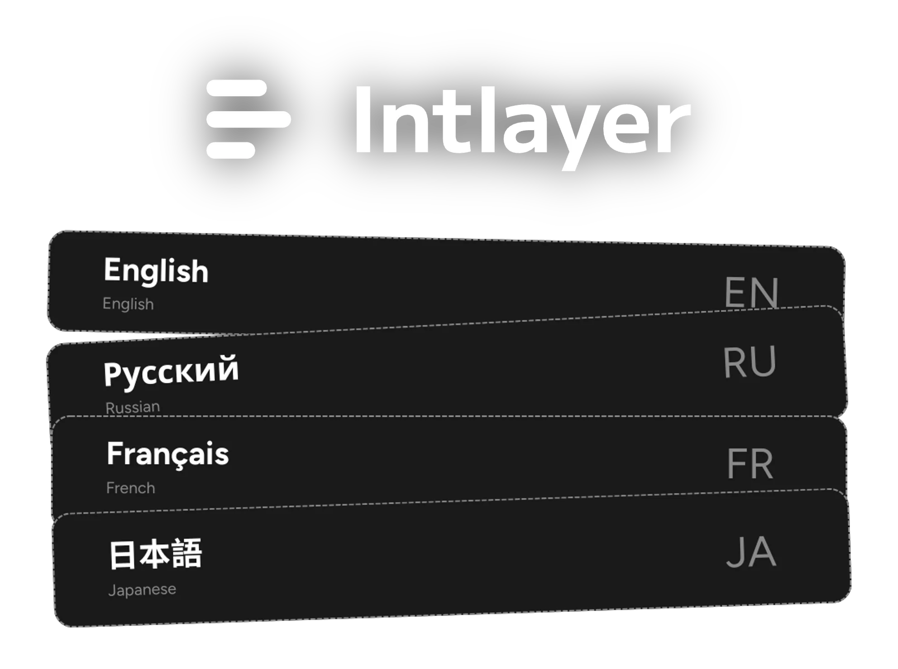
  </a>
</p>

<h1 align="center">
  <strong>בינאום מבוסס רכיב (Per-component i18n)</strong>
</h1>
<h2 align="center">
  <strong>תרגום מבוסס AI. עורך ויזואלי. CMS רב-לשוני.</strong>
</h2>

<br />

<p align="center">
  <a href="https://github.com/aymericzip/intlayer/blob/main/docs/docs/he/dictionary/content_file.md" rel="">תיעוד</a> •
  <a href="https://github.com/aymericzip/intlayer/blob/main/docs/docs/he/intlayer_with_nextjs_16.md" rel="">Next.js</a> •
  <a href="https://github.com/aymericzip/intlayer/blob/main/docs/docs/he/intlayer_with_vite+react.md" rel="">React + Vite</a> •
  <a href="https://github.com/aymericzip/intlayer/blob/main/docs/docs/he/intlayer_CMS.md" rel="">CMS</a> •
  <a href="https://discord.gg/7uxamYVeCk" rel="noopener noreferrer nofollow">דיסקורד</a>
</p>
<p align="center" style="margin-top:15px;">
  <a href="https://www.npmjs.com/package/intlayer" target="_blank" rel="noopener noreferrer nofollow"></a>
  <a href="https://github.com/aymericzip/intlayer/stargazers" target="_blank" rel="noopener noreferrer nofollow"></a>
  <a href="https://www.npmjs.org/package/intlayer" target="_blank" rel="noopener noreferrer nofollow"></a>
  <a href="https://github.com/aymericzip/intlayer/blob/main/LICENSE" target="_blank" rel="noopener noreferrer nofollow"></a>
  <a href="https://github.com/aymericzip/intlayer/commits/main" target="_blank" rel="noopener noreferrer nofollow">
  </a>
</p>


<a href="https://github.com/aymericzip/intlayer/blob/main/docs/docs/he/dictionary/content_file.md" rel="">
  
</a>

## מה זה Intlayer?

מרבית ספריות ה-i18n הן מורכבות מדי, קשיחות מדי, או שלא נבנו עבור סביבות פיתוח מודרניות.

Intlayer הוא **פתרון i18n מודרני** עבור יישומי ווב ומובייל.  
הוא אגנוסטי ל-frameworks, **מופעל על ידי AI**, וכולל **CMS ועורך ויזואלי** בחינם.

עם **קובצי תוכן לכל שפה (per-locale)**, **השלמה אוטומטית ב-TypeScript**, **מילונים תומכי Tree-shaking** ו**אינטגרציית CI/CD**, Intlayer הופך את תהליך הבינאום ל**מהיר, נקי וחכם יותר**.

## יתרונות מרכזיים של Intlayer:

| תכונה                                                                                                                                               | תיאור                                                                                                                                                                                                                                                                                                                                                                                                                                                                                                                                                                                                                                                                                                                                                       |
| --------------------------------------------------------------------------------------------------------------------------------------------------- | ----------------------------------------------------------------------------------------------------------------------------------------------------------------------------------------------------------------------------------------------------------------------------------------------------------------------------------------------------------------------------------------------------------------------------------------------------------------------------------------------------------------------------------------------------------------------------------------------------------------------------------------------------------------------------------------------------------------------------------------------------------- |
| 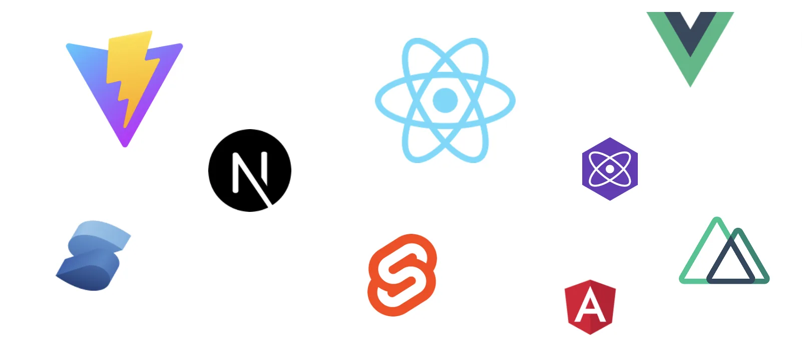                         | **תמיכה חוצת סביבות עבודה (Cross-Frameworks)**<br><br>Intlayer תואם לכל ה-frameworks והספריות המובילים, כולל Next.js, React, Vite, Vue.js, Nuxt, Preact, Express ועוד.                                                                                                                                                                                                                                                                                                                                                                                                                                                                                                                                                                                      |
| 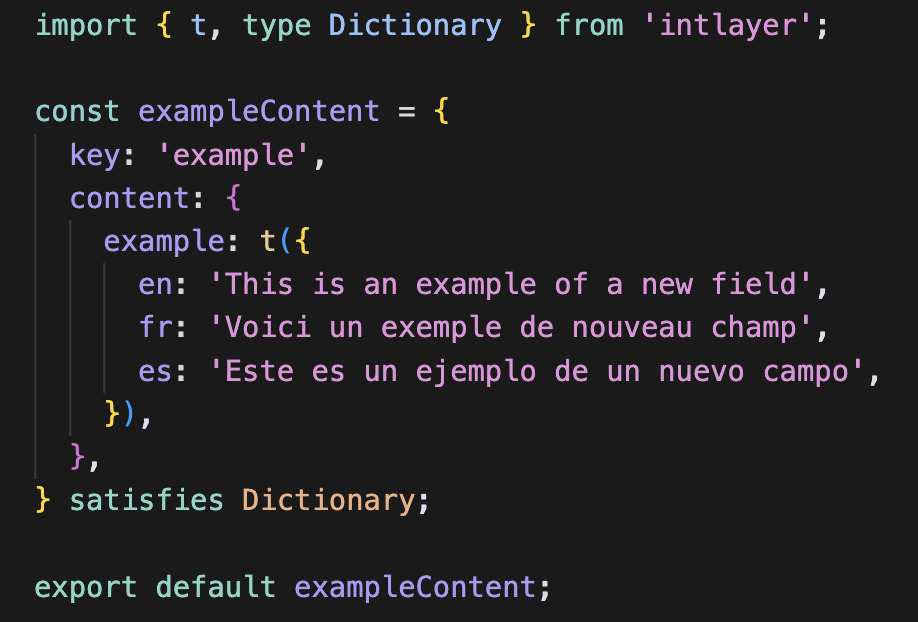       | **ניהול תוכן מבוסס JavaScript**<br><br>נצלו את הגמישות של JavaScript כדי להגדיר ולנהל את התוכן שלכם ביעילות.<br><br> - [הצהרת תוכן](https://github.com/aymericzip/intlayer/blob/main/docs/docs/he/dictionary/content_file.md)                                                                                                                                                                                                                                                                                                                                                                                                                                                                                                                               |
| 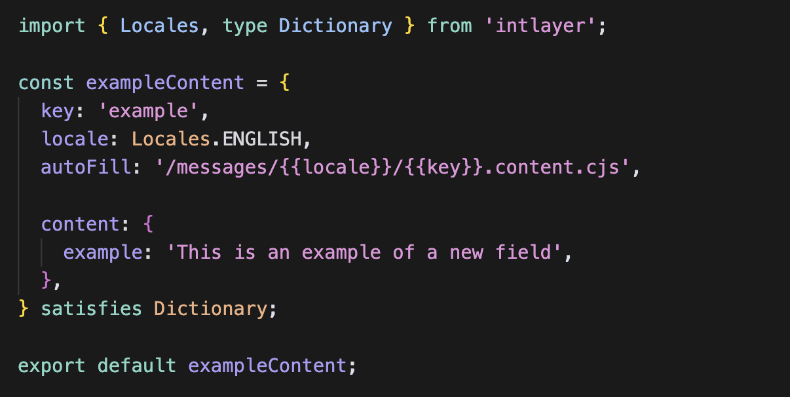 | **קובץ הצהרת תוכן לפי שפה (Per-Locale)**<br><br>האיצו את הפיתוח על ידי הצהרת התוכן פעם אחת, לפני יצירה אוטומטית.<br><br> - [קובץ הצהרת תוכן לפי שפה](https://github.com/aymericzip/intlayer/blob/main/docs/docs/he/per_locale_file.md)                                                                                                                                                                                                                                                                                                                                                                                                                                                                                                                      |
|                            | **קומפיילר (Compiler)**<br><br>הקומפיילר של Intlayer מחלץ אוטומטית את התוכן מהרכיבים ומייצר את קובצי המילון.<br><br> - [קומפיילר](https://github.com/aymericzip/intlayer/blob/main/docs/docs/he/compiler.md)                                                                                                                                                                                                                                                                                                                                                                                                                                                                                                                                                |
|                       | **סביבה בטוחה מסוגים (Type-Safe Environment)**<br><br>השתמשו ב-TypeScript כדי להבטיח שהגדרות התוכן והקוד שלכם נקיים משגיאות, תוך הנאה מהשלמה אוטומטית ב-IDE.<br><br> - [הגדרת TypeScript](https://github.com/aymericzip/intlayer/blob/main/docs/docs/he/intlayer_with_vite+react.md#configure-typescript)                                                                                                                                                                                                                                                                                                                                                                                                                                                   |
| 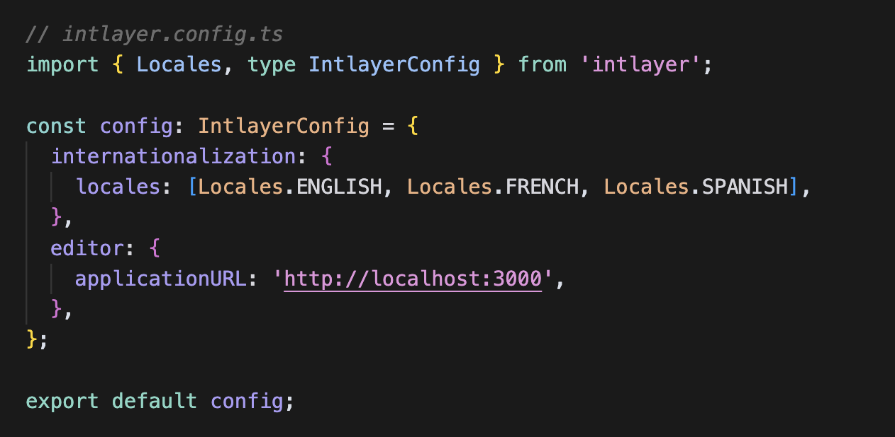                         | **הגדרה פשוטה ומהירה**<br><br>התחילו לעבוד במהירות עם תצורה מינימלית. התאימו בקלות הגדרות עבור בינאום, ניתוב, AI, בנייה וניהול תוכן.<br><br> - [גלו את השילוב עם Next.js](https://github.com/aymericzip/intlayer/blob/main/docs/docs/he/intlayer_with_nextjs_16.md)                                                                                                                                                                                                                                                                                                                                                                                                                                                                                         |
| 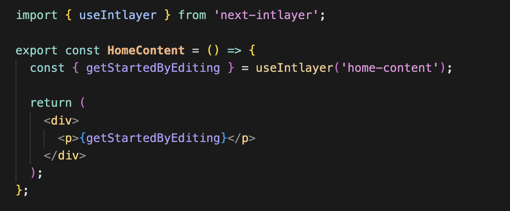                   | **אחזור תוכן פשוט**<br><br>אין צורך לקרוא לפונקציית ה-`t` שלכם עבור כל פריט תוכן בנפרד. שלפו את כל התוכן ישירות באמצעות hook יחיד.<br><br> - [שילוב עם React](https://github.com/aymericzip/intlayer/blob/main/docs/docs/he/intlayer_with_create_react_app.md)                                                                                                                                                                                                                                                                                                                                                                                                                                                                                              |
| 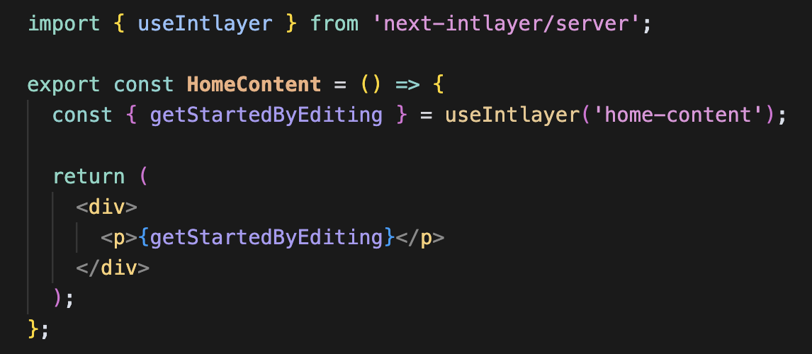                    | **מימוש עקבי ברכיבי שרת (Server Components)**<br><br>מותאם בצורה מושלמת לרכיבי שרת של Next.js, השתמשו באותו המימוש הן ברכיבי לקוח והן ברכיבי שרת, ללא צורך להעביר את פונקציית ה-`t` בין רכיבי השרת השונים.<br><br> - [רכיבי שרת](https://github.com/aymericzip/intlayer/blob/main/docs/docs/he/intlayer_with_nextjs_16.md#step-7-utilize-content-in-your-code)                                                                                                                                                                                                                                                                                                                                                                                              |
| 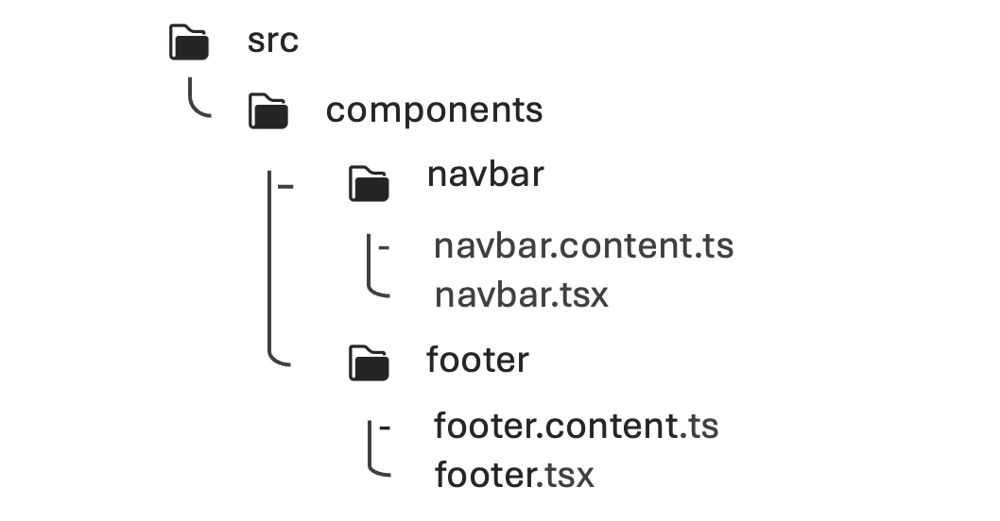                           | **בסיס קוד מאורגן ומסודר**<br><br>שמרו על בסיס קוד מאורגן יותר: רכיב 1 = מילון 1 באותה התיקייה. תרגומים קרובים לרכיבים המתאימים להם משפרים את התחזוקתיות והבהירות.<br><br> - [כיצד Intlayer עובד](https://github.com/aymericzip/intlayer/blob/main/docs/docs/he/how_works_intlayer.md)                                                                                                                                                                                                                                                                                                                                                                                                                                                                      |
| 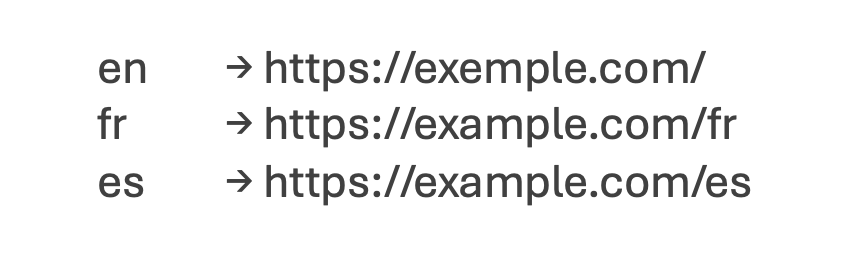                         | **ניתוב משופר (Enhanced Routing)**<br><br>תמיכה מלאה בניתוב אפליקציה, תוך הסתגלות חלקה למבני יישומים מורכבים עבור Next.js, React, Vite, Vue.js ועוד.<br><br> - [גלו את השילוב עם Next.js](https://github.com/aymericzip/intlayer/blob/main/docs/docs/he/intlayer_with_nextjs_16.md)                                                                                                                                                                                                                                                                                                                                                                                                                                                                         |
| 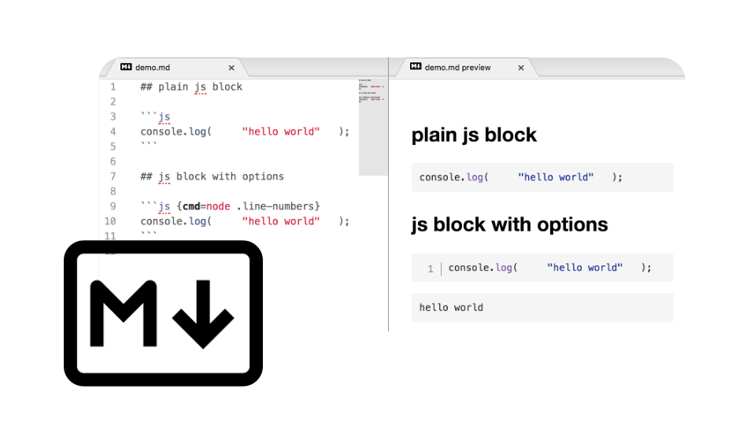                            | **תמיכה ב-Markdown**<br><br>ייבאו ופענחו קובצי שפה ו-Markdown מרוחק עבור תוכן רב-לשוני כגון מדיניות פרטיות, תיעוד ועוד. פענחו והפכו מטא-נתונים של Markdown לנגישים בקוד שלכם.<br><br> - [קובצי תוכן](https://github.com/aymericzip/intlayer/blob/main/docs/docs/he/dictionary/file.md)                                                                                                                                                                                                                                                                                                                                                                                                                                                                      |
| 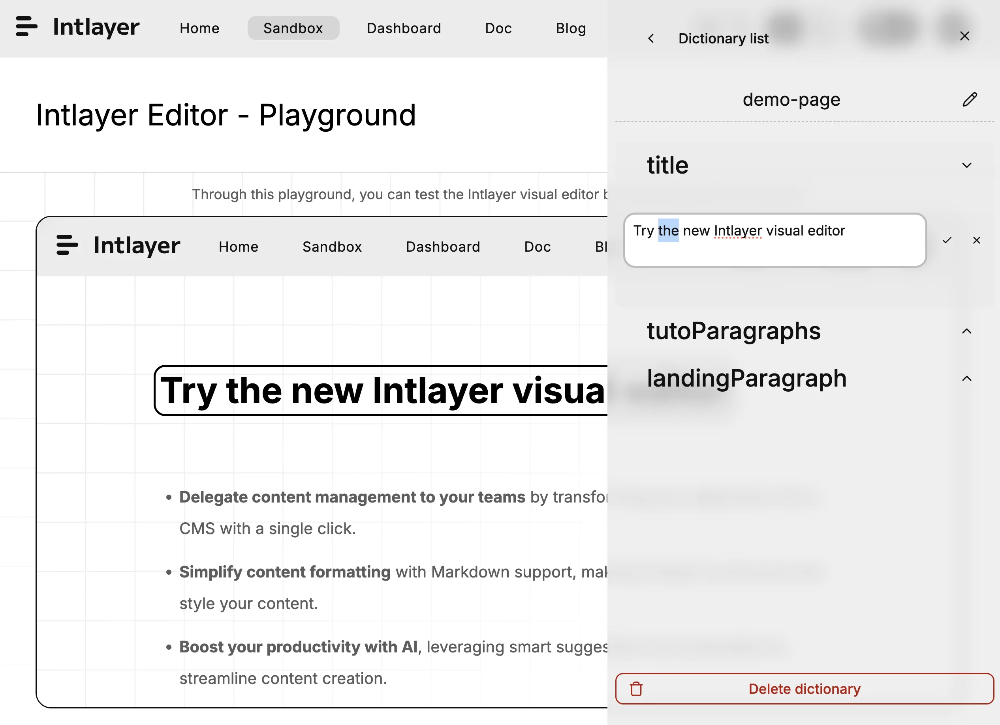                      | **עורך ויזואלי ו-CMS חינמיים**<br><br>עורך ויזואלי ו-CMS חינמיים זמינים לכותבי תוכן, מה שמייתר את הצורך בפלטפורמת לוקליזציה חיצונית. שמרו על התוכן שלכם מסונכרן באמצעות Git, או הוציאו אותו באופן מלא או חלקי לניהול ב-CMS.<br><br> - [עורך Intlayer](https://github.com/aymericzip/intlayer/blob/main/docs/docs/he/intlayer_visual_editor.md)<br> - [Intlayer CMS](https://github.com/aymericzip/intlayer/blob/main/docs/docs/he/intlayer_CMS.md)                                                                                                                                                                                                                                                                                                          |
| 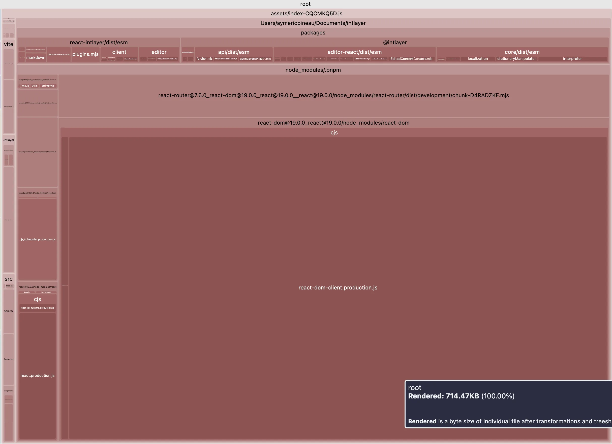                             | **תוכן תומך Tree-shaking**<br><br>תוכן תומך Tree-shaking מקטין את גודל ה-bundle הסופי. טוען תוכן לפי רכיב, ומחריג כל תוכן שאינו בשימוש מה-bundle שלכם. תומך בטעינה עצלה (lazy loading) כדי לשפר את יעילות טעינת האפליקציה.<br><br> - [אופטימיזציית build של האפליקציה](https://github.com/aymericzip/intlayer/blob/main/docs/docs/he/how_works_intlayer.md#app-build-optimization)                                                                                                                                                                                                                                                                                                                                                                          |
| 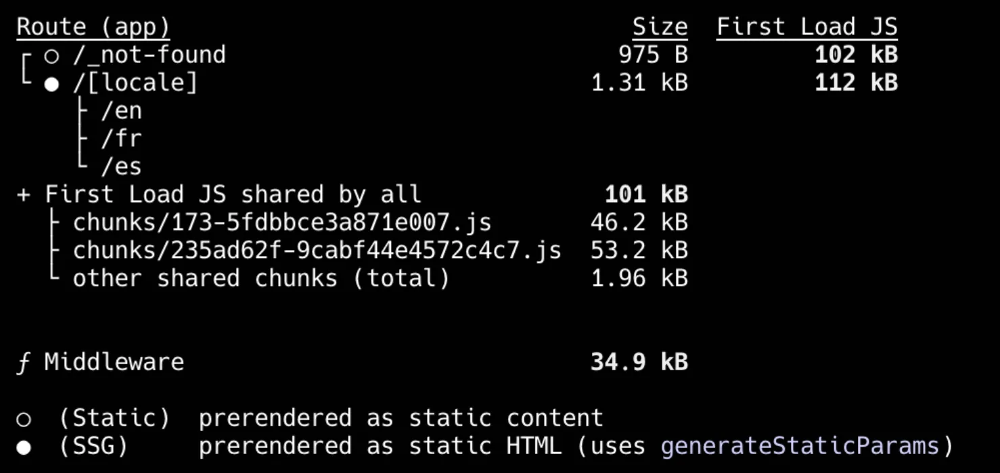                   | **רינדור סטטי (Static Rendering)**<br><br>אינו חוסם רינדור סטטי כלל.<br><br> - [שילוב עם Next.js](https://github.com/aymericzip/intlayer/blob/main/docs/docs/he/intlayer_with_nextjs_16.md)                                                                                                                                                                                                                                                                                                                                                                                                                                                                                                                                                                 |
| 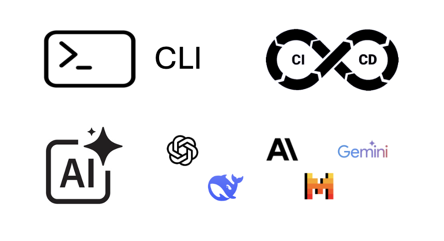                      | **תרגום מבוסס בינה מלאכותית (AI)**<br><br>הפכו את האתר שלכם לזמין ב-231 שפות בלחיצה אחת בלבד באמצעות כלי התרגום המתקדמים מבוססי ה-AI של Intlayer, תוך שימוש בספק ה-AI או מפתח ה-API שלכם.<br><br> - [אינטגרציית CI/CD](https://github.com/aymericzip/intlayer/blob/main/docs/docs/he/CI_CD.md)<br> - [Intlayer CLI](https://github.com/aymericzip/intlayer/blob/main/docs/docs/he/cli/index.md)<br> - [מילוי אוטומטי (Auto fill)](https://github.com/aymericzip/intlayer/blob/main/docs/docs/he/autoFill.md)                                                                                                                                                                                                                                                |
| 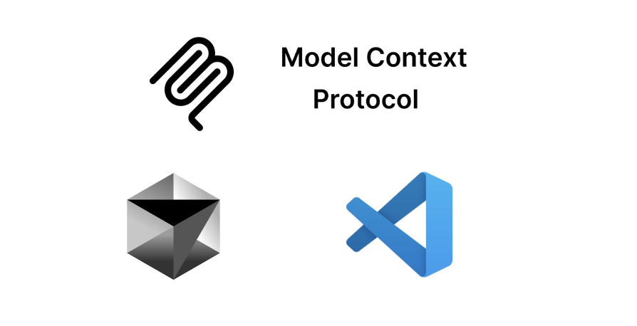                                 | **אינטגרציית שרת MCP**<br><br>מספק שרת MCP (פרוטוקול Model Context) לאוטומציה בסביבת הפיתוח (IDE), מה שמאפשר ניהול תוכן חופשי מתקלות ותהליכי עבודה של i18n ישירות מתוך סביבת הפיתוח שלכם.<br><br> - [שרת MCP](https://github.com/aymericzip/intlayer/blob/main/docs/docs/he/mcp_server.md)                                                                                                                                                                                                                                                                                                                                                                                                                                                                  |
| 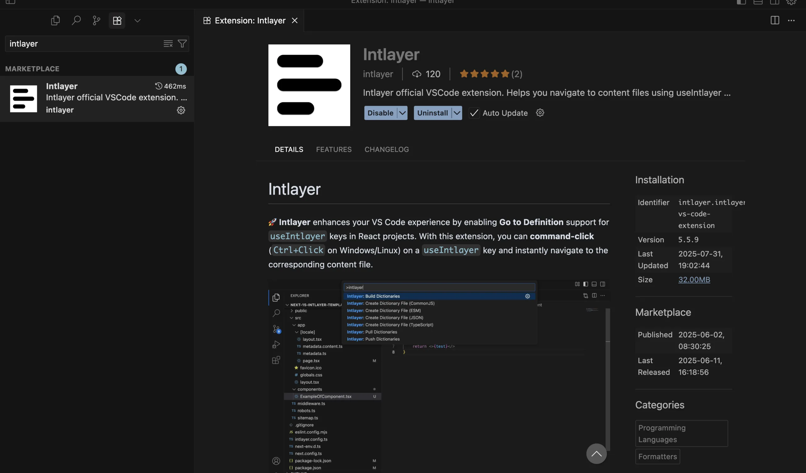                   | **הרחבה ל-VSCode**<br><br>Intlayer מספק הרחבה ל-VSCode כדי לעזור לכם לנהל את התוכן והתרגומים שלכם, לבנות את המילונים שלכם, לתרגם את התוכן שלכם ועוד.<br><br> - [הרחבת VSCode](https://github.com/aymericzip/intlayer/blob/main/docs/docs/he/vs_code_extension.md)                                                                                                                                                                                                                                                                                                                                                                                                                                                                                           |
| 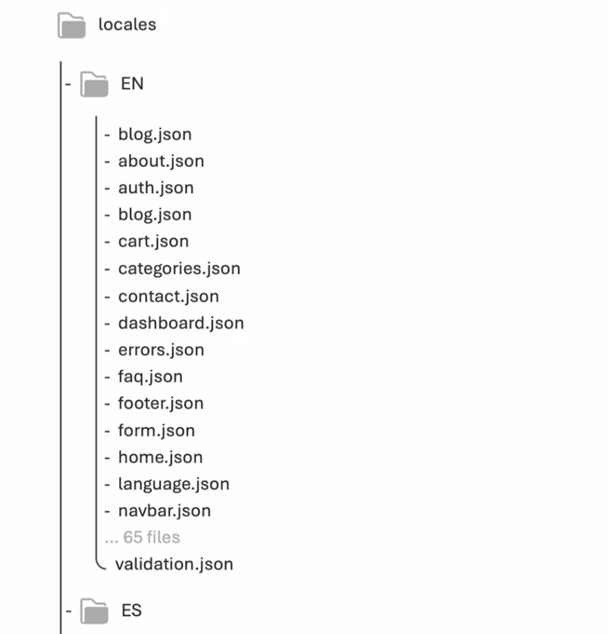                    | **יכולת פעולה הדדית (Interoperability)**<br><br>מאפשר אינטגרציה חלקה עם react-i18next, next-i18next, next-intl, react-intl, vue-i18n.<br><br> - [Intlayer ו-react-intl](https://github.com/aymericzip/intlayer/blob/main/docs/blog/he/intlayer_with_react-intl.md)<br> - [Intlayer ו-next-intl](https://github.com/aymericzip/intlayer/blob/main/docs/blog/he/intlayer_with_next-intl.md)<br> - [Intlayer ו-next-i18next](https://github.com/aymericzip/intlayer/blob/main/docs/blog/he/intlayer_with_next-i18next.md)<br> - [Intlayer ו-vue-i18n](https://github.com/aymericzip/intlayer/blob/main/docs/blog/he/intlayer_with_vue-i18n.md)<br> - [מתאמי תאימות של Intlayer](https://github.com/aymericzip/intlayer/blob/main/docs/docs/he/compat/index.md) |
| 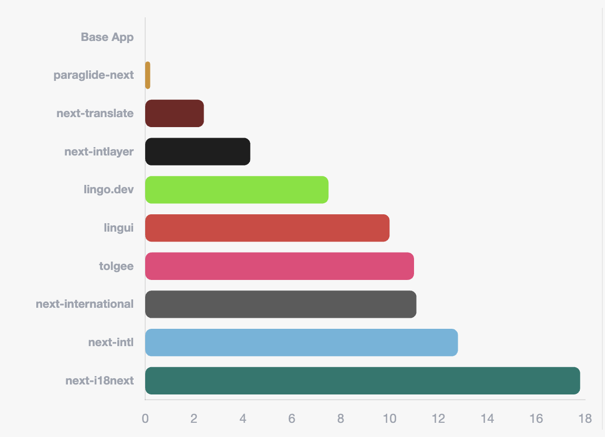                           | **ביצועים ומבחני השוואה (Benchmark)**<br><br>משתמש ב-tree-shaking מתקדם ובטעינה דינמית כדי להאיץ ביצועים ולשמור על הפתרון קל ככל האפשר.<br><br> - [ביצועים ומבחני השוואה](https://github.com/aymericzip/intlayer/blob/main/docs/docs/he/benchmark/index.md)                                                                                                                                                                                                                                                                                                                                                                                                                                                                                                 |

## 📦 התקנה

התחילו את המסע שלכם עם Intlayer עוד היום ותיהנו מגישה חלקה ועוצמתית יותר לבינאום.

<a href="https://github.com/aymericzip/intlayer/blob/main/docs/docs/he/dictionary/content_file.md" rel="">
  
</a>

```bash packageManager="npm"
npm install intlayer react-intlayer
```

```bash packageManager="yarn"
yarn add intlayer react-intlayer
```

```bash packageManager="pnpm"
pnpm add intlayer react-intlayer
```

```bash packageManager="bun"
bun add intlayer react-intlayer
```

⚡ התחלה מהירה (Next.js)

```ts
// intlayer.config.ts
import { Locales, type IntlayerConfig } from "intlayer";

const config: IntlayerConfig = {
  internationalization: {
    locales: [Locales.ENGLISH, Locales.FRENCH, Locales.SPANISH],
    defaultLocale: Locales.ENGLISH,
  },
};

export default config;
```

```ts
// app/home.content.ts
import { t, type Dictionary } from "intlayer";

const content = {
  key: "home",
  content: {
    title: t({
      he: "בית",
      en: "Home",
      fr: "Accueil",
      es: "Inicio",
    }),
  },
} satisfies Dictionary;

export default content;
```

```tsx
// app/page.tsx
import { useIntlayer } from "react-intlayer";

const HomePage = () => {
  const { title } = useIntlayer("home");

  return <h1>{title}</h1>;
};
```

<a href="https://github.com/aymericzip/intlayer/blob/main/docs/docs/he/intlayer_with_nextjs_16.md"> קבלו את המדריך המלא ← </a>

## 🎥 הדרכה חיה ב-YouTube

[](https://youtu.be/e_PPG7PTqGU?si=GyU_KpVhr61razRw)

<a href="https://github.com/aymericzip/intlayer/blob/main/docs/docs/he/dictionary/content_file.md" rel="">
  
</a>

## תוכן עניינים

גלו את התיעוד המקיף שלנו כדי להתחיל עם Intlayer וללמוד כיצד לשלב אותו בפרויקטים שלכם.

<details open>
<summary style="font-size:16px; font-weight:bold;">📘 התחלת עבודה</summary>
<ul>
  <li><a href="https://github.com/aymericzip/intlayer/blob/main/docs/docs/he/interest_of_intlayer.md" rel=''>למה Intlayer?</a></li>
  <li><a href="https://github.com/aymericzip/intlayer/blob/main/docs/docs/he/introduction.md" rel=''>מבוא</a></li>
</ul>
</details>

<details>
<summary style="font-size:16px; font-weight:bold;">⚙️ קונספט</summary>
<ul>
  <li><a href="https://github.com/aymericzip/intlayer/blob/main/docs/docs/he/how_works_intlayer.md" rel=''>כיצד עובד Intlayer</a></li>
  <li><a href="https://github.com/aymericzip/intlayer/blob/main/docs/docs/he/configuration.md" rel=''>תצורה (Configuration)</a></li>
  <li><a href="https://github.com/aymericzip/intlayer/blob/main/docs/docs/he/cli/index.md" rel=''>Intlayer CLI</a></li>
  <li><a href="https://github.com/aymericzip/intlayer/blob/main/docs/docs/he/compiler.md" rel=''>קומפיילר</a></li>

  <li><a href="https://github.com/aymericzip/intlayer/blob/main/docs/docs/he/intlayer_visual_editor.md" rel=''>עורך Intlayer</a></li>
  <li><a href="https://github.com/aymericzip/intlayer/blob/main/docs/docs/he/intlayer_CMS.md" rel=''>Intlayer CMS</a></li>
  <li><a href="https://github.com/aymericzip/intlayer/blob/main/docs/docs/he/dictionary/content_file.md" rel=''>מילון</a>
    <ul>
      <li><a href="https://github.com/aymericzip/intlayer/blob/main/docs/docs/he/per_locale_file.md" rel=''>קובץ הצהרת תוכן לפי שפה</a></li>
      <li><a href="https://github.com/aymericzip/intlayer/blob/main/docs/docs/he/dictionary/translation.md" rel=''>תרגום</a></li>
      <li><a href="https://github.com/aymericzip/intlayer/blob/main/docs/docs/he/dictionary/enumeration.md" rel=''>ספירה (Enumeration)</a></li>
      <li><a href="https://github.com/aymericzip/intlayer/blob/main/docs/docs/he/dictionary/condition.md" rel=''>תנאי (Condition)</a></li>
      <li><a href="https://github.com/aymericzip/intlayer/blob/main/docs/docs/he/dictionary/nesting.md" rel=''>קינון (Nesting)</a></li>
      <li><a href="https://github.com/aymericzip/intlayer/blob/main/docs/docs/he/dictionary/markdown.md" rel=''>Markdown</a></li>
      <li><a href="https://github.com/aymericzip/intlayer/blob/main/docs/docs/he/dictionary/function_fetching.md" rel=''>שליפה באמצעות פונקציה (Function Fetching)</a></li>
      <li><a href="https://github.com/aymericzip/intlayer/blob/main/docs/docs/he/dictionary/insertion.md" rel=''>שיבוץ משתנים (Insertion)</a></li>
      <li><a href="https://github.com/aymericzip/intlayer/blob/main/docs/docs/he/dictionary/file.md" rel=''>קובץ</a></li>
    </ul>
  </li>
</ul>
</details>

<details open>
<summary style="font-size:16px; font-weight:bold;">🌐 סביבות פיתוח וספריות</summary>
<ul>
  <li><a href="https://github.com/aymericzip/intlayer/blob/main/docs/docs/he/intlayer_with_nextjs_16.md" rel=''>Intlayer עם Next.js 16</a>
    <ul>
      <li><a href="https://github.com/aymericzip/intlayer/blob/main/docs/docs/he/intlayer_with_nextjs_15.md" rel=''>Next.js 15</a></li>
      <li><a href="https://github.com/aymericzip/intlayer/blob/main/docs/docs/he/intlayer_with_nextjs_14.md" rel=''>Next.js 14 (App Router)</a></li>
      <li><a href="https://github.com/aymericzip/intlayer/blob/main/docs/docs/he/intlayer_with_nextjs_page_router.md" rel=''>Next.js Page Router</a></li>
    </ul>
  </li>
  <li><a href="https://github.com/aymericzip/intlayer/blob/main/docs/docs/he/intlayer_with_vite+react.md" rel=''>Vite + React</a></li>
  <li><a href="https://github.com/aymericzip/intlayer/blob/main/docs/docs/he/intlayer_with_react_router_v7.md" rel=''>React-router-v7</a></li>
  <li><a href="https://github.com/aymericzip/intlayer/blob/main/docs/docs/he/intlayer_with_remix_3.md" rel=''>Remix 3</a></li>
  <li><a href="https://github.com/aymericzip/intlayer/blob/main/docs/docs/he/intlayer_with_tanstack.md" rel=''>Tanstack start</a>
    <ul>
      <li><a href="https://github.com/aymericzip/intlayer/blob/main/docs/docs/he/intlayer_with_tanstack+solid.md" rel=''>Solid</a></li>
    </ul>
  </li>
  <li><a href="https://github.com/aymericzip/intlayer/blob/main/docs/docs/he/intlayer_with_astro.md" rel=''>Astro</a>
    <ul>
      <li><a href="https://github.com/aymericzip/intlayer/blob/main/docs/docs/he/intlayer_with_astro_react.md" rel=''>React</a></li>
      <li><a href="https://github.com/aymericzip/intlayer/blob/main/docs/docs/he/intlayer_with_astro_vue.md" rel=''>Vue</a></li>
      <li><a href="https://github.com/aymericzip/intlayer/blob/main/docs/docs/he/intlayer_with_astro_svelte.md" rel=''>Svelte</a></li>
      <li><a href="https://github.com/aymericzip/intlayer/blob/main/docs/docs/he/intlayer_with_astro_solid.md" rel=''>Solid</a></li>
      <li><a href="https://github.com/aymericzip/intlayer/blob/main/docs/docs/he/intlayer_with_astro_lit.md" rel=''>Lit</a></li>
    </ul>
  </li>

  <li><a href="https://github.com/aymericzip/intlayer/blob/main/docs/docs/he/intlayer_with_react_native+expo.md" rel=''>React Native</a></li>
  <li><a href="https://github.com/aymericzip/intlayer/blob/main/docs/docs/he/intlayer_with_vite+svelte.md" rel=''>Vite + Svelte</a></li>
  <li><a href="https://github.com/aymericzip/intlayer/blob/main/docs/docs/he/intlayer_with_svelte_kit.md" rel=''>SvelteKit</a></li>
  <li><a href="https://github.com/aymericzip/intlayer/blob/main/docs/docs/he/intlayer_with_vite+preact.md" rel=''>Vite + Preact</a></li>
  <li><a href="https://github.com/aymericzip/intlayer/blob/main/docs/docs/he/intlayer_with_vite+vue.md" rel=''>Vite + Vue</a></li>
  <li><a href="https://github.com/aymericzip/intlayer/blob/main/docs/docs/he/intlayer_with_nuxt.md" rel=''>Vite + Nuxt</a></li>
  <li><a href="https://github.com/aymericzip/intlayer/blob/main/docs/docs/he/intlayer_with_vite+solid.md" rel=''>Vite + Solid</a></li>
  <li><a href="https://github.com/aymericzip/intlayer/blob/main/docs/docs/he/intlayer_with_vite+lit.md" rel=''>Vite + Lit</a></li>
  <li><a href="https://github.com/aymericzip/intlayer/blob/main/docs/docs/he/intlayer_with_angular_21.md" rel=''>Angular</a></li>
  <li>
     <a href="https://github.com/aymericzip/intlayer/blob/main/docs/docs/he/intlayer_with_express.md" rel=''>Backend</a>
     <ul>
      <li><a href="https://github.com/aymericzip/intlayer/blob/main/docs/docs/he/intlayer_with_express.md" rel=''>Express</a></li>
      <li><a href="https://github.com/aymericzip/intlayer/blob/main/docs/docs/he/intlayer_with_nestjs.md" rel=''>NestJS</a></li>
      <li><a href="https://github.com/aymericzip/intlayer/blob/main/docs/docs/he/intlayer_with_fastify.md" rel=''>Fastify</a></li>
      <li><a href="https://github.com/aymericzip/intlayer/blob/main/docs/docs/he/intlayer_with_adonisjs.md" rel=''>AdonisJS</a></li>
      <li><a href="https://github.com/aymericzip/intlayer/blob/main/docs/docs/he/intlayer_with_hono.md" rel=''>Hono</a></li>
      <li><a href="https://github.com/aymericzip/intlayer/blob/main/docs/docs/he/intlayer_with_elysia.md" rel=''>Elysia</a></li>
    </ul>
  </li>
</ul>
</details>

<details>
<summary style="font-size:16px; font-weight:bold;">📊 מבחני השוואה (Benchmark)</summary>
<ul>
  <li><a href="https://github.com/aymericzip/intlayer/blob/main/docs/docs/he/benchmark/nextjs.md" rel=''>Next.js</a></li>
  <li><a href="https://github.com/aymericzip/intlayer/blob/main/docs/docs/he/benchmark/tanstack.md" rel=''>TanStack Start</a></li>
  <li><a href="https://github.com/aymericzip/intlayer/blob/main/docs/docs/he/benchmark/vue.md" rel=''>Vue</a></li>
  <li><a href="https://github.com/aymericzip/intlayer/blob/main/docs/docs/he/benchmark/solid.md" rel=''>Solid</a></li>
  <li><a href="https://github.com/aymericzip/intlayer/blob/main/docs/docs/he/benchmark/svelte.md" rel=''>Svelte</a></li>
</ul>
</details>

<details>
<summary style="font-size:16px; font-weight:bold;">📰 בלוג</summary>
<ul>
  <li><a href="https://github.com/aymericzip/intlayer/blob/main/docs/blog/he/what_is_internationalization.md" rel=''>מה זה בינאום (i18n)</a></li>
  <li><a href="https://github.com/aymericzip/intlayer/blob/main/docs/blog/he/internationalization_and_SEO.md" rel=''>בינאום ו-SEO</a></li>
  <li><a href="https://github.com/aymericzip/intlayer/blob/main/docs/blog/he/intlayer_with_next-i18next.md" rel=''>Intlayer ו-i18next</a></li>
  <li><a href="https://github.com/aymericzip/intlayer/blob/main/docs/blog/he/intlayer_with_react-i18next.md" rel=''>Intlayer ו-react-intl</a></li>
  <li><a href="https://github.com/aymericzip/intlayer/blob/main/docs/blog/he/intlayer_with_next-intl.md" rel=''>Intlayer ו-next-intl</a></li>
</ul>
</details>

## מערכת ניהול תוכן רב-לשונית

יותר מסתם ספריית i18n, Intlayer הוא **מערכת ניהול תוכן רב-לשונית (CMS)** שלמה. מערכת CMS מלאה זמינה בחינם ב-[app.intlayer.org](https://app.intlayer.org).

Intlayer מחבר בין **מפתחים**, **אנשי תוכן ושיווק** ו**סוכני AI** בתהליך עבודה אחד ליצירה ותחזוקה של אתרים רב-לשוניים ללא מאמץ. Intlayer מחליף את ה-stack הבא בפתרון יחיד:

- פתרונות i18n (כגון `i18next`, `next-intl`, `vue-i18n`)
- מערכות ניהול תרגום (TMS - Translation Management Systems) (כגון Crowdin, Phrase, Lokalise)
- מערכות ניהול תוכן Headless (כגון Contentful, Strapi, Sanity)

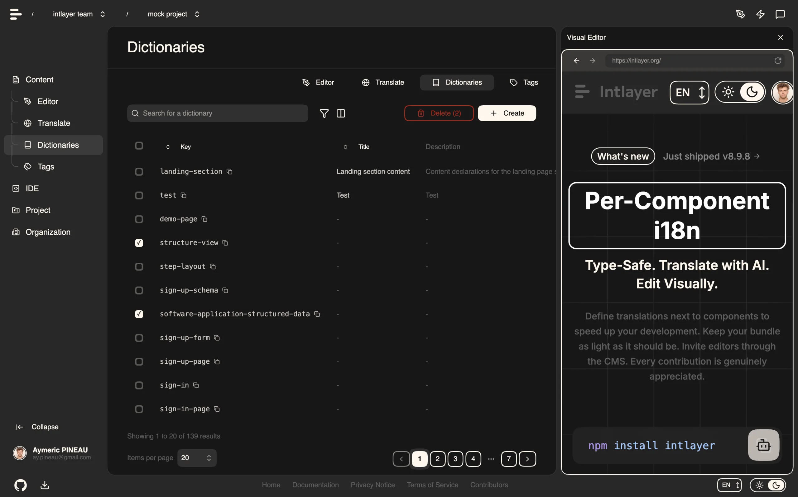

## 🌐 Readme בשפות אחרות

<p align="center">
  <a href="https://github.com/aymericzip/intlayer/blob/main/README.md">English</a> •
  <a href="https://github.com/aymericzip/intlayer/blob/main/docs/docs/zh/readme.md">简体中文</a> •
  <a href="https://github.com/aymericzip/intlayer/blob/main/docs/docs/ru/readme.md">Русский</a> •
  <a href="https://github.com/aymericzip/intlayer/blob/main/docs/docs/ja/readme.md">日本語</a> •
  <a href="https://github.com/aymericzip/intlayer/blob/main/docs/docs/fr/readme.md">Français</a> •
  <a href="https://github.com/aymericzip/intlayer/blob/main/docs/docs/ko/readme.md">한국어</a> •
  <a href="https://github.com/aymericzip/intlayer/blob/main/docs/docs/es/readme.md">Español</a> •
  <a href="https://github.com/aymericzip/intlayer/blob/main/docs/docs/de/readme.md">Deutsch</a> •
  <a href="https://github.com/aymericzip/intlayer/blob/main/docs/docs/ar/readme.md">العربية</a> •
  <a href="https://github.com/aymericzip/intlayer/blob/main/docs/docs/it/readme.md">Italiano</a> •
  <a href="https://github.com/aymericzip/intlayer/blob/main/docs/docs/en-GB/readme.md">English (UK)</a> •
  <a href="https://github.com/aymericzip/intlayer/blob/main/docs/docs/pt/readme.md">Português</a> •
  <a href="https://github.com/aymericzip/intlayer/blob/main/docs/docs/hi/readme.md">हिन्दी</a> •
  <a href="https://github.com/aymericzip/intlayer/blob/main/docs/docs/tr/readme.md">Türkçe</a>
</p>

## 🤝 קהילה

Intlayer נבנה יחד עם ולמען הקהילה, ונשמח מאוד למשוב ולתרומה שלכם!

- יש לכם הצעה? [פתחו issue](https://github.com/aymericzip/intlayer/issues)
- מצאתם באג או שיפור? [הגישו PR](https://github.com/aymericzip/intlayer/pulls)
- צריכים עזרה או רוצים לשוחח? [הצטרפו לדיסקורד שלנו](https://discord.gg/7uxamYVeCk)

אתם מוזמנים גם לעקוב אחרינו ב:

  <div>
    <br/>
    <p align="center">
      <a href="https://discord.gg/528mBV4N" target="blank" rel='noopener noreferrer nofollow'></a>
      <a href="https://www.linkedin.com/company/intlayerorg" target="blank" rel='noopener noreferrer nofollow'></a>
      <a href="https://www.instagram.com/intlayer/" target="blank" rel='noopener noreferrer nofollow'></a>
      <a href="https://x.com/Intlayer183096" target="blank" rel='noopener noreferrer nofollow'></a>
      <a href="https://www.youtube.com/@intlayer" target="blank" rel='noopener noreferrer nofollow'></a>
      <a href="https://www.tiktok.com/@intlayer" target="blank" rel='noopener noreferrer nofollow'></a>
      <br>
    </p>
</div>

### תרומה לפרויקט (Contribution)

להנחיות מפורטות יותר בנושא תרומה לפרויקט זה, עיינו בקובץ [`CONTRIBUTING.md`](https://github.com/aymericzip/intlayer/blob/main/CONTRIBUTING.md). הוא מכיל מידע חיוני על תהליך הפיתוח שלנו, מוסכמות הודעות commit ותהליכי גרסאות ושחרור (release). התרומות שלכם יקרות לנו, ואנו מעריכים את המאמצים שלכם לשפר את הפרויקט הזה!

תרמו ב-[GitHub](https://github.com/aymericzip/intlayer), [GitLab](https://gitlab.com/ay.pineau/intlayer) או [Bitbucket](https://bitbucket.org/intlayer/intlayer/).

### תודה רבה על התמיכה

אם אתם אוהבים את Intlayer, תנו לנו ⭐ ב-GitHub. זה עוזר לאחרים לגלות את הפרויקט! [ראו מדוע כוכבי GitHub חשובים](https://github.com/aymericzip/intlayer/blob/main/CONTRIBUTING.md#why-github-stars-matter-).

[](https://star-history.com/#aymericzip/intlayer&Date)
