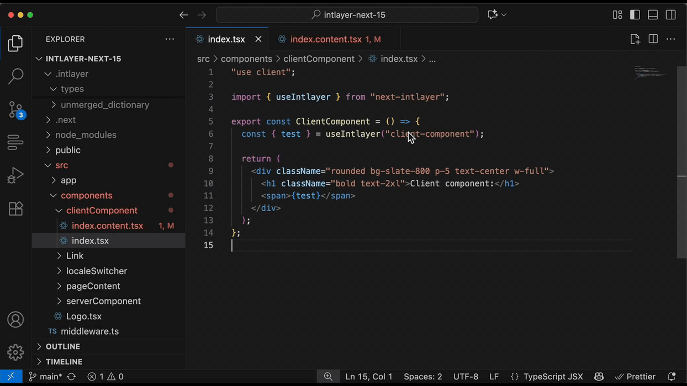
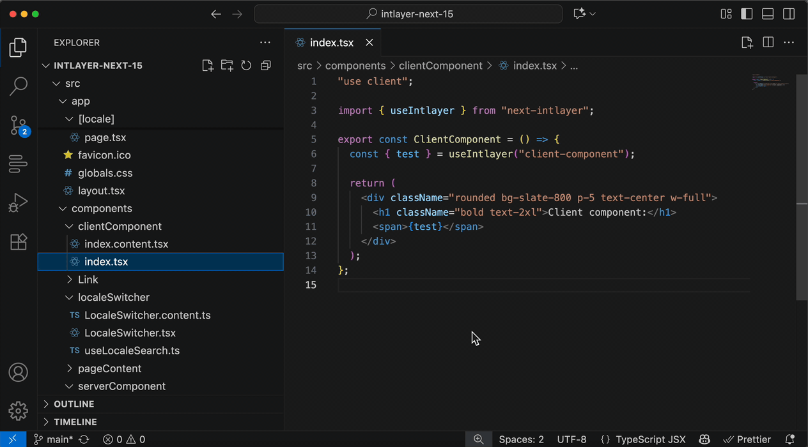
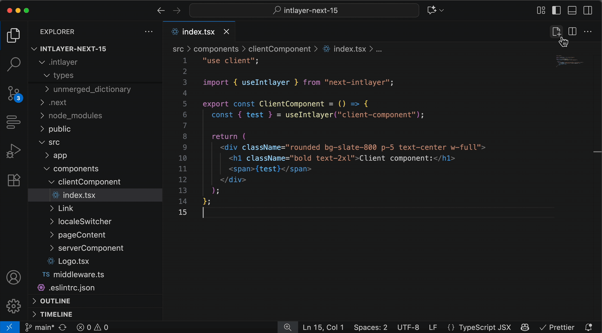
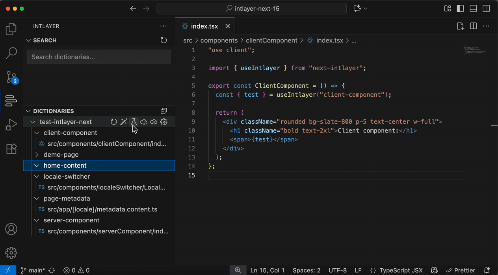
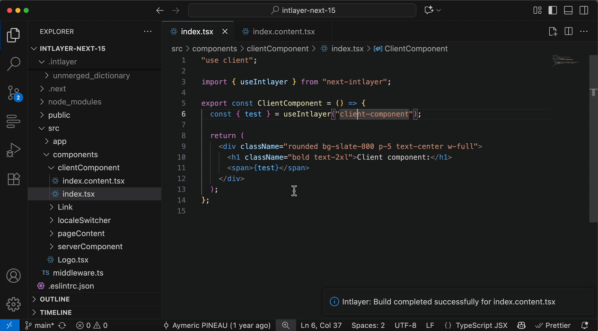
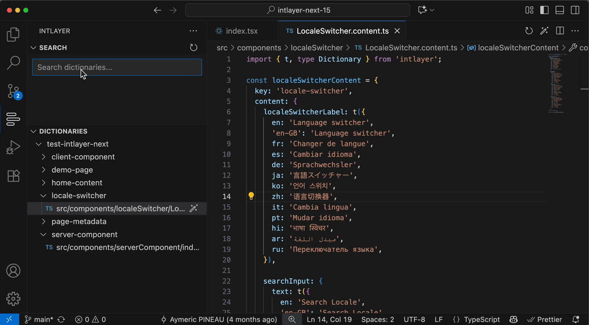

# הרחבה רשמית ל-VS Code

## סקירה כללית

[**Intlayer**](https://marketplace.visualstudio.com/items?itemName=Intlayer.intlayer-vs-code-extension) היא ההרחבה הרשמית ל-Visual Studio Code עבור **Intlayer**, שנועדה לשפר את חוויית המפתח בעת עבודה עם תוכן מקומי בפרויקטים שלך.


קישור להרחבה: [https://marketplace.visualstudio.com/items?itemName=Intlayer.intlayer-vs-code-extension](https://marketplace.visualstudio.com/items?itemName=Intlayer.intlayer-vs-code-extension)

## תכונות


- **חילוץ תוכן (Extract Content)**, חלץ תוכן מתוך רכיבי React / Vue / Svelte שלך



- **ניווט מיידי** – קפיצה מהירה לקובץ התוכן הנכון בעת לחיצה על מפתח של `useIntlayer`.
- **השלמת מילונים (Fill Dictionaries)**, השלם מילונים עם תוכן מתוך הפרויקט שלך.



- **גישה קלה לפקודות Intlayer**, בנייה, העלאה, משיכה, השלמה ובדיקה של מילוני תוכן בקלות.



- **מחולל הצהרות תוכן**, צור קובצי תוכן של מילונים בפורמטים שונים (`.ts`, `.esm`, `.cjs`, `.json`).



- **בדיקת מילונים (Test Dictionaries)**, בדוק מילונים עבור תרגומים חסרים.



- **שמור על המילונים שלך מעודכנים**, שמור על המילונים שלך מעודכנים עם התוכן העדכני ביותר מהפרויקט שלך.



- **לשונית Intlayer (בסרגל הפעילות - Activity Bar)**, עיין וחפש במילונים מתוך לשונית צד ייעודית עם סרגל כלים ופעולות תפריט הקשר (Build, Pull, Push, Fill, Refresh, Test, Create File).

## שימוש

### ניווט מהיר

1. פתח פרויקט המשתמש ב-**react-intlayer**.
2. אתר קריאה ל-`useIntlayer()`, כגון:

   ```tsx
   const content = useIntlayer("app");
   ```

3. לחץ על **Command-click** (`⌘+Click` ב-macOS) או **Ctrl+Click** (ב-Windows/Linux) על המפתח (למשל `"app"`).
4. VS Code יפתח אוטומטית את קובץ המילון המתאים, למשל `src/app.content.ts`.

### לשונית Intlayer (סרגל הפעילות)

השתמש בלשונית הצדדית כדי לעיין ולנהל מילונים:

- פתח את סמל Intlayer בסרגל הפעילות (Activity Bar).
- ב**חיפוש (Search)**, הקלד כדי לסנן מילונים וערכים בזמן אמת.
- ב**מילונים (Dictionaries)**, עיין בסביבות, מילונים וקבצים. השתמש בסרגל הכלים עבור Build, Pull, Push, Fill, Refresh, Test ו-Create Dictionary File. לחץ באמצעות לחצן העכבר הימני לפעולות תפריט הקשר (Pull/Push על גבי מילונים, Fill על קבצים). קובץ העורך הנוכחי מוצג אוטומטית בעץ במידת האפשר.

### גישה לפקודות

תוכל לגשת לפקודות מתוך **לוח הפקודות (Command Palette)**:

```sh
Cmd + Shift + P (macOS) / Ctrl + Shift + P (Windows/Linux)
```

- **Build Dictionaries (בניית מילונים)**
- **Push Dictionaries (העלאת מילונים)**
- **Pull Dictionaries (משיכת מילונים)**
- **Fill Dictionaries (השלמת מילונים)**
- **Test Dictionaries (בדיקת מילונים)**
- **Create Dictionary File (יצירת קובץ מילון)**

### טעינת משתני סביבה

Intlayer ממליץ לשמור את מפתחות ה-API של ה-AI שלך, וכן את ה-client ID וה-secret של Intlayer במשתני סביבה.

ההרחבה יכולה לטעון משתני סביבה מסביבת העבודה שלך כדי להריץ פקודות Intlayer עם ההקשר הנכון.

- **סדר טעינה (לפי עדיפות)**: `.env.<env>.local` ← `.env.<env>` ← `.env.local` ← `.env`
- **לא הרסני**: ערכי `process.env` קיימים אינם נדרסים.
- **היקף**: קבצים מפוענחים ביחס לספריית הבסיס המוגדרת (ברירת המחדל היא שורש סביבת העבודה).

#### בחירת הסביבה הפעילה

- **לוח הפקודות (Command Palette)**: פתח את הלוח והרץ את `Intlayer: Select Environment`, ולאחר מכן בחר את הסביבה (למשל `development`, `staging`, `production`). ההרחבה תנסה לטעון את הקובץ הזמין הראשון ברשימת העדיפויות למעלה ותציג הודעה כגון "Loaded env from `.env.<env>.local`".
- **הגדרות**: עבור אל `Settings → Extensions → Intlayer`, והגדר:
  - **Environment**: שם הסביבה המשמש לפענוח קובצי `.env.<env>*`.
  - (אופציונלי) **Env File**: נתיב מפורש לקובץ `.env`. כאשר הוא מסופק, יש לו קדימות על פני הרשימה הנגזרת.

#### מונוריפואים וספריות מותאמות אישית

אם קובצי ה-`.env` שלך נמצאים מחוץ לשורש סביבת העבודה, הגדר את ה-**Base Directory** ב-`Settings → Extensions → Intlayer`. הטוען יחפש קובצי `.env` ביחס לאותה ספרייה.
